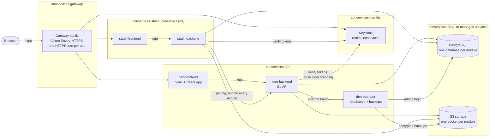
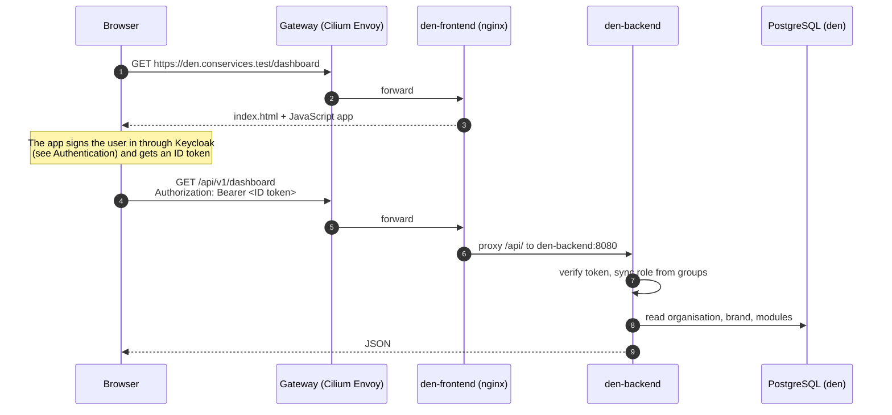
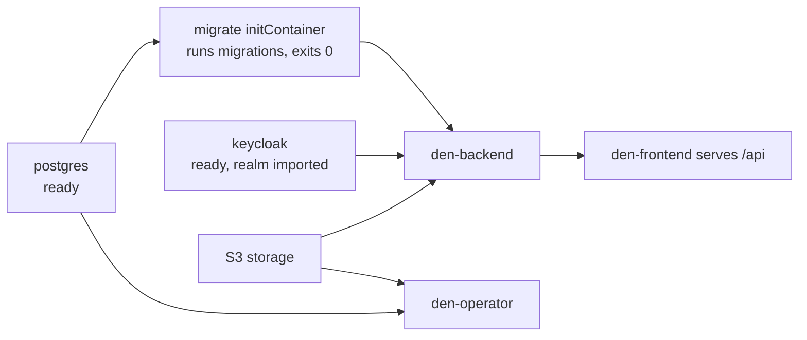
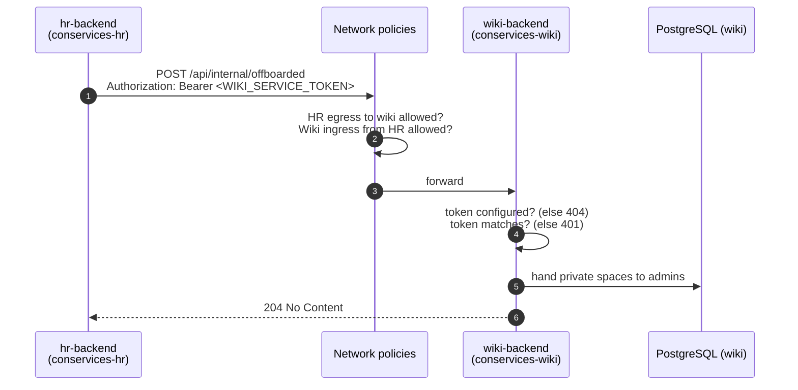

# Architecture

The goal of Con Services is to give a convention one coherent set of crew
tools (one sign-in, one brand, one portal) while keeping each tool
independent enough to install, upgrade, replace or run on its own. The
architecture below is how both halves of that goal are met at once.

Con Services is a set of independent applications, called **modules**, that
share three things: one sign-in server, one way of looking (the
organisation's brand), and optionally one portal, **Den**, that ties them
together. It runs on Kubernetes, with each part in its own **namespace** (a
named, separately secured section of the cluster). This page explains the
pieces and how they talk to each other. *Why* it is built this way is on
[Design principles](design-principles.md); the rules every API follows are
on [API conventions](api-conventions.md).

## The big picture

Reading it from left to right:

1. The **browser** only ever talks to the **Gateway**, over HTTPS. The
   Gateway is the cluster's entry point ([Gateway API](glossary.md#gateway-api),
   run by Cilium's Envoy proxy). Every app has its own address, set in its
   **HTTPRoute**: `den.conservices.test`, `stash.conservices.test`,
   `auth.conservices.test` for sign-in, and so on. (In your installation
   these are your own domain names.) The Gateway talks HTTPS to each app
   too, checked by a **BackendTLSPolicy**.
2. Each module has a **frontend** (an nginx container serving the React app)
   and a **backend** (a Go API). The frontend's nginx forwards everything
   under `/api/` to its own backend, so the browser sees one address per app.
3. **Keycloak** handles sign-in for every app. Backends never see passwords;
   they only check the tokens Keycloak issues.
4. **Den's backend** is the hub. Paired modules fetch the organisation's
   brand and settings from it every minute.
5. **PostgreSQL** and **S3 storage** are shared *servers*, but every module
   has its *own* database and its *own* bucket.
6. **Den's operator** is a small internal service that holds the database
   administrator login. It creates and drops module databases when Den asks,
   and backs up the whole suite.

Inside the cluster, parts find each other by **service DNS names** of the
form `<service>.<namespace>.svc.cluster.local`, for example
`den-backend.conservices-den.svc.cluster.local:8080`. Every namespace
blocks all traffic that is not explicitly allowed; the allowed paths are
exactly the arrows above, listed in
[Network policies](../operations/network-policies.md), and every one of them
is encrypted with TLS ([Internal TLS](../operations/internal-tls.md)).

## Namespaces and pieces

| Namespace | Piece | What it is | In-cluster address |
| --- | --- | --- | --- |
| `conservices-gateway` | Gateway `public` | The HTTPS entry point (Gateway API, served by Cilium's Envoy), holding the public certificate. Replaces the Caddy proxy of the development stack. | ports 80 and 443 |
| `conservices-identity` | Keycloak | The identity provider (sign-in server), realm `conservices`. Backends reach it as `auth.<domain>` through the Service `keycloak-public`, without leaving the cluster. | `keycloak.conservices-identity.svc.cluster.local:8443`, `keycloak-public.conservices-identity.svc.cluster.local:443` |
| `conservices-den` | Den frontend | Den's web app, served by nginx. | `den-frontend.conservices-den.svc.cluster.local:443` |
| `conservices-den` | Den backend | Den's API. Runs its database migrations in an initContainer before it starts. | `den-backend.conservices-den.svc.cluster.local:8080` |
| `conservices-den` | Den operator | Internal service for module databases and backups. Reachable only from Den's backend. | `den-operator.conservices-den.svc.cluster.local:8080` |
| `conservices-data` | PostgreSQL 16 | The shared database server (in-cluster option for a local trial; production: CloudNativePG with failover). | `postgres.conservices-data.svc.cluster.local:5432` |
| `conservices-data` | S3 storage (`s3`, SeaweedFS) | S3-compatible storage, **for a local trial only**. | `s3.conservices-data.svc.cluster.local:9000` |
| `conservices-<module>` | Module frontend and backend | One namespace per module, e.g. `conservices-stash`. | `stash-backend.conservices-stash.svc.cluster.local:8080` |

The local-trial manifests for all of this are in the
[`deploy/kubernetes/`](https://github.com/AGlElectronics/con-services/tree/main/deploy/kubernetes)
folder of the con-services repository; production installations use the
Helm charts in `deploy/charts/` through the GitOps repository
([Deploy with Argo CD](../deploy/index.md)).

!!! info "In production: Argo CD, Cilium, managed storage"
    The diagram above is the shape of every installation; production adds
    what a laptop does not have. A production cluster is managed with
    **Argo CD** from a Git repository, runs **Cilium** as its network plugin
    (it enforces the network policies, encrypts traffic between nodes and
    gives the Gateway a load-balancer address), runs PostgreSQL with
    failover (CloudNativePG), and stores files in a **managed S3 service**
    instead of the trial's SeaweedFS. Any S3-compatible service works, for example AWS S3,
    Hetzner Object Storage, Cloudflare R2 or Backblaze B2. See
    [Deploy with Argo CD](../deploy/index.md) and
    [Production and security](../operations/production.md#the-production-shape).

For working on the code there is also a Docker Compose stack; see
[Local development](../contributing/local-development.md).

## How a page loads

Here is what happens when someone opens Den's portal home:

## Start-up order

The platform starts **Den first**; modules come afterwards, each paired
with Den. [How the platform starts](../getting-started/how-the-platform-starts.md)
walks through the whole sequence. Within Den, Kubernetes keeps restarting a
part until what it needs is ready:

Den's API server **never** changes its own database structure. Only the
`migrate` initContainer does, and the API process only starts after it
finished successfully. When several Den backend pods start at once, their
migrate containers wait on a PostgreSQL advisory lock, so two migrations
can never run at the same time (see
[Running on Kubernetes](../operations/running.md#scaling)).

## How modules talk to each other

Modules do not share databases or buckets. When one needs something from
another, it makes an HTTP call to the other's backend, inside the cluster,
with a secret that proves who it is. Here is HR telling Wiki that someone's
account was deleted, so Wiki can hand that person's private space to the
admins:

Three things must line up for such a call to work: the endpoint exists and
is switched on, both sides hold the same service token (from your secret
manager), and both namespaces' network policies allow the flow. Every call
of this kind is listed in
[API conventions → Calls between modules](api-conventions.md#calls-between-modules)
and in the flow table of
[Network policies](../operations/network-policies.md#calls-between-modules).

## Versions

Every part runs from an image with an exact tag of the form
`MAJOR.MINOR.PATCH-BUILD`, such as `ghcr.io/aglelectronics/den-backend:1.4.2-3`.
All images of one module share a tag, and nothing uses `latest`. Modules
are released independently, so Den `1.4.2-3` can run next to Stash
`1.0.0-1`. See [Versions and upgrades](../operations/versioning.md).

## Rules every module follows

These come from Den's architecture decision records (ADRs), and every module
follows them. [Design principles](design-principles.md) explains them in
more depth, with what each means for you.

**The identity provider comes first.**
Nobody signs in "to Den". Everyone signs in to the organisation's identity
provider (Keycloak here; your own Keycloak, Entra ID, Okta and so on in
production) and every module, Den included, is just one more application that
trusts it. See
[ADR 0001](https://github.com/AGlElectronics/den/blob/main/docs/adr/0001-idp-first-ecosystem.md).

**Den is optional.**
Every module can run on its own (*standalone*) with its own settings and
default look. Pairing it with Den makes it follow Den's brand and
organisation settings. See [Pairing](pairing.md) and
[ADR 0002](https://github.com/AGlElectronics/den/blob/main/docs/adr/0002-pairing-url-and-token.md).

**No shared database.**
Each module has its own database and its own database login, and modules
talk to each other only through their APIs, never through SQL. Several
module databases may live on one PostgreSQL *server*, but a module's login
cannot even connect to another module's database. See
[ADR 0005](https://github.com/AGlElectronics/den/blob/main/docs/adr/0005-no-shared-postgres.md)
and [Databases, backups and restore](../operations/databases-and-backups.md).

**One bucket per module, and nobody shares storage credentials.**
Each module stores its files in its own bucket. When a paired module needs
Den's logo, it downloads it through Den's API with its pairing credential; it
never gets credentials for Den's bucket. See
[ADR 0004](https://github.com/AGlElectronics/den/blob/main/docs/adr/0004-one-bucket-per-module.md).

**The bundled S3 server is for development and local trials only.**
Docker Compose and the Kubernetes trial run
[SeaweedFS](https://github.com/seaweedfs/seaweedfs) as the service `s3`.
It has example keys,
a single copy of the data and no encryption. In production, point the
`S3_*` settings at a managed S3 service; any S3-compatible service works
(AWS S3, Hetzner Object Storage, Cloudflare R2, Backblaze B2, ...). Do not
run object storage inside the cluster.
See [ADR 0003](https://github.com/AGlElectronics/den/blob/main/docs/adr/0003-minio-dev-only.md).

**Modules do not talk to each other unless they must.**
Each module's namespace refuses traffic from other modules. The few
integrations that need a direct call (HR collecting role catalogs, HR
asking Learn for qualifications, HR telling Wiki and Tasks about people and
departments) are allowed one by one. See
[Network policies](../operations/network-policies.md#calls-between-modules).

**Secrets come from a secret manager.**
Outside a local trial, every password, key and token is delivered by a
secret manager (the External Secrets Operator, Sealed Secrets or SOPS), not
written into the manifests. See [Secrets](../operations/secrets.md).

## Den as the hub

Den holds the things that belong to the organisation rather than to any one
module:

- the **brand**: colours, fonts, wording, logo, favicon and the sign-in
  background picture;
- the **organisation settings**: name, email domain, naming templates and
  switches such as whether the event schedule is public;
- the **module registry**: which modules exist, where they live and whether
  they are paired;
- each person's **preferences** (currently the light or dark theme), shared
  by every app;
- **backups** of the whole suite, through the operator.

The Keycloak sign-in page looks like the rest of the suite too: its
`conservices` theme fetches Den's public brand in the browser, so Den needs
no write access to the realm. See
[Keycloak sync](../modules/den/admin-guide.md#keycloak-sync).

For the data model behind all this, see Den's
[domain model](https://github.com/AGlElectronics/den/blob/main/docs/domain-model.md).
