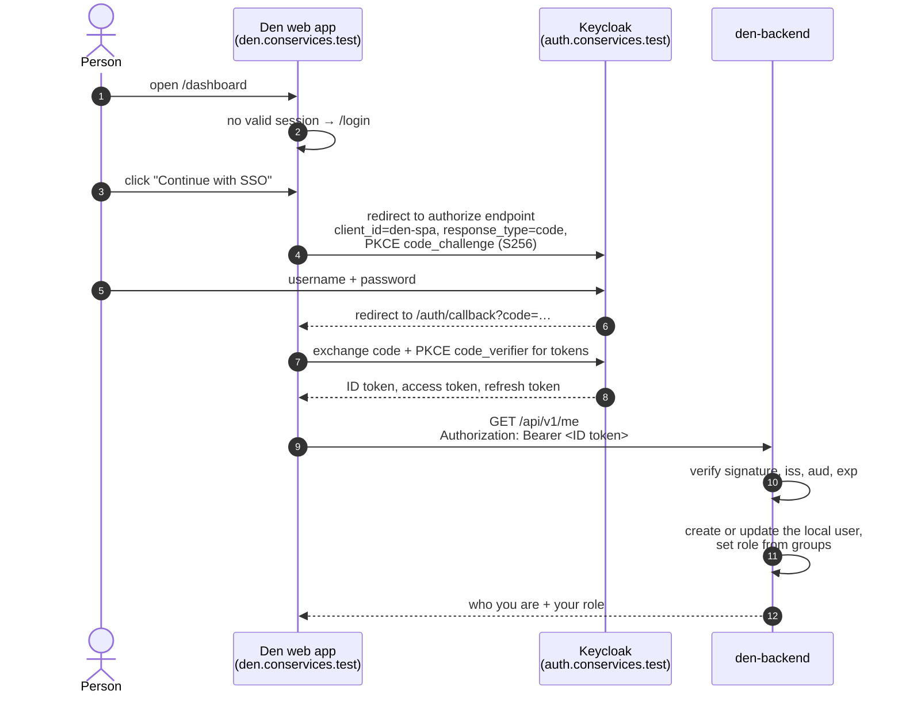
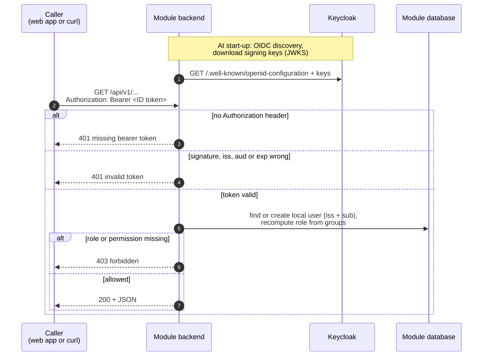
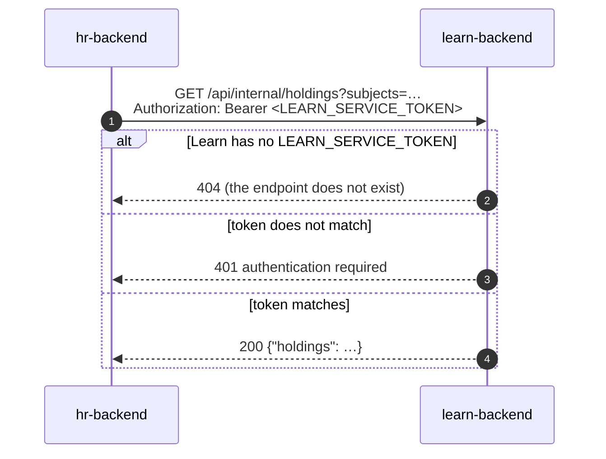

# Authentication

This page explains how people sign in to Con Services, how Den and the
modules check who is calling them, and how a person's groups in Keycloak
decide what they may do. It also covers how machines (paired modules,
other modules, outside systems) authenticate. For the headers, status codes
and a ready-made `curl` token recipe, see
[API conventions](api-conventions.md#authentication).

## The short version

- People sign in to **Keycloak**, never to Den or a module directly.
- Each web app is a **public OIDC client** in Keycloak and uses the
  *Authorization Code flow with PKCE*.
- The web app sends the person's **ID token** to its backend as
  `Authorization: Bearer <token>`.
- The backend checks the token's signature, issuer, audience and expiry, then
  reads the person's **groups** from it.
- In Den, groups become **roles** (`admin` or `member`) on every request, so
  removing someone from a group takes effect immediately.

## Words you need

**OIDC** (OpenID Connect)
:   The standard protocol for "sign in with another service". The app sends
    you to the identity provider, you sign in there, and the app gets signed
    tokens that say who you are.

**Identity provider (IdP)**
:   The service that holds accounts and passwords. Locally that is Keycloak.

**Realm**
:   A separate space inside Keycloak with its own users, groups and clients.
    Con Services uses the realm `conservices`.

**Client**
:   An application registered in the realm. Each web app has one:
    `den-spa`, `hr-spa`, `stash-spa` and so on.

**ID token**
:   A signed JSON Web Token (JWT) that says who signed in: a unique subject
    id (`sub`), name, email and groups.

See the [Glossary](glossary.md) for more.

## Signing in, step by step



**PKCE** (Proof Key for Code Exchange) protects the sign-in of apps that run
in the browser and therefore cannot keep a secret. The app makes up a random
secret, sends only its hash when it starts the sign-in, and must present the
secret itself to exchange the code for tokens. Someone who intercepts the
code cannot use it. Every `*-spa` client in the realm requires PKCE with
`S256`.

### What the Den web app does

The web app uses the `oidc-client-ts` library. It first loads its settings
from `/config.json` (issuer, client id, scopes; see
[Web app settings](../modules/den/configuration.md#web-app-settings-configjson)).
With `"authMode": "oidc"` there, it:

- sends people back to `/auth/callback` after sign-in, and to `/login` after
  sign-out;
- renews tokens silently in the background (through
  `/silent-callback.html`);
- keeps the signed-in user in the browser's `localStorage`, shared by all tabs
  of the app. Signing out in one tab, or signing in as someone else, is
  picked up by every other tab;
- goes back to the sign-in page whenever the API answers `401 Unauthorized`.

It sends the **ID token**, not the access token, to Den's API. The ID token's
audience (`aud`) is always the app's own client id, which is what Den checks;
Keycloak access tokens often carry a different audience. Den's portal also
sends the same ID token to paired modules when it collects
[portal to-dos](../modules/den/admin-guide.md#portal-to-dos).

### What Den's backend checks

At start-up, Den downloads Keycloak's public configuration and signing keys
from `OIDC_ISSUER_URL` (OIDC discovery). If that fails, Den does not start.
For every request it then checks that the bearer token:

1. is signed by one of Keycloak's keys;
2. was issued by `OIDC_ISSUER_URL`;
3. is meant for Den: its `aud` contains `OIDC_AUDIENCE` (which defaults to
   `OIDC_CLIENT_ID`);
4. has not expired;
5. has a subject (`sub`).

If any check fails, the answer is `401` with
`{"error":{"code":"unauthorized","message":"invalid token"}}`. A missing
token gives `"missing bearer token"`.

Every module's backend does the same checks against its own client, so the
same picture holds for all of them:



Checking a token needs no call to Keycloak per request: the backend has
Keycloak's public signing keys and verifies the signature itself. That is
why a backend refuses to start when it cannot reach Keycloak at start-up,
and why it keeps working through a short Keycloak outage afterwards.

Den then reads these claims from the token:

| Claim | Used for |
| --- | --- |
| `sub` | Together with the issuer, the person's permanent identity. |
| `email` | The local user's email. |
| `name`, `preferred_username`, `nickname` | The display name (the first one that is set; otherwise the email, otherwise `sub`). |
| `groups` | Group membership, used for roles. |
| `roles` | Merged into the groups list, so either claim works. |

The first time someone calls Den, Den creates a local user for them
(*just-in-time provisioning*), keyed by issuer and subject. On later calls it
updates their name, email and last sign-in time.

In the local realm, every web app's client has a **group membership mapper**
that puts the person's groups into the `groups` claim of the ID token, the
access token and the userinfo response, as plain names (`den-admin`, not
`/den-admin`).

## From groups to roles

Den has three roles in an organisation:

| Role | Can do | How you get it |
| --- | --- | --- |
| `owner` | Everything an admin can. | Set directly in Den's database. Den never changes an owner's role. |
| `admin` | Use the portal and the admin console: modules, pairing, branding, organisation settings, Keycloak sync, backups. | Be in one of the groups in `DEN_ADMIN_GROUPS` (default `den-admin`). |
| `member` | Use the portal home. | Be in one of the groups in `DEN_MEMBER_GROUPS` (default `den-member`). |

On **every** authenticated request, Den recomputes the role from the token's
groups:

1. In an admin group? The role becomes `admin`.
2. Otherwise, in a member group? The role becomes `member`.
3. Otherwise the person has **no role**: their membership is removed and Den
   refuses them everything except `/api/v1/me` and their preferences.

Group names are compared case-insensitively, and a leading `/` (Keycloak's
full-path form) is ignored. An `owner` membership is never changed or
removed by this sync.

So to give someone admin access, add them to `den-admin` in Keycloak; to
take it away, remove them. Because Den reads the groups from the token, the
change takes effect as soon as the person's token is renewed. The web app
renews tokens in the background, and tokens in the local realm are valid for
5 minutes.

!!! note "Other modules"
    Other modules use the same idea with their own groups: HR requires
    `HR_ACCESS_GROUPS` (default `hr-admin`), Finance `FINANCE_ACCESS_GROUPS`
    (default `finance-admin`), and Stash, Rally, Learn, Wiki, Desk and Tasks
    map groups to roles and permissions in their access configuration. Each
    module's configuration page lists its groups and roles.

### The role catalog

Every module publishes the roles it understands at `GET /api/role-catalog`.
It is public and read-only. HR collects these catalogs to build its access
picker: assigning a role in HR adds the person to that role's Keycloak group.

Den's catalog, with the default groups:

```json
{
  "module": "den",
  "display_name": "Den",
  "description": "Convention portal: home, modules, branding.",
  "roles": [
    {
      "key": "admin",
      "label": "Convention admin",
      "description": "Manage modules, pairing, branding and portal settings.",
      "group": "den-admin",
      "assignable": true,
      "scope": "organization",
      "permissions": ["modules.manage", "branding.manage", "settings.manage"]
    },
    {
      "key": "member",
      "label": "Member",
      "description": "Sees the portal home and every usable service.",
      "group": "den-member",
      "assignable": true,
      "default": true,
      "scope": "organization",
      "permissions": ["portal.view"]
    }
  ]
}
```

The `group` of each role is the **first** group in `DEN_ADMIN_GROUPS` or
`DEN_MEMBER_GROUPS`. `"default": true` tells HR to give new people the
member role by default.

## Dev mode (no Keycloak)

For quick local work on Den alone, the backend can run with
`AUTH_MODE=dev`. Then:

- Den believes whatever name the `X-Dev-User` header contains, or uses
  `DEV_DEFAULT_USER` (default `dev-admin`) when there is no header;
- unknown names are created on the spot as **admins** of the default
  organisation;
- the web app, with `"authMode": "dev"` in its `/config.json` (or
  `VITE_AUTH_MODE=dev` on the dev server), shows a **Dev sign in** page
  where you type a name, and stores it in `localStorage` under
  `den.devUser`.

```sh
curl -H "X-Dev-User: alice" http://localhost:8090/api/v1/me
```

!!! danger "Never use dev mode outside your own computer"
    In dev mode anyone can be anyone, and everyone is an admin.
    **`AUTH_MODE` defaults to `dev` when it is not set**, so always set
    `AUTH_MODE=oidc` explicitly in every real deployment. The Kubernetes
    manifests (`den-config`) and the suite's `docker-compose.yml` already do.

## Attendees: a separate realm

Rally's public submission site is used by people who are **not** staff:
speakers and panelists sending in proposals. They sign in to a second
Keycloak realm, `attendees` (client `rally-submit`), configured in Rally
with `ATTENDEE_OIDC_ISSUER_URL` and `ATTENDEE_OIDC_CLIENT_ID`. Rally accepts
attendee tokens only on its `/api/public/v1/...` endpoints and staff tokens
only on `/api/v1/...`, so an attendee account can never carry staff
permissions, and anyone may register as an attendee without getting near
the staff realm. See the [Rally docs](../modules/rally/index.md).

## Machine-to-machine authentication

Some callers are programs, not people. None of them uses Keycloak; each
sends a long random secret as `Authorization: Bearer <secret>`.

| Secret | Who sends it | Who checks it | Where it comes from |
| --- | --- | --- | --- |
| **Module credential** | A paired module | Den, on `/api/v1/integrations/*` | Handed out once when the module redeems a pairing URL. Den stores only its SHA-256 hash. See [Pairing](pairing.md). |
| **Service token** (`LEARN_SERVICE_TOKEN`, `WIKI_SERVICE_TOKEN`, `TASKS_SERVICE_TOKEN`) | HR | Learn, Wiki or Tasks, on `/api/internal/...` | You generate it and put the same value in both modules' Secrets, through your secret manager. |
| **Public API key** | A website, signage screen or calendar app | Rally, on its public schedule | Created by staff in Rally and shown once; Rally stores only a hash. Calendar feeds may send it as `?key=`. |
| **Operator token** (`OPERATOR_TOKEN`) | Den's backend | Den's operator | Shared by the two; the operator has no ingress, and a network policy lets only Den's backend reach it. |

A service-token call looks like this:



The rules for all of these secrets are the same:

- service tokens are compared in constant time, so their value cannot be
  guessed by timing the answers;
- an endpoint whose secret is not configured answers `404`, so a feature is
  off until an operator turns it on;
- secrets that Con Services issues itself (module credentials, public API
  keys) are stored only as hashes and shown once;
- every one of them lives in a Kubernetes Secret delivered by your secret
  manager, and appears in the inventory on [Secrets](../operations/secrets.md)
  with how to rotate it;
- on Kubernetes every one of these calls travels over TLS, and the caller
  checks the server's certificate against the internal certificate
  authority, so a pod that pretends to be Den or Learn cannot collect the
  secret. See [Internal TLS](../operations/internal-tls.md).

## Signing out and sessions

**Sign out** in Den redirects to Keycloak's logout endpoint, which ends the
person's Keycloak single sign-on session. The local realm keeps a session for
up to 10 hours of inactivity and at most 24 hours, and tokens are valid for 5
minutes; the web app renews them in the background for as long as the
Keycloak session lasts.
