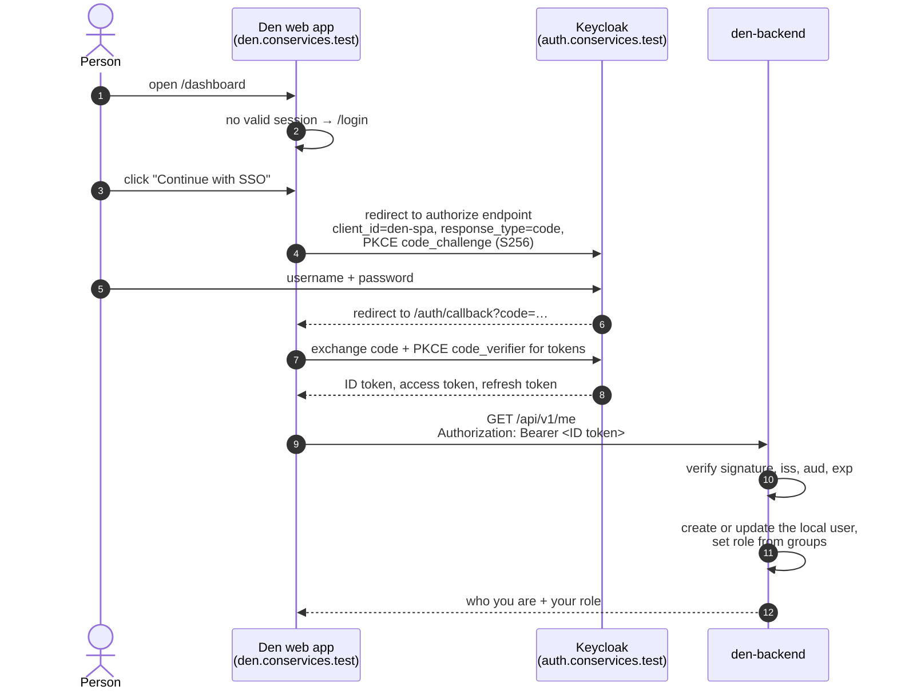
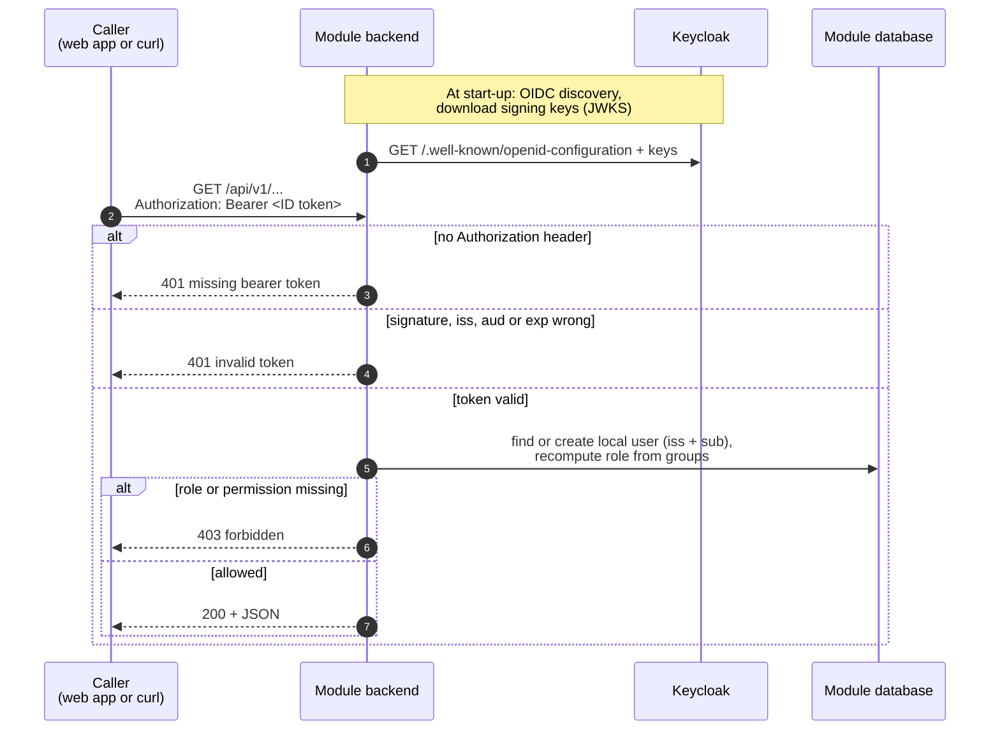
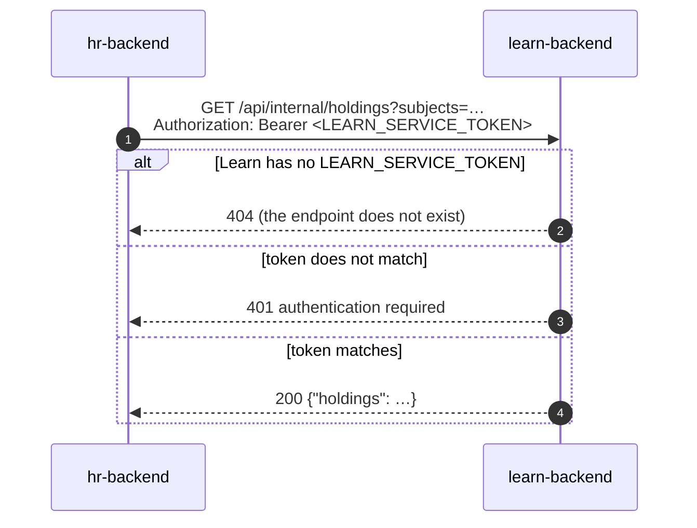

# Authentication

This page explains how people sign in to Con Services, how Den and the
modules check who is calling them, and how a person's groups in Keycloak
decide what they may do. It also covers how machines (paired modules,
other modules, outside systems) authenticate. For the headers, status codes
and a ready-made `curl` token recipe, see
[API conventions](api-conventions.md#authentication).

## The short version

- People sign in to **Keycloak**, never to Den or a module directly.
- Each web app is a **public OIDC client** in Keycloak and uses the
  *Authorization Code flow with PKCE*.
- The web app sends the person's **ID token** to its backend as
  `Authorization: Bearer <token>`.
- The backend checks the token's signature, issuer, audience and expiry, then
  reads the person's **groups** from it.
- In Den, groups become **roles** (`admin` or `member`) on every request, so
  removing someone from a group takes effect immediately.
- Every backend compares groups with the same rule
  ([How groups are matched](#how-groups-are-matched)) and, from 1.0.0 on,
  starts only in OIDC mode unless `APP_ENV=development`
  ([Defaults](#defaults-auth_mode-and-app_env)).

## Words you need

**OIDC** (OpenID Connect)
:   The standard protocol for "sign in with another service". The app sends
    you to the identity provider, you sign in there, and the app gets signed
    tokens that say who you are.

**Identity provider (IdP)**
:   The service that holds accounts and passwords. Locally that is Keycloak.

**Realm**
:   A separate space inside Keycloak with its own users, groups and clients.
    Con Services uses the realm `conservices`.

**Client**
:   An application registered in the realm. Each web app has one:
    `den-spa`, `hr-spa`, `stash-spa` and so on.

**ID token**
:   A signed JSON Web Token (JWT) that says who signed in: a unique subject
    id (`sub`), name, email and groups.

See the [Glossary](glossary.md) for more.

## Signing in, step by step



**PKCE** (Proof Key for Code Exchange) protects the sign-in of apps that run
in the browser and therefore cannot keep a secret. The app makes up a random
secret, sends only its hash when it starts the sign-in, and must present the
secret itself to exchange the code for tokens. Someone who intercepts the
code cannot use it. Every `*-spa` client in the realm requires PKCE with
`S256`.

### What the Den web app does

The web app uses the `oidc-client-ts` library. It first loads its settings
from `/config.json` (issuer, client id, scopes; see
[Web app settings](../modules/den/configuration.md#web-app-settings-configjson)).
With `"authMode": "oidc"` there, it:

- sends people back to `/auth/callback` after sign-in, and to `/login` after
  sign-out;
- renews tokens silently in the background (through
  `/silent-callback.html`);
- keeps the signed-in user in the browser's `localStorage`, shared by all tabs
  of the app. Signing out in one tab, or signing in as someone else, is
  picked up by every other tab;
- goes back to the sign-in page whenever the API answers `401 Unauthorized`.

It sends the **ID token**, not the access token, to Den's API. The ID token's
audience (`aud`) is always the app's own client id, which is what Den checks;
Keycloak access tokens often carry a different audience. The token is only
ever sent to Den: for [portal to-dos](../modules/den/admin-guide.md#portal-to-dos)
Den's backend calls the modules itself, with each module's pairing
credential and the person's issuer and subject.
This changes with the [token contract](#tokens-the-10-contract) below.

### Tokens: the 1.0 contract

The way web apps hold and send tokens is being tightened for 1.0. Den and
each module adopt it in their own release (their changelogs say when);
until then they work as described above.

1. **An access token per API.** Each web app sends an **access token**
   whose audience (`aud`) names its own API (for example `hr-api`), not the
   ID token. Keycloak adds the audience with an *audience mapper* on the
   app's client; the backend checks it through `OIDC_AUDIENCE`. A token for
   HR is then refused by Stash, and an ID token is refused everywhere. The
   name per API and who adds the mappers are in
   [Audiences per API](#audiences-per-api).
2. **Tokens only in memory.** The web app keeps tokens in memory (in
   `oidc-client-ts`, an `InMemoryWebStorage` user store), never in
   `localStorage` or `sessionStorage`, so a script injected into the page
   cannot read a stored token. After a reload, the app signs in again
   silently through the Keycloak session; nobody has to type a password.
   The hidden page is `/silent-callback.html`. The app's nginx must let
   the app frame that one file and no other page; see
   [Silent sign-in iframe](shared-code.md#silent-sign-in-iframe).
3. **No user token leaves Den.** Den's portal no longer sends the person's
   token to modules. Den's **backend** asks each paired module for the
   person's to-dos, server to server:
   `GET <module>/api/portal/todos` with the person in the headers
   `X-Den-User-Issuer` and `X-Den-User-Subject`, authenticated with the
   module's pairing credential as a bearer token. Den derives that
   credential from `DEN_CREDENTIAL_KEY`; the module keeps it encrypted with
   `DEN_LINK_ENCRYPTION_KEY` and compares it in constant time. The module
   answers for that person only, and refuses the person given only as query
   parameters. Modules then no longer need Den's client in
   `OIDC_EXTRA_AUDIENCES` or Den's address in `CORS_ALLOWED_ORIGINS` for
   to-dos. Modules serve the route with the shared helper; see
   [Portal to-dos](shared-code.md#portal-to-dos).

#### Audiences per API

An **audience mapper** is a Keycloak setting on a client that adds a name
to the `aud` claim of the tokens Keycloak issues to that client. Each web
app's client gets exactly one, naming the app's own API; the mapper writes
to the **access token only**, so ID tokens keep their old audience (the
client id) and backends that still take ID tokens are not affected.

| App | Web app client (realm) | Audience its access tokens carry | Backend setting that checks it |
| --- | --- | --- | --- |
| Den | `den-spa` (`conservices`) | `den-api` | `OIDC_AUDIENCE=den-api` |
| HR | `hr-spa` (`conservices`) | `hr-api` | `OIDC_AUDIENCE=hr-api` |
| Stash | `stash-spa` (`conservices`) | `stash-api` | `OIDC_AUDIENCE=stash-api` |
| Rally, staff app | `events-spa` (`conservices`) | `events-api` | `OIDC_AUDIENCE` (default `events-api`) |
| Rally, submission site | `rally-submit` (`attendees`) | `events-public-api` | `ATTENDEE_OIDC_AUDIENCE` (default `events-public-api`) |
| Learn | `learn-spa` (`conservices`) | `learn-api` | `OIDC_AUDIENCE=learn-api` |
| Finance | `finance-spa` (`conservices`) | `finance-api` | `OIDC_AUDIENCE=finance-api` |
| Desk | `desk-spa` (`conservices`) | `desk-api` | `OIDC_AUDIENCE=desk-api` |
| Tasks | `tasks-spa` (`conservices`) | `tasks-api` | `OIDC_AUDIENCE=tasks-api` |
| Wiki | `wiki-spa` (`conservices`) | `wiki-api` | `OIDC_AUDIENCE=wiki-api` |

The names follow `<module>-api`; Rally keeps the `events` name of its
client and host. A client never gets another app's audience: Den's web app
needs only `den-api`, because no user token leaves Den (portal to-dos are
fetched by Den's backend, point 3 above). A module's backend switches to
access tokens and its new `OIDC_AUDIENCE` in the module's own release; its
changelog says so.

**Who adds the mappers: the realm, not the modules.**

- **Development:** the realm files `infra/keycloak/realm-conservices.json`
  and `infra/keycloak/realm-attendees.json` have the mappers, so a fresh
  Docker stack gets them. A stack whose realms already exist gets them from
  `infra/keycloak/apply-mvp.sh` (idempotent):

    ```sh
    docker exec conservices-keycloak bash /opt/keycloak/data/import/apply-mvp.sh
    ```

    ```text
    Created new model with id '…'
    …
    conservices MVP patch applied
    ```

- **Production:** the realm imports in the GitOps repository
  (`charts/keycloak/templates/realm-*.yaml`) are generated from those
  development files by `bootstrap/scripts/keycloak-realm.py`, which copies
  protocol mappers unchanged. Maintainers of the GitOps template
  regenerate them so new installations get the mappers
  ([Identity: the realms](../deploy/identity.md#the-realms)). Keycloak
  imports a realm only once, so a **running** installation adds each mapper
  by hand before the module that needs it is upgraded: in the admin
  console, **conservices → Clients → hr-spa → Client scopes →
  hr-spa-dedicated → Configure a new mapper → Audience**, name
  `audience hr-api`, *Included Custom Audience* `hr-api`, *Add to ID token*
  **off**, *Add to access token* **on**. Do the same for `rally-submit` in
  the `attendees` realm with `events-public-api`.

Check an access token (the password grant works on the development realm
only):

```sh
TOKEN=$(curl -s -d grant_type=password -d client_id=hr-spa -d username=admin -d password=adminadmin \
  https://auth.conservices.test/realms/conservices/protocol/openid-connect/token | jq -r .access_token)
python3 -c 'import base64,json,sys; p=sys.argv[1].split(".")[1]; print(json.dumps(json.loads(base64.urlsafe_b64decode(p + "=" * (-len(p) % 4)))["aud"]))' "$TOKEN"
```

```text
["hr-api", "account"]
```

A token without the expected audience is refused with `401`
`{"error":{"code":"unauthorized","message":"invalid token"}}`: add the
mapper (above), sign out and in again.

#### Refusing ID tokens

A backend on the token contract accepts access tokens only. It tells them
apart by Keycloak's **`typ` claim** in the token body: Keycloak writes
`"typ": "Bearer"` into access tokens and `"typ": "ID"` into ID tokens. The
backend refuses every token whose `typ` is not `Bearer` with the same `401
invalid token`.

This is a Keycloak convention, not an OIDC standard: other identity
providers leave `typ` out or put `at+jwt` in the token *header* instead
(RFC 9068). The audience check is the second line of defence: an ID
token's `aud` is the web app's client (`hr-spa`), never the API's name
(`hr-api`), so it fails there too, as long as `OIDC_AUDIENCE` is never set
to a web app's client id. If you put another identity provider in front of
Con Services, check what it writes before relying on `typ`.

Check the claim with the token from the example above:

```sh
python3 -c 'import base64,json,sys; p=sys.argv[1].split(".")[1]; print(json.loads(base64.urlsafe_b64decode(p + "=" * (-len(p) % 4)))["typ"])' "$TOKEN"
```

```text
Bearer
```

### What Den's backend checks

At start-up, Den downloads Keycloak's public configuration and signing keys
from `OIDC_ISSUER_URL` (OIDC discovery). If that fails, Den does not start.
For every request it then checks that the bearer token:

1. is signed by one of Keycloak's keys;
2. was issued by `OIDC_ISSUER_URL`;
3. is meant for Den: its `aud` contains `OIDC_AUDIENCE` (which defaults to
   `OIDC_CLIENT_ID`);
4. has not expired;
5. has a subject (`sub`).

If any check fails, the answer is `401` with
`{"error":{"code":"unauthorized","message":"invalid token"}}`. A missing
token gives `"missing bearer token"`.

Every module's backend does the same checks against its own client, so the
same picture holds for all of them:



Checking a token needs no call to Keycloak per request: the backend has
Keycloak's public signing keys and verifies the signature itself. That is
why a backend refuses to start when it cannot reach Keycloak at start-up,
and why it keeps working through a short Keycloak outage afterwards.

Den then reads these claims from the token:

| Claim | Used for |
| --- | --- |
| `sub` | Together with the issuer, the person's permanent identity. |
| `email` | The local user's email. |
| `name`, `preferred_username`, `nickname` | The display name (the first one that is set; otherwise the email, otherwise `sub`). |
| `groups` | Group membership, used for roles. The claim name is `OIDC_GROUPS_CLAIM` once a backend uses the shared rule. |
| `roles` | Today merged into the groups list, so either claim works. With the [shared rule](#how-groups-are-matched) it is **not** read: only the claim named by `OIDC_GROUPS_CLAIM` counts. |

The first time someone calls Den, Den creates a local user for them
(*just-in-time provisioning*), keyed by issuer and subject. On later calls it
updates their name, email and last sign-in time.

In the local realm, every web app's client has a **group membership mapper**
that puts the person's groups into the `groups` claim of the ID token, the
access token and the userinfo response, as plain names (`den-admin`, not
`/den-admin`).

## From groups to roles

Den has three roles in an organisation:

| Role | Can do | How you get it |
| --- | --- | --- |
| `owner` | Everything an admin can. | Set directly in Den's database. Den never changes an owner's role. |
| `admin` | Use the portal and the admin console: modules, pairing, branding, organisation settings, Keycloak sync, backups. | Be in one of the groups in `DEN_ADMIN_GROUPS` (default `den-admin`). |
| `member` | Use the portal home. | Be in one of the groups in `DEN_MEMBER_GROUPS` (default `den-member`). |

On **every** authenticated request, Den recomputes the role from the token's
groups:

1. In an admin group? The role becomes `admin`.
2. Otherwise, in a member group? The role becomes `member`.
3. Otherwise the person has **no role**: their membership is removed and Den
   refuses them everything except `/api/v1/me` and their preferences.

Group names are compared case-insensitively, and a leading `/` (Keycloak's
full-path form) is ignored; the full rule is in
[How groups are matched](#how-groups-are-matched). An `owner` membership is
never changed or removed by this sync.

So to give someone admin access, add them to `den-admin` in Keycloak; to
take it away, remove them. Because Den reads the groups from the token, the
change takes effect as soon as the person's token is renewed. The web app
renews tokens in the background, and tokens in the local realm are valid for
5 minutes.

!!! note "Other modules"
    Other modules use the same idea with their own groups: HR requires
    `HR_ACCESS_GROUPS` (default `hr-admin`), Finance `FINANCE_ACCESS_GROUPS`
    (default `finance-admin`), and Stash, Rally, Learn, Wiki, Desk and Tasks
    map groups to roles and permissions in their access configuration. Each
    module's configuration page lists its groups and roles.

### How groups are matched

Every backend decides "is this person in group X?" with the same rule, from
the shared package `groupmatch` ([Shared code](shared-code.md)). Modules
switch to it in their own release; before that, a module's configuration
page describes its current rule.

1. **Where groups come from.** Only from the claim named by
   `OIDC_GROUPS_CLAIM` (default `groups`). The claim may be a list of
   strings or a single string (one group). The `roles` claim is never merged
   in, so a Keycloak realm role cannot grant access by accident.
2. **Normalising.** Both the token's group and the configured group are
   trimmed, lose **one** leading `/` and are lower-cased:
   ` /Departments/Security ` becomes `departments/security`. The original is
   kept for display.
3. **Prefix.** With `OIDC_GROUP_PREFIX` (for example `/con2026`), a group
   that starts with that parent loses it before comparing:
   `/con2026/departments/security` becomes `departments/security`. Groups
   outside the parent are compared as they are; the parent group itself
   matches nothing.
4. **Full path or last segment.** By default (`OIDC_GROUP_MATCH=full`) the
   whole path must be equal. With `OIDC_GROUP_MATCH=last` only the last
   segment is compared.

| Token group | Configured group | `full` | `last` |
| --- | --- | --- | --- |
| `/den-admin` | `den-admin` | match | match |
| `/Departments/Security` | `departments/security` | match | match |
| `/departments/security` | `security` | **no** | match |
| `/teams/security` | `departments/security` | no | match |
| `/departments/security-lead` | `departments/security` | no | no |
| `/con2026/den-admin` (prefix `/con2026`) | `den-admin` | match | match |
| `/con2025/den-admin` (prefix `/con2026`) | `den-admin` | no | no |

Use `last` only when group names are unique across the whole tree:
otherwise `/teams/security` and `/departments/security` grant the same
roles.

| Setting | Default | What it does |
| --- | --- | --- |
| `OIDC_GROUPS_CLAIM` | `groups` | The claim that holds the groups. |
| `OIDC_GROUP_MATCH` | `full` | `full` or `last`. |
| `OIDC_GROUP_PREFIX` | none | Parent group removed before matching. |

When an admin types a group into a module's access settings, the module
stores the normalised form (for comparisons and uniqueness) and shows what
was typed. With a prefix or `last` the stored form is not what is compared,
so a backend matches grants in code, never with an SQL `=`; see
[Shared code → groupmatch](shared-code.md#what-adopting-a-package-involves).

### The role catalog

Every module publishes the roles it understands at `GET /api/role-catalog`.
It is public and read-only today. HR collects these catalogs to build its access
picker: assigning a role in HR adds the person to that role's Keycloak group.
For 1.0 the endpoint gains dynamic roles, a `privileged` flag and an
authentication requirement; see [Role catalog](role-catalog.md).

Den's catalog, with the default groups:

```json
{
  "module": "den",
  "display_name": "Den",
  "description": "Convention portal: home, modules, branding.",
  "roles": [
    {
      "key": "admin",
      "label": "Convention admin",
      "description": "Manage modules, pairing, branding and portal settings.",
      "group": "den-admin",
      "assignable": true,
      "scope": "organization",
      "permissions": ["modules.manage", "branding.manage", "settings.manage"]
    },
    {
      "key": "member",
      "label": "Member",
      "description": "Sees the portal home and every usable service.",
      "group": "den-member",
      "assignable": true,
      "default": true,
      "scope": "organization",
      "permissions": ["portal.view"]
    }
  ]
}
```

The `group` of each role is the **first** group in `DEN_ADMIN_GROUPS` or
`DEN_MEMBER_GROUPS`. `"default": true` tells HR to give new people the
member role by default.

## Dev mode (no Keycloak)

For quick local work on Den alone, the backend can run with
`AUTH_MODE=dev`. Then:

- Den believes whatever name the `X-Dev-User` header contains, or uses
  `DEV_DEFAULT_USER` (default `dev-admin`) when there is no header;
- unknown names are created on the spot as **admins** of the default
  organisation;
- the web app, with `"authMode": "dev"` in its `/config.json` (or
  `VITE_AUTH_MODE=dev` on the dev server), shows a **Dev sign in** page
  where you type a name, and stores it in `localStorage` under
  `den.devUser`.

```sh
curl -H "X-Dev-User: alice" http://localhost:8090/api/v1/me
```

!!! danger "Never use dev mode outside your own computer"
    In dev mode anyone can be anyone, and everyone is an admin.
    **Today `AUTH_MODE` defaults to `dev` when it is not set**, so always set
    `AUTH_MODE=oidc` explicitly in every real deployment. The Kubernetes
    manifests (`den-config`) and the suite's `docker-compose.yml` already do.

### Defaults: AUTH_MODE and APP_ENV

From the release in which a backend adopts the shared package `authbase`
([Shared code](shared-code.md)), the defaults are safe:

| Setting | Default | Rule |
| --- | --- | --- |
| `AUTH_MODE` | `oidc` | `dev` is accepted **only** together with `APP_ENV=development`; otherwise the backend refuses to start. |
| `APP_ENV` | `production` | Only `development` enables development conveniences (dev sign-in, an unencrypted Den credential, `http://` pairing URLs). |

In dev mode the backend allows the `X-Dev-User` and `X-Dev-Groups` headers
through CORS; in OIDC mode it does not, and it deletes them from incoming
requests so no handler can trust them by mistake.

A backend started with `AUTH_MODE=dev` on a cluster stops with:

```text
AUTH_MODE=dev lets anyone sign in as anyone and is only allowed with APP_ENV=development (got APP_ENV="production")
```

Fix it by removing `AUTH_MODE` (or setting it to `oidc`). For local work,
set both `AUTH_MODE=dev` and `APP_ENV=development`.

## Attendees: a separate realm

Rally's public submission site is used by people who are **not** staff:
speakers and panelists sending in proposals. They sign in to a second
Keycloak realm, `attendees` (client `rally-submit`), configured in Rally
with `ATTENDEE_OIDC_ISSUER_URL` and `ATTENDEE_OIDC_CLIENT_ID`. Rally accepts
attendee tokens only on its `/api/public/v1/...` endpoints and staff tokens
only on `/api/v1/...`, so an attendee account can never carry staff
permissions, and anyone may register as an attendee without getting near
the staff realm. See the [Rally docs](../modules/rally/index.md).

## Machine-to-machine authentication

Some callers are programs, not people. None of them uses Keycloak; each
sends a long random secret as `Authorization: Bearer <secret>`.

| Secret | Who sends it | Who checks it | Where it comes from |
| --- | --- | --- | --- |
| **Module credential** | A paired module | Den, on `/api/v1/integrations/*` | Handed out once when the module redeems a pairing URL. Den stores only its SHA-256 hash. See [Pairing](pairing.md). |
| **Service token** (`LEARN_SERVICE_TOKEN`, `WIKI_SERVICE_TOKEN`, `TASKS_SERVICE_TOKEN`) | HR | Learn, Wiki or Tasks, on `/api/internal/...` | You generate it and put the same value in both modules' Secrets, through your secret manager. |
| **Public API key** | A website, signage screen or calendar app | Rally, on its public schedule | Created by staff in Rally and shown once; Rally stores only a hash. Calendar feeds may send it as `?key=`. |
| **Operator token** (`OPERATOR_TOKEN`) | Den's backend | Den's operator | Shared by the two; the operator has no ingress, and a network policy lets only Den's backend reach it. |

A service-token call looks like this:



The rules for all of these secrets are the same:

- service tokens are compared in constant time, so their value cannot be
  guessed by timing the answers;
- an endpoint whose secret is not configured answers `404`, so a feature is
  off until an operator turns it on;
- secrets that Con Services issues itself are shown once. Den stores public
  API keys and its side of module credentials only as hashes; a module keeps
  its copy of the credential encrypted with `DEN_LINK_ENCRYPTION_KEY`,
  because it has to send it back to Den;
- every one of them lives in a Kubernetes Secret delivered by your secret
  manager, and appears in the inventory on [Secrets](../operations/secrets.md)
  with how to rotate it;
- on Kubernetes every one of these calls travels over TLS, and the caller
  checks the server's certificate against the internal certificate
  authority, so a pod that pretends to be Den or Learn cannot collect the
  secret. See [Internal TLS](../operations/internal-tls.md).

## Signing out and sessions

**Sign out** in Den redirects to Keycloak's logout endpoint, which ends the
person's Keycloak single sign-on session. The local realm keeps a session for
up to 10 hours of inactivity and at most 24 hours, and tokens are valid for 5
minutes; the web app renews them in the background for as long as the
Keycloak session lasts.
