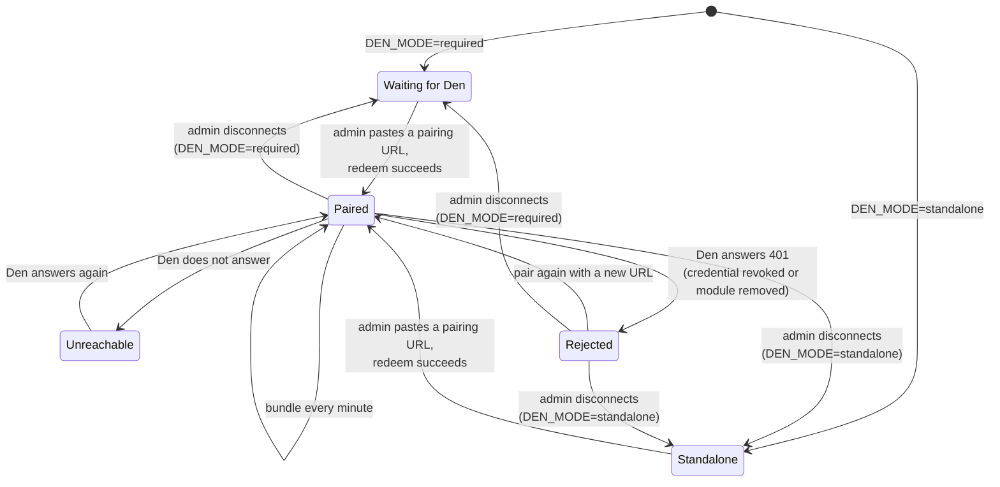

# Pairing

**Pairing** connects a module (HR, Stash, Rally, …) to Den. A paired module
follows Den's brand and organisation settings, and shares each person's
theme preference with the rest of the suite. What a module does before it
is paired depends on its **Den mode** (see
[Required or standalone](#required-or-standalone)): on Kubernetes it waits
for Den; in standalone mode it works on its own, with its own settings and
its default look.

Pairing uses a one-time **pairing URL**. An admin makes one in Den, pastes it
into the module, and the module exchanges it for a long-lived **module
credential**. No passwords or storage keys change hands.

!!! note "Pairing is always done by a person"
    No setting, Helm chart, Kustomize overlay or GitOps template pairs a
    module automatically, and none ever should: connecting a module to Den
    gives it the organisation's settings and branding, so an admin decides
    it, every time. The GitOps template only **pre-registers** the enabled
    modules (`DEN_PREREGISTER_MODULES`): they appear on Den's Modules page
    as *unpaired*, and no pairing URL or credential is created. An admin
    still mints the pairing URL in Den (**Modules → Pair**) and pastes it
    into the module's *Den connection* page. The reasoning is in
[ADR 0002](https://github.com/AGlElectronics/den/blob/main/docs/adr/0002-pairing-url-and-token.md).

## Required or standalone

Every module backend reads the setting `DEN_MODE`. It decides whether the
module may be used before it is paired:

| `DEN_MODE` | Before pairing | Where it is the default |
| --- | --- | --- |
| `required` | The module **waits for Den**. Its API answers `503 den_pairing_required` (see [below](#the-503-den_pairing_required-error)) and its web app shows *Connect this module to Den* to the module's admins and *Waiting for Den* to everyone else. Once paired, it works normally. | Every Kubernetes setup: the Helm charts (`den.mode: required`), the Kustomize manifests and the GitOps template. |
| `standalone` | The module works on its own. Pairing with Den is optional and can happen at any time. | The Docker Compose development stack, and a module started without the setting at all. |

`required` is the reference setup: an organisation runs Den, and a module
that is not connected to it would otherwise start with its own settings
and look, and people would begin using it that way. Use `standalone` only
for a module you run without Den, for example
[one module on its own on Kubernetes](../getting-started/standalone-kubernetes.md).

How to set it:

| Setup | Setting |
| --- | --- |
| Helm chart | `den.mode: required` or `standalone` ([Helm](../operations/helm.md)). The chart stops with an error on any other value. |
| Kustomize | `DEN_MODE=required` in the module's ConfigMap (`stash-config`); patch it to `standalone` in your overlay for a module without Den. |
| GitOps template | Always `required`; there is no option in `cluster.yaml`. Enabled modules are listed on Den's Modules page from the start ([Deploy the apps](../deploy/apps.md)). |
| Docker Compose | `DEN_MODE` in the root `.env` file, default `standalone`. |

While a module waits, these paths still answer, so the web app can sign
people in, show the waiting page and let an admin pair the module:
`/api/health`, the brand endpoints (`/api/brand…`), `/api/role-catalog`,
`/api/me…` and the Den connection endpoints (`/api/den…`, including
[`GET /api/den/state`](#den-mode-and-pairing-state)).

Switching a module from `required` to `standalone` (or back) needs only a
restart with the new value; no data changes. Unpairing a module in
`required` mode puts it back into the waiting state.

## How it works

```mermaid
sequenceDiagram
    autonumber
    actor Admin
    participant Den as Den (backend)
    participant Mod as Module backend<br/>(e.g. HR)
    participant MDB as Module database

    Admin->>Den: Modules → New module (slug, name, address)
    Den-->>Admin: module registered, status "unpaired"
    Admin->>Den: Modules → Pair
    Den->>Den: random token, store only its SHA-256 hash,<br/>valid 15 minutes, single use
    Den-->>Admin: pairing URL (shown once)
    Admin->>Mod: paste the URL into the module's<br/>"Den connection" settings
    Mod->>Den: POST /api/v1/integrations/pairing/redeem?token=…<br/>{"module_slug":"hr","module_version":"…"}
    Den->>Den: one transaction: lock the token row; known, not used,<br/>not expired, module_id/module_slug match?
    Den->>Den: mark token used, revoke older credentials,<br/>create module credential, status → "paired",<br/>write audit event
    Den-->>Mod: credential (shown once), module_id,<br/>organization_id, den_base_url
    Mod->>MDB: store credential and Den's address
    Mod->>Den: GET /api/v1/integrations/bundle<br/>Authorization: Bearer <credential>
    Den-->>Mod: brand + organisation settings
    Mod->>Den: GET /api/v1/integrations/branding/assets/{id}<br/>(logo, sign-in background)
    loop every minute
        Mod->>Den: GET /api/v1/integrations/bundle
    end
```

Seen from the module, the connection moves through these states:



**Waiting for Den** only exists with `DEN_MODE=required`: the API answers
`503 den_pairing_required` for everything except the paths listed in
[Required or standalone](#required-or-standalone). While **Unreachable**, the module keeps using the last bundle it stored.
**Rejected** is shown on the module's Den connection page as an error with
advice to pair again. Both are described in
[When Den is not there](#when-den-is-not-there).

The pairing URL looks like this:

```text
https://den.conservices.test/api/v1/integrations/pairing/redeem?token=Q2b9…
```

Its first part is Den's `APP_BASE_URL`. The token is 32 random bytes,
URL-safe base64 encoded. Den never stores the token itself, only its
SHA-256 hash, so a leaked database does not leak usable tokens.

A token can fail for these reasons:

| Status | Message | Meaning |
| --- | --- | --- |
| 401 | `invalid pairing token` | Den does not know this token. Check you copied the whole URL. |
| 401 | `pairing token already consumed` | It was already used. Make a new one. |
| 401 | `pairing token expired` | More than 15 minutes passed. Make a new one. |
| 409 | `this pairing URL was made for the module hr, not stash` | The module sent a `module_slug` (or `module_id`) of another module. The token stays unused: paste it into the right module. |
| 429 | `too many requests, try again later` | More than 10 redeems a minute from one address. |

Redeeming is a single database transaction that locks the token, so one URL
gives exactly one credential even if it is sent twice at the same moment.
Den writes the redeem to its audit log with the admin who created the URL.

### The module credential

The credential is another 32-byte secret. Den returns it exactly once, in the
redeem response, and keeps only its hash. The module stores it in its
**own** database and sends it as `Authorization: Bearer <credential>` on
every call to Den's integration API. Each credential gets a label such as
`pairing-20261106-101500 v1.2.0`, and Den records when it was last used.

Modules that use the shared `denlink` package ([Shared code](shared-code.md))
store the credential **encrypted** (AES-256-GCM) with the module's
`DEN_LINK_ENCRYPTION_KEY`, so a copy of the module's database alone does
not reveal it. Outside `APP_ENV=development` such a module refuses to start
without the key. A credential stored in plain text by an older version is
encrypted the first time it is read; nobody has to pair again. Generating
and rotating the key: [Secrets](../operations/secrets.md#den-link-encryption-key).
With `DEN_CREDENTIAL_KEY` set, Den derives the credential from that key and
the credential's id (HMAC-SHA256) instead of picking it at random. Den can
then recompute it to call the module itself, for the portal's to-do list,
while its database still holds only the hash. A module sees no difference.

A module has **one active credential**. Pairing it again creates a new one
and revokes every older one in the same step. Admins can see and revoke
credentials in Den → Modules → **Credentials**
([API](../modules/den/api.md#get-apiv1modulesidcredentials)); a module left
without an active credential is shown as `unpaired`. Den never pairs a
module by itself: reconnecting is always an admin pasting a new URL.

### When the browser and the module see Den at different addresses

The pairing URL contains the address *your browser* uses for Den. Inside
the cluster, a module's backend often cannot (or should not) go out through
the public address. For this, the modules support `DEN_INTERNAL_URL`: when
it is set, the module replaces the scheme and host of the pasted URL before
redeeming it, and uses that address for every later call to Den.

On Kubernetes, modules set:

```text
DEN_INTERNAL_URL=https://den-backend.conservices-den.svc.cluster.local:8080
```

The network policies allow exactly this path, from any module backend to
Den's backend on port 8080, over TLS: the module checks Den's certificate
against the internal certificate authority before it sends the pairing
token or its credential ([Internal TLS](../operations/internal-tls.md)).
In the Docker Compose development stack the
value is `http://den-backend:8080`.

Without `DEN_INTERNAL_URL`, a module using the shared `denlink` sends the
pairing request only to a host in **`DEN_ALLOWED_HOSTS`** (comma-separated;
`*.example.org` allows every subdomain), and only over `https://`. This stops
an admin account (or someone who stole one) from making the module's
backend call an arbitrary internal address. With `APP_ENV=development`,
`localhost`, `127.0.0.1`, `::1` and `*.conservices.test` are always
allowed, also over `http://`. The module never follows redirects from Den.

```text
DEN_ALLOWED_HOSTS=den.con.example.org
```

## What a paired module receives

Every minute, a paired module pulls the **bundle** from
`GET /api/v1/integrations/bundle`. It contains two parts:

```json
{
  "brand": {
    "revision": 10,
    "updated_at": "2026-11-05T08:41:57Z",
    "organization_name": "Con Services Demo",
    "theme": { "primary": "#715056", "primary_hover": "#ff5c5c", "accent": "#ff7070" },
    "typography": { "heading_font": "Montserrat", "body_font": "Inter" },
    "copy": { "convention_name": "Con Services", "login_layout": "centered" },
    "assets": {
      "logo": "c8c43a98-e96c-4dc4-a501-138f13d10ad3",
      "login-background": "21a7297b-766a-48f7-a81c-54e8c449f009"
    }
  },
  "settings": {
    "data": {
      "organization_name": "Con Services Demo",
      "org_email_domain": "example.org",
      "events_public_schedule": true
    },
    "updated_at": "2026-11-05T13:58:34Z"
  }
}
```

- **brand** is Den's current branding: colours, fonts, wording and the id of
  the newest asset for each role. When an asset id changes, the module
  downloads the new file through
  `GET /api/v1/integrations/branding/assets/{id}` and serves it itself.
- **settings** is the organisation settings document. Modules show the keys
  they use as *Managed in Den* and stop letting people edit them locally.
  Keys Den does not set fall back to the module's own value. See
  [Organisation settings](../modules/den/admin-guide.md#organisation-settings).

The bundle also has a third part, **module_settings**: the values from Den →
[Module settings](../modules/den/admin-guide.md#module-settings) meant for
this module (retention, SMTP, identity links, and the module's own section,
for example `stash.lost_and_found`).

Modules can also read and save a person's theme choice (system, light or
dark) through `/api/v1/integrations/user-preferences`, so picking dark mode in
one app applies everywhere. Den only answers for the module's own users
(people who signed in to Den and may use the module).

The exact endpoints are in the
[API reference](../modules/den/api.md#integration-api-for-paired-modules).

## When Den is not there

With `DEN_MODE=standalone`, Den is optional and modules are built to keep
working without it. With `DEN_MODE=required`, a module needs Den only until
it is paired; after that the rules below apply in both modes.

**Never paired.** With `standalone`, the module uses its own settings page
and its default look. With `required`, it shows *Waiting for Den* and its
API answers `503 den_pairing_required`.

**Paired, but Den is unreachable.** The module keeps the last bundle it
received (it stores it in its own database, so this survives a restart) and
keeps trying every minute. It shows the error on its Den connection settings
page.

**The credential was revoked.** If Den answers `401` (an admin revoked the
credential, the module was paired again elsewhere, or it was removed from
Den), the module reports that Den rejected its credential and that it
should be paired again. A module using the shared `denlink` also records
this: it marks the link **revoked** (kept across restarts), shows
`"revoked": true` in [`GET /api/den/state`](#den-mode-and-pairing-state)
and its status, and its web app tells the module's admins to pair again.
It **never pairs again by itself**; an admin mints a new pairing URL in Den
and pastes it. Meanwhile the module keeps its last bundle and keeps serving
its API. If a later sync is accepted (Den's credential table was restored,
for example), the mark is cleared.

**Unpaired from the module's side.** Disconnecting in the module deletes the
stored credential, and the module goes back to its local settings and look.

## Removing a module from Den

Removing a module in Den → Modules deletes its registration together with its
pairing tokens and credentials, so the module's next call is refused with
`401`. Den can optionally also delete the module's database (after backing it
up); see
[Adding and removing modules](../operations/databases-and-backups.md#adding-and-removing-modules).

!!! note "Pairing again and revoking"
    Pairing a module again (minting and redeeming a new URL) replaces its
    credential: every earlier credential of the module is revoked in the
    same transaction. To cut a module off without removing it, revoke its
    credentials in Modules → **Credentials**. If a pairing URL or a
    credential may have leaked, follow the
    [runbook](../operations/disaster-recovery.md#a-pairing-url-or-module-credential-leaked).

## The Den connection API in each module

Every module (not Den) has the same four endpoints behind its *Den
connection* settings page. They are for the module's administrators, so
they need a person's ID token with the module's admin permission (for
example `settings.manage` in Wiki, `org.manage` in Rally). Getting a token
is described in [API conventions](api-conventions.md#get-a-token-for-curl).

The prefix is `/api/v1/den` in Rally, Wiki, Learn, Desk and Tasks, and
`/api/den` in HR, Stash and Finance.

| Method and path | What it does | Success | Errors |
| --- | --- | --- | --- |
| `GET /api/v1/den` | The connection status. | `200` status object | `401`, `403` |
| `POST /api/v1/den/pair` | Redeem a pairing URL, then fetch the bundle straight away. Body: `{"pairing_url": "…"}`. | `200` status object | `400 bad_request` (body is not JSON), `422 pairing_failed` (the message says why) |
| `POST /api/v1/den/sync` | Fetch the bundle from Den now instead of waiting a minute. | `200` status object | `409 sync_failed` (not paired), `502 sync_failed` (Den did not answer or refused) |
| `DELETE /api/v1/den/pair` | Disconnect: delete the stored credential and go back to standalone. | `204` | `401`, `403` |

The status object:

| Field | Meaning |
| --- | --- |
| `paired` | `true` when the module holds a credential. |
| `den_base_url` | The Den address the module calls (after `DEN_INTERNAL_URL` is applied). |
| `module_id` | The module's id in Den's registry. |
| `paired_at`, `synced_at` | When it was paired, and when the last bundle arrived. |
| `last_error` | The last problem talking to Den, or absent when all is well. |
| `revoked`, `revoked_at` | Shared `denlink` only: `true` (and since when) after Den rejected the credential. Pair again to clear it. |

With the shared `denlink`, `POST …/den/sync` answers a rejected credential
with `409 den_credential_revoked` instead of `502 sync_failed`:

```json
{"error":{"code":"den_credential_revoked","message":"Den rejected this module's credential (revoked, or the module was removed in Den); pair again from Den → Modules → Pair"}}
```

And the status of a revoked link:

```json
{
  "paired": true,
  "den_base_url": "https://den-backend.conservices-den.svc.cluster.local:8080",
  "module_id": "5d0c1b9e-3f7a-4c2e-9b1d-8a6f2e4c7d10",
  "paired_at": "2026-11-06T10:15:02Z",
  "synced_at": "2026-11-10T22:41:00Z",
  "last_error": "Den rejected this module's credential (revoked, or the module was removed in Den); pair again from Den → Modules → Pair",
  "revoked": true,
  "revoked_at": "2026-11-10T22:42:00Z"
}
```

Pair Wiki with a URL you minted in Den → Modules → Pair:

```sh
curl -s -X POST https://wiki.conservices.test/api/v1/den/pair \
  -H "Authorization: Bearer $TOKEN" \
  -H "Content-Type: application/json" \
  -d '{"pairing_url":"https://den.conservices.test/api/v1/integrations/pairing/redeem?token=Q2b9…"}'
```

```json
{
  "paired": true,
  "den_base_url": "https://den-backend.conservices-den.svc.cluster.local:8080",
  "module_id": "5d0c1b9e-3f7a-4c2e-9b1d-8a6f2e4c7d10",
  "paired_at": "2026-11-06T10:15:02Z",
  "synced_at": "2026-11-06T10:15:02Z"
}
```

A token that was already used:

```json
{"error":{"code":"pairing_failed","message":"Den refused the pairing URL: pairing token already consumed"}}
```

Other `pairing_failed` messages you may see:

| Message | Fix |
| --- | --- |
| `paste the full pairing URL from Den (Admin → Modules → Pair)` | The text is not a URL with a `token=` in it. Copy the whole URL. |
| `could not reach Den at …` | The module cannot reach Den's backend. Check `DEN_INTERNAL_URL` and the network policies. |
| `Den refused the pairing URL: pairing token expired` | More than 15 minutes passed. Mint a new URL. |
| `pairing with Den at … is not allowed here; add the host to DEN_ALLOWED_HOSTS or set DEN_INTERNAL_URL` | Shared `denlink` only. The pasted URL points at a host the module may not call. |
| `the pairing URL must start with https://` | Shared `denlink` only, outside development. |
| `DEN_LINK_ENCRYPTION_KEY is required unless APP_ENV=development …` | Shared `denlink` only. The module has no encryption key; see [Secrets](../operations/secrets.md#den-link-encryption-key). |

A module that is not paired answers `GET /api/v1/den` with
`{"paired": false}`.

### Den mode and pairing state

`GET /api/den/state` tells a web app (or a monitoring check) whether the
module waits for Den. Every module serves it at this path.

- **Who may call it:** anyone. It needs no token, so the web app can ask
  before anyone signs in. It reveals only the mode and whether the module
  is paired.
- **Request body:** none.
- **Response:** `200` with

| Field | Meaning |
| --- | --- |
| `mode` | `required` or `standalone`, the module's `DEN_MODE`. |
| `paired` | `true` when the module holds a credential from Den. |
| `revoked` | Shared `denlink` only: `true` when Den rejected that credential. The web app then asks the module's admins to pair again. |

- **Errors:** none of its own; `5xx` only when the backend itself is broken.

```sh
curl -s https://stash.conservices.test/api/den/state
```

A module on Kubernetes that nobody has paired yet:

```json
{"mode":"required","paired":false}
```

After pairing:

```json
{"mode":"required","paired":true}
```

A module using the shared `denlink` always includes `revoked`; after Den
rejected its credential:

```json
{"mode":"required","paired":true,"revoked":true}
```

The web app reads it at start-up: with `"mode":"required"` and
`"paired":false` it shows *Connect this module to Den* to the module's
admins (with the field for the pairing URL) and *Waiting for Den* to
everyone else.

### The 503 den_pairing_required error

While a module with `DEN_MODE=required` is not paired, every API call
except the ones listed in [Required or standalone](#required-or-standalone)
answers `503 Service Unavailable` with:

```json
{"error":{"code":"den_pairing_required","message":"This module is waiting to be connected to Den."}}
```

For example, listing Stash's items before Stash is paired:

```sh
curl -s -i https://stash.conservices.test/api/items -H "Authorization: Bearer $TOKEN"
```

```text
HTTP/2 503
content-type: application/json

{"error":{"code":"den_pairing_required","message":"This module is waiting to be connected to Den."}}
```

What to do: pair the module (Den admin → **Modules → Pair**, then paste the
URL into the module's Den connection page). If the module should run
without Den, set `DEN_MODE=standalone` (Helm: `den.mode: standalone`) and
restart it. Scripts and integrations that call a module's API should treat
this code as "not ready yet" and retry later, not as a failure of the
request itself.

This includes calls between modules and public pages: until Wiki and
Tasks are paired, HR's notifications to them (`POST /api/internal/offboarded`,
`POST /api/internal/departments`) get the same `503`, and Rally's public
submission site shows only its branding. Pair every module you run before
you rely on these connections.

## Trying it out

On Kubernetes, pair a module by hand as described in
[How the platform starts](../getting-started/how-the-platform-starts.md#4c-pair-stash-with-den).

For contributors, the repository has a smoke test that pairs a module with
Den and checks that the module follows Den's brand. It talks to the
`localhost` ports of the
[Docker Compose development stack](../contributing/local-development.md),
so it does not work against a cluster. With Den and, for example, HR
running in Compose:

```powershell
scripts/smoke-den-pairing.ps1 -Module hr
```

It needs the module to be registered in Den first (Den → Modules → New
module, slug `hr`). Valid modules are `hr`, `stash`, `events`, `finance`,
`learn`, `desk`, `tasks` and `wiki`.
