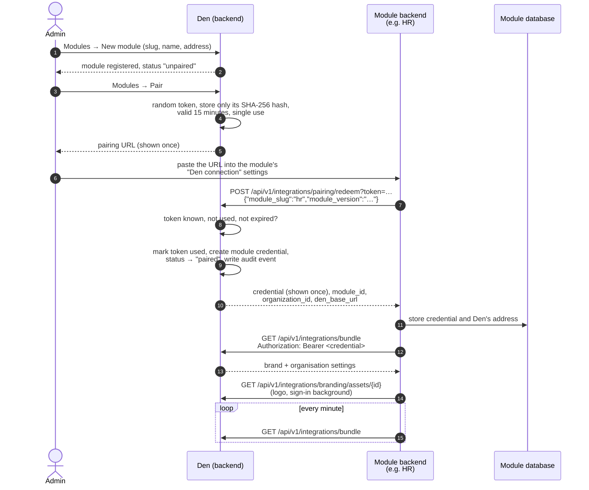
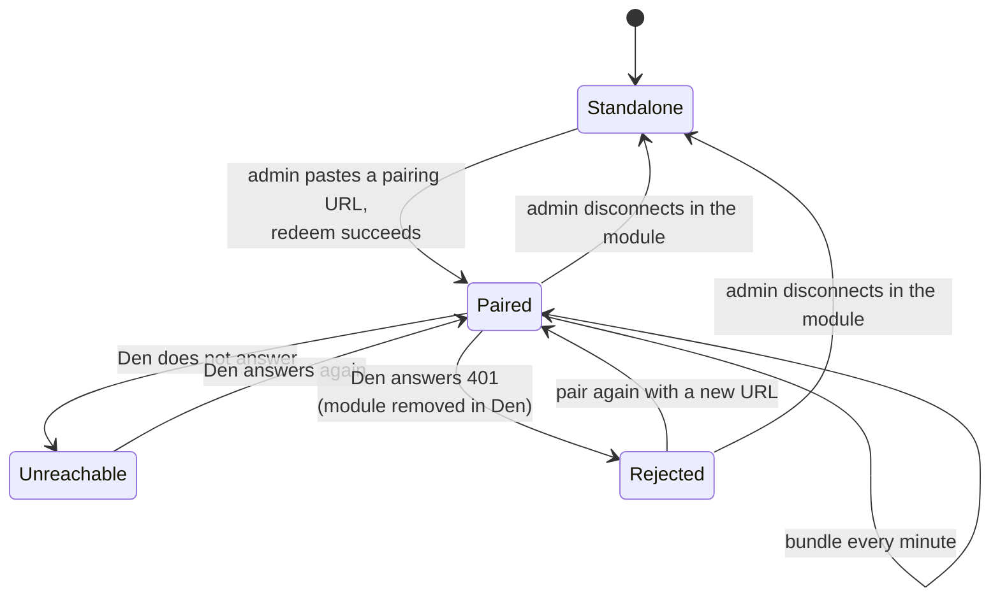

# Pairing

**Pairing** connects a module (HR, Stash, Rally, …) to Den. A paired module
follows Den's brand and organisation settings, and shares each person's
theme preference with the rest of the suite. A module that is not paired is
**standalone**: it works on its own, with its own settings and its default
look.

Pairing uses a one-time **pairing URL**. An admin makes one in Den, pastes it
into the module, and the module exchanges it for a long-lived **module
credential**. No passwords or storage keys change hands. The reasoning is in
[ADR 0002](https://github.com/AGlElectronics/den/blob/main/docs/adr/0002-pairing-url-and-token.md).

## How it works



Seen from the module, the connection moves through these states:



While **Unreachable**, the module keeps using the last bundle it stored.
**Rejected** is shown on the module's Den connection page as an error with
advice to pair again. Both are described in
[When Den is not there](#when-den-is-not-there).

The pairing URL looks like this:

```text
https://den.conservices.test/api/v1/integrations/pairing/redeem?token=Q2b9…
```

Its first part is Den's `APP_BASE_URL`. The token is 32 random bytes,
URL-safe base64 encoded. Den never stores the token itself, only its
SHA-256 hash, so a leaked database does not leak usable tokens.

A token can fail for three reasons, each answered with `401 Unauthorized`:

| Message | Meaning |
| --- | --- |
| `invalid pairing token` | Den does not know this token. Check you copied the whole URL. |
| `pairing token already consumed` | It was already used. Make a new one. |
| `pairing token expired` | More than 15 minutes passed. Make a new one. |

### The module credential

The credential is another 32-byte random secret. Den returns it exactly once,
in the redeem response, and keeps only its hash. The module stores it in its
**own** database and sends it as `Authorization: Bearer <credential>` on
every call to Den's integration API. Each credential gets a label such as
`pairing-20261106-101500 v1.2.0`, and Den records when it was last used.

### When the browser and the module see Den at different addresses

The pairing URL contains the address *your browser* uses for Den. Inside
the cluster, a module's backend often cannot (or should not) go out through
the public address. For this, the modules support `DEN_INTERNAL_URL`: when
it is set, the module replaces the scheme and host of the pasted URL before
redeeming it, and uses that address for every later call to Den.

On Kubernetes, modules set:

```text
DEN_INTERNAL_URL=https://den-backend.conservices-den.svc.cluster.local:8080
```

The network policies allow exactly this path, from any module backend to
Den's backend on port 8080, over TLS: the module checks Den's certificate
against the internal certificate authority before it sends the pairing
token or its credential ([Internal TLS](../operations/internal-tls.md)).
In the Docker Compose development stack the
value is `http://den-backend:8080`.

## What a paired module receives

Every minute, a paired module pulls the **bundle** from
`GET /api/v1/integrations/bundle`. It contains two parts:

```json
{
  "brand": {
    "revision": 10,
    "updated_at": "2026-11-05T08:41:57Z",
    "organization_name": "Con Services Demo",
    "theme": { "primary": "#715056", "primary_hover": "#ff5c5c", "accent": "#ff7070" },
    "typography": { "heading_font": "Montserrat", "body_font": "Inter" },
    "copy": { "convention_name": "Con Services", "login_layout": "centered" },
    "assets": {
      "logo": "c8c43a98-e96c-4dc4-a501-138f13d10ad3",
      "login-background": "21a7297b-766a-48f7-a81c-54e8c449f009"
    }
  },
  "settings": {
    "data": {
      "organization_name": "Con Services Demo",
      "org_email_domain": "example.org",
      "events_public_schedule": true
    },
    "updated_at": "2026-11-05T13:58:34Z"
  }
}
```

- **brand** is Den's current branding: colours, fonts, wording and the id of
  the newest asset for each role. When an asset id changes, the module
  downloads the new file through
  `GET /api/v1/integrations/branding/assets/{id}` and serves it itself.
- **settings** is the organisation settings document. Modules show the keys
  they use as *Managed in Den* and stop letting people edit them locally.
  Keys Den does not set fall back to the module's own value. See
  [Organisation settings](../modules/den/admin-guide.md#organisation-settings).

Modules can also read and save a person's theme choice (system, light or
dark) through `/api/v1/integrations/user-preferences`, so picking dark mode in
one app applies everywhere.

The exact endpoints are in the
[API reference](../modules/den/api.md#integration-api-for-paired-modules).

## When Den is not there

Den is optional, and modules are built to keep working without it.

**Never paired.** The module is standalone. It uses its own settings page and
its default look.

**Paired, but Den is unreachable.** The module keeps the last bundle it
received (it stores it in its own database, so this survives a restart) and
keeps trying every minute. It shows the error on its Den connection settings
page.

**The credential was revoked.** If Den answers `401` (for example because the
module was removed from Den), the module reports that Den rejected its
credential and that it should be paired again.

**Unpaired from the module's side.** Disconnecting in the module deletes the
stored credential, and the module goes back to its local settings and look.

## Removing a module from Den

Removing a module in Den → Modules deletes its registration together with its
pairing tokens and credentials, so the module's next call is refused with
`401`. Den can optionally also delete the module's database (after backing it
up); see
[Adding and removing modules](../operations/databases-and-backups.md#adding-and-removing-modules).

!!! note "Pairing again"
    Pairing a module again (minting and redeeming a new URL) adds a new
    credential; earlier credentials of the same module are not revoked
    automatically. Den has no endpoint yet to list or revoke individual
    credentials. Removing the module revokes all of them.

## The Den connection API in each module

Every module (not Den) has the same four endpoints behind its *Den
connection* settings page. They are for the module's administrators, so
they need a person's ID token with the module's admin permission (for
example `settings.manage` in Wiki, `org.manage` in Rally). Getting a token
is described in [API conventions](api-conventions.md#get-a-token-for-curl).

The prefix is `/api/v1/den` in Rally, Wiki, Learn, Desk and Tasks, and
`/api/den` in HR, Stash and Finance.

| Method and path | What it does | Success | Errors |
| --- | --- | --- | --- |
| `GET /api/v1/den` | The connection status. | `200` status object | `401`, `403` |
| `POST /api/v1/den/pair` | Redeem a pairing URL, then fetch the bundle straight away. Body: `{"pairing_url": "…"}`. | `200` status object | `400 bad_request` (body is not JSON), `422 pairing_failed` (the message says why) |
| `POST /api/v1/den/sync` | Fetch the bundle from Den now instead of waiting a minute. | `200` status object | `409 sync_failed` (not paired), `502 sync_failed` (Den did not answer or refused) |
| `DELETE /api/v1/den/pair` | Disconnect: delete the stored credential and go back to standalone. | `204` | `401`, `403` |

The status object:

| Field | Meaning |
| --- | --- |
| `paired` | `true` when the module holds a credential. |
| `den_base_url` | The Den address the module calls (after `DEN_INTERNAL_URL` is applied). |
| `module_id` | The module's id in Den's registry. |
| `paired_at`, `synced_at` | When it was paired, and when the last bundle arrived. |
| `last_error` | The last problem talking to Den, or absent when all is well. |

Pair Wiki with a URL you minted in Den → Modules → Pair:

```sh
curl -s -X POST https://wiki.conservices.test/api/v1/den/pair \
  -H "Authorization: Bearer $TOKEN" \
  -H "Content-Type: application/json" \
  -d '{"pairing_url":"https://den.conservices.test/api/v1/integrations/pairing/redeem?token=Q2b9…"}'
```

```json
{
  "paired": true,
  "den_base_url": "https://den-backend.conservices-den.svc.cluster.local:8080",
  "module_id": "5d0c1b9e-3f7a-4c2e-9b1d-8a6f2e4c7d10",
  "paired_at": "2026-11-06T10:15:02Z",
  "synced_at": "2026-11-06T10:15:02Z"
}
```

A token that was already used:

```json
{"error":{"code":"pairing_failed","message":"Den refused the pairing URL: pairing token already consumed"}}
```

Other `pairing_failed` messages you may see:

| Message | Fix |
| --- | --- |
| `paste the full pairing URL from Den (Admin → Modules → Pair)` | The text is not a URL with a `token=` in it. Copy the whole URL. |
| `could not reach Den at …` | The module cannot reach Den's backend. Check `DEN_INTERNAL_URL` and the network policies. |
| `Den refused the pairing URL: pairing token expired` | More than 15 minutes passed. Mint a new URL. |

A module that is not paired answers `GET /api/v1/den` with
`{"paired": false}`.

## Trying it out

On Kubernetes, pair a module by hand as described in
[How the platform starts](../getting-started/how-the-platform-starts.md#4c-pair-stash-with-den).

For contributors, the repository has a smoke test that pairs a module with
Den and checks that the module follows Den's brand. It talks to the
`localhost` ports of the
[Docker Compose development stack](../contributing/local-development.md),
so it does not work against a cluster. With Den and, for example, HR
running in Compose:

```powershell
scripts/smoke-den-pairing.ps1 -Module hr
```

It needs the module to be registered in Den first (Den → Modules → New
module, slug `hr`). Valid modules are `hr`, `stash`, `events`, `finance`,
`learn`, `desk`, `tasks` and `wiki`.
