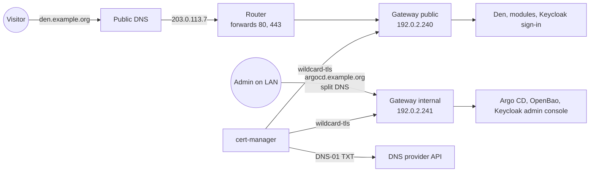

# DNS and certificates

This guide connects your domain to the cluster: the IP addresses of the two
Gateways, the port forward on your router, the DNS records, and trusted
HTTPS certificates from Let's Encrypt. All examples use `example.org`, the
documentation addresses `192.0.2.240` and `192.0.2.241` for the Gateways,
and `203.0.113.7` as the public IP; use your own.

## Terms used on this page

**DNS zone**
:   All DNS records of a domain, hosted by a DNS provider (Cloudflare,
    your registrar, ...).

**Let's Encrypt / ACME**
:   A free certificate authority trusted by every browser. cert-manager
    talks to it with the ACME protocol and renews certificates
    automatically (valid 90 days, renewed after 60).

**DNS-01 challenge**
:   Let's Encrypt asks you to prove you control the domain by publishing a
    TXT record `_acme-challenge.<domain>`. cert-manager creates and removes
    that record through your DNS provider's API. DNS-01 is the only
    challenge that can issue **wildcard** certificates (`*.example.org`),
    and it needs no open port.

**Gateway**
:   The entry point for HTTPS traffic (Kubernetes
    [Gateway API](../concepts/glossary.md#gateway-api)), served by Cilium's
    Envoy. The template creates two: `public` (from the internet) and
    `internal` (LAN or VPN only, admin tools).

**Split DNS**
:   Answering a name differently inside your network than on the internet.

## How it fits together



Both Gateways terminate TLS with the same certificate `wildcard-tls`
(`example.org` and `*.example.org`) and re-encrypt to the apps with the
[internal CA](../operations/internal-tls.md).

## 1. Choose the Gateway IPs

Each Gateway is a `Service` of type `LoadBalancer`. Pick one of:

- **Your load balancer assigns them** (cloud provider, MetalLB, or your
  own Cilium IP pool): nothing to set. To pin addresses, set
  `gateway.public.loadBalancerIP` and `gateway.internal.loadBalancerIP`.
- **The template hands them out with Cilium** (bare metal on one LAN):
  choose a small free range outside your router's DHCP range and put it in
  `cluster.yaml`:

    ```yaml
    loadBalancer:
      ciliumL2:
        enabled: true
        blocks: ["192.0.2.240/29"]   # 192.0.2.240 to 192.0.2.247
    gateway:
      public:
        loadBalancerIP: 192.0.2.240
      internal:
        loadBalancerIP: 192.0.2.241
    ```

    The `cilium-lb` Application then creates a `CiliumLoadBalancerIPPool`
    and a `CiliumL2AnnouncementPolicy`; one node answers ARP for each IP
    and another takes over if it fails. Cilium must run with
    `l2announcements.enabled: true` ([Prerequisites](prerequisites.md#2-cilium)).

After the `gateway` Application has synced, check:

```sh
kubectl get gateway -n conservices-gateway
```

```text
NAME       CLASS    ADDRESS       PROGRAMMED   AGE
internal   cilium   192.0.2.241   True         5m
public     cilium   192.0.2.240   True         5m
```

## 2. Forward ports 80 and 443

On your router or firewall, forward **TCP 80 and TCP 443** from the
internet to the **public** Gateway IP (`192.0.2.240`). Port 80 only
redirects to HTTPS. **Never** forward anything to the internal Gateway.

Find your public IP with `curl -4 https://ifconfig.me`. If your router's
WAN address is in `100.64.0.0/10` or differs from that answer, your
provider uses CGNAT and port forwarding cannot work; use a tunnel such as
Cloudflare Tunnel instead.

## 3. Create the DNS records

At your DNS provider, add:

| Type | Name | Content | Note |
| --- | --- | --- | --- |
| A | `*` | your public IP (`203.0.113.7`) | every app name; at Cloudflare choose **DNS only** (grey cloud) |
| CAA (optional) | `@` | `0 issue "letsencrypt.org"` | only Let's Encrypt may issue certificates for the domain |

Instead of the wildcard you can create one A record per name: `auth`,
`den`, `stash`, `hr`, `events`, `finance`, `learn`, `wiki`, `desk`,
`tasks`, and `submit` if Rally's submission site is on. A wildcard never
overrides a name that has its own record (like `www`) and does not affect
mail (MX and TXT records live on the apex).

If your public IP changes from time to time, keep the record current with
a dynamic DNS updater, for example [ddclient](https://ddclient.net/).

**Cloudflare: DNS only or proxied?** TLS terminates in the cluster with a
valid Let's Encrypt certificate, so **DNS only** works directly and is
recommended. Proxied (orange cloud) also works with SSL/TLS mode **Full
(strict)**; it hides your IP, but on the free plan uploads above 100 MB are
rejected and Cloudflare sees all traffic decrypted.

Check from any computer:

```sh
dig +short den.example.org
```

```text
203.0.113.7
```

## 4. Give cert-manager access to your DNS

### Cloudflare (built in, `acme.dns01.provider: cloudflare`)

cert-manager needs a token that can edit DNS records in your zone only.

1. Cloudflare dashboard → **My Profile → API Tokens → Create Token →
   Create Custom Token**.
2. Name: `cert-manager example.org`.
3. Permissions: **Zone → DNS → Edit** and **Zone → Zone → Read**.
4. Zone Resources: **Include → Specific zone → example.org**.
5. **Continue to summary → Create Token**, then copy the token (shown only
   once).
6. Test it:

    ```sh
    curl -s -H "Authorization: Bearer change-me" \
      https://api.cloudflare.com/client/v4/user/tokens/verify | jq .result.status
    ```

    ```text
    "active"
    ```

The token goes into OpenBao, never into Git: `openbao-seed.sh` asks for it
and stores it at `kv/infra/cloudflare` (property `api-token`); an
ExternalSecret copies it into the Secret `cloudflare-api-token` in the
`cert-manager` namespace. See
[Secrets with OpenBao](secrets-openbao.md#3-seed-the-secrets) and
[Secrets](../operations/secrets.md).

### Any other DNS provider (`acme.dns01.provider: custom`)

Give cert-manager your own solver in
[cert-manager's format](https://cert-manager.io/docs/configuration/acme/dns01/).
Example for AWS Route 53 with a credentials Secret you create yourself
(preferably with an ExternalSecret from OpenBao):

```yaml
acme:
  dns01:
    provider: custom
    solvers:
      - dns01:
          route53:
            region: eu-central-1
            accessKeyIDSecretRef:
              name: route53-credentials
              key: access-key-id
            secretAccessKeySecretRef:
              name: route53-credentials
              key: secret-access-key
```

The Secret must be in the `cert-manager` namespace. `openbao-seed.sh` does
not ask for a Cloudflare token in this mode.

## 5. Let Argo CD issue the certificate

Nothing to do by hand: the `letsencrypt` Application (wave -3) creates the
ClusterIssuers `letsencrypt-staging` and `letsencrypt-prod` with the e-mail
from `acme.email`, and the `gateway` Application (wave -2) requests the
wildcard certificate from the issuer in `acme.issuer` (default
`letsencrypt-staging`: untrusted test certificates with generous rate
limits, so mistakes do not lock you out), then creates the Gateways.

```sh
kubectl get certificate -A
```

```text
NAMESPACE             NAME                      READY   SECRET                    AGE
cert-manager          conservices-internal-ca   True    conservices-internal-ca   12m
conservices-gateway   wildcard-tls              True    wildcard-tls              2m
openbao               openbao-tls               True    openbao-tls               9m
```

Issuance takes one to three minutes; cert-manager waits until the TXT
record is visible on the resolvers in `acme.recursiveNameservers`.

## 6. Switch to production certificates

When `wildcard-tls` is `READY True` with staging:

1. In `cluster.yaml`:

    ```yaml
    acme:
      issuer: letsencrypt-prod
    ```

2. Commit and push. cert-manager issues a trusted certificate within
   minutes.
3. Check:

    ```sh
    curl -I https://den.example.org
    ```

    ```text
    HTTP/2 200
    ```

    `curl: (60) SSL certificate problem` means you still have the staging
    certificate.

Let's Encrypt allows 5 identical certificates per week; do not delete and
recreate the production certificate in a loop.

## The Gateways

Both live in the namespace `conservices-gateway` and use the GatewayClass
from `gateway.className` (`cilium`):

| Gateway | Listeners | Who may attach routes |
| --- | --- | --- |
| `public` | `http` :80 (redirects to HTTPS), `https` :443 `*.<domain>` | namespaces labelled `app.kubernetes.io/part-of=conservices` |
| `internal` | `http` :80 (redirects), `https` :443 `*.<domain>` | `conservices-gateway`, `openbao`, `argocd`, plus `longhorn-system` and `kube-system` when their admin routes are on |

## Internal hostnames

The admin tools are only on the internal Gateway:

| Hostname | Tool | `cluster.yaml` |
| --- | --- | --- |
| `argocd.<domain>` | Argo CD | `argocd.selfManage: true` |
| `bao.<domain>` | OpenBao UI | `adminRoutes.openbao: true` |
| `auth-admin.<domain>` | Keycloak admin console | always |
| `longhorn.<domain>` | Longhorn UI (**no login**) | `adminRoutes.longhorn: true` |
| `hubble.<domain>` | Hubble UI (Cilium network flows) | `adminRoutes.hubble: true` |

With the wildcard record, these names resolve to your **public** IP on the
internet, where the public Gateway answers `404` because no public route
has those hostnames. To reach them, make them resolve to the internal
Gateway IP on your LAN, with one of:

- **Split DNS** on your router or local DNS server (Pi-hole, AdGuard Home,
  Unbound, ...): local records `argocd.example.org` → `192.0.2.241`, and so
  on. Recommended.
- **A hosts file** on each admin computer (`/etc/hosts`, or
  `C:\Windows\System32\drivers\etc\hosts`):

    ```text
    192.0.2.241  argocd.example.org bao.example.org auth-admin.example.org
    ```

The certificate is the same wildcard, so browsers trust it either way.

## Inside the cluster: reaching Keycloak

Backends check sign-in tokens against Keycloak at `https://auth.<domain>`.
Without help, that request leaves the cluster, comes back through the
router (**hairpin NAT**, which many routers do not support) and the public
Gateway. You need one of:

- **`oidcHairpin.mode: coredns-custom`** (k3s and AKS): the template writes
  the ConfigMap `kube-system/coredns-custom`, which those distributions'
  CoreDNS reads. It contains:

    ```text
    rewrite stop {
        name exact auth.example.org. keycloak-public.conservices-identity.svc.cluster.local.
        answer auto
    }
    ```

    Pods resolving `auth.example.org` get the Service `keycloak-public`
    (443 to Keycloak's 8443), whose internal certificate carries
    `auth.example.org`, so the connection stays inside the cluster and is
    still verified. If you already have a `coredns-custom` ConfigMap, merge
    its keys into a copy of `charts/oidc-hairpin` instead.
- **The same rewrite in your CoreDNS configuration** (kubeadm, Talos and
  others; see [Kubernetes distributions](distributions.md)), with
  `oidcHairpin.mode: none`.
- **Nothing**, if your router supports hairpin NAT or your cluster's
  outbound traffic reaches the public IP anyway (most cloud load
  balancers). Leave `oidcHairpin.mode: none`.

Check from a pod once Keycloak runs ([Identity](identity.md)):

```sh
kubectl run dnstest --rm -it --restart=Never --image=busybox:1.37 -- nslookup auth.example.org
```

With the rewrite the answer is a cluster address such as `10.43.12.34`. If
the ConfigMap was created after CoreDNS started, restart CoreDNS once:
`kubectl -n kube-system rollout restart deploy/coredns`.

## Troubleshooting

**The certificate stays `READY False`; `kubectl describe challenge -A` says `Waiting for DNS-01 challenge propagation`**
:   Check the TXT record yourself:
    `dig +short TXT _acme-challenge.example.org @1.1.1.1`. If it is empty
    after 5 minutes, the token cannot write the zone (wrong zone in the
    token's resources, or missing **Zone:Read**). The cert-manager logs show
    the provider's error:
    `kubectl -n cert-manager logs deploy/cert-manager | grep -i -e cloudflare -e dns01`.

**`Error: 6003 Invalid request headers` or `Actor ... requires permission`**
:   The Cloudflare token is wrong or lacks permissions. Create it again
    (step 4), replace it with
    `bao kv put kv/infra/cloudflare api-token=-` (see
    [Secrets with OpenBao](secrets-openbao.md#change-a-secret)), then force
    a refresh:
    `kubectl -n cert-manager annotate externalsecret cloudflare-api-token force-sync=$(date +%s) --overwrite`.

**`kubectl -n cert-manager get externalsecret cloudflare-api-token` shows `SecretSyncedError`**
:   The value is not in OpenBao (`kv/infra/cloudflare`, property
    `api-token`) or OpenBao is sealed. Run `openbao-seed.sh` again; see
    [Secrets with OpenBao](secrets-openbao.md#troubleshooting).

**`too many certificates already issued` / `rateLimited`**
:   You hit a Let's Encrypt production rate limit. Set
    `acme.issuer: letsencrypt-staging`, fix the problem, and wait until the
    limit resets (the error says when). See
    [Let's Encrypt rate limits](https://letsencrypt.org/docs/rate-limits/).

**From inside your LAN, `https://den.example.org` times out, but it works over mobile data**
:   Your router does not support hairpin NAT for LAN clients. Add split DNS
    records for the public names pointing to the public Gateway IP
    (`192.0.2.240`), the same way as the internal hostnames.

**`https://argocd.example.org` shows `404` or times out**
:   The name resolves to the public IP. Set up split DNS or a hosts entry
    ([Internal hostnames](#internal-hostnames)).

**The browser says the certificate is not trusted**
:   Still the staging certificate (step 6), or a proxied Cloudflare record
    with an SSL mode other than **Full (strict)**.

**`kubectl get gateway` shows `PROGRAMMED False` with `ResolvedRefs: False`**
:   The Secret `wildcard-tls` is missing. Check the certificate:
    `kubectl -n conservices-gateway describe certificate wildcard-tls`.

**The Gateway has no `ADDRESS`**
:   With `loadBalancer.ciliumL2`: the pinned IP is outside the pool, or
    another Service holds it. Check
    `kubectl get ciliumloadbalancerippool -o wide` and
    `kubectl -n conservices-gateway describe svc`. Without it: your load
    balancer did not assign an address; check its controller's logs.

**Sign-in fails in the apps with `issuer` or `connection refused` errors, but the browser can open `https://auth.<domain>`**
:   Pods cannot reach the public address (no hairpin NAT). Use one of the
    options in [Inside the cluster](#inside-the-cluster-reaching-keycloak).

Next: [Secrets with OpenBao](secrets-openbao.md).
