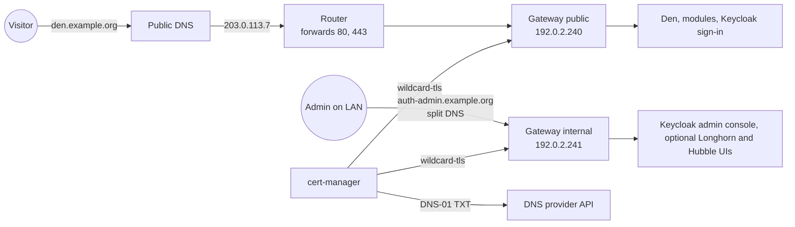

# DNS and certificates

This guide connects your domain to the cluster: the IP addresses of the two
Gateways, the port forward on your router, the DNS records, and trusted
HTTPS certificates from Let's Encrypt. All examples use `example.org`, the
documentation addresses `192.0.2.240` and `192.0.2.241` for the Gateways,
and `203.0.113.7` as the public IP; use your own.

## Terms used on this page

**DNS zone**
:   All DNS records of a domain, hosted by a DNS provider (Cloudflare,
    your registrar, ...).

**Let's Encrypt / ACME**
:   A free certificate authority trusted by every browser. cert-manager
    talks to it with the ACME protocol and renews certificates
    automatically (valid 90 days, renewed after 60).

**DNS-01 challenge**
:   Let's Encrypt asks you to prove you control the domain by publishing a
    TXT record `_acme-challenge.<domain>`. cert-manager creates and removes
    that record through your DNS provider's API. DNS-01 is the only
    challenge that can issue **wildcard** certificates (`*.example.org`),
    and it needs no open port.

**Gateway**
:   The entry point for HTTPS traffic (Kubernetes
    [Gateway API](../concepts/glossary.md#gateway-api)), served by Cilium's
    Envoy. The template creates two: `public` (from the internet) and
    `internal` (LAN or VPN only, admin tools).

**Split DNS**
:   Answering a name differently inside your network than on the internet.

**LB IPAM**
:   Cilium's *load balancer IP address management*: it gives every
    `Service` of type `LoadBalancer` an address from a pool you define
    ([Cilium docs](https://docs.cilium.io/en/stable/network/lb-ipam/)).

**Cloudflare Tunnel**
:   A program, `cloudflared`, that runs in your cluster and keeps an
    outgoing connection open to Cloudflare. Visitors reach your apps
    through Cloudflare and that connection, so you need no public IP and no
    port forward ([Cloudflare Tunnel instead of a port forward](#cloudflare-tunnel-instead-of-a-port-forward)).

Commands that differ between shells have a **Linux / macOS** and a
**Windows (PowerShell)** tab. In Windows PowerShell 5.1, `curl` is a name
for `Invoke-WebRequest`; the PowerShell tabs therefore call `curl.exe`, the
real curl that ships with Windows 10 and newer.

## How it fits together



Both Gateways terminate TLS with the same certificate `wildcard-tls`
(`example.org` and `*.example.org`) and re-encrypt to the apps with the
[internal CA](../operations/internal-tls.md).

## 1. Choose the Gateway IPs

There are two Gateways, each with its own address, so that the
administration tools are never reachable from the internet:

| Gateway | Carries | Reachable from |
| --- | --- | --- |
| `public` | Den, the modules, the Keycloak sign-in page (`auth.<domain>`) | the internet (port forward or tunnel) |
| `internal` | the Keycloak admin console (`auth-admin.<domain>`), optionally the Longhorn and Hubble UIs | your LAN or VPN only |

Because nothing on the internet leads to the internal address, nobody
outside your network can try passwords on the Keycloak admin login.

Each Gateway is a `Service` of type `LoadBalancer`, and your cluster
assigns the addresses (cloud provider, MetalLB, or a Cilium LB IPAM pool;
the template does not create the pool, see
[Prerequisites](prerequisites.md#5-loadbalancer-ips-dns-and-ports)). On
bare metal with Cilium, that is an
[LB IPAM pool](https://docs.cilium.io/en/stable/network/lb-ipam/) with
[L2 announcements](https://docs.cilium.io/en/stable/network/l2-announcements/)
(Cilium needs `l2announcements.enabled: true`).

1. **Pin both addresses** (strongly recommended). Pick two free addresses
   from your Cilium pool and set them in `cluster.yaml`:

    ```yaml title="cluster.yaml"
    gateway:
      public:
        loadBalancerIP: 192.0.2.240
      internal:
        loadBalancerIP: 192.0.2.241
    ```

    !!! warning "Without pinned addresses the order is a matter of luck"
        LB IPAM hands out addresses in the order the Services happen to be
        created. On the project's test install it gave `public` the
        **second** address of the pool and `internal` the **first**. The
        router forwarded ports 80 and 443 to the first address, so the
        internet reached the internal Gateway and the Keycloak admin
        console. Pinning both addresses makes the result fixed and
        predictable.

    Other load balancers use their own annotation; put it in
    `gateway.public.annotations` and `gateway.internal.annotations`.

2. Commit and push, as in [Argo CD, step 2](argocd.md#2-fill-in-clusteryaml).

3. After the `gateway` Application has synced, check that each Gateway
   has the address you chose:

    ```sh
    kubectl get gateway -n conservices-gateway
    ```

    ```text
    NAME       CLASS    ADDRESS       PROGRAMMED   AGE
    internal   cilium   192.0.2.241   True         5m
    public     cilium   192.0.2.240   True         5m
    ```

    If the addresses are swapped or not the ones you pinned, see
    [Port forward reaches the wrong Gateway](#wrong-gateway).

## 2. Forward ports 80 and 443

On your router or firewall, forward **TCP 80 and TCP 443** from the
internet to the **public** Gateway IP (`192.0.2.240`). Port 80 only
redirects to HTTPS. **Never** forward anything to the internal Gateway.

Find your public IP:

=== "Linux / macOS"

    ```sh
    curl -4 https://ifconfig.me
    ```

=== "Windows (PowerShell)"

    ```powershell
    curl.exe -4 https://ifconfig.me
    ```

```text
203.0.113.7
```

If your router's WAN address is in `100.64.0.0/10` or differs from that
answer, your provider uses CGNAT (several customers share one public
address) and port forwarding cannot work. Use a
[Cloudflare Tunnel](#cloudflare-tunnel-instead-of-a-port-forward)
instead; it also works when you simply do not want to open ports.

## 3. Create the DNS records

At your DNS provider, add:

| Type | Name | Content | Note |
| --- | --- | --- | --- |
| A | `*` | your public IP (`203.0.113.7`) | every app name; at Cloudflare choose **DNS only** (grey cloud) |
| CAA (optional) | `@` | `0 issue "letsencrypt.org"` | only Let's Encrypt may issue certificates for the domain |

Instead of the wildcard you can create one A record per name: `auth`,
`den`, `stash`, `hr`, `events`, `finance`, `learn`, `wiki`, `desk`,
`tasks`, and `submit` if Rally's submission site is on. A wildcard never
overrides a name that has its own record (like `www`) and does not affect
mail (MX and TXT records live on the apex).

If your public IP changes from time to time, keep the record current with
a dynamic DNS updater, for example [ddclient](https://ddclient.net/).

**Cloudflare: DNS only or proxied?** TLS terminates in the cluster with a
valid Let's Encrypt certificate, so **DNS only** works directly and is
recommended. Proxied (orange cloud) also works with SSL/TLS mode **Full
(strict)**; it hides your IP, but on the free plan uploads above 100 MB are
rejected and Cloudflare sees all traffic decrypted.

With a [Cloudflare Tunnel](#cloudflare-tunnel-instead-of-a-port-forward)
you do not create these A records; Cloudflare creates one record per
published name.

Check from any computer:

=== "Linux / macOS"

    ```sh
    dig +short den.example.org
    ```

=== "Windows (PowerShell)"

    ```powershell
    (Resolve-DnsName den.example.org -Type A).IPAddress
    ```

```text
203.0.113.7
```

## 4. Give cert-manager access to your DNS

### Cloudflare (built in, `acme.dns01.provider: cloudflare`)

cert-manager needs a token that can edit DNS records in your zone only.

1. Cloudflare dashboard → **My Profile → API Tokens → Create Token →
   Create Custom Token**.
2. Name: `cert-manager example.org`.
3. Permissions: **Zone → DNS → Edit** and **Zone → Zone → Read**.
4. Zone Resources: **Include → Specific zone → example.org**.
5. **Continue to summary → Create Token**, then copy the token (shown only
   once).
6. Test it. The commands ask for the token, so it does not land in your
   shell history:

    === "Linux / macOS"

        ```sh
        read -rsp "Cloudflare API token: " CF_TOKEN; echo
        printf 'Authorization: Bearer %s\n' "$CF_TOKEN" \
          | curl -s -H @- https://api.cloudflare.com/client/v4/user/tokens/verify | jq .result.status
        unset CF_TOKEN
        ```

    === "Windows (PowerShell)"

        ```powershell
        $secure = Read-Host "Cloudflare API token" -AsSecureString
        $token = (New-Object System.Management.Automation.PSCredential("x", $secure)).GetNetworkCredential().Password
        (Invoke-RestMethod -Uri https://api.cloudflare.com/client/v4/user/tokens/verify -Headers @{ Authorization = "Bearer $token" }).result.status
        Remove-Variable token, secure
        ```

    ```text
    "active"
    ```

    (PowerShell prints `active` without quotes.) Paste exactly the token,
    with nothing before or after it: no quotes, no spaces and no
    `Bearer`.

The token goes into OpenBao, never into Git: you store it at
`conservices/infra/cloudflare` (property `api-token`), in the OpenBao web
UI or with the seed script (`openbao-seed.sh`, on Windows
`openbao-seed.ps1`), which asks for it; an ExternalSecret copies it into
the Secret `cloudflare-api-token` in the `cert-manager` namespace. See
[Secrets with OpenBao](secrets-openbao.md#4-enter-your-provider-credentials) and
[Secrets](../operations/secrets.md).

### Any other DNS provider (`acme.dns01.provider: custom`)

Give cert-manager your own solver in
[cert-manager's format](https://cert-manager.io/docs/configuration/acme/dns01/).
Example for AWS Route 53 with a credentials Secret you create yourself
(preferably with an ExternalSecret from OpenBao):

```yaml
acme:
  dns01:
    provider: custom
    solvers:
      - dns01:
          route53:
            region: eu-central-1
            accessKeyIDSecretRef:
              name: route53-credentials
              key: access-key-id
            secretAccessKeySecretRef:
              name: route53-credentials
              key: secret-access-key
```

The Secret must be in the `cert-manager` namespace. The seed script does
not ask for a Cloudflare token in this mode.

## 5. Let Argo CD issue the certificate

Nothing to do by hand: the `letsencrypt` Application (wave -3) creates the
ClusterIssuers `letsencrypt-staging` and `letsencrypt-prod` with the e-mail
from `acme.email`, and the `gateway` Application (wave -2) requests the
wildcard certificate from the issuer in `acme.issuer` (default
`letsencrypt-staging`: untrusted test certificates with generous rate
limits, so mistakes do not lock you out), then creates the Gateways.

```sh
kubectl get certificate -A
```

```text
NAMESPACE             NAME                      READY   SECRET                    AGE
cert-manager          conservices-internal-ca   True    conservices-internal-ca   12m
conservices-gateway   wildcard-tls              True    wildcard-tls              2m
```

Issuance takes one to three minutes; cert-manager waits until the TXT
record is visible on public DNS. If your cluster's DNS answers for your
domain itself (split DNS), cert-manager must check against public
resolvers instead: that is a cert-manager setting
(`--dns01-recursive-nameservers`) of whoever runs it.

## 6. Switch to production certificates

When `wildcard-tls` is `READY True` with staging:

1. In `cluster.yaml`:

    ```yaml
    acme:
      issuer: letsencrypt-prod
    ```

2. Commit and push. cert-manager issues a trusted certificate within
   minutes.
3. Check:

    === "Linux / macOS"

        ```sh
        curl -I https://den.example.org
        ```

    === "Windows (PowerShell)"

        ```powershell
        curl.exe -I https://den.example.org
        ```

    ```text
    HTTP/2 200
    ```

    `curl: (60) SSL certificate problem` means you still have the staging
    certificate.

Let's Encrypt allows 5 identical certificates per week; do not delete and
recreate the production certificate in a loop.

## The Gateways

Both live in the namespace `conservices-gateway` and use the GatewayClass
from `gateway.className` (`cilium`):

| Gateway | Listeners | Who may attach routes |
| --- | --- | --- |
| `public` | `http` :80 (redirects to HTTPS), `https` :443 `*.<domain>` | namespaces labelled `app.kubernetes.io/part-of=conservices` |
| `internal` | `http` :80 (redirects), `https` :443 `*.<domain>` | `conservices-gateway`, plus `longhorn-system` and `kube-system` when their admin routes are on |

## Internal hostnames

The admin tools are only on the internal Gateway:

| Hostname | Tool | `cluster.yaml` |
| --- | --- | --- |
| `auth-admin.<domain>` | Keycloak admin console | always |
| `longhorn.<domain>` | Longhorn UI (**no login**) | `adminRoutes.longhorn: true` |
| `hubble.<domain>` | Hubble UI (Cilium network flows) | `adminRoutes.hubble: true` |

With the wildcard record, these names resolve to your **public** IP on the
internet, where the public Gateway answers `404` because no public route
has those hostnames. To reach them, make them resolve to the internal
Gateway IP on your LAN, with one of:

- **Split DNS** on your router or local DNS server (Pi-hole, AdGuard Home,
  Unbound, ...): local records `auth-admin.example.org` → `192.0.2.241`, and so
  on. Recommended.
- **A hosts file** on each admin computer (`/etc/hosts`, or
  `C:\Windows\System32\drivers\etc\hosts`):

    ```text
    192.0.2.241  auth-admin.example.org longhorn.example.org hubble.example.org
    ```

The certificate is the same wildcard, so browsers trust it either way.

## Inside the cluster: reaching Keycloak

Backends check sign-in tokens against Keycloak at `https://auth.<domain>`
(or the name you set in `keycloak.host`; use that name in the rewrite below).
Without help, that request leaves the cluster, comes back through the
router (**hairpin NAT**, which many routers do not support) and the public
Gateway. Cluster DNS belongs to whoever runs the cluster, so the template
does not change it. You need one of:

- **A CoreDNS rewrite** that answers `auth.<domain>` with the in-cluster
  Service `keycloak-public`:

    ```text
    rewrite stop {
        name exact auth.example.org. keycloak-public.conservices-identity.svc.cluster.local.
        answer auto
    }
    ```

    Pods resolving `auth.example.org` get the Service `keycloak-public`
    (443 to Keycloak's 8443), whose internal certificate carries
    `auth.example.org`, so the connection stays inside the cluster and is
    still verified. On k3s and AKS, CoreDNS reads extra configuration from
    the ConfigMap `kube-system/coredns-custom`:

    ```yaml
    apiVersion: v1
    kind: ConfigMap
    metadata:
      name: coredns-custom
      namespace: kube-system
    data:
      keycloak.override: |
        rewrite stop {
            name exact auth.example.org. keycloak-public.conservices-identity.svc.cluster.local.
            answer auto
        }
    ```

    On other distributions, add the block to the server block of your
    CoreDNS configuration.
- **Nothing**, if your router supports hairpin NAT or your cluster's
  outbound traffic reaches the public IP anyway (most cloud load
  balancers).

Check from a pod once Keycloak runs ([Identity](identity.md)):

```sh
kubectl run dnstest --rm -it --restart=Never --image=busybox:1.37 -- nslookup auth.example.org
```

With the rewrite the answer is a cluster address such as `10.43.12.34`. If
the ConfigMap was created after CoreDNS started, restart CoreDNS once:
`kubectl -n kube-system rollout restart deploy/coredns`.

## Cloudflare Tunnel instead of a port forward

A [Cloudflare Tunnel](https://developers.cloudflare.com/cloudflare-one/connections/connect-networks/)
replaces steps 2 and 3 when you cannot or do not want to forward ports
(CGNAT, a shared office network, no fixed public IP). `cloudflared` runs in
your cluster, connects **out** to Cloudflare, and Cloudflare sends each
request for a published name through that connection to the address you
configure. The project's test cluster runs this way.

The template does not install `cloudflared`; it is installed like the
other prerequisites, by whoever runs the cluster
([Cloudflare's Kubernetes guide](https://developers.cloudflare.com/cloudflare-one/connections/connect-networks/deployment-guides/kubernetes/)).
This section assumes a **remotely managed** tunnel (configured in the
Cloudflare dashboard) whose `cloudflared` runs in the namespace
`cloudflared`.

**What changes compared to a port forward:**

- Visitors' traffic passes through Cloudflare, which decrypts it (as with a
  proxied record), and the free plan rejects uploads above 100 MB.
- DNS-01 and the Let's Encrypt certificate stay exactly as described in
  steps 4 to 6: the Gateway still terminates TLS with `wildcard-tls`.
- The internal Gateway and split DNS for the admin names are unchanged.

### Publish the names

1. In the Cloudflare dashboard, open **Zero Trust → Networks → Tunnels**,
   select your tunnel and open the tab **Public Hostname** (called
   **Published application routes** in newer dashboards).
2. Add one entry per name the public Gateway serves:

    | Subdomain | Needed |
    | --- | --- |
    | `den` | always |
    | `auth` | always (sign-in) |
    | one per enabled module: `stash`, `hr`, `events` (Rally), `finance`, `learn`, `wiki`, `desk`, `tasks` | for each module you enabled |
    | `submit` | if Rally's submission site is on |

    If you changed a module's host name in `cluster.yaml`, use that name.
    For each entry:

    - **Domain:** your domain, `example.org`.
    - **Service:** type **HTTPS**, URL
      `cilium-gateway-public.conservices-gateway.svc:443` (the Service
      Cilium creates for the Gateway `public`, as seen from inside the
      cluster).
    - **Additional application settings → TLS → Match SNI to Host:** **on**.
      The Gateway chooses its certificate and routes by the name the
      client asks for (SNI); without this setting `cloudflared` asks for
      `cilium-gateway-public.conservices-gateway.svc`, which no listener
      serves, and the request fails.
    - **No TLS Verify:** **off** once `acme.issuer` is `letsencrypt-prod`
      (the certificate is then publicly trusted). Only while you still use
      `letsencrypt-staging`, turn it **on**, because the staging
      certificate is not trusted; turn it off again after
      [step 6](#6-switch-to-production-certificates).

3. Save. Cloudflare creates a proxied `CNAME` record for each name,
   pointing at the tunnel. Remove any `A` record for the same names (and
   the wildcard `*` record of step 3 if you created it).

!!! danger "Never publish the admin names through the tunnel"
    Do not add `auth-admin`, `longhorn` or `hubble`, and never point an
    entry at `cilium-gateway-internal`. The tunnel would put the Keycloak
    admin console (or the Longhorn UI, which has no login) on the
    internet, which is exactly what the internal Gateway exists to
    prevent. Reach those names on your LAN or VPN as described in
    [Internal hostnames](#internal-hostnames).

### Network policies

The template creates no NetworkPolicy in `conservices-gateway`, so it does
not block requests from `cloudflared`. On the test cluster, requests from
the `cloudflared` namespace to the public Gateway answered `200` without any
extra rule. If whoever runs the cluster has put an egress policy on the
`cloudflared` namespace, it must allow TCP 443 to the Service
`cilium-gateway-public` in `conservices-gateway` (besides DNS and
`cloudflared`'s own connection to Cloudflare); the test below shows
whether it does.

### Check it

1. From inside the cluster, in the `cloudflared` namespace, ask the public
   Gateway for Den the same way `cloudflared` does (same command in bash
   and PowerShell):

    ```sh
    kubectl -n cloudflared run tunneltest --rm -it --restart=Never --image=curlimages/curl:8.11.1 -- curl -s -o /dev/null -w '%{http_code}\n' --connect-to den.example.org:443:cilium-gateway-public.conservices-gateway.svc:443 https://den.example.org/
    ```

    ```text
    200
    pod "tunneltest" deleted
    ```

    Add `-k` after `-s` while you still use the staging certificate. A
    timeout means a network policy blocks the way; `404` means the
    Gateway has no route for that name (is the app installed?).

2. Look at the configuration `cloudflared` actually uses: it logs every
   change it receives from the dashboard.

    === "Linux / macOS"

        ```sh
        kubectl -n cloudflared logs deploy/cloudflared | grep "Updated to new configuration"
        ```

    === "Windows (PowerShell)"

        ```powershell
        kubectl -n cloudflared logs deploy/cloudflared | Select-String -SimpleMatch "Updated to new configuration"
        ```

    The last line lists every hostname and its service, for example:

    ```text
    2026-11-10T14:02:11Z INF Updated to new configuration config="{\"ingress\":[{\"hostname\":\"den.example.org\",\"originRequest\":{\"matchSNItoHost\":true},\"service\":\"https://cilium-gateway-public.conservices-gateway.svc:443\"}, ...
    ```

    Every Con Services name must point at
    `https://cilium-gateway-public.conservices-gateway.svc:443` with
    `"matchSNItoHost":true`.

3. From any computer, `https://den.example.org` opens Den's sign-in.

## Troubleshooting

**The certificate stays `READY False`; `kubectl describe challenge -A` says `Waiting for DNS-01 challenge propagation`**
:   Check the TXT record yourself:
    `dig +short TXT _acme-challenge.example.org @1.1.1.1` (PowerShell:
    `Resolve-DnsName -Type TXT _acme-challenge.example.org -Server 1.1.1.1`).
    If it is empty after 5 minutes, the token cannot write the zone (wrong
    zone in the token's resources, or missing **Zone:Read**). The
    cert-manager logs show the provider's error:
    `kubectl -n cert-manager logs deploy/cert-manager | grep -i -e cloudflare -e dns01`
    (PowerShell: `kubectl -n cert-manager logs deploy/cert-manager | Select-String -Pattern 'cloudflare|dns01'`).

**`Error: 6003 Invalid request headers` or `Actor ... requires permission`**
:   The Cloudflare token is wrong or lacks permissions. Create it again
    (step 4), store it again at `conservices/infra/cloudflare`, property
    `api-token` (see
    [Secrets with OpenBao](secrets-openbao.md#change-a-secret)), then
    force a refresh as in the next entry.

**The certificate `wildcard-tls` waits, and the Challenge says `Cloudflare API Error ... 6111: Invalid format for Authorization header`** { #cloudflare-6111 }
:   The token stored in OpenBao is malformed: something other than the
    bare token was saved. On the project's test install, the seed script
    run in Git Bash stored a single backslash (`\`) instead of the token.
    You see the message with
    `kubectl describe challenge -A`.

    1. Store the token again at `conservices/infra/cloudflare`, property
       `api-token`: in the OpenBao web UI, or with the seed script and its
       `--overwrite` option
       ([Secrets with OpenBao](secrets-openbao.md#change-a-secret)).
       Paste only the token, without quotes or spaces.
    2. Make External Secrets copy the new value now instead of within the
       hour:

        === "Linux / macOS"

            ```sh
            kubectl -n cert-manager annotate externalsecret cloudflare-api-token force-sync="$(date +%s)" --overwrite
            ```

        === "Windows (PowerShell)"

            ```powershell
            kubectl -n cert-manager annotate externalsecret cloudflare-api-token force-sync="$(Get-Date -UFormat %s)" --overwrite
            ```

        ```text
        externalsecret.external-secrets.io/cloudflare-api-token annotated
        ```

    3. Make cert-manager start a new attempt at once. Its requests are
       named `wildcard-tls-` plus a random suffix; list them and delete
       the pending one by name:

        ```sh
        kubectl -n conservices-gateway get certificaterequest
        kubectl -n conservices-gateway delete certificaterequest wildcard-tls-x7k2p
        ```

        ```text
        NAME                 APPROVED   DENIED   READY   ISSUER                AGE
        wildcard-tls-x7k2p   True                False   letsencrypt-staging   25m
        certificaterequest.cert-manager.io "wildcard-tls-x7k2p" deleted
        ```

        (cert-manager marks its requests with an *annotation*
        `cert-manager.io/certificate-name`, not a label, so `-l` cannot
        select them.) cert-manager creates a new request within seconds,
        and `kubectl get certificate -A` shows `wildcard-tls` `True`
        within a few minutes. If the request had already failed and
        cert-manager waits before retrying, `cmctl renew wildcard-tls -n conservices-gateway`
        ([cmctl](https://cert-manager.io/docs/reference/cmctl/)) starts
        a new attempt immediately.

**`kubectl -n cert-manager get externalsecret cloudflare-api-token` shows `SecretSyncedError`**
:   The value is not in OpenBao (`conservices/infra/cloudflare`, property
    `api-token`) or OpenBao is sealed. Store the token (for example with
    the seed script); see
    [Secrets with OpenBao](secrets-openbao.md#troubleshooting).

**`too many certificates already issued` / `rateLimited`**
:   You hit a Let's Encrypt production rate limit. Set
    `acme.issuer: letsencrypt-staging`, fix the problem, and wait until the
    limit resets (the error says when). See
    [Let's Encrypt rate limits](https://letsencrypt.org/docs/rate-limits/).

**From inside your LAN, `https://den.example.org` times out, but it works over mobile data**
:   Your router does not support hairpin NAT for LAN clients. Add split DNS
    records for the public names pointing to the public Gateway IP
    (`192.0.2.240`), the same way as the internal hostnames.

**`https://auth-admin.example.org` shows `404` or times out**
:   The name resolves to the public IP. Set up split DNS or a hosts entry
    ([Internal hostnames](#internal-hostnames)).

**The browser says the certificate is not trusted**
:   Still the staging certificate (step 6), or a proxied Cloudflare record
    with an SSL mode other than **Full (strict)**.

**`kubectl get gateway` shows `PROGRAMMED False` with `ResolvedRefs: False`**
:   The Secret `wildcard-tls` is missing. Check the certificate:
    `kubectl -n conservices-gateway describe certificate wildcard-tls`.

**The Gateway has no `ADDRESS`**
:   Your load balancer did not assign an address. With a Cilium pool: the
    pinned IP is outside the pool, or another Service holds it; check
    `kubectl get ciliumloadbalancerippool -o wide` and
    `kubectl -n conservices-gateway describe svc`. Otherwise check your
    load balancer controller's logs.

**Sign-in fails in the apps with `issuer` or `connection refused` errors, but the browser can open `https://auth.<domain>`**
:   Pods cannot reach the public address (no hairpin NAT). Use one of the
    options in [Inside the cluster](#inside-the-cluster-reaching-keycloak).

**Port forward reaches the wrong Gateway / admin console exposed** { #wrong-gateway }
:   `https://auth-admin.example.org` opens from the internet, or the apps
    answer `404` from outside while the admin console works. The router
    forwards to the internal Gateway's address because LB IPAM gave the
    two Gateways the addresses in the other order (this happened on the
    project's test install). Compare the addresses with your port forward:
    `kubectl get gateway -n conservices-gateway`.

    1. Pin both addresses in `cluster.yaml`
       (`gateway.public.loadBalancerIP`, `gateway.internal.loadBalancerIP`,
       [step 1](#1-choose-the-gateway-ips)), commit and push.
    2. Wait until the `gateway` Application is `Synced` again (up to three
       minutes): `kubectl get application -n argocd gateway`.
    3. If `kubectl get gateway -n conservices-gateway` still shows the old
       addresses, Cilium kept the addresses it had handed out. Delete the
       two Services; Cilium recreates them at once with the pinned
       addresses (both Gateways are unreachable for a few seconds):

        ```sh
        kubectl -n conservices-gateway delete service cilium-gateway-public cilium-gateway-internal
        ```

    4. Check again with `kubectl get gateway -n conservices-gateway`, and
       from outside your network check that `https://auth-admin.example.org`
       no longer answers.

**Cloudflare answers `404` for `den.<domain>` while other hostnames of the tunnel work**
:   The tunnel's public hostname for that name points at another service.
    On the project's test cluster, every Con Services name pointed at a
    different Gateway (the cluster's own platform admin Gateway), which has
    no route for them and answers `404`.

    1. Look at the tunnel's active configuration, as in
       [Check it](#check-it), step 2:
       `kubectl -n cloudflared logs deploy/cloudflared | grep "Updated to new configuration"`
       (PowerShell: `... | Select-String -SimpleMatch "Updated to new configuration"`).
       Find the entry for `den.<domain>` and its `service`.
    2. In the dashboard, set its service to
       `https://cilium-gateway-public.conservices-gateway.svc:443` with
       **Match SNI to Host** on
       ([Publish the names](#publish-the-names)). Do the same for `auth`
       and every module name.
    3. Test the Gateway from inside the cluster with the `curl` command of
       [Check it](#check-it), step 1. `200` there but `404` through
       Cloudflare means the tunnel still points elsewhere; wait for the
       next `Updated to new configuration` line in the log.

**Through the tunnel, the browser shows `502 Bad Gateway`; the `cloudflared` log says `tls: unrecognized name`, `certificate is valid for ... not cilium-gateway-public...` or `certificate signed by unknown authority`**
:   **Match SNI to Host** is off for that hostname (the first two
    messages), or the Gateway still has the staging certificate while
    **No TLS Verify** is off (the last one). Fix the hostname's TLS
    settings ([Publish the names](#publish-the-names)).

Next: [Secrets with OpenBao](secrets-openbao.md).
