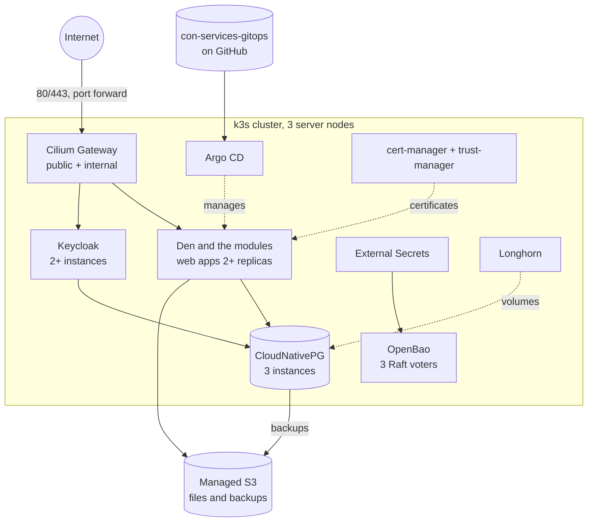

# Deploy with Argo CD

This section takes you from empty virtual machines to the full Con Services
suite running highly available on Kubernetes, managed with **GitOps**: a Git
repository describes everything that runs in the cluster, and
[Argo CD](https://argo-cd.readthedocs.io/) keeps the cluster equal to it.

The repository is
[`AGlElectronics/con-services-gitops`](https://github.com/AGlElectronics/con-services-gitops).
It is the **golden reference**: the setup the project tests and recommends,
published as a blank template. You make your own copy, fill in one
settings file, point Argo CD at your copy, and Argo CD installs and
configures everything else.

## What you build



| Layer | Choice | Why |
| --- | --- | --- |
| Kubernetes | [k3s](https://k3s.io) v1.37, 3 server nodes with embedded etcd | Small, one binary, HA control plane with 3 nodes. |
| Network | [Cilium](https://cilium.io) 1.20: CNI, kube-proxy replacement, WireGuard encryption, NetworkPolicy, **Gateway API**, load balancer IPs | One component for networking, policy and the entry point. Cilium's Gateway checks the apps' internal certificates (`BackendTLSPolicy`), so [internal TLS](../operations/internal-tls.md) works end to end. No ingress-nginx (no longer developed) and no Traefik. |
| Storage | [Longhorn](https://longhorn.io) 1.13 | Replicated block storage across nodes. |
| Delivery | [Argo CD](https://argo-cd.readthedocs.io/) 3.6 | GitOps: Git is the source of truth. |
| Certificates | cert-manager + trust-manager | Let's Encrypt (DNS-01 through Cloudflare) for the public side, the internal CA inside the cluster. |
| Secrets | [OpenBao](https://openbao.org) + External Secrets Operator | Secrets never go into Git; see [Secrets](../operations/secrets.md). |
| Database | [CloudNativePG](https://cloudnative-pg.io) | PostgreSQL with automatic failover and backups. |
| Object storage | A **managed S3 service**, for example [Hetzner Object Storage](https://www.hetzner.com/storage/object-storage/) | Files and backups live outside the cluster, so losing the cluster never loses them, and the provider runs the replication. Any S3-compatible service works (AWS S3, Cloudflare R2, Backblaze B2, Wasabi, Scaleway, OVH, ...); see [Data](data.md). |
| Sign-in | Keycloak through the Keycloak Operator | Production mode, several instances. |
| Images | GitHub Actions on GitHub-hosted or [self-hosted runners](self-hosted-runners.md), GHCR | Tested, scanned with Trivy and signed; see [CI](../contributing/ci.md). If you run your own private images, the cluster can pull them with a pull secret; see [Den and the modules](apps.md). |

## How it works

1. **Copy the template.** On GitHub, open
   [`con-services-gitops`](https://github.com/AGlElectronics/con-services-gitops)
   and choose **Use this template → Create a new repository**. Your copy
   can be private.
2. **Fill in one file.** Everything that differs per installation (your
   domain, IP addresses, e-mail address, S3 endpoint and bucket names,
   which modules you want, the address of your copy) is in `cluster.yaml`
   at the top of the repository. Every value you must set is marked
   `change-me`:

    ```sh
    grep -n "change-me" cluster.yaml
    ```

    When that command prints nothing, the file is complete.
3. **Check your cluster.** You bring a Kubernetes cluster that meets the
   [Prerequisites](prerequisites.md): at least 3 nodes, Cilium with the
   Gateway API, a replicated default StorageClass, and Argo CD. Any
   conformant Kubernetes works (k3s, kubeadm, Talos, managed clouds);
   [Kubernetes distributions](distributions.md) lists what to prepare on
   each. If you still need to build one, [Example: a k3s cluster](cluster.md)
   shows a tested way.
4. **Point Argo CD at your copy.** One command,
   `bash bootstrap/install-root.sh`, creates the root Application; from then on Argo CD installs every component in the right
   order and keeps it equal to your repository
   ([Argo CD](argocd.md)).
5. **Do the steps only a person can do**: unseal OpenBao and store the
   secrets in it ([Secrets with OpenBao](secrets-openbao.md)), create the
   DNS records and the port forward
   ([DNS and certificates](dns-and-certificates.md)), create the S3
   buckets ([Data](data.md)). Argo CD waits for these and continues by
   itself once they are done.

Secrets are never in your repository; they live in OpenBao.

Each guide gives numbered steps with the exact command to run and what you
should see afterwards, ends with a checkpoint ("you are done when ...")
and has a Troubleshooting section. With a ready cluster, plan about one
hour from copying the template to signing in to Den.

## The guides, in order

1. [Prerequisites](prerequisites.md): what your cluster and accounts must
   provide, and how to check it.
2. [Argo CD](argocd.md): fill in `cluster.yaml` and point Argo CD at your
   copy.
3. [DNS and certificates](dns-and-certificates.md): DNS records, the
   Let's Encrypt token, the public and internal gateways.
4. [Secrets with OpenBao](secrets-openbao.md): initialise, unseal and fill
   OpenBao.
5. [Data](data.md): PostgreSQL with CloudNativePG, buckets at a managed
   S3 service, backups.
6. [Identity](identity.md): Keycloak and the production realm.
7. [Den and the modules](apps.md): first sign-in, pairing, upgrades.

Before you go live, read [Sizing and resources](sizing.md) (the CPU and
memory every component requests and may use, and how to change it) and
[High availability](high-availability.md) (what survives which failure).

Optional: [Example: a k3s cluster](cluster.md) if you need to build a
cluster first, and [Self-hosted CI runners](self-hosted-runners.md) if you
build your own images.

!!! warning "Three nodes on one physical host is not fully highly available"
    Three nodes protect you against one node failing, being upgraded or
    being restarted. If all three are virtual machines on the same physical
    server, that server, its disks and its power supply are still a single
    point of failure. Keep off-site backups ([Data](data.md#backups)) no
    matter how many nodes you have.

## Troubleshooting

Each guide ends with the problems people actually hit at that step. If you
are not sure where something broke, start with:

```sh
kubectl get applications -n argocd
kubectl get pods -A | grep -v -E "Running|Completed"
```

The first shows which Argo CD Application is not `Synced`/`Healthy`; the
second lists every pod that is not running. Then open the guide for that
component.
