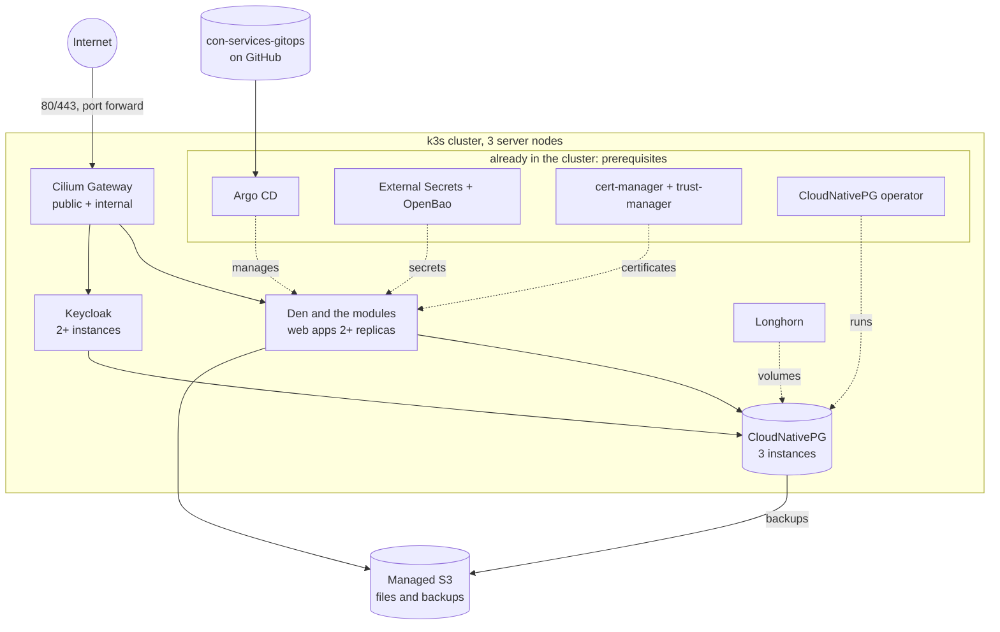

# Deploy with Argo CD

This section takes you from a running Kubernetes cluster to the full Con
Services suite running highly available on it, managed with **GitOps**: a Git
repository describes everything that runs in the cluster, and
[Argo CD](https://argo-cd.readthedocs.io/) keeps the cluster equal to it.

The repository is
[`AGlElectronics/con-services-gitops`](https://github.com/AGlElectronics/con-services-gitops).
It is the **golden reference**: the setup the project tests and recommends,
published as a blank template. You make your own copy, fill in one
settings file, point Argo CD at your copy, and Argo CD installs and
configures Con Services: Den and the modules, their database, Keycloak,
and the certificates, gateways and secret references they need.

!!! note "What the template does not install"
    The template assumes a running, hardened cluster that already provides
    the shared services a cluster like that has anyway: Argo CD,
    cert-manager with trust-manager, External Secrets Operator with
    OpenBao, the CloudNativePG operator with its Barman Cloud plugin,
    load balancer addresses and cluster DNS. These are
    [prerequisites](prerequisites.md): the guides say which versions are
    tested and how to check them, but setting them up is left to their own
    documentation.

## What you build



Rows marked *prerequisite* are already in your cluster; the template uses
them but does not install them.

| Layer | Choice | Why |
| --- | --- | --- |
| Kubernetes | [k3s](https://k3s.io) v1.37, 3 server nodes with embedded etcd | Small, one binary, HA control plane with 3 nodes. |
| Network | [Cilium](https://cilium.io) 1.20: CNI, kube-proxy replacement, WireGuard encryption, NetworkPolicy, **Gateway API**, load balancer IPs | One component for networking, policy and the entry point. Cilium's Gateway checks the apps' internal certificates (`BackendTLSPolicy`), so [internal TLS](../operations/internal-tls.md) works end to end. No ingress-nginx (no longer developed) and no Traefik. |
| Storage | [Longhorn](https://longhorn.io) 1.13 | Replicated block storage across nodes. |
| Delivery | [Argo CD](https://argo-cd.readthedocs.io/) 3.6 (*prerequisite*) | GitOps: Git is the source of truth. |
| Certificates | cert-manager + trust-manager (*prerequisite*) | The template adds the issuers: Let's Encrypt (DNS-01 through Cloudflare) for the public side, the internal CA inside the cluster. |
| Secrets | [OpenBao](https://openbao.org) + External Secrets Operator (*prerequisite*) | The template adds the store and one ExternalSecret per Secret. Secrets never go into Git; see [Secrets](../operations/secrets.md). |
| Database | [CloudNativePG](https://cloudnative-pg.io) operator (*prerequisite*) | The template creates the PostgreSQL cluster: automatic failover and backups. |
| Object storage | A **managed S3 service**, for example [Hetzner Object Storage](https://www.hetzner.com/storage/object-storage/) | Files and backups live outside the cluster, so losing the cluster never loses them, and the provider runs the replication. Any S3-compatible service works (AWS S3, Cloudflare R2, Backblaze B2, Wasabi, Scaleway, OVH, ...); see [Data](data.md). |
| Sign-in | Keycloak through the Keycloak Operator | Production mode, several instances. |
| Images | Published by the project on GHCR | Tested, scanned with Trivy and signed; see [CI](../contributing/ci.md). If you run your own private images, the cluster can pull them with a pull secret; see [Den and the modules](apps.md). |

## How it works

1. **Copy the template.** On GitHub, open
   [`con-services-gitops`](https://github.com/AGlElectronics/con-services-gitops)
   and choose **Use this template → Create a new repository**. Your copy
   can be private.
2. **Fill in one file.** Everything that differs per installation (your
   domain, IP addresses, e-mail address, S3 endpoint and bucket names,
   which modules you want, the address of your copy) is in `cluster.yaml`
   at the top of the repository. Every value you must set is marked
   `change-me`:

    ```sh
    grep -n "change-me" cluster.yaml
    ```

    When that command prints nothing, the file is complete.
3. **Check your cluster.** You bring a Kubernetes cluster that meets the
   [Prerequisites](prerequisites.md): at least 3 nodes, Cilium with the
   Gateway API, a replicated default StorageClass, Argo CD, cert-manager,
   External Secrets Operator with OpenBao, and CloudNativePG. Any
   conformant Kubernetes works (k3s, kubeadm, Talos, managed clouds).
   Building the cluster and installing these is not covered here; the
   prerequisites page says what Con Services needs from each.
4. **Prepare OpenBao.** Two scripts create what Con Services needs in your
   OpenBao (a KV engine, a login for External Secrets) and store its
   secrets there ([Secrets with OpenBao](secrets-openbao.md)).
5. **Point Argo CD at your copy.** One command,
   `bash bootstrap/install-root.sh`, checks the prerequisites and creates
   the root Application; from then on Argo CD installs every Con Services
   component in the right order and keeps it equal to your repository
   ([Argo CD](argocd.md)).
6. **Do the steps only a person can do**: create the
   DNS records and the port forward
   ([DNS and certificates](dns-and-certificates.md)), create the S3
   buckets ([Data](data.md)). Argo CD waits for these and continues by
   itself once they are done.

Secrets are never in your repository; they live in OpenBao.

Each guide gives numbered steps with the exact command to run and what you
should see afterwards, ends with a checkpoint ("you are done when ...")
and has a Troubleshooting section. With a ready cluster, plan about one
hour from copying the template to signing in to Den.

## The guides, in order

1. [Prerequisites](prerequisites.md): what your cluster and accounts must
   provide, and how to check it.
2. [Argo CD](argocd.md): fill in `cluster.yaml` and point Argo CD at your
   copy.
3. [DNS and certificates](dns-and-certificates.md): DNS records, the
   Let's Encrypt token, the public and internal gateways.
4. [Secrets with OpenBao](secrets-openbao.md): prepare your OpenBao for
   Con Services and fill it.
5. [Data](data.md): PostgreSQL with CloudNativePG, buckets at a managed
   S3 service, backups.
6. [Identity](identity.md): Keycloak and the production realm.
7. [Den and the modules](apps.md): first sign-in, pairing, upgrades.

Before you go live, read [Sizing and resources](sizing.md) (the CPU and
memory every component requests and may use, and how to change it) and
[High availability](high-availability.md) (what survives which failure).

!!! warning "Three nodes on one physical host is not fully highly available"
    Three nodes protect you against one node failing, being upgraded or
    being restarted. If all three are virtual machines on the same physical
    server, that server, its disks and its power supply are still a single
    point of failure. Keep off-site backups ([Data](data.md#backups)) no
    matter how many nodes you have.

## Troubleshooting

Each guide ends with the problems people actually hit at that step. If you
are not sure where something broke, start with:

```sh
kubectl get applications -n argocd
kubectl get pods -A | grep -v -E "Running|Completed"
```

The first shows which Argo CD Application is not `Synced`/`Healthy`; the
second lists every pod that is not running. Then open the guide for that
component.
