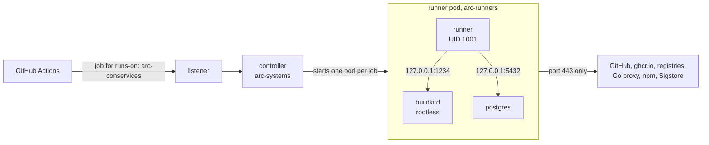

# Self-hosted CI runners

**Goal:** run the Con Services [CI pipeline](../contributing/ci.md) on
runners in your own Kubernetes cluster, so builds do not depend on GitHub's
Actions minutes, without giving the runners privileged access to your
nodes.

A *runner* is the machine that executes a GitHub Actions job. The module
pipelines use the runner label `arc-conservices`: a group of runners in the
cluster, managed by Actions Runner Controller.

## Choose an option

| Option | Cost | Effort | arm64 images |
| --- | --- | --- | --- |
| **A. Public repositories, GitHub-hosted runners** | Free, no minute limit | One setting per repository, three inputs per module | Free native `ubuntu-24.04-arm` runners exist, but the pipeline builds arm64 with QEMU on the same runner |
| **B. Actions Runner Controller in your cluster** (the default of the pipeline) | Your cluster's CPU and memory | This page | QEMU emulation (slow), only with `arm64: true` |

**Option A.** Con Services is open source; GitHub gives public repositories
standard hosted runners without a minute limit. In each repository:
**Settings → General → Danger Zone → Change visibility → Public**. The CI
pipeline scans only the current files for secrets, so scan the whole
history once first with a tool such as
[gitleaks](https://github.com/gitleaks/gitleaks) (`gitleaks git .`). Then
switch the module to GitHub-hosted runners in its `.github/workflows/ci.yml`:

```yaml
    with:
      runner: ubuntu-24.04
      buildkit-endpoint: ""
      test-database-mode: service
```

**Option B** is described on the rest of this page.

## How option B works

[Actions Runner Controller](https://github.com/actions/actions-runner-controller)
(ARC) is GitHub's operator for runners on Kubernetes. It has two parts,
each a Helm chart:

- the **controller** (`gha-runner-scale-set-controller`), in the namespace
  `arc-systems`;
- the **runner scale set** `arc-conservices` (`gha-runner-scale-set`), in
  the namespace `arc-runners`. A *listener* pod waits for jobs whose
  `runs-on` is `arc-conservices`, and ARC starts one short-lived pod per job.
  With `minRunners: 0` nothing runs while there are no jobs (*scale to
  zero*).

Building container images normally needs a Docker daemon, which on
Kubernetes means a *privileged* "Docker in Docker" container with full
access to the node. Con Services avoids that. Each runner pod has three
containers that share the pod's network (`127.0.0.1`) and live exactly as
long as the job:

| Container | Image | What it does |
| --- | --- | --- |
| `runner` | `ghcr.io/aglelectronics/ci-runner` (built from `infra/ci-runner/` in `con-services`) | Runs the job. Non-root (UID 1001), no privilege escalation, no Docker daemon. |
| `buildkitd` (sidecar) | `moby/buildkit:<version>-rootless` | Builds images, at `tcp://127.0.0.1:1234`. Rootless: runs as UID 1000, not privileged. |
| `postgres` (sidecar) | `postgres:16.15-alpine` | A throw-away database for the Go tests, at `127.0.0.1:5432` (user `ci`, test-only password). |

Because each job gets its own BuildKit and database, a pull request cannot
read another job's build cache or data.



A `CiliumNetworkPolicy` gives runner pods no ingress and egress only to
cluster DNS and to the internet on port 443; they cannot reach anything
inside the cluster or on your local network. That matters because jobs run
code from pull requests.

!!! note "Why `arc-runners` is labelled Pod Security privileged"
    Rootless BuildKit creates user namespaces and needs *unconfined* seccomp
    and AppArmor profiles, although it runs as UID 1000 without privileged
    mode. Kubernetes
    [Pod Security](https://kubernetes.io/docs/concepts/security/pod-security-standards/)
    admits that only at the `privileged` level, so `arc-runners` enforces
    `privileged` and warns and audits at `baseline`. Keep anything else out
    of this namespace. `arc-systems` enforces `restricted`.

**Dind alternative.** If rootless BuildKit cannot run on your nodes (see
Troubleshooting), you can switch the scale set to `containerMode.type: dind`
instead of the sidecars (this means editing `root.arcRunnerValues` in
`charts/root/templates/_apps.tpl`) and set `buildkit-endpoint: ""` in the
callers.
That is simpler, but every runner pod then has a privileged container, so
any job, including one from a pull request, can take over the node. Only do
that when every contributor is trusted, and never on nodes that run Con
Services itself.

## Prerequisites

- A cluster managed with Argo CD from your copy of
  [`con-services-gitops`](https://github.com/AGlElectronics/con-services-gitops),
  with External Secrets Operator, the `openbao` ClusterSecretStore and
  Cilium running (they come before ARC in the sync waves).
- Admin rights on the GitHub organisation, to create a GitHub App.
- Spare capacity: each job pod requests about 2.1 CPU and 4.3 GiB
  (runner 1 CPU/2 GiB, BuildKit 1 CPU/2 GiB, PostgreSQL 0.1 CPU/256 MiB;
  `arc.resources` in `cluster.yaml`). With `maxRunners: 3`, plan for up to
  three of those at once. See [Sizing](sizing.md).

## Step 1: create the GitHub App

ARC authenticates as a *GitHub App*: an identity owned by the organisation,
with narrow permissions and short-lived tokens.

1. On GitHub: **Organization settings → Developer settings → GitHub Apps →
   New GitHub App**.
2. Name, for example, `con-services-arc`; homepage URL your organisation;
   under **Webhook** untick *Active*.
3. **Organization permissions → Self-hosted runners: Read and write.**
   (Repository permission *Metadata: Read-only* is preselected.)
4. **Create GitHub App.** Note the **App ID** shown on the next page.
5. **Generate a private key**; a `.pem` file downloads.
6. **Install App** → your organisation → *All repositories* or just the
   module repositories. The address now ends in `/installations/<number>`:
   that number is the **installation ID**.

## Step 2: store the App in OpenBao

Set `arc.enabled: true` in `cluster.yaml` first (Step 3); the seed script
asks for the GitHub App only when ARC is enabled. It writes the three
values to `kv/infra/github-arc`:

```sh
BAO_TOKEN=<token> bash bootstrap/scripts/openbao-seed.sh
```

```text
GitHub App ID for Actions runners (empty = skip): 123456
GitHub App installation ID: 7654321
Path to the GitHub App private key (.pem): ./con-services-arc.2026-11-07.private-key.pem
==> kv/infra/github-arc written (you may now delete ./con-services-arc.2026-11-07.private-key.pem)
```

Delete the `.pem` file afterwards. The ExternalSecret `arc-github-app`
(`charts/arc-runners-extras/templates/external-secret.yaml`) copies `github_app_id`, `github_app_installation_id` and
`github_app_private_key` into the Secret `arc-github-app` in `arc-runners`.
See [Secrets](../operations/secrets.md) for how secrets reach the cluster.

## Step 3: enable ARC in `cluster.yaml`

ARC is **off** by default (`arc.enabled: false`): nothing of it is
installed. The pieces in `con-services-gitops`:

| File | What it is |
| --- | --- |
| `charts/root/templates/arc.yaml` | Rendered only with `arc.enabled: true`: the Argo CD Applications `arc-controller` (sync wave 20) and `arc-runners` (wave 21), and the registration of ARC's OCI Helm chart repository |
| `charts/root/templates/_apps.tpl` (`root.arcRunnerValues`) | The scale set values computed from `arc.*`: organisation, `minRunners`/`maxRunners`, the runner pod with its two sidecars |
| `values/arc-controller.yaml`, `values/arc-runners.yaml` | Fixed Helm values of the two charts |
| `charts/arc-runners-extras` | The GitHub App ExternalSecret and the runners' CiliumNetworkPolicy |

1. In `cluster.yaml`, turn ARC on and set your organisation and the number
   of jobs that may run at once:

    ```yaml
    arc:
      enabled: true
      githubConfigUrl: https://github.com/your-org
      runnerScaleSetName: arc-conservices
      minRunners: 0
      maxRunners: 3
    ```

    The other `arc.*` keys (images, `resources`) have working defaults; see
    the [`cluster.yaml` reference](argocd.md#clusteryaml-reference).

2. Commit and push. Argo CD syncs `arc-controller`, then `arc-runners`.

To remove ARC again, set `arc.enabled: false`; the root Application deletes
both Applications.

Check:

```sh
kubectl get pods -n arc-systems
kubectl get autoscalingrunnerset -n arc-runners
```

```text
NAME                                      READY   STATUS    RESTARTS   AGE
arc-gha-rs-controller-6c9d8f7b5-x2k8q     1/1     Running   0          2m
arc-conservices-754b578d-listener         1/1     Running   0          1m

NAME              MINIMUM RUNNERS   MAXIMUM RUNNERS   CURRENT RUNNERS   STATE
arc-conservices   0                 3                 0
```

On GitHub, **Organization settings → Actions → Runner groups → Default**
now lists `arc-conservices`.

## Step 4: the runner image

The pipeline needs `go test -race`, which needs a C compiler; the upstream
runner image has none, and the runner pod cannot install packages because
it runs without privilege escalation. `infra/ci-runner/Dockerfile` in
`con-services` adds `gcc`; the workflow `ci-runner-image.yml` publishes it
as `ghcr.io/aglelectronics/ci-runner:<runner version>-<BUILD>` (the tag is
in `infra/ci-runner/VERSION`). `arc.runnerImage` in `cluster.yaml` pins
that tag. When you raise the runner version, change both.

## Step 5: run a pipeline

The module pipelines already use `runner: arc-conservices`. Open a pull
request on a module; within a few seconds a pod appears:

```sh
kubectl get pods -n arc-runners -w
```

```text
NAME                                  READY   STATUS     RESTARTS   AGE
arc-conservices-x7k2p-runner-9fz4d    0/3     Init:0/2   0          1s
arc-conservices-x7k2p-runner-9fz4d    3/3     Running    0          9s
arc-conservices-x7k2p-runner-9fz4d    0/3     Completed  0          4m12s
```

It runs one job and is deleted afterwards.

## arm64 images

By default the pipeline publishes `linux/amd64` only. With `arm64: true` in
a module's `ci.yml`, the release also builds `linux/arm64` with QEMU
emulation, which is several times slower. BuildKit in the runner pod uses
the node's QEMU handlers, so install them once on every node that can run
runner pods:

```sh
docker run --privileged --rm tonistiigi/binfmt --install arm64
# or, without Docker on the node:
sudo apt-get install -y qemu-user-static binfmt-support
```

The release fails early with *The builder cannot build linux/arm64* when
the handlers are missing.

## Rotate the GitHub App key

1. GitHub: organisation **Settings → Developer settings → GitHub Apps →**
   the App → **Generate a private key**.
2. Write it to OpenBao, replacing only the key (the seed script keeps
   existing entries, so use `bao kv patch`; how to open a `bao` session is
   in [Change a secret](secrets-openbao.md#change-a-secret)):

    ```sh
    bao kv patch kv/infra/github-arc github_app_private_key=@./con-services-arc.new.private-key.pem
    ```

    Then delete the `.pem` file.
3. Make External Secrets pick it up now instead of within the hour:

    ```sh
    kubectl annotate externalsecret -n arc-runners arc-github-app force-sync=$(date +%s) --overwrite
    ```

4. Restart the listener so it reads the new key:

    ```sh
    kubectl delete pod -n arc-systems -l app.kubernetes.io/component=runner-scale-set-listener
    ```

5. Delete the old key on the App page.

Queued jobs wait a few seconds while the listener restarts.

## Troubleshooting

**The job waits with *Waiting for a runner to pick up this job***
: Read the listener's log:
  `kubectl logs -n arc-systems -l app.kubernetes.io/component=runner-scale-set-listener`.
  `401 Unauthorized` or `could not find installation` means a wrong App ID,
  installation ID or key in OpenBao (Step 2), or the App is not installed
  on that repository. Also check that the module's `runner:` is exactly
  `arc-conservices` and that `maxRunners` is not `0`.

**`secret "arc-github-app" not found`**
: The ExternalSecret has not synced:
  `kubectl describe externalsecret -n arc-runners arc-github-app`. Usually
  `kv/infra/github-arc` is missing or a field name is wrong.

**Argo CD: `metadata.annotations: Too long` on a CRD**
: ARC's CRDs need server-side apply; check that `ServerSideApply=true` is
  still in the Applications' `syncOptions`.

**Argo CD cannot pull the chart (`failed to fetch chart`)**
: The repository Secret `repo-arc-charts` (from `charts/root/templates/arc.yaml`) registers
  `ghcr.io/actions/actions-runner-controller-charts` with
  `enableOCI: "true"`; check that it exists in the `argocd` namespace.

**`violates PodSecurity "restricted"` for the runner pod**
: The namespace `arc-runners` must enforce `privileged`. Argo CD sets the
  label through `managedNamespaceMetadata`; if the namespace was created by
  hand before, label it:
  `kubectl label ns arc-runners pod-security.kubernetes.io/enforce=privileged --overwrite`.

**The `buildkitd` sidecar logs `operation not permitted` or `newuidmap` errors**
: The node does not allow unprivileged user namespaces. On Ubuntu 24.04
  AppArmor restricts them; allow them with
  `sudo sysctl -w kernel.apparmor_restrict_unprivileged_userns=0` (and the
  same line in `/etc/sysctl.d/99-userns.conf` to keep it after a reboot),
  or use the dind alternative with its trade-off.

**`go test -race needs a C compiler`**
: The runner pod uses an image without gcc. Set `arc.runnerImage` to
  `ghcr.io/aglelectronics/ci-runner:<tag>` in `cluster.yaml` (Step 4).

**`No PostgreSQL on 127.0.0.1:5432`**
: The runner pod has no `postgres` sidecar (check `arc.testDatabaseImage`
  and `kubectl get pod -n arc-runners <pod> -o jsonpath='{.spec.initContainers[*].name}'`), or
  the module runs on GitHub-hosted runners without
  `test-database-mode: service`.

**`npm ci`, `go mod download` or a base image pull times out**
: The network policy allows only port 443. A registry or mirror on another
  port, or inside your network, needs an extra egress rule in
  `charts/arc-runners-extras/templates/network-policy.yaml`.

**Jobs are slow**
: Every job starts with an empty BuildKit cache; that is the price of not
  sharing caches between pull requests. Pull request builds read and write
  GitHub's Actions cache for image layers, which helps after the first run;
  release builds deliberately use no cache.

## Related pages

- [CI and releases](../contributing/ci.md): what the pipeline does.
- [Secrets](../operations/secrets.md): how secrets get into the cluster.
- [About Actions Runner Controller](https://docs.github.com/actions/hosting-your-own-runners/managing-self-hosted-runners-with-actions-runner-controller/about-actions-runner-controller) (GitHub docs).
