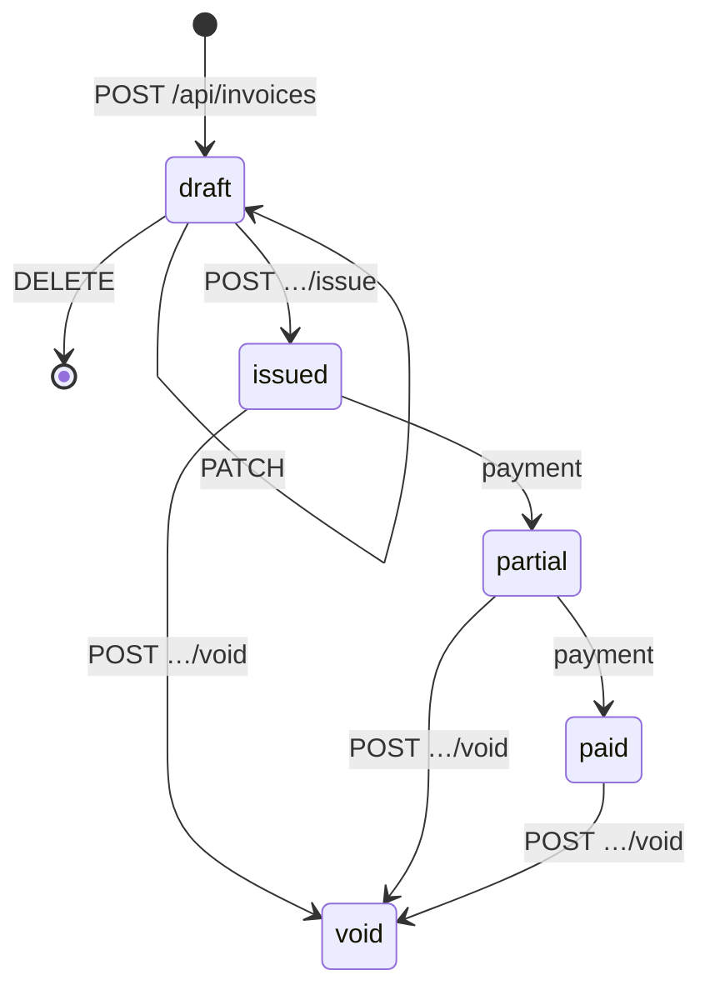

# Finance API reference

Finance's web app is built entirely on this HTTP API: customers, invoices,
payments, expenses, the ledger and the dashboard. Use it to script
bookkeeping, import data or build reports. This page lists **every route** in
[`backend/internal/http/router.go`](https://github.com/AGlElectronics/finance/blob/main/backend/internal/http/router.go)
with who may call it, the request and response bodies, the errors and a
`curl` example.

The rules shared by every Con Services module (tokens, error shape, ids,
timestamps) are on [API conventions](../../concepts/api-conventions.md). This
page covers what is specific to Finance, including two differences from most
modules:

- Finance's routes sit directly under **`/api/`** (no `/v1`).
- There is **one access level**: you either have Finance access or you do
  not. There are no finer permissions.

## Basics

| What | Value |
| --- | --- |
| Base address (browser, scripts) | The Finance address, for example `https://finance.example.org`. nginx forwards `/api/`, `/livez` and `/readyz` to the backend. |
| Base address (inside the cluster) | `http://finance-backend.conservices-finance.svc.cluster.local:8080` |
| Request bodies | JSON, `Content-Type: application/json`. **Unknown fields are rejected** with `400`. |
| Ids | UUIDs. A malformed id answers `400` `invalid id`. |
| Money | Integer **cents** in **EUR** (`36300` = €363.00). Never floats. |
| Quantities | Decimal numbers on invoice lines (`1.5`), stored exactly in hundredths: `0.01` to `1000000`. |
| Tax rates | Basis points: 21% = `2100`, 9% = `900`, 0% = `0`; `0` to `10000`. |
| Dates | Calendar dates are `YYYY-MM-DD`. Timestamps (`created_at`, `updated_at`) are RFC 3339 UTC. |
| Request id | Every response carries an `X-Request-ID` header; quote it when reporting a problem. |
| Audit | Every create, update, delete, issue, void and payment is written to the `audit_events` table with who did it. The log is not exposed over the API yet. |

In the examples ([how to get a token](../../concepts/api-conventions.md#get-a-token-for-curl)):

```sh
export FIN=https://finance.example.org
export TOKEN=eyJhbGciOi...   # access token from Keycloak for the Finance web app's client
```

## Authentication and access

| Caller | How | Accepted on |
| --- | --- | --- |
| Staff (production, `AUTH_MODE=oidc`) | `Authorization: Bearer <token>` from Keycloak, verified against `OIDC_ISSUER_URL` | everything under `/api/` except the role catalog and brand |
| Local development (`AUTH_MODE=dev`, the default) | `X-Dev-User: <name>` or nothing (`DEV_DEFAULT_USER`, default `dev-finance-admin`) | the same routes |
| Anyone | nothing | `/livez`, `/readyz`, `/api/role-catalog`, `/api/brand…` |

**Finance access** means: your token's `groups` claim contains one of the
groups in `FINANCE_ACCESS_GROUPS` (default `finance-admin`; a leading `/`
and letter case are ignored). Every business route and the Den connection
need it; others answer `403` `you don't have access to Finance`. `/api/me`
and `/api/me/preferences` only need a valid token, so the web app can tell
people *why* they cannot get in.

!!! danger "Dev mode lets everyone in"
    With `AUTH_MODE=dev` every caller has full Finance access, whoever they
    claim to be. `AUTH_MODE` defaults to `dev`, so production **must** set
    `AUTH_MODE=oidc`. See [Configuration](configuration.md) and
    [Authentication](../../concepts/authentication.md).

## Errors

```json
{"error":{"code":"validation_failed","message":"line 2 is invalid","details":{"quantity":"must be between 0.01 and 1000000"}}}
```

| Status | `code` | Typical cause in Finance |
| --- | --- | --- |
| 400 | `bad_request` | Malformed JSON, unknown field, empty body, bad id or `customer_id` filter. |
| 401 | `unauthorized` | `missing bearer token` or `invalid token`. |
| 403 | `forbidden` | `you don't have access to Finance`. |
| 404 | `not_found` | `customer not found`, `invoice not found`, `expense not found`. |
| 409 | `conflict` | An action not allowed in the invoice's state (editing an issued invoice, voiding a draft), deleting a customer with invoices. |
| 422 | `validation_failed` | Field problems; `details` maps field to problem. |
| 500 | `internal` | Unexpected failure; see the backend log with the request id. |

The Den pairing routes add `pairing_failed` (422) and `sync_failed` (409 when
not paired, 502 when Den cannot be reached).

## Endpoint overview

| # | Method | Path | Who |
| --- | --- | --- | --- |
| 1 | GET | `/livez` | anyone |
| 2 | GET | `/readyz` | anyone |
| 3 | GET | `/api/role-catalog` | anyone (HR) |
| 4 | GET | `/api/brand` | anyone |
| 5 | GET | `/api/brand/{role}` | anyone |
| 6 | GET | `/api/me` | signed in |
| 7 | GET | `/api/me/preferences` | signed in |
| 8 | PUT | `/api/me/preferences` | signed in |
| 9 | GET | `/api/dashboard` | Finance access |
| 10 | GET | `/api/customers` | Finance access |
| 11 | POST | `/api/customers` | Finance access |
| 12 | GET | `/api/customers/{id}` | Finance access |
| 13 | PATCH | `/api/customers/{id}` | Finance access |
| 14 | DELETE | `/api/customers/{id}` | Finance access |
| 15 | GET | `/api/invoices` | Finance access |
| 16 | POST | `/api/invoices` | Finance access |
| 17 | GET | `/api/invoices/{id}` | Finance access |
| 18 | PATCH | `/api/invoices/{id}` | Finance access |
| 19 | DELETE | `/api/invoices/{id}` | Finance access |
| 20 | POST | `/api/invoices/{id}/issue` | Finance access |
| 21 | POST | `/api/invoices/{id}/void` | Finance access |
| 22 | POST | `/api/invoices/{id}/payments` | Finance access |
| 23 | GET | `/api/expenses` | Finance access |
| 24 | POST | `/api/expenses` | Finance access |
| 25 | GET | `/api/expenses/{id}` | Finance access |
| 26 | PATCH | `/api/expenses/{id}` | Finance access |
| 27 | DELETE | `/api/expenses/{id}` | Finance access |
| 28 | GET | `/api/ledger` | Finance access |
| 29 | GET | `/api/den` | Finance access |
| 30 | POST | `/api/den/pair` | Finance access |
| 31 | POST | `/api/den/sync` | Finance access |
| 32 | DELETE | `/api/den/pair` | Finance access |

**32 endpoints.** Finance has no `/api/health`; use `/livez` and `/readyz`.

---

## Probes and catalog

### `GET /livez`

Anyone. `200` while the process runs, with the build version and uptime. It
never touches the database.

```sh
curl -s $FIN/livez
```

```json
{"status":"ok","version":"0.2.0-1","uptime_sec":7260}
```

### `GET /readyz`

Anyone. Pings PostgreSQL (2-second timeout).

```json
{"status":"ready","database":"ok"}
```

`503` `{"status":"not_ready","database":"down"}` (or `"not_configured"`)
when the database cannot be reached.

### `GET /api/role-catalog`

Anyone; HR reads it to offer the Finance role in its access picker. Finance
has a single, fixed role.

```sh
curl -s http://finance-backend.conservices-finance.svc.cluster.local:8080/api/role-catalog
```

```json
{"module":"finance","display_name":"Finance","description":"Invoices and money tracking.",
 "roles":[{"key":"finance-admin","label":"Finance admin",
           "description":"Full access: customers, invoices and payments.",
           "group":"finance-admin","assignable":true,"scope":"global","permissions":["finance.*"]}],
 "source":"self","status":"ok"}
```

The catalog always names the group `finance-admin`, even if you changed
`FINANCE_ACCESS_GROUPS`; keep that group in the list if HR assigns access.

## Brand

### `GET /api/brand`

Anyone (the sign-in screen needs it). Den's brand once paired, otherwise
`"source":"standalone"` with an empty theme.

```sh
curl -s $FIN/api/brand
```

```json
{"source":"den","revision":4,"organization_name":"Example Con",
 "logo_url":"/api/brand/logo?v=3f2a…","login_background_url":"/api/brand/login-background?v=91bc…",
 "theme":{"primary":"#0f766e"},"copy":{"login_layout":"panel","login_caption":"Welcome back"}}
```

### `GET /api/brand/{role}`

Anyone. The binary asset copied from Den: `role` is `logo` or
`login-background`. Cached for a day. `404` `no such brand asset` when there
is none.

```sh
curl -s -o logo.png $FIN/api/brand/logo
```

## You

### `GET /api/me`

Signed in (no Finance access needed). Answers who you are and **whether you
have access**.

```sh
curl -s -H "Authorization: Bearer $TOKEN" $FIN/api/me
```

```json
{"username":"Alex Treasurer","auth_mode":"oidc","has_access":true,"groups":["finance-admin","staff"]}
```

`has_access:false` with your groups listed means none of them is in
`FINANCE_ACCESS_GROUPS`. In dev mode `groups` is `[]` and `has_access` is
always `true`.

### `GET /api/me/preferences`

Signed in. Your theme, kept in Den so every module shares it.

```json
{"theme":"dark","updated_at":"2026-11-01T18:20:00Z","synced":true}
```

`synced:false` (theme `system`) when Finance is not paired or Den is
unreachable.

### `PUT /api/me/preferences`

Signed in. Body `{"theme":"system"|"light"|"dark"}`. `200` with the same
shape as `GET`; `422` `theme must be system, light or dark`.

```sh
curl -s -X PUT $FIN/api/me/preferences \
  -H "Authorization: Bearer $TOKEN" -H "Content-Type: application/json" -d '{"theme":"light"}'
```

## Dashboard

### `GET /api/dashboard`

Finance access. The money position on the home page, computed live.

```sh
curl -s -H "Authorization: Bearer $TOKEN" $FIN/api/dashboard
```

```json
{
  "outstanding_cents": 120000, "overdue_cents": 36300, "overdue_count": 1,
  "received_month_cents": 50000, "received_total_cents": 410000,
  "spent_month_cents": 12000, "spent_total_cents": 98000, "net_total_cents": 312000,
  "draft_count": 2, "open_count": 4,
  "months": [
    {"month":"2026-06","in_cents":0,"out_cents":0},
    {"month":"2026-07","in_cents":80000,"out_cents":20000},
    {"month":"2026-08","in_cents":120000,"out_cents":30000},
    {"month":"2026-09","in_cents":90000,"out_cents":18000},
    {"month":"2026-10","in_cents":70000,"out_cents":18000},
    {"month":"2026-11","in_cents":50000,"out_cents":12000}
  ],
  "recent_invoices": [
    {"id":"77d0…","number":"FIN-0007","customer_id":"a3c1…","customer_name":"Example Hotel",
     "status":"partial","currency":"EUR","issue_date":"2026-10-01","due_date":"2026-10-31","overdue":true,
     "subtotal_cents":30000,"tax_cents":6300,"total_cents":36300,"paid_cents":10000,
     "created_at":"2026-09-30T10:00:00Z","updated_at":"2026-10-15T09:00:00Z"}
  ]
}
```

| Field | Meaning |
| --- | --- |
| `outstanding_cents` | What customers still owe on issued, not fully paid invoices. Void invoices do not count. |
| `overdue_cents`, `overdue_count` | The part of that past its due date. |
| `received_*`, `spent_*` | Payments in and expenses out, this calendar month and all time. |
| `net_total_cents` | Cash position: all received minus all spent. |
| `draft_count`, `open_count` | Drafts; issued invoices not fully paid. |
| `months` | The last six calendar months, oldest first, including empty ones. |
| `recent_invoices` | The 8 most recently changed invoices (summary shape). |

## Customers

A **customer** is who an invoice is addressed to.

### The customer object

| Field | Notes |
| --- | --- |
| `id` | UUID. |
| `name` | Required. |
| `email`, `billing_address`, `tax_id`, `notes` | Free text, trimmed. |
| `archived` | `true` hides the customer from the default list. |
| `invoice_count` | Invoices of any status. |
| `outstanding_cents` | Still owed on this customer's issued invoices. |
| `created_at`, `updated_at` | |

### `GET /api/customers`

Finance access. Customers sorted by name. Archived ones are left out unless
`?include_archived=true`.

```sh
curl -s -H "Authorization: Bearer $TOKEN" "$FIN/api/customers?include_archived=true"
```

```json
{"customers":[{"id":"a3c1…","name":"Example Hotel","email":"billing@example-hotel.test",
  "billing_address":"1 Main St, Example City","tax_id":"NL000000000B01","notes":"",
  "archived":false,"created_at":"2026-09-01T10:00:00Z","updated_at":"2026-09-01T10:00:00Z",
  "invoice_count":3,"outstanding_cents":26300}]}
```

### `POST /api/customers`

Finance access. Body: `name` (required), `email`, `billing_address`,
`tax_id`, `notes`. Answers `201` with the customer. `422` `customer needs a
name`.

```sh
curl -s -X POST $FIN/api/customers \
  -H "Authorization: Bearer $TOKEN" -H "Content-Type: application/json" \
  -d '{"name":"Example Hotel","email":"billing@example-hotel.test","billing_address":"1 Main St, Example City"}'
```

```json
{"id":"a3c1…","name":"Example Hotel","email":"billing@example-hotel.test",
 "billing_address":"1 Main St, Example City","tax_id":"","notes":"","archived":false,
 "created_at":"2026-11-06T12:00:00Z","updated_at":"2026-11-06T12:00:00Z","invoice_count":0,"outstanding_cents":0}
```

### `GET /api/customers/{id}`

Finance access. One customer. `404` `customer not found`.

### `PATCH /api/customers/{id}`

Finance access. Changes only the fields you send, including `archived`
(`true` archives, `false` restores). An empty `name` answers `422`. Answers
`200` with the customer.

```sh
curl -s -X PATCH $FIN/api/customers/a3c1… \
  -H "Authorization: Bearer $TOKEN" -H "Content-Type: application/json" -d '{"archived":true}'
```

### `DELETE /api/customers/{id}`

Finance access. Deletes a customer **without invoices**. Answers `204`.

| Status | When |
| --- | --- |
| `204` | Deleted. |
| `404` | Not found. |
| `409` | `customer has invoices; archive it instead`. Invoices are legal records, so their customer stays. |

## Invoices

An **invoice** starts as a **draft** you can edit freely. **Issuing** it
takes the next gap-free number (`FIN-0001`, `FIN-0002`, …), sets the dates
and locks it. Payments then move it to **partial** and **paid**. An issued
invoice is never deleted: you **void** it and its number stays taken.



`partial` and `paid` are **derived** from the payments, not stored;
**overdue** is a separate `true`/`false` flag for `issued` or `partial`
invoices whose `due_date` is before today.

### The invoice object

`GET /api/invoices` returns summaries; every other invoice route returns the
full invoice (summary plus `notes`, `lines` and `payments`).

```json
{"id":"77d0…","number":"FIN-0001","customer_id":"a3c1…","customer_name":"Example Hotel",
 "status":"partial","currency":"EUR","issue_date":"2026-11-06","due_date":"2026-12-06","overdue":false,
 "subtotal_cents":30000,"tax_cents":6300,"total_cents":36300,"paid_cents":10000,
 "created_at":"2026-11-06T12:00:00Z","updated_at":"2026-11-06T12:30:00Z",
 "notes":"Room block 2026",
 "lines":[{"id":"e5f1…","description":"Dealer table","quantity":2,"unit_price_cents":15000,"tax_rate_bp":2100,
           "subtotal_cents":30000,"tax_cents":6300,"total_cents":36300}],
 "payments":[{"id":"b7a2…","paid_on":"2026-11-06","amount_cents":10000,"method":"bank_transfer",
              "reference":"FIN-0001","note":"deposit","created_at":"2026-11-06T12:30:00Z"}]}
```

`number` and `issue_date` are left out on drafts; `due_date` is left out when
not set. Line totals are computed per line: `subtotal = quantity ×
unit_price` and `tax = subtotal × tax_rate_bp / 10000`, each rounded half
away from zero to whole cents; invoice totals are the sums of the lines.

### `GET /api/invoices`

Finance access. Newest first. Optional filters:

| Parameter | Values |
| --- | --- |
| `status` | `draft`, `issued`, `partial`, `paid`, `void` (the derived status). Other values just return an empty list. |
| `customer_id` | One customer's invoices. `400` `invalid customer_id` if not a UUID. |

```sh
curl -s -H "Authorization: Bearer $TOKEN" "$FIN/api/invoices?status=partial&customer_id=a3c1…"
```

```json
{"invoices":[{"id":"77d0…","number":"FIN-0001","customer_id":"a3c1…","customer_name":"Example Hotel",
  "status":"partial","currency":"EUR","issue_date":"2026-11-06","due_date":"2026-12-06","overdue":false,
  "subtotal_cents":30000,"tax_cents":6300,"total_cents":36300,"paid_cents":10000,
  "created_at":"2026-11-06T12:00:00Z","updated_at":"2026-11-06T12:30:00Z"}]}
```

### `POST /api/invoices`

Finance access. Creates a **draft**.

| Field | Required | Notes |
| --- | --- | --- |
| `customer_id` | yes | Must exist. |
| `lines` | yes, at least one | Each: `description` (required), `quantity` (0.01–1000000), `unit_price_cents` (may be negative for a discount line), `tax_rate_bp` (0–10000). |
| `due_date` | no | `YYYY-MM-DD`. If empty, issuing sets it to 30 days after the issue date. |
| `notes` | no | Printed on the invoice. |

Answers `201` with the full invoice.

```sh
curl -s -X POST $FIN/api/invoices \
  -H "Authorization: Bearer $TOKEN" -H "Content-Type: application/json" \
  -d '{"customer_id":"a3c1…","notes":"Room block 2026",
       "lines":[{"description":"Dealer table","quantity":2,"unit_price_cents":15000,"tax_rate_bp":2100},
                {"description":"Early-bird discount","quantity":1,"unit_price_cents":-2000,"tax_rate_bp":2100}]}'
```

| Status | When |
| --- | --- |
| `201` | Draft created. |
| `422` | `an invoice needs at least one line`; `line N is invalid` with `details` for `description`, `quantity` or `tax_rate_bp`; `invoice total cannot be negative`; `customer does not exist` (`details.customer_id: unknown`); `due_date must be a YYYY-MM-DD date`. |

### `GET /api/invoices/{id}`

Finance access. The full invoice. `404` `invoice not found`.

### `PATCH /api/invoices/{id}`

Finance access. **Replaces** a draft's customer, due date, notes and all its
lines: send the complete body, as for create (fields you leave out are
cleared, and `customer_id` is required). Answers `200` with the invoice.

```sh
curl -s -X PATCH $FIN/api/invoices/77d0… \
  -H "Authorization: Bearer $TOKEN" -H "Content-Type: application/json" \
  -d '{"customer_id":"a3c1…","due_date":"2026-12-31","notes":"Room block 2026",
       "lines":[{"description":"Dealer table","quantity":3,"unit_price_cents":15000,"tax_rate_bp":2100}]}'
```

Same `422`s as create; `409` `only draft invoices can be edited`; `404`.

### `DELETE /api/invoices/{id}`

Finance access. Deletes a **draft**. Answers `204`. `409` `only drafts can be
deleted; void the invoice instead`; `404`.

### `POST /api/invoices/{id}/issue`

Finance access. Issues a draft: takes the next number, sets the dates and
locks the lines. The body is optional:

| Field | Default |
| --- | --- |
| `issue_date` | Today. |
| `due_date` | 30 days after `issue_date`. Overrides the draft's due date. |

```sh
curl -s -X POST $FIN/api/invoices/77d0…/issue \
  -H "Authorization: Bearer $TOKEN" -H "Content-Type: application/json" -d '{"issue_date":"2026-11-06"}'
```

Answers `200` with the invoice, now with `"number":"FIN-0001"` and
`"status":"issued"`.

| Status | When |
| --- | --- |
| `200` | Issued. |
| `409` | `only drafts can be issued`. |
| `422` | A date not in `YYYY-MM-DD`; a draft without lines. |

Numbers are taken inside the same database transaction as the status
change, so two people issuing at once never get the same number and a
failed issue does not leave a gap.

### `POST /api/invoices/{id}/void`

Finance access. Cancels an issued invoice (also when partly or fully paid).
Recorded payments stay, and stay in the ledger; if you pay money back, book
the refund as an expense. Answers `200` with the invoice, `"status":"void"`.

```sh
curl -s -X POST -H "Authorization: Bearer $TOKEN" $FIN/api/invoices/77d0…/void
```

`409` `drafts are deleted, not voided` or `invoice is already void`; `404`.

### `POST /api/invoices/{id}/payments`

Finance access. Records money received against an issued invoice.

| Field | Required | Notes |
| --- | --- | --- |
| `amount_cents` | yes | More than 0 and at most what is still owed. |
| `method` | yes | `bank_transfer`, `cash`, `card` or `other`. |
| `paid_on` | no | `YYYY-MM-DD`, default today. |
| `reference` | no | For example the bank transfer's description. |
| `note` | no | |

Answers `201` with the **updated invoice**.

```sh
curl -s -X POST $FIN/api/invoices/77d0…/payments \
  -H "Authorization: Bearer $TOKEN" -H "Content-Type: application/json" \
  -d '{"amount_cents":26300,"method":"bank_transfer","paid_on":"2026-11-20","reference":"FIN-0001"}'
```

| Status | When |
| --- | --- |
| `201` | Recorded; `status` is now `partial` or `paid`. |
| `404` | Invoice not found. |
| `409` | `payments can only be recorded on issued invoices` (draft or void). |
| `422` | `amount must be positive`; `amount exceeds what is still owed (N cents)`; `method must be one of: bank_transfer, cash, card, other`; bad `paid_on`. |

Payments cannot be edited or deleted over the API: book a correction as an
expense, or void the invoice and issue a new one.

## Expenses

An **expense** is money going out: venue rent, equipment, travel.

### The expense object

| Field | Notes |
| --- | --- |
| `id` | UUID. |
| `occurred_on` | `YYYY-MM-DD`; default today. |
| `vendor` | Required. |
| `category` | `venue`, `equipment`, `travel`, `supplies`, `services`, `fees`, `other` (default). |
| `description`, `reference` | Free text. |
| `amount_cents` | Required, more than 0. |
| `method` | `bank_transfer` (default), `cash`, `card`, `other`. |
| `created_at`, `updated_at` | |

### `GET /api/expenses`

Finance access. Newest first (by `occurred_on`). Optional `?category=venue`;
an unknown category returns an empty list.

```sh
curl -s -H "Authorization: Bearer $TOKEN" "$FIN/api/expenses?category=venue"
```

```json
{"expenses":[{"id":"c0d4…","occurred_on":"2026-11-02","vendor":"Example Convention Centre",
  "category":"venue","description":"Hall B deposit","amount_cents":250000,"method":"bank_transfer",
  "reference":"INV-88231","created_at":"2026-11-02T09:00:00Z","updated_at":"2026-11-02T09:00:00Z"}]}
```

### `POST /api/expenses`

Finance access. Body: the fields above (`vendor` and `amount_cents`
required). Answers `201` with the expense.

```sh
curl -s -X POST $FIN/api/expenses \
  -H "Authorization: Bearer $TOKEN" -H "Content-Type: application/json" \
  -d '{"occurred_on":"2026-11-02","vendor":"Example Convention Centre","category":"venue",
       "description":"Hall B deposit","amount_cents":250000,"reference":"INV-88231"}'
```

`422` `expense is not valid` with `details` such as `vendor: required`,
`amount_cents: must be positive`, `category: unknown category`,
`method: unknown method`, `occurred_on: use YYYY-MM-DD`.

### `GET /api/expenses/{id}`

Finance access. One expense. `404` `expense not found`.

### `PATCH /api/expenses/{id}`

Finance access. Changes only the fields you send; same validation as create.
Answers `200` with the expense.

```sh
curl -s -X PATCH $FIN/api/expenses/c0d4… \
  -H "Authorization: Bearer $TOKEN" -H "Content-Type: application/json" -d '{"amount_cents":245000}'
```

### `DELETE /api/expenses/{id}`

Finance access. Deletes an expense. Answers `204`; `404` if not found.

## Ledger

### `GET /api/ledger`

Finance access. Every payment (in) and expense (out) as one stream, newest
first, with the running cash balance after each entry and the totals. No
filters or paging yet.

```sh
curl -s -H "Authorization: Bearer $TOKEN" $FIN/api/ledger
```

```json
{"in_cents":36300,"out_cents":250000,"net_cents":-213700,
 "entries":[
   {"id":"b7a2…","day":"2026-11-20","direction":"in","amount_cents":26300,"counterparty":"Example Hotel",
    "detail":"FIN-0001","method":"bank_transfer","invoice_id":"77d0…","balance_cents":-213700},
   {"id":"b6a1…","day":"2026-11-06","direction":"in","amount_cents":10000,"counterparty":"Example Hotel",
    "detail":"FIN-0001","method":"bank_transfer","invoice_id":"77d0…","balance_cents":-240000},
   {"id":"c0d4…","day":"2026-11-02","direction":"out","amount_cents":250000,
    "counterparty":"Example Convention Centre","detail":"venue","method":"bank_transfer","balance_cents":-250000}
 ]}
```

`counterparty` is the customer (in) or vendor (out); `detail` is the invoice
number (in) or expense category (out); `invoice_id` only appears on
payments.

## Den pairing

Pairing connects Finance to Den for brand and shared preferences
([Pairing](../../concepts/pairing.md)). In Finance these routes need Finance
access (there is no separate settings permission).

### `GET /api/den`

```json
{"paired":true,"den_base_url":"http://den-backend.conservices-den.svc.cluster.local:8080",
 "module_id":"3c9d…","paired_at":"2026-11-01T09:00:00Z","synced_at":"2026-11-06T11:55:00Z"}
```

Unpaired: `{"paired":false}`. `last_error` appears when the last sync failed.

### `POST /api/den/pair`

Body `{"pairing_url":"…"}` with the one-time link from Den's **Modules**
page. `200` with the status; `422` `pairing_failed` with Den's reason.

```sh
curl -s -X POST $FIN/api/den/pair \
  -H "Authorization: Bearer $TOKEN" -H "Content-Type: application/json" \
  -d '{"pairing_url":"https://den.example.org/pair/abc123…"}'
```

### `POST /api/den/sync`

Fetches brand and settings now. `200` with the status; `409` `sync_failed`
when not paired; `502` when Den cannot be reached.

### `DELETE /api/den/pair`

Forgets the pairing. `204`.

## Troubleshooting

| Symptom | Likely cause and fix |
| --- | --- |
| `403` `you don't have access to Finance` | `GET /api/me` shows your `groups`. Add the person to `finance-admin` (or a group in `FINANCE_ACCESS_GROUPS`) and get a fresh token. If `groups` is empty, the Keycloak client is missing the groups mapper. |
| Everyone has access, even without the group | The backend runs with `AUTH_MODE=dev` (the default). Set `AUTH_MODE=oidc`. |
| `400` `invalid JSON: json: unknown field "…"` | Finance rejects unknown fields; check spelling (`unit_price_cents`, not `unit_price`). |
| `422` `line 1 is invalid` `quantity` | Quantity must be at least `0.01`; send numbers, not strings. |
| `409` `only draft invoices can be edited` | The invoice is issued. Void it and create a new one. |
| `422` `amount exceeds what is still owed` | The message says how many cents remain; record that amount. |
| Totals off by a cent from your spreadsheet | Finance rounds tax **per line**, half away from zero. Round per line in the spreadsheet too. |
