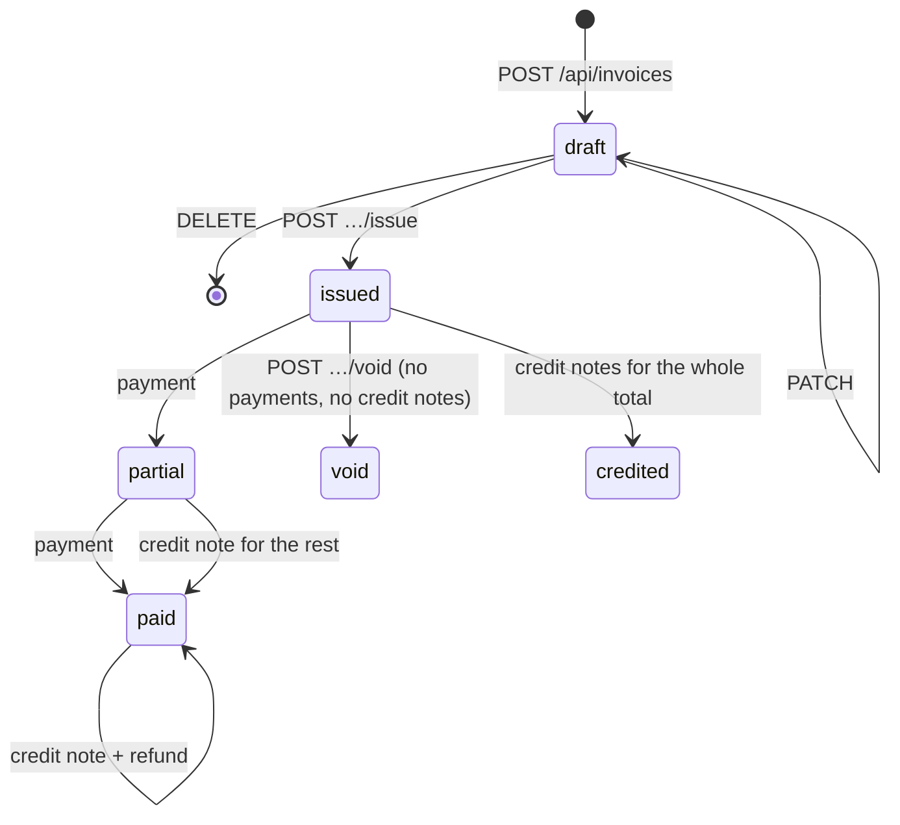

# Finance API reference

Finance's web app is built entirely on this HTTP API: customers, invoices,
credit notes, payments, refunds, expenses, the ledger, approvals, closed
months, settings and the audit log. Use it to script bookkeeping, import
data or build reports. This page lists **every route** in
[`backend/internal/http/router.go`](https://github.com/AGlElectronics/finance/blob/main/backend/internal/http/router.go)
with who may call it, the request and response bodies, the errors and a
`curl` example. How the pieces fit together for the people doing the books
is on [Bookkeeping](bookkeeping.md).

The rules shared by every Con Services module (tokens, error shape, ids,
timestamps) are on [API conventions](../../concepts/api-conventions.md). This
page covers what is specific to Finance, including two differences from most
modules:

- Finance's routes sit directly under **`/api/`** (no `/v1`).
- Create and payment requests need an **`Idempotency-Key`** header, and
  money movements may answer **`202`** because they wait for a second
  person ([four-eyes approval](#approvals)).

## Basics

| What | Value |
| --- | --- |
| Base address (browser, scripts) | The Finance address, for example `https://finance.example.org`. nginx forwards `/api/`, `/livez` and `/readyz` to the backend. |
| Base address (inside the cluster) | `https://finance-backend.conservices-finance.svc.cluster.local:8080` |
| Request bodies | JSON, `Content-Type: application/json`. **Unknown fields are rejected** with `400`. |
| Ids | UUIDs. A malformed id answers `400` `invalid id`. |
| Money | Integer **cents** in the installation's one currency (`FINANCE_CURRENCY`, default EUR; `36300` = 363.00). Never floats. |
| Quantities | Decimal numbers on lines (`1.5`), stored exactly in hundredths: `0.01` to `1000000`. |
| Unit prices | `0` to `1000000000` cents (10,000,000.00). Negative prices are refused; corrections are [credit notes](#credit-notes-and-refunds). |
| Tax rates | Basis points: 21% = `2100`, 9% = `900`, 0% = `0`; `0` to `10000`. |
| Dates | Calendar dates are `YYYY-MM-DD`. Issue, payment, expense, credit note and refund dates cannot be in the future or more than `FINANCE_MAX_BACKDATE_DAYS` (default 366) in the past, nor in a [closed month](#closed-months). Timestamps are RFC 3339 UTC. |
| Lists | Invoices, expenses, the ledger, approvals and the audit log are paginated: `?limit=` (default 50, at most 200) and `?offset=`; the answer carries `total`, `limit` and `offset`. |
| Request id | Every response carries an `X-Request-ID` header; quote it when reporting a problem. |
| Audit | Every change is written to the audit log **in the same database transaction**, with who did it and the values before and after. Read it with [`GET /api/audit`](#get-apiaudit). |

In the examples ([how to get a token](../../concepts/api-conventions.md#get-a-token-for-curl)):

```sh
export FIN=https://finance.example.org
export TOKEN=eyJhbGciOi...   # ID token from Keycloak for the client finance-spa (see below)
```

## Authentication and roles

| Caller | How | Accepted on |
| --- | --- | --- |
| Staff (production, `AUTH_MODE=oidc`) | `Authorization: Bearer <ID token>` from Keycloak, client `finance-spa`, verified against `OIDC_ISSUER_URL` | everything under `/api/` except the role catalog, brand and Den state |
| Local development (`AUTH_MODE=dev`, the default) | `X-Dev-User: <name>` and `X-Dev-Groups: <groups>`, or nothing (`DEV_DEFAULT_USER`, `DEV_DEFAULT_GROUPS`) | the same routes |
| Anyone | nothing | `/livez`, `/readyz`, `/api/role-catalog`, `/api/brand…`, `/api/den/state` |

!!! note "Token type: ID token today"
    Finance currently checks an **OpenID Connect ID token** whose audience is
    `finance-spa` (`OIDC_AUDIENCE`), which is what the web app sends. A
    Keycloak *access* token is refused with `401 invalid token`. Accepting
    access tokens is planned for the whole suite at once; until then scripts
    send the `id_token` field of Keycloak's token answer.

Your token's `groups` claim decides your **roles** (a leading `/` and letter
case are ignored); the [Configuration](configuration.md#roles) page says
how groups map to roles. Each route checks one **permission**:

| Permission | Roles | Allows |
| --- | --- | --- |
| `finance.read` | all four | Reading everything except the audit log. |
| `finance.write` | bookkeeper, admin | Customers, drafts, issuing, and *requesting* voids, payments, credit notes, refunds and expenses. |
| `finance.approve` | approver, admin | Approving or rejecting requests of others, closing months. |
| `finance.audit` | read-only, approver, admin | `GET /api/audit`. |
| `finance.admin` | admin | Reopening months, `PUT /api/settings`, the Den connection. |

Without any Finance role every business route answers `403` `you don't have
access to Finance`; with a role but not the permission, `403` `this needs the
permission finance.write` (for example). `/api/me` and `/api/me/preferences`
only need a valid token, so the web app can tell people *why* they cannot
get in.

!!! danger "Dev mode lets anyone claim any role"
    With `AUTH_MODE=dev` every caller is whoever `X-Dev-User` says, with the
    groups `X-Dev-Groups` says. `AUTH_MODE` defaults to `dev`, so production
    **must** set `AUTH_MODE=oidc`. See [Configuration](configuration.md) and
    [Authentication](../../concepts/authentication.md).

## Idempotency keys

`POST /api/invoices`, `POST /api/invoices/{id}/payments`,
`POST /api/invoices/{id}/credit-notes`, `POST /api/credit-notes/{id}/refunds`
and `POST /api/expenses` need an **`Idempotency-Key`** header: any string up
to 200 characters that is unique for this attempt, for example a UUID.

- Send the **same key** when you retry the same request after a timeout or
  network error. Finance then does nothing new and answers what the first
  request answered, with the header `Idempotent-Replayed: true`.
- Use a **new key** for every new attempt. Reusing a key with a different
  body or path answers `422` `idempotency_key_reused`.
- Keys belong to the caller: two people can use the same key.
- Without the header: `400` `idempotency_key_required`.

```sh
KEY=$(uuidgen)
curl -s -X POST $FIN/api/expenses -H "Idempotency-Key: $KEY" \
  -H "Authorization: Bearer $TOKEN" -H "Content-Type: application/json" \
  -d '{"vendor":"Example Print Shop","amount_cents":4900}'
# The network dropped? Run exactly the same command again with the same $KEY.
```

## Approvals in answers (202)

Voids, payments, expenses, credit notes and refunds whose amount is above
`FINANCE_APPROVAL_THRESHOLD_CENTS` (default `0`, so all of them) are not
carried out at once. The request answers **`202 Accepted`** with the
waiting [approval](#approvals):

```json
{"status":"pending_approval",
 "approval":{"id":"5b1e…","action":"payment.record","target_id":"77d0…","target_number":"FIN-0001",
   "amount_cents":26300,"payload":{"paid_on":"2026-11-20","amount_cents":26300,"method":"bank_transfer",
   "reference":"FIN-0001","note":""},"status":"pending",
   "requested_by":{"name":"bea","issuer":"https://auth.example.org/realms/conservices","subject":"6f1c…"},
   "requested_at":"2026-11-20T09:12:00Z","decided_by":null,"decided_at":null,"decision_note":"","result_id":null}}
```

At or below the threshold the request is carried out and answers as
described for each route (`200` or `201`). Every request is checked in full
before it is stored, and again when it is approved.

## Errors

```json
{"error":{"code":"validation_failed","message":"line 2 is invalid","details":{"quantity":"must be between 0.01 and 1000000"}}}
```

| Status | `code` | Typical cause in Finance |
| --- | --- | --- |
| 400 | `bad_request` | Malformed JSON, unknown field, empty body, bad id, bad `limit`/`offset`, unknown `status` filter. |
| 400 | `idempotency_key_required` | A create or payment request without `Idempotency-Key`. |
| 401 | `unauthorized` | `missing bearer token` or `invalid token` (including an access token instead of an ID token). |
| 403 | `forbidden` | No Finance role, or a role without the route's permission. |
| 403 | `approver_is_requester` | Approving your own request. |
| 404 | `not_found` | `customer not found`, `invoice not found`, `credit note not found`, `expense not found`, `approval not found`. |
| 409 | `conflict` | An action not allowed in the current state: editing an issued invoice, voiding a paid invoice, approving a decided request, closing a closed month. |
| 409 | `period_closed` | A date in a closed month: `2026-10 is closed; an admin must reopen it first`. |
| 422 | `validation_failed` | Field problems; `details` maps field to problem. |
| 422 | `idempotency_key_reused` | The key was used before for a different request. |
| 503 | `storage_unavailable` | Issuing while S3 is not configured or not reachable; nothing was issued. Downloading a PDF while S3 is down. |
| 500 | `internal` | Unexpected failure, including a stored PDF that no longer matches its SHA-256; see the backend log with the request id. |

The Den pairing routes add `pairing_failed` (422) and `sync_failed` (409 when
not paired, 502 when Den cannot be reached).

## Endpoint overview

| # | Method | Path | Permission |
| --- | --- | --- | --- |
| 1 | GET | `/livez` | anyone |
| 2 | GET | `/readyz` | anyone |
| 3 | GET | `/api/role-catalog` | anyone (HR) |
| 4 | GET | `/api/brand` | anyone |
| 5 | GET | `/api/brand/{role}` | anyone |
| 6 | GET | `/api/den/state` | anyone |
| 7 | GET | `/api/me` | signed in |
| 8 | GET | `/api/me/preferences` | signed in |
| 9 | PUT | `/api/me/preferences` | signed in |
| 10 | GET | `/api/dashboard` | `finance.read` |
| 11 | GET | `/api/customers` | `finance.read` |
| 12 | POST | `/api/customers` | `finance.write` |
| 13 | GET | `/api/customers/{id}` | `finance.read` |
| 14 | PATCH | `/api/customers/{id}` | `finance.write` |
| 15 | DELETE | `/api/customers/{id}` | `finance.write` |
| 16 | GET | `/api/invoices` | `finance.read` |
| 17 | POST | `/api/invoices` | `finance.write` + key |
| 18 | GET | `/api/invoices/{id}` | `finance.read` |
| 19 | GET | `/api/invoices/{id}/pdf` | `finance.read` |
| 20 | PATCH | `/api/invoices/{id}` | `finance.write` |
| 21 | DELETE | `/api/invoices/{id}` | `finance.write` |
| 22 | POST | `/api/invoices/{id}/issue` | `finance.write` |
| 23 | POST | `/api/invoices/{id}/void` | `finance.write` (may need approval) |
| 24 | POST | `/api/invoices/{id}/payments` | `finance.write` + key (may need approval) |
| 25 | POST | `/api/invoices/{id}/credit-notes` | `finance.write` + key (may need approval) |
| 26 | GET | `/api/credit-notes/{id}` | `finance.read` |
| 27 | GET | `/api/credit-notes/{id}/pdf` | `finance.read` |
| 28 | POST | `/api/credit-notes/{id}/refunds` | `finance.write` + key (may need approval) |
| 29 | GET | `/api/expenses` | `finance.read` |
| 30 | POST | `/api/expenses` | `finance.write` + key (may need approval) |
| 31 | GET | `/api/expenses/{id}` | `finance.read` |
| 32 | PATCH | `/api/expenses/{id}` | `finance.write` |
| 33 | DELETE | `/api/expenses/{id}` | `finance.write` |
| 34 | GET | `/api/ledger` | `finance.read` |
| 35 | GET | `/api/approvals` | `finance.read` |
| 36 | GET | `/api/approvals/{id}` | `finance.read` |
| 37 | POST | `/api/approvals/{id}/approve` | `finance.approve` |
| 38 | POST | `/api/approvals/{id}/reject` | `finance.approve`, or the requester |
| 39 | GET | `/api/periods` | `finance.read` |
| 40 | POST | `/api/periods/{month}/close` | `finance.approve` |
| 41 | POST | `/api/periods/{month}/reopen` | `finance.admin` |
| 42 | GET | `/api/settings` | `finance.read` |
| 43 | PUT | `/api/settings` | `finance.admin` |
| 44 | GET | `/api/audit` | `finance.audit` |
| 45 | GET | `/api/den` | `finance.admin` |
| 46 | POST | `/api/den/pair` | `finance.admin` |
| 47 | POST | `/api/den/sync` | `finance.admin` |
| 48 | DELETE | `/api/den/pair` | `finance.admin` |

**48 endpoints.** Finance has no `/api/health`; use `/livez` and `/readyz`.

---

## Probes and catalog

### `GET /livez`

Anyone. `200` while the process runs, with the build version and uptime. It
never touches the database.

```sh
curl -s $FIN/livez
```

```json
{"status":"ok","version":"1.0.0-1","uptime_sec":7260}
```

### `GET /readyz`

Anyone. Pings PostgreSQL (2-second timeout).

```json
{"status":"ready","database":"ok"}
```

`503` `{"status":"not_ready","database":"down"}` (or `"not_configured"`)
when the database cannot be reached.

### `GET /api/role-catalog`

Anyone; HR reads it to offer Finance's roles in its access picker. `group`
is the first group configured for the role (`FINANCE_*_GROUPS`), which is
the one HR adds people to.

```sh
curl -s --cacert /etc/conservices-internal-ca/ca.crt https://finance-backend.conservices-finance.svc.cluster.local:8080/api/role-catalog
```

```json
{"module":"finance","display_name":"Finance","description":"Invoices and money tracking.",
 "roles":[
  {"key":"finance_admin","label":"Finance admin","description":"Everything a bookkeeper and an approver can do, plus reopening closed months, Finance settings and the Den connection.",
   "group":"finance_admin","assignable":true,"scope":"global",
   "permissions":["finance.read","finance.write","finance.approve","finance.audit","finance.admin"]},
  {"key":"finance_approver","label":"Finance approver","description":"Approves or rejects voids, payments, expenses, credit notes and refunds requested by someone else, and closes months. Cannot record money itself.",
   "group":"finance_approver","assignable":true,"scope":"global","permissions":["finance.read","finance.approve","finance.audit"]},
  {"key":"finance_bookkeeper","label":"Finance bookkeeper","description":"Keeps customers, invoices and expenses, and requests payments, voids, credit notes and refunds.",
   "group":"finance_bookkeeper","assignable":true,"scope":"global","permissions":["finance.read","finance.write"]},
  {"key":"finance_read-only","label":"Finance read-only","description":"Sees invoices, expenses, the ledger and the audit log; changes nothing. For accountants and auditors.",
   "group":"finance_read-only","assignable":true,"scope":"global","permissions":["finance.read","finance.audit"]}],
 "source":"self","status":"ok"}
```

## Brand and Den state

### `GET /api/brand`

Anyone (the sign-in screen needs it). Den's brand once paired, otherwise
`"source":"standalone"` with an empty theme.

```sh
curl -s $FIN/api/brand
```

```json
{"source":"den","revision":4,"organization_name":"Example Con",
 "logo_url":"/api/brand/logo?v=3f2a…","login_background_url":"/api/brand/login-background?v=91bc…",
 "theme":{"primary":"#0f766e"},"copy":{"login_layout":"panel","login_caption":"Welcome back"}}
```

### `GET /api/brand/{role}`

Anyone. The binary asset copied from Den: `role` is `logo` or
`login-background`. Cached for a day. `404` `no such brand asset` when there
is none.

```sh
curl -s -o logo.png $FIN/api/brand/logo
```

### `GET /api/den/state`

Anyone. Whether the backend waits for Den (`DEN_MODE`) and is paired.

```sh
curl -s $FIN/api/den/state
```

```json
{"mode":"required","paired":true}
```

## You

### `GET /api/me`

Signed in (no Finance role needed). Who you are, your roles and what they
allow.

```sh
curl -s -H "Authorization: Bearer $TOKEN" $FIN/api/me
```

```json
{"username":"alex","issuer":"https://auth.example.org/realms/conservices","subject":"6f1c…",
 "auth_mode":"oidc","has_access":true,"groups":["finance_approver","staff"],
 "roles":["finance_approver"],"permissions":["finance.read","finance.approve","finance.audit"]}
```

`has_access:false` and `roles:[]` with your groups listed means none of them
grants a Finance role.

### `GET /api/me/preferences`

Signed in. Your theme, kept in Den so every module shares it.

```json
{"theme":"dark","updated_at":"2026-11-01T18:20:00Z","synced":true}
```

`synced:false` (theme `system`) when Finance is not paired or Den is
unreachable.

### `PUT /api/me/preferences`

Signed in. Body `{"theme":"system"|"light"|"dark"}`. `200` with the same
shape as `GET`; `422` `theme must be system, light or dark`.

```sh
curl -s -X PUT $FIN/api/me/preferences \
  -H "Authorization: Bearer $TOKEN" -H "Content-Type: application/json" -d '{"theme":"light"}'
```

## Dashboard

### `GET /api/dashboard`

`finance.read`. The money position on the home page, computed live.

```sh
curl -s -H "Authorization: Bearer $TOKEN" $FIN/api/dashboard
```

```json
{
  "outstanding_cents": 120000, "overdue_cents": 36300, "overdue_count": 1,
  "received_month_cents": 50000, "received_total_cents": 410000,
  "spent_month_cents": 12000, "spent_total_cents": 98000, "net_total_cents": 312000,
  "draft_count": 2, "open_count": 4, "pending_approvals": 3,
  "months": [
    {"month":"2026-06","in_cents":0,"out_cents":0},
    {"month":"2026-07","in_cents":80000,"out_cents":20000},
    {"month":"2026-08","in_cents":120000,"out_cents":30000},
    {"month":"2026-09","in_cents":90000,"out_cents":18000},
    {"month":"2026-10","in_cents":70000,"out_cents":18000},
    {"month":"2026-11","in_cents":50000,"out_cents":12000}
  ],
  "recent_invoices": [ { "id":"77d0…", "number":"FIN-0007", "status":"partial", "…": "summary shape" } ]
}
```

| Field | Meaning |
| --- | --- |
| `outstanding_cents` | What customers still owe on issued invoices after credit notes and payments. Void invoices do not count. |
| `overdue_cents`, `overdue_count` | The part of that past its due date. |
| `received_*` | Payments in, this calendar month and all time. |
| `spent_*` | Expenses (not deleted) and refunds out, this month and all time. |
| `net_total_cents` | Cash position: all received minus all spent. |
| `draft_count`, `open_count` | Drafts; issued invoices not fully paid. |
| `pending_approvals` | Requests waiting for a second person. |
| `months` | The last six calendar months, oldest first, including empty ones. |
| `recent_invoices` | The 8 most recently changed invoices (summary shape). |

## Customers

A **customer** is who an invoice is addressed to. Issued invoices keep a
frozen copy of the customer's name, email, address and tax ID, so changing a
customer changes only new invoices.

### The customer object

| Field | Notes |
| --- | --- |
| `id` | UUID. |
| `name` | Required. |
| `email`, `billing_address`, `tax_id`, `notes` | Free text, trimmed; at most 2000 characters each. |
| `archived` | `true` hides the customer from the default list. |
| `invoice_count` | Invoices of any status. |
| `outstanding_cents` | Still owed on this customer's issued invoices. |
| `created_at`, `updated_at` | |

### `GET /api/customers`

`finance.read`. Customers sorted by name (not paginated). Archived ones are
left out unless `?include_archived=true`.

```sh
curl -s -H "Authorization: Bearer $TOKEN" "$FIN/api/customers?include_archived=true"
```

```json
{"customers":[{"id":"a3c1…","name":"Example Hotel","email":"billing@example-hotel.test",
  "billing_address":"1 Main St, Example City","tax_id":"NL000000000B01","notes":"",
  "archived":false,"created_at":"2026-09-01T10:00:00Z","updated_at":"2026-09-01T10:00:00Z",
  "invoice_count":3,"outstanding_cents":26300}]}
```

### `POST /api/customers`

`finance.write`. Body: `name` (required), `email`, `billing_address`,
`tax_id`, `notes`. Answers `201` with the customer. `422` `customer is not
valid` with `details.name: required`.

```sh
curl -s -X POST $FIN/api/customers \
  -H "Authorization: Bearer $TOKEN" -H "Content-Type: application/json" \
  -d '{"name":"Example Hotel","email":"billing@example-hotel.test","billing_address":"1 Main St, Example City"}'
```

```json
{"id":"a3c1…","name":"Example Hotel","email":"billing@example-hotel.test",
 "billing_address":"1 Main St, Example City","tax_id":"","notes":"","archived":false,
 "created_at":"2026-11-06T12:00:00Z","updated_at":"2026-11-06T12:00:00Z","invoice_count":0,"outstanding_cents":0}
```

### `GET /api/customers/{id}`

`finance.read`. One customer. `404` `customer not found`.

### `PATCH /api/customers/{id}`

`finance.write`. Changes only the fields you send, including `archived`
(`true` archives, `false` restores). An empty `name` answers `422`. Answers
`200` with the customer.

```sh
curl -s -X PATCH $FIN/api/customers/a3c1… \
  -H "Authorization: Bearer $TOKEN" -H "Content-Type: application/json" -d '{"archived":true}'
```

### `DELETE /api/customers/{id}`

`finance.write`. Deletes a customer **without invoices**. `204`; `404`;
`409` `customer has invoices; archive it instead`.

## Invoices

An **invoice** starts as a **draft** you can edit freely. **Issuing** it
takes the next gap-free number (`FIN-0001`, …), sets the dates, freezes the
customer and seller details and stores its PDF. Payments then move it to
**partial** and **paid**; credit notes lower what is owed, down to
**credited**. Only an invoice without payments or credit notes can be
**voided**; its number stays taken.



`partial`, `paid` and `credited` are **derived** from payments, credit notes
and refunds, not stored; **overdue** is a separate `true`/`false` flag for
`issued` or `partial` invoices whose `due_date` is before today.

### The invoice object

`GET /api/invoices` returns summaries; every other invoice route returns the
full invoice.

```json
{"id":"77d0…","number":"FIN-0001","customer_id":"a3c1…","customer_name":"Example Hotel",
 "status":"partial","currency":"EUR","issue_date":"2026-11-06","due_date":"2026-12-06","overdue":false,
 "subtotal_cents":30000,"tax_cents":6300,"total_cents":36300,"paid_cents":10000,
 "credited_cents":0,"refunded_cents":0,"due_cents":26300,"refundable_cents":0,
 "created_at":"2026-11-06T12:00:00Z","updated_at":"2026-11-06T12:30:00Z",
 "notes":"Room block 2026",
 "customer":{"name":"Example Hotel","email":"billing@example-hotel.test","address":"1 Main St, Example City","tax_id":"NL000000000B01"},
 "seller":{"name":"Example Con e.V.","address":"Main Street 1\n12345 Example Town","vat_number":"DE123456789"},
 "has_pdf":true,
 "lines":[{"id":"e5f1…","description":"Dealer table","quantity":2,"unit_price_cents":15000,"tax_rate_bp":2100,
           "subtotal_cents":30000,"tax_cents":6300,"total_cents":36300}],
 "payments":[{"id":"b7a2…","paid_on":"2026-11-06","amount_cents":10000,"method":"bank_transfer",
              "reference":"FIN-0001","note":"deposit","created_at":"2026-11-06T12:30:00Z"}],
 "credit_notes":[],"refunds":[],"pending_approvals":[]}
```

| Field | Meaning |
| --- | --- |
| `customer_name`, `customer` | Frozen at issue; on drafts the live customer. |
| `seller` | Frozen at issue; `null` on drafts. |
| `credited_cents` | Sum of the invoice's credit notes. |
| `due_cents` | What the customer still owes: total − credited − (paid − refunded), never below 0. |
| `refundable_cents` | What the customer paid beyond the credited total and has not been paid back. |
| `has_pdf` | The issued PDF is stored and can be downloaded. |
| `pending_approvals` | Requests about this invoice or its credit notes that wait for approval. |

`number` and `issue_date` are left out on drafts. Line totals are computed
per line: `subtotal = quantity × unit_price` and `tax = subtotal ×
tax_rate_bp / 10000`, each rounded half away from zero to whole cents;
totals are the sums of the lines.

### `GET /api/invoices`

`finance.read`. Newest first, paginated. Optional filters:

| Parameter | Values |
| --- | --- |
| `status` | `draft`, `issued`, `partial`, `paid`, `credited`, `void` (the derived status). Anything else: `400`. |
| `customer_id` | One customer's invoices. `400` `invalid customer_id` if not a UUID. |
| `limit`, `offset` | Paging; default 50, at most 200. |

```sh
curl -s -H "Authorization: Bearer $TOKEN" "$FIN/api/invoices?status=partial&limit=20&offset=0"
```

```json
{"invoices":[{"id":"77d0…","number":"FIN-0001","customer_id":"a3c1…","customer_name":"Example Hotel",
  "status":"partial","currency":"EUR","issue_date":"2026-11-06","due_date":"2026-12-06","overdue":false,
  "subtotal_cents":30000,"tax_cents":6300,"total_cents":36300,"paid_cents":10000,
  "credited_cents":0,"refunded_cents":0,"due_cents":26300,"refundable_cents":0,
  "created_at":"2026-11-06T12:00:00Z","updated_at":"2026-11-06T12:30:00Z"}],
 "total":1,"limit":20,"offset":0}
```

### `POST /api/invoices`

`finance.write`, `Idempotency-Key`. Creates a **draft** in
`FINANCE_CURRENCY`.

| Field | Required | Notes |
| --- | --- | --- |
| `customer_id` | yes | Must exist. |
| `lines` | yes, 1 to 200 | Each: `description` (required, at most 1000 characters), `quantity` (0.01–1000000), `unit_price_cents` (0–1000000000), `tax_rate_bp` (0–10000). Quantity × price may be at most 1,000,000,000,000.00. |
| `due_date` | no | `YYYY-MM-DD` between 2000 and 2100. Checked against the issue date when issuing. |
| `notes` | no | Printed on the invoice; at most 5000 characters. |

Answers `201` with the full invoice.

```sh
curl -s -X POST $FIN/api/invoices -H "Idempotency-Key: $(uuidgen)" \
  -H "Authorization: Bearer $TOKEN" -H "Content-Type: application/json" \
  -d '{"customer_id":"a3c1…","notes":"Room block 2026",
       "lines":[{"description":"Dealer table","quantity":2,"unit_price_cents":15000,"tax_rate_bp":2100}]}'
```

| Status | When |
| --- | --- |
| `201` | Draft created (or the first answer again, with `Idempotent-Replayed: true`). |
| `400` | `idempotency_key_required`; bad JSON. |
| `422` | `at least one line is needed`; `at most 200 lines`; `line N is invalid` with `details` for `description`, `quantity`, `unit_price_cents` or `tax_rate_bp`; `customer does not exist`; a bad `due_date`; `idempotency_key_reused`. |

### `GET /api/invoices/{id}`

`finance.read`. The full invoice. `404` `invoice not found`.

### `GET /api/invoices/{id}/pdf`

`finance.read`. The PDF stored when the invoice was issued, byte for byte.
Finance checks it against the SHA-256 it recorded at issue before sending
it.

```sh
curl -s -H "Authorization: Bearer $TOKEN" -o FIN-0001.pdf $FIN/api/invoices/77d0…/pdf
```

```text
HTTP/2 200
content-type: application/pdf
content-disposition: attachment; filename="FIN-0001.pdf"
cache-control: private, no-store
```

| Status | When |
| --- | --- |
| `200` | The PDF. |
| `404` | No such invoice, or no PDF (a draft). |
| `503` | `storage_unavailable`: S3 is not configured or did not answer. |
| `500` | The stored file is missing or no longer matches its SHA-256 (see the backend log); restore it from the bucket's backup. |

### `PATCH /api/invoices/{id}`

`finance.write`. **Replaces** a draft's customer, due date, notes and all its
lines: send the complete body, as for create (fields you leave out are
cleared, and `customer_id` is required). No idempotency key needed: sending
it twice gives the same draft. Answers `200` with the invoice.

```sh
curl -s -X PATCH $FIN/api/invoices/77d0… \
  -H "Authorization: Bearer $TOKEN" -H "Content-Type: application/json" \
  -d '{"customer_id":"a3c1…","due_date":"2026-12-31","notes":"Room block 2026",
       "lines":[{"description":"Dealer table","quantity":3,"unit_price_cents":15000,"tax_rate_bp":2100}]}'
```

Same `422`s as create; `409` `only draft invoices can be edited`; `404`.

### `DELETE /api/invoices/{id}`

`finance.write`. Deletes a **draft**. `204`; `409` `only drafts can be
deleted; void the invoice or issue a credit note instead`; `404`.

### `POST /api/invoices/{id}/issue`

`finance.write`. Issues a draft, in one transaction: takes the next number,
sets the dates, freezes the customer and the [seller
details](configuration.md#seller-details), renders the PDF and stores it in
S3. If storing the PDF fails, nothing is issued and the number is not used.
The body is optional:

| Field | Default | Rules |
| --- | --- | --- |
| `issue_date` | today | Not in the future, at most `FINANCE_MAX_BACKDATE_DAYS` ago, not in a closed month. |
| `due_date` | the draft's due date, else 30 days after `issue_date` | Not before `issue_date`, at most one year after it. |

```sh
curl -s -X POST $FIN/api/invoices/77d0…/issue \
  -H "Authorization: Bearer $TOKEN" -H "Content-Type: application/json" -d '{"issue_date":"2026-11-06"}'
```

Answers `200` with the invoice, now with `"number":"FIN-0001"`,
`"status":"issued"`, `seller` and `"has_pdf":true`.

| Status | When |
| --- | --- |
| `200` | Issued. |
| `409` | `only drafts can be issued`; `period_closed`. |
| `422` | A bad date; `due_date cannot be before issue_date`; a draft without lines; `the seller name and address are needed before issuing` (`details.seller_name`, `details.seller_address`). |
| `503` | `storage_unavailable`: S3 not configured or not reachable. Nothing was issued; fix S3 and try again. |

### `POST /api/invoices/{id}/void`

`finance.write`; may need approval. Cancels an issued invoice that has **no
payments and no credit notes**. The number stays taken. Body:
`{"reason":"…"}` (required). The issue month must be open.

```sh
curl -s -X POST $FIN/api/invoices/77d0…/void \
  -H "Authorization: Bearer $TOKEN" -H "Content-Type: application/json" -d '{"reason":"Sent twice by mistake"}'
```

| Status | When |
| --- | --- |
| `200` | Voided at once (total at or below the approval threshold); the invoice with `"status":"void"`. |
| `202` | Waiting for approval (see [above](#approvals-in-answers-202)). |
| `409` | `an invoice with payments can never be voided; issue a credit note (and a refund) instead`; `an invoice with credit notes cannot be voided`; `drafts are deleted, not voided`; `invoice is already void`; `a void of this invoice is already waiting for approval`; `period_closed`. |
| `422` | `say why the invoice is voided`. |

### `POST /api/invoices/{id}/payments`

`finance.write`, `Idempotency-Key`; may need approval. Records money
received against an issued invoice.

| Field | Required | Notes |
| --- | --- | --- |
| `amount_cents` | yes | More than 0 and at most `due_cents`. |
| `method` | yes | `bank_transfer`, `cash`, `card` or `other`. |
| `paid_on` | no | `YYYY-MM-DD`, default today; see the date rules in [Basics](#basics). |
| `reference` | no | For example the bank transfer's description (at most 200 characters). |
| `note` | no | At most 2000 characters. |

```sh
curl -s -X POST $FIN/api/invoices/77d0…/payments -H "Idempotency-Key: pay-77d0-20261120" \
  -H "Authorization: Bearer $TOKEN" -H "Content-Type: application/json" \
  -d '{"amount_cents":26300,"method":"bank_transfer","paid_on":"2026-11-20","reference":"FIN-0001"}'
```

| Status | When |
| --- | --- |
| `201` | Recorded; the **updated invoice** (`status` now `partial` or `paid`). |
| `202` | Waiting for approval; the payment is not counted until approved. |
| `404` | Invoice not found. |
| `409` | `payments can only be recorded on issued invoices`; `period_closed`. |
| `422` | `amount must be positive`; `amount exceeds what is still owed (N cents)`; `method must be one of: …`; `paid_on cannot be in the future`; `idempotency_key_reused`. |

Payments are never edited or deleted. A wrong payment is corrected with a
credit note and a refund ([Bookkeeping](bookkeeping.md#correct-a-mistake)).

## Credit notes and refunds

A **credit note** corrects an issued invoice. It has its own gap-free
series (`FIN-CN-0001`, `FINANCE_CREDIT_NOTE_PREFIX`), the invoice's frozen
customer and seller details, its own lines and its own stored PDF. It lowers
what the customer owes. When the customer already paid more than the new
total, a **refund** records the money paid back.

### The credit note object

```json
{"id":"c41e…","number":"FIN-CN-0001","invoice_id":"77d0…","invoice_number":"FIN-0001",
 "issue_date":"2026-11-21","reason":"Hall was smaller than booked","currency":"EUR",
 "subtotal_cents":3000,"tax_cents":630,"total_cents":3630,"refunded_cents":3630,"created_at":"2026-11-21T10:00:00Z",
 "customer":{"name":"Example Hotel","email":"billing@example-hotel.test","address":"1 Main St, Example City","tax_id":"NL000000000B01"},
 "seller":{"name":"Example Con e.V.","address":"Main Street 1\n12345 Example Town","vat_number":"DE123456789"},
 "lines":[{"id":"9a0c…","description":"Discount: smaller hall","quantity":1,"unit_price_cents":3000,"tax_rate_bp":2100,
           "subtotal_cents":3000,"tax_cents":630,"total_cents":3630}],
 "refunds":[{"id":"r7d2…","credit_note_id":"c41e…","invoice_id":"77d0…","refunded_on":"2026-11-22",
             "amount_cents":3630,"method":"bank_transfer","reference":"REFUND-1","note":"","created_at":"2026-11-22T08:00:00Z"}]}
```

### `POST /api/invoices/{id}/credit-notes`

`finance.write`, `Idempotency-Key`; may need approval. Body:

| Field | Required | Notes |
| --- | --- | --- |
| `reason` | yes | Printed on the credit note (at most 2000 characters). |
| `full` | either this… | `true` copies every line of an invoice that has no credit notes yet. |
| `lines` | …or this | The credited lines, same rules as invoice lines. Their total must be more than 0 and at most what is left on the invoice (total − earlier credit notes). |
| `issue_date` | no | Default today; the date rules in [Basics](#basics) apply. |

```sh
curl -s -X POST $FIN/api/invoices/77d0…/credit-notes -H "Idempotency-Key: $(uuidgen)" \
  -H "Authorization: Bearer $TOKEN" -H "Content-Type: application/json" \
  -d '{"reason":"Hall was smaller than booked",
       "lines":[{"description":"Discount: smaller hall","quantity":1,"unit_price_cents":3000,"tax_rate_bp":2100}]}'
```

| Status | When |
| --- | --- |
| `201` | Issued; the credit note. The number is taken in the same transaction as the PDF is stored, so the series has no gaps. |
| `202` | Waiting for approval; the number is taken when it is approved. |
| `409` | `credit notes can only correct issued invoices`; `the invoice already has credit notes; list the lines to credit` (with `full`); `period_closed`. |
| `422` | `say why the invoice is corrected`; `send either full or lines, not both`; line problems; `the credit note (N cents) is more than what is left on the invoice (M cents)`. |
| `503` | `storage_unavailable`; nothing was issued. |

### `GET /api/credit-notes/{id}`

`finance.read`. One credit note with lines and refunds. `404` `credit note
not found`.

### `GET /api/credit-notes/{id}/pdf`

`finance.read`. The stored PDF (`FIN-CN-0001.pdf`), checked against its
SHA-256. Same answers as the [invoice PDF](#get-apiinvoicesidpdf).

```sh
curl -s -H "Authorization: Bearer $TOKEN" -o FIN-CN-0001.pdf $FIN/api/credit-notes/c41e…/pdf
```

### `POST /api/credit-notes/{id}/refunds`

`finance.write`, `Idempotency-Key`; may need approval. Records money paid
back against a credit note. Body as for a payment, with `refunded_on`
instead of `paid_on`. `amount_cents` may be at most the invoice's
`refundable_cents` and at most what is left of the credit note.

```sh
curl -s -X POST $FIN/api/credit-notes/c41e…/refunds -H "Idempotency-Key: $(uuidgen)" \
  -H "Authorization: Bearer $TOKEN" -H "Content-Type: application/json" \
  -d '{"amount_cents":3630,"method":"bank_transfer","refunded_on":"2026-11-22","reference":"REFUND-1"}'
```

| Status | When |
| --- | --- |
| `201` | Recorded; the credit note with the refund. The refund shows in the ledger as money out. |
| `202` | Waiting for approval. |
| `404` | `credit note not found`. |
| `409` | `period_closed`. |
| `422` | `amount exceeds what can be refunded (N cents)`; payment-style field problems. |

## Expenses

An **expense** is money going out: venue rent, equipment, travel. Expenses
are **soft-deleted**: a deleted expense stays in the database and the audit
log with its reason, but leaves the ledger and the dashboard. The amount and
date of a recorded expense are fixed (delete it and record it again), so a
change can never bypass approval or a closed month.

### The expense object

| Field | Notes |
| --- | --- |
| `id` | UUID. |
| `occurred_on` | `YYYY-MM-DD`; default today; the date rules in [Basics](#basics) apply. |
| `vendor` | Required. |
| `category` | `venue`, `equipment`, `travel`, `supplies`, `services`, `fees`, `other` (default). |
| `description`, `reference` | Free text. |
| `amount_cents` | Required, more than 0. |
| `method` | `bank_transfer` (default), `cash`, `card`, `other`. |
| `deleted`, `deleted_at`, `deleted_reason` | Set once deleted. |
| `created_at`, `updated_at` | |

### `GET /api/expenses`

`finance.read`. Newest first (by `occurred_on`), paginated. Optional
`?category=venue` (an unknown category returns an empty list) and
`?include_deleted=true`.

```sh
curl -s -H "Authorization: Bearer $TOKEN" "$FIN/api/expenses?category=venue&limit=50"
```

```json
{"expenses":[{"id":"c0d4…","occurred_on":"2026-11-02","vendor":"Example Convention Centre",
  "category":"venue","description":"Hall B deposit","amount_cents":250000,"method":"bank_transfer",
  "reference":"INV-88231","created_at":"2026-11-02T09:00:00Z","updated_at":"2026-11-02T09:00:00Z","deleted":false}],
 "total":1,"limit":50,"offset":0}
```

### `POST /api/expenses`

`finance.write`, `Idempotency-Key`; may need approval. Body: the fields
above (`vendor` and `amount_cents` required).

```sh
curl -s -X POST $FIN/api/expenses -H "Idempotency-Key: $(uuidgen)" \
  -H "Authorization: Bearer $TOKEN" -H "Content-Type: application/json" \
  -d '{"occurred_on":"2026-11-02","vendor":"Example Convention Centre","category":"venue",
       "description":"Hall B deposit","amount_cents":250000,"reference":"INV-88231"}'
```

| Status | When |
| --- | --- |
| `201` | Recorded; the expense. |
| `202` | Waiting for approval; the expense is created when approved (`result_id` of the approval). |
| `409` | `period_closed`. |
| `422` | `expense is not valid` with `details` such as `vendor: required`, `amount_cents: must be positive`, `category: unknown category`, `method: unknown method`, `occurred_on: use YYYY-MM-DD`; `occurred_on cannot be in the future`. |

### `GET /api/expenses/{id}`

`finance.read`. One expense, deleted or not. `404` `expense not found`.

### `PATCH /api/expenses/{id}`

`finance.write`. Changes `vendor`, `category`, `description`, `method` or
`reference`. Sending a different `amount_cents` or `occurred_on` answers
`422` `the amount and date of a recorded expense are fixed`. `409` for a
deleted expense or a closed month. Answers `200` with the expense.

```sh
curl -s -X PATCH $FIN/api/expenses/c0d4… \
  -H "Authorization: Bearer $TOKEN" -H "Content-Type: application/json" -d '{"description":"Hall B deposit (50%)"}'
```

### `DELETE /api/expenses/{id}`

`finance.write`. Soft-deletes an expense. The reason is required, in a JSON
body or as `?reason=`.

```sh
curl -s -X DELETE "$FIN/api/expenses/c0d4…?reason=Booked%20twice" -H "Authorization: Bearer $TOKEN"
```

`204`; `404`; `409` `expense is already deleted` or `period_closed`; `422`
`say why the expense is deleted`.

## Ledger

### `GET /api/ledger`

`finance.read`. Every payment (in), refund (out) and not-deleted expense
(out) as one stream, newest first, with the running cash balance after each
entry. Paginated; the totals cover everything, not only the page.

```sh
curl -s -H "Authorization: Bearer $TOKEN" "$FIN/api/ledger?limit=50&offset=0"
```

```json
{"in_cents":36300,"out_cents":253630,"net_cents":-217330,"total":4,"limit":50,"offset":0,
 "entries":[
   {"id":"r7d2…","day":"2026-11-22","direction":"out","kind":"refund","amount_cents":3630,"counterparty":"Example Hotel",
    "detail":"FIN-CN-0001","method":"bank_transfer","invoice_id":"77d0…","balance_cents":-217330},
   {"id":"b7a2…","day":"2026-11-20","direction":"in","kind":"payment","amount_cents":26300,"counterparty":"Example Hotel",
    "detail":"FIN-0001","method":"bank_transfer","invoice_id":"77d0…","balance_cents":-213700},
   {"id":"b6a1…","day":"2026-11-06","direction":"in","kind":"payment","amount_cents":10000,"counterparty":"Example Hotel",
    "detail":"FIN-0001","method":"bank_transfer","invoice_id":"77d0…","balance_cents":-240000},
   {"id":"c0d4…","day":"2026-11-02","direction":"out","kind":"expense","amount_cents":250000,
    "counterparty":"Example Convention Centre","detail":"venue","method":"bank_transfer","balance_cents":-250000}
 ]}
```

`counterparty` is the customer (payment, refund) or vendor (expense);
`detail` is the invoice number, credit note number or expense category.

## Approvals

Four-eyes requests ([Bookkeeping](bookkeeping.md#four-eyes-approval)).

### The approval object

| Field | Notes |
| --- | --- |
| `action` | `invoice.void`, `payment.record`, `expense.create`, `credit_note.issue`, `refund.record`. |
| `target_id`, `target_number` | The invoice (void, payment, credit note) or credit note (refund); `null` for an expense. |
| `amount_cents` | What is compared with the threshold (the invoice total for a void). |
| `payload` | The request as it will be carried out, with defaults filled in (for example the date). |
| `status` | `pending`, `approved`, `rejected`. |
| `requested_by`, `decided_by` | `{name, issuer, subject}`. |
| `decision_note` | The approver's note or the reason for rejecting. |
| `result_id` | What the approval created: the payment, expense, credit note or refund (the invoice for a void). |

### `GET /api/approvals`

`finance.read`. Newest first, paginated; `?status=pending|approved|rejected`.

```sh
curl -s -H "Authorization: Bearer $TOKEN" "$FIN/api/approvals?status=pending"
```

```json
{"approvals":[{"id":"5b1e…","action":"payment.record","target_id":"77d0…","target_number":"FIN-0001",
  "amount_cents":26300,"payload":{"paid_on":"2026-11-20","amount_cents":26300,"method":"bank_transfer","reference":"FIN-0001","note":""},
  "status":"pending","requested_by":{"name":"bea","issuer":"https://auth.example.org/realms/conservices","subject":"6f1c…"},
  "requested_at":"2026-11-20T09:12:00Z","decided_by":null,"decided_at":null,"decision_note":"","result_id":null}],
 "total":1,"limit":50,"offset":0}
```

### `GET /api/approvals/{id}`

`finance.read`. One approval. `404` `approval not found`.

### `POST /api/approvals/{id}/approve`

`finance.approve`. Carries the request out, in one transaction with the
approval and its audit events. The approver must be **a different person**
from the requester (compared by issuer and subject), even an admin. Body
optional: `{"note":"…"}`.

```sh
curl -s -X POST $FIN/api/approvals/5b1e…/approve \
  -H "Authorization: Bearer $TOKEN" -H "Content-Type: application/json" -d '{"note":"Matches the bank statement"}'
```

| Status | When |
| --- | --- |
| `200` | Approved; the approval with `status:"approved"` and `result_id`. |
| `403` | `approver_is_requester`; or no `finance.approve`. |
| `409` | `this request was already approved` (or `rejected`); the request can no longer be carried out (for example the invoice was paid meanwhile, or the month was closed). The request stays pending; reject it. |
| `422` | The request no longer passes its checks (for example the amount is now more than what is owed). |

### `POST /api/approvals/{id}/reject`

`finance.approve`, or the person who made the request (to withdraw it).
Body `{"note":"…"}` (required). `200` with `status:"rejected"`; `409` when
already decided; `422` `say why the request is rejected`.

```sh
curl -s -X POST $FIN/api/approvals/5b1e…/reject \
  -H "Authorization: Bearer $TOKEN" -H "Content-Type: application/json" -d '{"note":"Wrong invoice"}'
```

## Closed months

### `GET /api/periods`

`finance.read`. The closed months, newest first.

```json
{"closed":[{"month":"2026-10","closed_at":"2026-11-03T08:00:00Z",
  "closed_by":{"name":"aki","issuer":"https://auth.example.org/realms/conservices","subject":"9d3e…"}}]}
```

### `POST /api/periods/{month}/close`

`finance.approve`. Closes a month (`YYYY-MM`, the current month or earlier).
Afterwards nothing dated in it can be issued, paid, refunded, credited,
voided (by issue date), recorded, changed or deleted.

```sh
curl -s -X POST -H "Authorization: Bearer $TOKEN" $FIN/api/periods/2026-10/close
```

`201` with the closure; `409` `2026-10 is already closed`; `422` for a
malformed or future month.

### `POST /api/periods/{month}/reopen`

`finance.admin`. Reopens a closed month. Body `{"reason":"…"}` (required);
the reason and the earlier closure go into the audit log.

```sh
curl -s -X POST $FIN/api/periods/2026-10/reopen \
  -H "Authorization: Bearer $TOKEN" -H "Content-Type: application/json" -d '{"reason":"Late bank statement for October"}'
```

`204`; `409` `2026-10 is not closed`; `422` `say why the month is reopened`.

## Settings

### `GET /api/settings`

`finance.read`. The seller details new invoices will print, where each comes
from, and the installation settings.

```sh
curl -s -H "Authorization: Bearer $TOKEN" $FIN/api/settings
```

```json
{"seller":{"name":"Example Con e.V.","address":"Main Street 1\n12345 Example Town","vat_number":"DE123456789"},
 "sources":{"name":"den","address":"den","vat_number":"finance"},
 "overrides":{"name":"","address":"","vat_number":"DE123456789"},
 "den":{"name":"Example Con e.V.","address":"Main Street 1\n12345 Example Town","vat_number":""},
 "den_paired":true,
 "currency":"EUR","default_vat_rate_bp":2000,"invoice_prefix":"FIN-","credit_note_prefix":"FIN-CN-",
 "approval_threshold_cents":0,"max_backdate_days":366,"storage_configured":true}
```

`sources` is `finance` (Finance's override), `den` (Den → Module settings)
or `unset`.

### `PUT /api/settings`

`finance.admin`. Sets Finance's seller overrides. Send only the fields to
change; an empty string clears an override so Den's value applies again.
At most 500 characters each.

```sh
curl -s -X PUT $FIN/api/settings \
  -H "Authorization: Bearer $TOKEN" -H "Content-Type: application/json" \
  -d '{"seller_name":"Example Con e.V.","seller_address":"Main Street 1\n12345 Example Town","seller_vat_number":"DE123456789"}'
```

`200` with the settings; `422` for a value that is too long. Invoices
already issued keep their details.

## Audit log

### `GET /api/audit`

`finance.audit`. Every change, newest first, paginated. Filters:

| Parameter | Matches |
| --- | --- |
| `entity_type` | `invoice`, `credit_note`, `expense`, `customer`, `approval`, `period`, `settings`, `den_link`. |
| `entity_id` | One record. |
| `action` | Exactly (`payment.recorded`) or as a prefix (`invoice` finds `invoice.created`, `invoice.issued`, …). |
| `actor` | Part of the name, or the exact subject. |

```sh
curl -s -H "Authorization: Bearer $TOKEN" "$FIN/api/audit?entity_type=invoice&entity_id=77d0…"
```

```json
{"events":[
  {"id":"e1…","occurred_at":"2026-11-20T09:30:00Z",
   "actor":{"name":"aki","issuer":"https://auth.example.org/realms/conservices","subject":"9d3e…"},
   "action":"payment.recorded","entity_type":"invoice","entity_id":"77d0…",
   "metadata":{"payment_id":"b7a2…","approval_id":"5b1e…"},"before":null,
   "after":{"paid_on":"2026-11-20","amount_cents":26300,"method":"bank_transfer","reference":"FIN-0001","note":""}},
  {"id":"e0…","occurred_at":"2026-11-06T12:05:00Z",
   "actor":{"name":"bea","issuer":"https://auth.example.org/realms/conservices","subject":"6f1c…"},
   "action":"invoice.issued","entity_type":"invoice","entity_id":"77d0…","metadata":null,"before":null,
   "after":{"number":"FIN-0001","issue_date":"2026-11-06","due_date":"2026-12-06","total_cents":36300,"pdf_sha256":"5c9f…"}}],
 "total":2,"limit":50,"offset":0}
```

Actions: `customer.created|updated|deleted`, `invoice.created|updated|deleted|issued|voided`,
`payment.recorded`, `credit_note.issued`, `refund.recorded`,
`expense.created|updated|deleted`, `approval.requested|approved|rejected`,
`period.closed|reopened`, `settings.updated`, `den.paired|synced|unpaired`.
The database refuses to change or delete audit events.

## Den pairing

Pairing connects Finance to Den for brand, shared preferences and the seller
details ([Pairing](../../concepts/pairing.md)). These routes need
`finance.admin`. Pairing, syncing and unpairing are written to the audit
log.

### `GET /api/den`

```json
{"paired":true,"den_base_url":"https://den-backend.conservices-den.svc.cluster.local:8080",
 "module_id":"3c9d…","paired_at":"2026-11-01T09:00:00Z","synced_at":"2026-11-06T11:55:00Z"}
```

Unpaired: `{"paired":false}`. `last_error` appears when the last sync failed.

### `POST /api/den/pair`

Body `{"pairing_url":"…"}` with the one-time link from Den's **Modules**
page. `200` with the status; `422` `pairing_failed` with Den's reason.

```sh
curl -s -X POST $FIN/api/den/pair \
  -H "Authorization: Bearer $TOKEN" -H "Content-Type: application/json" \
  -d '{"pairing_url":"https://den.example.org/pair/abc123…"}'
```

### `POST /api/den/sync`

Fetches brand and settings now. `200` with the status; `409` `sync_failed`
when not paired; `502` when Den cannot be reached.

### `DELETE /api/den/pair`

Forgets the pairing. `204`.

## Troubleshooting

| Symptom | Likely cause and fix |
| --- | --- |
| `401` `invalid token` with a token that works elsewhere | You sent a Keycloak **access** token; Finance checks the **ID token** (audience `finance-spa`) for now. Use the `id_token` of the token answer. |
| `403` `you don't have access to Finance` | `GET /api/me` shows your `groups` and `roles`. Give the person a Finance role in HR (or add them to a group in `FINANCE_*_GROUPS`) and get a fresh token. If `groups` is empty, the Keycloak client is missing the groups mapper. |
| `403` `this needs the permission finance.write` | Your role may not do that: approvers do not record money, bookkeepers do not approve. |
| `403` `approver_is_requester` | Someone else with the approver role must approve it. |
| `400` `idempotency_key_required` | Add `-H "Idempotency-Key: $(uuidgen)"`. |
| `422` `idempotency_key_reused` | You changed the body but kept the key. Use a new key for a new request. |
| `409` `period_closed` | The date is in a closed month. Use a date in an open month, or ask an admin to reopen it (`POST /api/periods/{month}/reopen`). |
| `409` `an invoice with payments can never be voided` | Issue a credit note (and a refund if money goes back). |
| `422` `the seller name and address are needed before issuing` | Set them in Den → Module settings → Finance, or on Finance's Settings page. |
| `503` `storage_unavailable` when issuing | S3 is not configured (`S3_*`) or not reachable. Nothing was issued; fix S3 and issue again. |
| `400` `invalid JSON: json: unknown field "…"` | Finance rejects unknown fields; check spelling (`unit_price_cents`, not `unit_price`). |
| `422` `line 1 is invalid` `unit_price_cents` | Prices are between 0 and 1000000000 cents; discounts are a credit note or a lower price. |
| Totals off by a cent from your spreadsheet | Finance rounds tax **per line**, half away from zero. Round per line in the spreadsheet too. |
