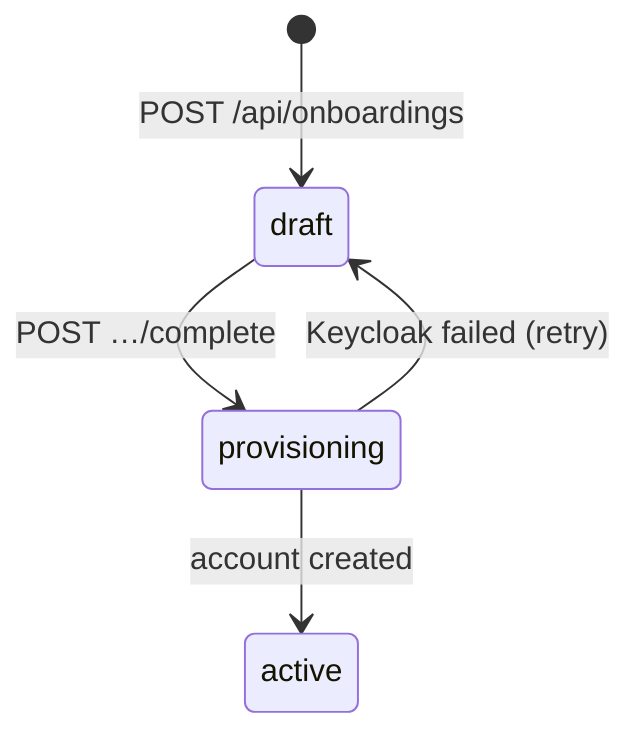

# HR API reference

HR's backend is a JSON-over-HTTP API for everything that happens to a
person in Con Services: the volunteer register, **onboarding** (profile,
department, planned access), **provisioning** of their Keycloak account,
access changes, pausing and **offboarding**, plus departments, training
requirements for roles, and HR's settings. HR's own web app is one client
of it; you can use the same endpoints to script bulk onboarding, connect an
applicant form, or build reports. HR has no machine-to-machine API of its
own: every call is made by a signed-in person who is allowed to use HR.

This page lists all **48 endpoints**, taken from
[`backend/internal/http/router.go`](https://github.com/AGlElectronics/hr/blob/main/backend/internal/http/router.go)
and the handlers and services behind it. What all modules share (error
shape, request IDs, health probes, how tokens are checked) is on
[API conventions](../../concepts/api-conventions.md); how sign-in works is
on [Authentication](../../concepts/authentication.md).

## Basics

### Base URL and routing

HR is reached at its own address. The Gateway sends every request to
`hr-frontend`, whose nginx passes `/api/`, `/livez` and `/readyz` on to
`hr-backend`. The examples on this page use the
[local example installation](../../getting-started/den-quickstart.md):

```sh
HR=https://hr.conservices.test
```

| From | Address |
| --- | --- |
| Your computer, scripts, the web app | `https://hr.conservices.test` (your own domain in a real installation) |
| Inside the cluster | `https://hr-backend.conservices-hr.svc.cluster.local:8080`, only from namespaces the [network policies](../../operations/network-policies.md) allow |
| Docker Compose development stack | the backend's published port; see [Setup](setup.md#development-with-docker) |

!!! note "No `/v1` segment"
    HR serves its signed-in endpoints directly under `/api/…` (for example
    `GET /api/people`), not under `/api/v1/…` like Den and Rally. Copy paths
    from this page.

Collection paths are mounted with a trailing slash in the router
(`/api/people/`), and chi also matches them without it, so
`GET /api/people` and `GET /api/people/` are the same request.

### Authenticating to HR

HR has **one level of access**: you either may use HR or you may not.

| Mode | What to send | Who gets in |
| --- | --- | --- |
| `AUTH_MODE=oidc` (every real installation) | `Authorization: Bearer <ID token>` issued by Keycloak to the `hr-spa` client (or a token whose audience matches `OIDC_AUDIENCE`). | Anyone with a valid token is **signed in**. Only people whose `groups` claim contains one of `HR_ACCESS_GROUPS` (default `hr-admin`, matched case-insensitively, with or without Keycloak's leading `/`) have **HR access**. |
| `AUTH_MODE=dev` (local development only) | `X-Dev-User: <name>`, or nothing (then `DEV_DEFAULT_USER`, default `dev-hr-admin`). | Everyone, with HR access. |

Every endpoint below is marked with one of:

- **public**: no token;
- **signed in**: any valid token;
- **HR access**: signed in and in an HR access group.

Authentication errors:

| Status | Body | When |
| --- | --- | --- |
| 401 | `{"error":{"code":"unauthorized","message":"missing bearer token"}}` | No `Authorization: Bearer` header. |
| 401 | `{"error":{"code":"unauthorized","message":"invalid token"}}` | Expired, wrong issuer, or issued for another client (for example a `den-spa` token). |
| 403 | `{"error":{"code":"forbidden","message":"you don't have access to HR"}}` | Signed in but not in `HR_ACCESS_GROUPS`. Check with [`GET /api/me`](#get-apime). |

#### Getting a token for testing

!!! danger "Local development only"
    This uses Keycloak's password grant and the local realm's dev account
    `admin` / `adminadmin` (a member of `hr-admin`). Real installations
    must turn off direct access grants for app clients, and the dev
    accounts must not exist there. See [Secrets](../../operations/secrets.md).

=== "macOS / Linux"

    ```sh
    TOKEN=$(curl -s https://auth.conservices.test/realms/conservices/protocol/openid-connect/token \
      -d grant_type=password -d client_id=hr-spa \
      -d username=admin -d password=adminadmin -d scope=openid \
      | jq -r .id_token)
    ```

=== "Windows (PowerShell)"

    ```powershell
    $TOKEN = (Invoke-RestMethod -Method Post `
      -Uri https://auth.conservices.test/realms/conservices/protocol/openid-connect/token `
      -Body @{ grant_type='password'; client_id='hr-spa'; username='admin'; password='adminadmin'; scope='openid' }).id_token
    ```

Tokens last 5 minutes in the local realm. The `curl` examples below use
bash syntax with `$HR` and `$TOKEN`. In dev mode replace the
`Authorization` header with `-H "X-Dev-User: dev-hr-admin"`.

### Requests, responses and errors

- Bodies are JSON. Unknown fields are rejected with
  `400 bad_request` (`invalid JSON: json: unknown field "…"`); an empty body
  where one is required gives `400 request body is empty`.
- IDs are UUIDs; a malformed one in the path gives `400 invalid id`.
- Times are RFC 3339 (`2026-11-06T09:00:00Z`); dates of birth are
  `YYYY-MM-DD`.
- Lists answer `{"items": [...]}` and are not paginated.
- Every response carries `X-Request-ID`. Requests are cut off after 60
  seconds.
- No HR endpoint is rate limited (HR never answers `429`). The address
  lookup throttles itself instead, see
  [`GET /api/address/search`](#get-apiaddresssearch).

Errors use the shared shape `{"error":{"code","message","details"}}`:

| Status | `code` | Typical cause in HR |
| --- | --- | --- |
| 400 | `bad_request` | Malformed JSON, unknown field, bad UUID. |
| 401 | `unauthorized` | No or invalid token. |
| 403 | `forbidden` | Not in an HR access group. |
| 404 | `not_found` | `person not found`, `department not found`, `employment_draft not found`, `pending grant not found`, `role requirement not found`. |
| 409 | `conflict` | The action does not fit the current state, for example completing an onboarding that is not a draft, or editing settings that Den manages. |
| 422 | `validation_failed` | Field errors in `details`, keyed by field path (`address.city`, `emergency_contact.phone`). |
| 502 | `upstream_failed` | Keycloak or another system failed; the message says what to check. |
| 500 | `internal` | A bug or database failure; details only in HR's log. |

The Den pairing endpoints answer with their own codes (`pairing_failed`,
`sync_failed`), described with them.

---

## Endpoint summary

| Method | Path | Access | Section |
| --- | --- | --- | --- |
| GET | `/livez`, `/readyz` | public | [Health](#health-and-catalog) |
| GET | `/api/role-catalog` | public | [Health](#health-and-catalog) |
| GET | `/api/brand`, `/api/brand/{role}` | public | [Brand](#brand-and-preferences) |
| GET | `/api/me` | signed in | [You](#you) |
| GET, PUT | `/api/me/preferences` | signed in | [Brand](#brand-and-preferences) |
| GET, POST | `/api/people` | HR access | [People](#people) |
| GET, PUT | `/api/people/{id}` | HR access | [People](#people) |
| GET, PUT | `/api/people/{id}/access` | HR access | [Access](#access-of-one-person) |
| POST | `/api/people/{id}/status` | HR access | [Lifecycle](#pause-and-reactivate) |
| POST | `/api/people/{id}/offboard` | HR access | [Offboarding](#offboarding) |
| GET, POST | `/api/departments` | HR access | [Departments](#departments) |
| GET, PUT | `/api/departments/{id}` | HR access | [Departments](#departments) |
| POST | `/api/onboardings` | HR access | [Onboarding](#onboarding) |
| GET | `/api/onboardings/{id}` | HR access | [Onboarding](#onboarding) |
| PUT | `/api/onboardings/{id}/details` | HR access | [Onboarding](#onboarding) |
| POST | `/api/onboardings/{id}/complete` | HR access | [Provisioning](#complete-an-onboarding-provisioning) |
| GET, POST | `/api/drafts` | HR access | [Drafts](#employment-drafts-low-level) |
| GET | `/api/drafts/{id}` | HR access | [Drafts](#employment-drafts-low-level) |
| PUT | `/api/drafts/{id}/roles` | HR access | [Drafts](#employment-drafts-low-level) |
| GET | `/api/drafts/{id}/provisioning-jobs` | HR access | [Provisioning](#get-apidraftsidprovisioning-jobs) |
| POST | `/api/drafts/{id}/notify` | HR access | [Drafts](#post-apidraftsidnotify) |
| GET | `/api/access-catalog` | HR access | [Catalogs](#catalogs-and-training-requirements) |
| GET | `/api/qualification-catalog` | HR access | [Catalogs](#catalogs-and-training-requirements) |
| GET, POST | `/api/role-requirements` | HR access | [Catalogs](#catalogs-and-training-requirements) |
| DELETE | `/api/role-requirements/{id}` | HR access | [Catalogs](#catalogs-and-training-requirements) |
| GET | `/api/pending-grants` | HR access | [Catalogs](#pending-grants) |
| POST | `/api/pending-grants/{id}/override` | HR access | [Catalogs](#pending-grants) |
| GET, PUT | `/api/settings` | HR access | [Settings](#settings) |
| GET | `/api/den` | HR access | [Den pairing](#den-pairing) |
| POST, DELETE | `/api/den/pair` | HR access | [Den pairing](#den-pairing) |
| POST | `/api/den/sync` | HR access | [Den pairing](#den-pairing) |
| GET | `/api/check/email`, `/api/check/username` | HR access | [Checks](#checks-and-helpers) |
| GET | `/api/address/search` | HR access | [Checks](#checks-and-helpers) |
| GET | `/api/dashboard` | HR access | [Checks](#checks-and-helpers) |
| GET | `/api/idp/groups` | HR access | [Checks](#checks-and-helpers) |

---

## Health and catalog

### `GET /livez`

Is the process running? Never touches the database. **Access:** public.
Not routed through the Gateway; forward the port to try it:

```sh
kubectl -n conservices-hr port-forward deploy/hr-backend 8080:8080
curl -sk https://localhost:8080/livez
```

The backend serves HTTPS with a certificate for its service name, not for
`localhost`, so `-k` skips the name check for this local test only.

```json
{"status":"ok","version":"1.0.0-1","uptime_sec":930}
```

### `GET /readyz`

Can HR serve traffic? Pings the database (2-second limit). **Access:** public.

```sh
curl -sk https://localhost:8080/readyz
```

```json
{"status":"ready","database":"ok"}
```

When the database does not answer: **503** with
`{"status":"not_ready","database":"down"}`.

### `GET /api/role-catalog`

HR's own roles in the shared role-catalog format, so other tools can show
them. **Access:** public.

```sh
curl -s $HR/api/role-catalog
```

```json
{
  "module": "hr",
  "display_name": "HR",
  "description": "Onboarding, people and access.",
  "roles": [
    {
      "key": "admin",
      "label": "HR admin",
      "description": "Onboard and offboard people, manage departments and access.",
      "group": "hr-admin",
      "assignable": true,
      "scope": "organization",
      "permissions": ["people.manage", "drafts.manage", "provision.run"]
    }
  ],
  "source": "self",
  "status": "ok"
}
```

The catalog is fixed in code: `group` is always `hr-admin`, even if you
changed `HR_ACCESS_GROUPS`.

---

## You

### `GET /api/me`

Who HR thinks you are and whether you may use it. The first thing to check
when someone gets `you don't have access to HR`. **Access:** signed in.

```sh
curl -s -H "Authorization: Bearer $TOKEN" $HR/api/me
```

```json
{
  "username": "Dev Admin",
  "auth_mode": "oidc",
  "has_access": true,
  "groups": ["/den-admin", "/events-admin", "/hr-admin", "/stash-admin"]
}
```

| Field | Meaning |
| --- | --- |
| `username` | Display name built from the token (name, else preferred username). Used as the actor in HR's audit log. |
| `auth_mode` | `oidc` or `dev`. |
| `has_access` | Whether one of `groups` is in `HR_ACCESS_GROUPS`. Always `true` in dev mode. |
| `groups` | The token's `groups` (and `roles`) claim. Empty in dev mode. |

---

## Brand and preferences

These follow the same pattern in every paired module. HR copies Den's brand
and serves it itself, so browsers never call Den.

### `GET /api/brand`

The active brand for HR's sign-in screen and theme. **Access:** public.
`Cache-Control: no-cache`.

```sh
curl -s $HR/api/brand
```

Paired with Den:

```json
{
  "source": "den",
  "revision": 10,
  "organization_name": "Example Con e.V.",
  "logo_url": "/api/brand/logo?v=9e8d7c6b-5a4f-4e3d-2c1b-0a9f8e7d6c5b",
  "login_background_url": "/api/brand/login-background?v=1a2b3c4d-5e6f-4a7b-8c9d-0e1f2a3b4c5d",
  "theme": { "primary": "#e44763" },
  "copy": { "convention_name": "Example Con 2027", "login_layout": "panel" }
}
```

Not paired: `{"source":"standalone","revision":0,"organization_name":"","theme":{},"copy":{}}`.
The URLs are only present when Den has that asset.

### `GET /api/brand/{role}`

A brand file copied from Den: `logo` or `login-background`. **Access:**
public. Served with its content type and `Cache-Control: public, max-age=86400`.

```sh
curl -s -o logo.svg $HR/api/brand/logo
```

Errors: **404** `{"error":{"code":"not_found","message":"no such brand asset"}}`
when HR is not paired or Den has no such asset.

### `GET /api/me/preferences`

Your theme. Stored in Den (shared by every app) when HR is paired.
**Access:** signed in.

```sh
curl -s -H "Authorization: Bearer $TOKEN" $HR/api/me/preferences
```

```json
{"theme":"dark","updated_at":"2026-11-06T09:12:44Z","synced":true}
```

`synced` is `false` when HR is standalone or Den could not be reached; the
answer is then `{"theme":"system","updated_at":null,"synced":false}` and
the web app keeps the choice cached in the browser. This endpoint never
fails because of Den.

### `PUT /api/me/preferences`

Save your theme. **Access:** signed in.

| Field | Type | Required | Values |
| --- | --- | --- | --- |
| `theme` | string | yes | `system`, `light`, `dark` |

```sh
curl -s -X PUT -H "Authorization: Bearer $TOKEN" -H "Content-Type: application/json" \
  -d '{"theme":"dark"}' $HR/api/me/preferences
```

```json
{"theme":"dark","updated_at":"2026-11-06T09:15:02Z","synced":true}
```

Errors: **400** `invalid JSON body`, **422** `theme must be system, light or dark`.
If Den cannot store it, HR still answers **200** with
`{"theme":"dark","updated_at":null,"synced":false}`.

---

## People

A **person** is HR's record of one volunteer or staff member. It survives
onboardings and access changes; offboarding deletes it.

### The person object

```json
{
  "id": "a9b8c7d6-1111-4e2f-8a9b-0c1d2e3f4a5b",
  "first_name": "Alex",
  "last_name": "Sample",
  "nickname": "alex",
  "username": "alex",
  "date_of_birth": "1996-04-12",
  "is_banned": false,
  "legal_name": "Alex Sample",
  "display_name": "alex",
  "email": "alex.sample@mail.example",
  "org_email": "alex.sample@example.org",
  "phone": "+436601234567",
  "address": { "street": "Hauptstraße 1", "postal_code": "1010", "city": "Wien", "country": "AT" },
  "social_handles": { "telegram": "@alexsample" },
  "emergency_contact": { "name": "Sam Sample", "phone": "+436609876543", "email": "sam@mail.example", "comments": "Sibling" },
  "status": "active",
  "notes": "Prefers night shifts.",
  "created_at": "2026-11-03T18:20:11Z",
  "updated_at": "2026-11-06T09:05:00Z"
}
```

| Field | Notes |
| --- | --- |
| `username` | Login name, computed from the username template (default `{nickname}`, falling back to `{first}.{last}`); read-only. |
| `legal_name`, `display_name` | Computed: first + last, and the nickname (else the legal name). |
| `email` | Private address; account emails (set-password links, notices) go here. |
| `org_email` | Organisation address; must end with `@<org_email_domain>` when a domain is set. |
| `phone` | Stored in E.164 form. |
| `status` | `applicant`, `onboarding`, `active` or `paused`. There is no `offboarded`: offboarding deletes the person. |
| `social_handles` | Keys `telegram`, `discord`, `x`, `instagram`, `bluesky`, `mastodon`. |

### The person body (create and update)

Used by `POST /api/people`, `PUT /api/people/{id}` and the `person` field
of onboarding.

| Field | Type | Required | Rules |
| --- | --- | --- | --- |
| `first_name`, `last_name` | string | yes | Letters (any script), spaces, `.`, `-`, `'`; must start with a letter. |
| `nickname` | string | yes | Same rule. Must give a login name of at least 3 letters that nobody else (in HR or Keycloak) uses. |
| `date_of_birth` | string `YYYY-MM-DD` | yes | Realistic (not in the future, not over 120 years ago). |
| `email` | string | yes | Valid ASCII address, unique in HR. Lower-cased. |
| `phone` | string | yes | Valid number; international form, or national form for `default_country`. Rewritten to E.164. |
| `address` | object | yes | `street`, `postal_code`, `city`, `country` (two-letter ISO code), all required. |
| `emergency_contact` | object | `name` and `phone` required | `email` and `comments` optional. |
| `org_email` | string | no | Unique; lower-case letters, digits, `.`, `-`, `_` before the `@`. |
| `social_handles` | object | no | Known networks only; empty values are dropped. |
| `is_banned` | bool | no | Banned people cannot be onboarded. |
| `notes` | string | no | Internal notes. |
| `status` | string | no | Only honoured on create (default `applicant`). Ignored on update; use the lifecycle endpoints. |

Validation errors come back together:

```json
{
  "error": {
    "code": "validation_failed",
    "message": "validation failed",
    "details": {
      "phone": "must be a valid phone number with country code, e.g. +43 660 1234567",
      "address.country": "must be a two-letter country code",
      "nickname": "this nickname is already taken (login name alex)"
    }
  }
}
```

### `GET /api/people`

All people, sorted by display name. **Access:** HR access.

| Query | Meaning |
| --- | --- |
| `q` | Case-insensitive substring of legal name, display name, email, login name or organisation email. |
| `status` | `applicant`, `onboarding`, `active` or `paused`. |

```sh
curl -s -H "Authorization: Bearer $TOKEN" "$HR/api/people?status=active&q=sample"
```

```json
{"items": [ { "id": "a9b8c7d6-1111-4e2f-8a9b-0c1d2e3f4a5b", "display_name": "alex", "status": "active", "…": "…" } ]}
```

### `POST /api/people`

Create a person without starting an onboarding (for example an applicant).
**Access:** HR access. Body: [the person body](#the-person-body-create-and-update).

```sh
curl -s -X POST -H "Authorization: Bearer $TOKEN" -H "Content-Type: application/json" $HR/api/people -d '{
  "first_name": "Alex", "last_name": "Sample", "nickname": "alex",
  "date_of_birth": "1996-04-12", "email": "alex.sample@mail.example", "phone": "+43 660 1234567",
  "address": {"street": "Hauptstraße 1", "postal_code": "1010", "city": "Wien", "country": "AT"},
  "emergency_contact": {"name": "Sam Sample", "phone": "+43 660 9876543"}
}'
```

**201** with the person object (`status: "applicant"`). Errors: **422**
as above.

### `GET /api/people/{id}`

One person. **Access:** HR access. Errors: **400** `invalid id`,
**404** `person not found`.

```sh
curl -s -H "Authorization: Bearer $TOKEN" $HR/api/people/a9b8c7d6-1111-4e2f-8a9b-0c1d2e3f4a5b
```

### `PUT /api/people/{id}`

Replace the profile (send every field). The status is kept. If the person
has a Keycloak account, HR also pushes name, email, login name and profile
attributes there, and emails the person when their login name or
organisation email changed. **Access:** HR access.

```sh
curl -s -X PUT -H "Authorization: Bearer $TOKEN" -H "Content-Type: application/json" \
  $HR/api/people/a9b8c7d6-1111-4e2f-8a9b-0c1d2e3f4a5b -d @alex.json
```

**200** with the person object plus, when something went wrong outside HR:

| Field | When |
| --- | --- |
| `idp_sync_error` | Keycloak refused the update or could not be reached (HR's record **is** saved). For example `HR's Keycloak service account is not allowed to update their profile (needs manage-users).` |
| `warning` | The account was updated but the notice email was not sent, or the account no longer exists. |

Errors: **404**, **422** (same rules as create).

---

## Access of one person

### `GET /api/people/{id}/access`

What the person holds through HR: their completed memberships (one per
completed onboarding), their Keycloak account, and every onboarding.
**Access:** HR access. HR asks Keycloak live for the account state.

```sh
curl -s -H "Authorization: Bearer $TOKEN" $HR/api/people/a9b8c7d6-1111-4e2f-8a9b-0c1d2e3f4a5b/access
```

```json
{
  "person": { "id": "a9b8c7d6-1111-4e2f-8a9b-0c1d2e3f4a5b", "display_name": "alex", "status": "active", "…": "…" },
  "memberships": [
    {
      "draft_id": "c1d2e3f4-0000-4a1b-9c8d-7e6f5a4b3c2d",
      "department": { "id": "5b0c7f1e-9d2a-4c3b-8e6f-1a2b3c4d5e6f", "slug": "tech", "name": "Tech", "group_name": "dept-tech", "…": "…" },
      "roles": [
        { "id": "0d9c8b7a-…", "draft_id": "c1d2e3f4-…", "role_name": "stash:volunteer", "group_name": "stash-volunteer", "scope": "global", "created_at": "2026-11-06T09:00:00Z" }
      ]
    }
  ],
  "external_id": "8f7e6d5c-4b3a-4291-8f7e-6d5c4b3a2918",
  "account": { "state": "linked", "username": "alex", "enabled": true },
  "onboardings": [ { "id": "c1d2e3f4-…", "state": "active", "title": "Tech volunteer", "…": "…" } ]
}
```

`account.state` is `none` (never provisioned), `linked`, `missing` (the
stored Keycloak id no longer exists) or `unreachable` (`error` says why).

### `PUT /api/people/{id}/access`

Replace the roles of **one** membership and sync Keycloak groups: new
groups are added, groups no other membership needs are removed. Roles that
need training not yet done are held back as
[pending grants](#pending-grants). **Access:** HR access.

| Field | Type | Required | Notes |
| --- | --- | --- | --- |
| `draft_id` | UUID | when the person has more than one membership | Which membership to change. |
| `roles` | array | yes | Each `{"role_name": "<module>:<role>", "group_name": "…", "scope": "global"}`; `role_name` required, `scope` defaults to `global`. |

```sh
curl -s -X PUT -H "Authorization: Bearer $TOKEN" -H "Content-Type: application/json" \
  $HR/api/people/a9b8c7d6-1111-4e2f-8a9b-0c1d2e3f4a5b/access -d '{
    "draft_id": "c1d2e3f4-0000-4a1b-9c8d-7e6f5a4b3c2d",
    "roles": [
      {"role_name": "stash:volunteer", "group_name": "stash-volunteer"},
      {"role_name": "events:reviewer", "group_name": "events-reviewer"}
    ]
  }'
```

**200** with the updated access view, as `GET`.

| Status | Message |
| --- | --- |
| 422 | `pick which membership to change` (`details.draft_id`) |
| 422 | `each role requires role_name` |
| 409 | `This person's Keycloak account no longer exists, so access cannot be synced. …` |
| 502 | Keycloak unreachable or refused (`upstream_failed`). Nothing in HR is changed. |

---

## Departments

A **department** is a team volunteers join. Each one has a Keycloak group
`dept-<slug>` (created by HR) and a list of **default roles** that every
new member of the department gets planned.

### The department object

```json
{
  "id": "5b0c7f1e-9d2a-4c3b-8e6f-1a2b3c4d5e6f",
  "slug": "tech",
  "name": "Tech",
  "description": "Stage tech, network and streaming.",
  "group_name": "dept-tech",
  "default_roles": [
    { "role_name": "stash:volunteer", "group_name": "stash-volunteer", "scope": "global" }
  ],
  "idp_synced_at": "2026-11-05T17:00:02Z",
  "member_count": 14,
  "created_at": "2026-10-01T12:00:00Z",
  "updated_at": "2026-11-05T17:00:02Z"
}
```

`idp_sync_error` appears when HR could not create the groups in Keycloak;
saving the department again retries. `member_count` counts active and
paused people with a completed onboarding in the department.

### `GET /api/departments`

All departments, by name: `{"items": [ … ]}`. **Access:** HR access.

```sh
curl -s -H "Authorization: Bearer $TOKEN" $HR/api/departments
```

### `POST /api/departments`

Create a department. HR then makes sure the Keycloak groups exist and
calls the **department hooks**. **Access:** HR access.

| Field | Type | Required | Rules |
| --- | --- | --- | --- |
| `name` | string | yes | |
| `slug` | string | no | Lower-case letters, digits, `-`. Default: made from the name. Fixed after creation; the group is `dept-<slug>`. |
| `description` | string | no | |
| `default_roles` | array | no | Each `role_name` must look like `<module>:<role>`; duplicates are dropped; `scope` defaults to `global`. |

```sh
curl -s -X POST -H "Authorization: Bearer $TOKEN" -H "Content-Type: application/json" $HR/api/departments -d '{
  "name": "Tech", "description": "Stage tech, network and streaming.",
  "default_roles": [{"role_name": "stash:volunteer", "group_name": "stash-volunteer"}]
}'
```

**201** with the department. Errors: **422** `name: required`,
`slug: lowercase letters, digits and dashes only`,
`slug: already used by another department`,
`default_roles: role_name must look like <module>:<role>`. A Keycloak
failure does **not** fail the request; it shows in `idp_sync_error`.

### `GET /api/departments/{id}`

One department. **Access:** HR access. **404** `department not found`.

### `PUT /api/departments/{id}`

Change `name`, `description` and `default_roles` (send all three; `slug`
is ignored and never changes). Changing default roles does not touch
people who are already members. Calls the department hooks again.
**Access:** HR access. **200** with the department; errors as for create
plus **404**.

### Department hooks (outbound)

When a department is created or saved, HR sends this to every entry of
`DEPARTMENT_HOOKS` (comma-separated `url|token`, see
[Configuration](configuration.md)), for example Tasks, which keeps one
space per department:

```http
POST /api/internal/departments HTTP/1.1
Authorization: Bearer <token from DEPARTMENT_HOOKS>
Content-Type: application/json

{"id":"5b0c7f1e-9d2a-4c3b-8e6f-1a2b3c4d5e6f","slug":"tech","name":"Tech","group":"dept-tech"}
```

Timeout 5 seconds. Failures are only logged; the save still succeeds.

---

## Onboarding

**Onboarding** is how a person gets access: HR records their profile and
department (page 1 of the wizard), adjusts the planned roles (page 2), then
completes it (page 3), which creates the Keycloak account. Behind the
scenes an onboarding is an [employment draft](#employment-drafts-low-level).



### The onboarding view

Returned by start, get and update:

```json
{
  "draft": {
    "id": "c1d2e3f4-0000-4a1b-9c8d-7e6f5a4b3c2d",
    "person_id": "a9b8c7d6-1111-4e2f-8a9b-0c1d2e3f4a5b",
    "department_id": "5b0c7f1e-9d2a-4c3b-8e6f-1a2b3c4d5e6f",
    "title": "Tech volunteer",
    "state": "draft",
    "created_by": "Dev Admin",
    "created_at": "2026-11-06T09:00:00Z",
    "updated_at": "2026-11-06T09:00:00Z",
    "roles": [
      { "id": "0d9c8b7a-6f5e-4d3c-2b1a-0f9e8d7c6b5a", "draft_id": "c1d2e3f4-0000-4a1b-9c8d-7e6f5a4b3c2d", "role_name": "stash:volunteer", "group_name": "stash-volunteer", "scope": "global", "created_at": "2026-11-06T09:00:00Z" }
    ]
  },
  "person": { "id": "a9b8c7d6-1111-4e2f-8a9b-0c1d2e3f4a5b", "status": "onboarding", "…": "…" },
  "department": { "id": "5b0c7f1e-9d2a-4c3b-8e6f-1a2b3c4d5e6f", "slug": "tech", "name": "Tech", "group_name": "dept-tech", "…": "…" },
  "missing_fields": {},
  "pending_grants": []
}
```

- `missing_fields` lists profile fields that would block completion
  (normally empty, because saving already requires a complete profile; it
  catches records created under older rules).
- `pending_grants` lists roles from this onboarding waiting for training
  (only once it is `active`).

### `POST /api/onboardings`

Start onboarding. Creates the person (or updates an existing one), creates
a draft in the department, and plans the roles: every role that a module's
catalog marks as **default**, plus the department's default roles. The
person's status becomes `onboarding`. **Access:** HR access.

| Field | Type | Required | Notes |
| --- | --- | --- | --- |
| `department_id` | UUID | yes | |
| `person` | object | yes | [The person body](#the-person-body-create-and-update); **every required field must be filled**. |
| `person_id` | UUID | no | Onboard someone HR already knows; `person` then replaces their profile. |

```sh
curl -s -X POST -H "Authorization: Bearer $TOKEN" -H "Content-Type: application/json" $HR/api/onboardings -d '{
  "department_id": "5b0c7f1e-9d2a-4c3b-8e6f-1a2b3c4d5e6f",
  "person": {
    "first_name": "Alex", "last_name": "Sample", "nickname": "alex",
    "date_of_birth": "1996-04-12", "email": "alex.sample@mail.example", "phone": "+43 660 1234567",
    "address": {"street": "Hauptstraße 1", "postal_code": "1010", "city": "Wien", "country": "AT"},
    "emergency_contact": {"name": "Sam Sample", "phone": "+43 660 9876543"}
  }
}'
```

**201** with the onboarding view.

| Status | Message |
| --- | --- |
| 422 | `department_id: required`, or any person field error |
| 404 | `department not found`, `person not found` |
| 409 | `this person is banned and cannot be onboarded` |

### `GET /api/onboardings/{id}`

The onboarding view. `{id}` is the draft id. **Access:** HR access.

```sh
curl -s -H "Authorization: Bearer $TOKEN" $HR/api/onboardings/c1d2e3f4-0000-4a1b-9c8d-7e6f5a4b3c2d
```

### `PUT /api/onboardings/{id}/details`

Re-save page 1. Same body as start (`person_id` is ignored). Switching
department resets the planned roles to the new department's defaults.
**Access:** HR access. **200** with the onboarding view.
Errors: **409** `this onboarding is no longer editable` (not a draft any
more), plus the start errors.

To change the planned roles, use
[`PUT /api/drafts/{id}/roles`](#put-apidraftsidroles).

### Complete an onboarding (provisioning)

#### `POST /api/onboardings/{id}/complete`

Provision the person in one step. No body. **Access:** HR access.

1. Checks the draft is a `draft`, has a department, the profile is complete
   and the person is not banned.
2. Splits the planned roles into those granted now and those waiting for
   training (see [role requirements](#catalogs-and-training-requirements)).
3. Creates or reuses the Keycloak account (login name from the username
   template), puts it in the department group and the granted role groups,
   and asks Keycloak to email a set-password link.
4. Provisions the workspace account (a no-op stub today).
5. Marks the draft and the person `active`.

```sh
curl -s -X POST -H "Authorization: Bearer $TOKEN" \
  $HR/api/onboardings/c1d2e3f4-0000-4a1b-9c8d-7e6f5a4b3c2d/complete
```

```json
{
  "ok": true,
  "draft": { "id": "c1d2e3f4-0000-4a1b-9c8d-7e6f5a4b3c2d", "state": "active", "…": "…" },
  "jobs": [
    { "id": "e1f2a3b4-…", "draft_id": "c1d2e3f4-…", "target": "idp", "status": "succeeded", "attempt": 1,
      "message": "password_setup_email_sent", "started_at": "2026-11-06T09:05:00Z",
      "finished_at": "2026-11-06T09:05:01Z", "external_id": "8f7e6d5c-4b3a-4291-8f7e-6d5c4b3a2918" },
    { "id": "f2a3b4c5-…", "draft_id": "c1d2e3f4-…", "target": "workspace", "status": "succeeded", "attempt": 1,
      "started_at": "2026-11-06T09:05:01Z", "finished_at": "2026-11-06T09:05:01Z" }
  ],
  "groups_applied": ["dept-tech", "stash-volunteer"],
  "account_created": true,
  "password_setup_email_sent": true,
  "pending_grants": []
}
```

| Field | Meaning |
| --- | --- |
| `ok` | `false` when Keycloak or the workspace failed. The answer is still **200**; `error` says why, the draft is back in `draft` so you can fix and retry, and the failed job is kept. |
| `password_setup_email_sent` | `false` when Keycloak could not send the email; then `password_setup_error` says why and `temporary_password` is returned **once**. Hand it over securely; Keycloak forces a change at first sign-in. |
| `pending_grants` | Roles held back until the person finishes training. |

| Status | Message |
| --- | --- |
| 409 | `onboarding is already "active"` (or `"provisioning"`, `"rejected"`) |
| 422 | `pick a department before completing`; `volunteer profile is incomplete` with the missing fields in `details` |
| 409 | `this person is banned and cannot be onboarded` |

---

## Employment drafts (low level)

An **employment draft** is the record behind an onboarding: one person, one
department, a planned list of roles and a state (`draft`, `provisioning`,
`active`, `rejected`). The onboarding endpoints are the friendly way to use
them; these endpoints expose the drafts directly.

### `GET /api/drafts`

All drafts, newest change first, **without** their roles. **Access:** HR access.

| Query | Meaning |
| --- | --- |
| `state` | `draft`, `provisioning`, `active` or `rejected`. |

```sh
curl -s -H "Authorization: Bearer $TOKEN" "$HR/api/drafts?state=draft"
```

### `POST /api/drafts`

Create a draft for an existing person. **Access:** HR access.

| Field | Type | Required | Notes |
| --- | --- | --- | --- |
| `person_id` | UUID | yes | |
| `department_id` | UUID | no | |
| `title` | string | without a department | Default `<department name> volunteer`. |
| `start_date`, `end_date` | RFC 3339 time | no | |
| `notes` | string | no | |

**201** with the draft. Errors: **422** `person_id is required`,
`title is required`; **404** `person not found`, `department not found`.

### `GET /api/drafts/{id}`

One draft with its roles. **Access:** HR access. **404** `employment_draft not found`.

### `PUT /api/drafts/{id}/roles`

Replace the planned roles. Only while the draft is in state `draft`.
**Access:** HR access.

```sh
curl -s -X PUT -H "Authorization: Bearer $TOKEN" -H "Content-Type: application/json" \
  $HR/api/drafts/c1d2e3f4-0000-4a1b-9c8d-7e6f5a4b3c2d/roles -d '{
    "roles": [
      {"role_name": "stash:volunteer", "group_name": "stash-volunteer"},
      {"role_name": "events:reviewer", "group_name": "events-reviewer", "scope": "global"}
    ]
  }'
```

```json
{"roles": [
  {"id": "…", "draft_id": "c1d2e3f4-…", "role_name": "events:reviewer", "group_name": "events-reviewer", "scope": "global", "created_at": "2026-11-06T09:02:00Z"},
  {"id": "…", "draft_id": "c1d2e3f4-…", "role_name": "stash:volunteer", "group_name": "stash-volunteer", "scope": "global", "created_at": "2026-11-06T09:02:00Z"}
]}
```

Errors: **422** `each role requires role_name`; **404**; **409**
`roles can only be assigned while the draft is in state 'draft'`.

### `GET /api/drafts/{id}/provisioning-jobs`

Every provisioning attempt for a draft, newest first: `{"items": [ … ]}`
with the job objects shown under
[complete](#post-apionboardingsidcomplete). **Access:** HR access.

`target` is `idp` or `workspace`; `status` is `pending`, `running`,
`succeeded` or `failed`; `message` holds the error of a failed job.

!!! warning "Treat job messages as sensitive"
    When Keycloak could not send the set-password email, the successful
    `idp` job's `message` contains `temporary_password=<password>`. Anyone
    with HR access can read it here. Have the person change it at first
    sign-in (Keycloak enforces this).

### `POST /api/drafts/{id}/notify`

Record that the person was told their account is ready. **Access:** HR
access. Optional body:

| Field | Type | Default |
| --- | --- | --- |
| `subject` | string | `Your account is ready` |
| `message` | string | `Your HR onboarding is complete. Sign in via the identity provider to continue.` |

```sh
curl -s -X POST -H "Authorization: Bearer $TOKEN" \
  $HR/api/drafts/c1d2e3f4-0000-4a1b-9c8d-7e6f5a4b3c2d/notify
```

```json
{
  "channel": "log",
  "recipient": "alex.sample@mail.example",
  "subject": "Your account is ready",
  "draft_id": "c1d2e3f4-0000-4a1b-9c8d-7e6f5a4b3c2d",
  "person_id": "a9b8c7d6-1111-4e2f-8a9b-0c1d2e3f4a5b"
}
```

This is a **stub**: nothing is sent, HR only writes a log line and an
audit entry (`channel` is always `log`). The real welcome email is the
set-password email Keycloak sends during completion. Only drafts in state
`active` can be notified; for any other state the endpoint currently
answers **500** `internal` (see handler) rather than a 409.

---

## Pause and reactivate

### `POST /api/people/{id}/status`

Swap a person between `active` and `paused`. Pausing keeps their account
and access (it is a marker for HR); offboard to remove access. **Access:**
HR access.

| Field | Type | Required | Values |
| --- | --- | --- | --- |
| `status` | string | yes | `paused` (from `active`) or `active` (from `paused`) |

```sh
curl -s -X POST -H "Authorization: Bearer $TOKEN" -H "Content-Type: application/json" \
  $HR/api/people/a9b8c7d6-1111-4e2f-8a9b-0c1d2e3f4a5b/status -d '{"status":"paused"}'
```

**200** with the person. Errors: **409**
`only active ↔ paused can be changed here (status is onboarding)`, **404**.

---

## Offboarding

### `POST /api/people/{id}/offboard`

Remove a person: delete their Keycloak account, email them (if SMTP is
configured), delete them from HR, then call the **offboarding hooks**.
HR keeps one audit line (login name, who, when) and deletes everything
else about the person, including earlier audit entries. **Access:** HR access.

| Field | Type | Required | Notes |
| --- | --- | --- | --- |
| `reason` | string | yes | Recorded for HR. |
| `share_reason` | bool | no | Include the reason in the email to the person. |
| `hr_only` | bool | no | Skip Keycloak (for example when it is down); delete the account in the Keycloak console afterwards. |

```sh
curl -s -X POST -H "Authorization: Bearer $TOKEN" -H "Content-Type: application/json" \
  $HR/api/people/a9b8c7d6-1111-4e2f-8a9b-0c1d2e3f4a5b/offboard \
  -d '{"reason": "Left the team", "share_reason": false}'
```

```json
{
  "username": "alex",
  "warnings": [
    "Could not tell https://wiki-backend.conservices-wiki.svc.cluster.local:8080/api/internal/offboarded about the offboarding: HTTP 503 Service Unavailable. The module keeps their data until it hears about it."
  ]
}
```

`warnings` lists what HR could not do (Keycloak skipped, account already
gone, email not sent, a hook failed). They never block the offboarding.

| Status | Message |
| --- | --- |
| 422 | `reason: required` |
| 404 | `person not found` |
| 502 | `Keycloak is unreachable, so HR could not delete their account. …` Nothing is deleted; retry, or send `"hr_only": true`. |

### Offboarding hooks (outbound)

After the person is deleted, and only if they ever had a Keycloak account,
HR sends this to every entry of `OFFBOARD_HOOKS` (comma-separated
`url|token`), for example Wiki, which then orphans the person's private
space:

```http
POST /api/internal/offboarded HTTP/1.1
Authorization: Bearer <token from OFFBOARD_HOOKS>
Content-Type: application/json

{"subject":"8f7e6d5c-4b3a-4291-8f7e-6d5c4b3a2918","username":"alex"}
```

`subject` is the person's Keycloak user id (the `sub` claim of their
tokens). Timeout 5 seconds; a non-2xx answer becomes a warning in the
offboard response. Each hook is a cross-module call and needs
NetworkPolicy rules on both sides
([Network policies](../../operations/network-policies.md)).

---

## Catalogs and training requirements

### `GET /api/access-catalog`

Every role HR can assign: HR's own catalog followed by each module in
`ROLE_CATALOG_SOURCES` (fetched live, 5-second timeout each). **Access:**
HR access.

```sh
curl -s -H "Authorization: Bearer $TOKEN" $HR/api/access-catalog
```

```json
{"modules": [
  {"module": "hr", "display_name": "HR", "roles": [ … ], "source": "self", "status": "ok"},
  {"module": "stash", "display_name": "Stash", "description": "Inventory.", "roles": [
     {"key": "volunteer", "label": "Volunteer", "group": "stash-volunteer", "assignable": true, "default": true, "scope": "organization", "permissions": ["item.view"]}
   ], "source": "https://stash-backend.conservices-stash.svc.cluster.local:8080/api/role-catalog", "status": "ok"},
  {"module": "events", "display_name": "events", "roles": [], "source": "https://rally-backend.conservices-rally.svc.cluster.local:8080/api/role-catalog",
   "status": "error", "error": "Get \"http://rally-backend…\": context deadline exceeded"}
]}
```

A role is assigned by planning `"<module>:<key>"` with its `group`.
Roles with `"default": true` are planned for every new onboarding.

### `GET /api/qualification-catalog`

Qualifications (trainings) from `QUALIFICATION_CATALOG_SOURCES`, usually
Learn. **Access:** HR access.

```json
{"modules": [
  {"module": "learn", "display_name": "Learn", "qualifications": [
     {"key": "forklift", "name": "Forklift licence", "valid_months": 24}
   ], "source": "http://learn-backend…/api/…", "status": "ok"}
]}
```

### `GET /api/role-requirements`

Which roles need which qualification before HR grants them. **Access:** HR access.

```json
{
  "active": true,
  "items": [
    {"id": "7a6b5c4d-…", "role_key": "stash:forklift-driver", "qualification_key": "forklift",
     "qualification_name": "Forklift licence", "revoke_on_expiry": true, "created_at": "2026-10-20T10:00:00Z"}
  ]
}
```

`active` is `false` when gating is off (no `LEARN_HOLDINGS_URL` and
`LEARN_SERVICE_TOKEN`); requirements are then stored but not enforced.

### `POST /api/role-requirements`

**Access:** HR access.

| Field | Type | Required | Notes |
| --- | --- | --- | --- |
| `role_key` | string | yes | `<module>:<key>` |
| `qualification_key` | string | yes | A key from the qualification catalog. |
| `revoke_on_expiry` | bool | no | Remove the group again when the qualification expires. |

```sh
curl -s -X POST -H "Authorization: Bearer $TOKEN" -H "Content-Type: application/json" \
  $HR/api/role-requirements -d '{"role_key":"stash:forklift-driver","qualification_key":"forklift","revoke_on_expiry":true}'
```

**201** with the requirement. Errors: **422** `role_key: pick a role (<module>:<key>)`,
`qualification_key: required`; **409** `this role already requires that qualification`.

### `DELETE /api/role-requirements/{id}`

**204**. Roles waiting only on this requirement are granted on the
background worker's next cycle. **404** `role requirement not found`.

### Pending grants

A **pending grant** is a planned role that HR held back because the person
lacks a required qualification. A background worker grants it once Learn
reports the qualification.

#### `GET /api/pending-grants`

**Access:** HR access. Query `status`: `pending`, `granted`, `overridden`
or `revoked` (422 for anything else).

```sh
curl -s -H "Authorization: Bearer $TOKEN" "$HR/api/pending-grants?status=pending"
```

```json
{
  "active": true,
  "items": [
    {"id": "3c4d5e6f-…", "person_id": "a9b8c7d6-…", "person_name": "alex",
     "draft_id": "c1d2e3f4-…", "role_key": "stash:forklift-driver", "group_name": "stash-forklift",
     "status": "pending", "created_at": "2026-11-06T09:05:01Z",
     "waiting_for": [{"key": "forklift", "name": "Forklift licence"}]}
  ]
}
```

#### `POST /api/pending-grants/{id}/override`

Grant the role now, without the training. Adds the Keycloak group
immediately. **Access:** HR access.

| Field | Type | Required |
| --- | --- | --- |
| `reason` | string | yes |

```sh
curl -s -X POST -H "Authorization: Bearer $TOKEN" -H "Content-Type: application/json" \
  $HR/api/pending-grants/3c4d5e6f-0000-4000-8000-000000000001/override -d '{"reason":"Certified at another event"}'
```

**200** with the grant (`status: "overridden"`). Errors: **422**
`reason: required`; **404** `pending grant not found`; **409**
`this role is already granted`, `this person has no account yet, so the role cannot be granted`,
`this person's Keycloak account no longer exists`; **502** Keycloak failed.

---

## Settings

### `GET /api/settings`

HR's settings. **Access:** HR access.

```sh
curl -s -H "Authorization: Bearer $TOKEN" $HR/api/settings
```

```json
{
  "organization_name": "Example Con e.V.",
  "org_email_domain": "example.org",
  "username_template": "{nickname}",
  "org_email_template": "{first}.{last}",
  "default_country": "AT",
  "address_lookup_url": "https://photon.komoot.io",
  "managed_by": "den"
}
```

`managed_by: "den"` means HR is paired: the first four fields come from
Den's [organisation settings](../den/api.md#organisation-settings) and are
read-only here.

### `PUT /api/settings`

Save the settings; send every field. **Access:** HR access.

| Field | Rules | While paired with Den |
| --- | --- | --- |
| `organization_name` | Free text. | ignored |
| `org_email_domain` | A domain like `example.org`; a leading `@` is removed. | ignored |
| `username_template`, `org_email_template` | Letters, digits, `.`, `-`, `_` and at least one of `{first}`, `{last}`, `{nickname}`. | ignored |
| `default_country` | Two-letter ISO code, for phone numbers and address suggestions. | saved |
| `address_lookup_url` | An http(s) URL of a Photon server; empty turns suggestions off. | saved |

```sh
curl -s -X PUT -H "Authorization: Bearer $TOKEN" -H "Content-Type: application/json" $HR/api/settings -d '{
  "organization_name": "Example Con e.V.", "org_email_domain": "example.org",
  "username_template": "{nickname}", "org_email_template": "{first}.{last}",
  "default_country": "AT", "address_lookup_url": "https://photon.komoot.io"
}'
```

**200** with the settings, as `GET`. Errors: **422** with one message per
field, for example `default_country: must be a two-letter country code, e.g. AT`.
While paired, the organisation fields are silently ignored (no error) and
only their validation is skipped; `managed_by` in the body is ignored too.

---

## Den pairing

Connects HR to Den so it follows Den's brand and organisation settings.
See [Pairing](../../concepts/pairing.md). **Access:** HR access.

### `GET /api/den`

```sh
curl -s -H "Authorization: Bearer $TOKEN" $HR/api/den
```

```json
{
  "paired": true,
  "den_base_url": "https://den.conservices.test",
  "module_id": "3d2c1b0a-9f8e-4d7c-b6a5-0f1e2d3c4b5a",
  "paired_at": "2026-11-03T18:25:40Z",
  "synced_at": "2026-11-06T09:14:00Z"
}
```

Not paired: `{"paired": false}`. `last_error` appears when the last sync failed.

### `POST /api/den/pair`

Redeem a pairing URL created in Den (Admin → Modules → Pair), then sync
straight away. When `DEN_INTERNAL_URL` is set, HR calls that address
instead of the URL's host.

| Field | Type | Required |
| --- | --- | --- |
| `pairing_url` | string | yes |

```sh
curl -s -X POST -H "Authorization: Bearer $TOKEN" -H "Content-Type: application/json" $HR/api/den/pair \
  -d '{"pairing_url":"https://den.conservices.test/api/v1/integrations/pairing/redeem?token=change-me"}'
```

**200** with the status, as `GET`. Errors (`{"error":{"code","message"}}`):

| Status | `code` | Message |
| --- | --- | --- |
| 400 | `bad_request` | `invalid JSON body` |
| 422 | `pairing_failed` | `paste the full pairing URL from Den (Admin → Modules → Pair)` |
| 422 | `pairing_failed` | `could not reach Den at den.conservices.test: …` |
| 422 | `pairing_failed` | `Den refused the pairing URL: pairing token expired` (or `already consumed`, `invalid pairing token`) |

### `POST /api/den/sync`

Fetch Den's brand and settings now (HR also does this every minute).
**200** with the status. Errors: **409** `sync_failed` when not paired,
**502** `sync_failed` when Den fails.

### `DELETE /api/den/pair`

Forget the credential; HR goes back to standalone. **204**. The module
stays registered in Den; remove it there too if you are done with it.

---

## Checks and helpers

### `GET /api/check/email`

Is an address valid, and does its domain accept mail (MX or address
record lookup, 3-second limit)? Never blocks a save; the web app shows the
result as a warning. **Access:** HR access.

```sh
curl -s -H "Authorization: Bearer $TOKEN" "$HR/api/check/email?address=alex.sample@mail.example"
```

```json
{"valid":true,"deliverable":true}
```

Other answers: `{"valid":false,"reason":"not a valid email address"}`,
`{"valid":true,"deliverable":false,"reason":"this domain doesn't seem to receive email"}`,
or `{"valid":true}` when DNS could not be asked.

### `GET /api/check/username`

Preview the login name a set of names would give, and whether it is free
in HR and in Keycloak. **Access:** HR access.

| Query | Meaning |
| --- | --- |
| `first`, `last`, `nickname` | The names. |
| `person_id` | The person being edited (so their own name does not count as taken). |

```sh
curl -s -H "Authorization: Bearer $TOKEN" "$HR/api/check/username?first=Alex&last=Sample&nickname=alex"
```

```json
{"username":"alex","available":true}
```

Taken: `{"username":"alex","available":false,"reason":"this nickname is already taken"}`.
Errors: **400** `person_id must be a uuid`.

### `GET /api/address/search`

Address suggestions from the configured Photon (OpenStreetMap) server,
proxied so browsers never contact it. **Access:** HR access.

| Query | Meaning |
| --- | --- |
| `q` | At least 3 characters; shorter queries return no items. |

```sh
curl -s -H "Authorization: Bearer $TOKEN" "$HR/api/address/search?q=Hauptstra%C3%9Fe%201%20Wien"
```

```json
{
  "enabled": true,
  "items": [
    {"label": "Hauptstraße 1, 1010 Wien, AT", "street": "Hauptstraße 1", "postal_code": "1010", "city": "Wien", "country": "AT"}
  ]
}
```

- At most 6 items; addresses in `default_country` come first.
- `enabled: false` when `address_lookup_url` is empty.
- HR allows one lookup every 250 ms in total; extra requests get
  `"throttled": true` and no items (not a 429).
- **502** `Address suggestions are unavailable right now; type the address by hand.`
  when Photon fails.

### `GET /api/dashboard`

Everything HR's start page needs. **Access:** HR access.

```sh
curl -s -H "Authorization: Bearer $TOKEN" $HR/api/dashboard
```

```json
{
  "status_counts": {"active": 42, "onboarding": 3, "paused": 2, "applicant": 5},
  "attention": [
    {"kind": "failed_provisioning", "person_id": "a9b8c7d6-…", "display_name": "alex", "legal_name": "Alex Sample",
     "email": "alex.sample@mail.example", "draft_id": "c1d2e3f4-…",
     "detail": "The login name is already taken. Change their nickname and try again.",
     "technical": "the username \"alex\" is already used by another account; change their nickname and try again"},
    {"kind": "incomplete_profile", "person_id": "b8c7d6e5-…", "display_name": "kim", "legal_name": "Kim Example",
     "email": "kim@mail.example", "fields": ["city", "phone"], "detail": "Missing or invalid: city, phone"}
  ],
  "departments": [
    {"id": "5b0c7f1e-…", "slug": "tech", "name": "Tech", "group_name": "dept-tech", "default_roles": [], "member_count": 14,
     "active_members": 14, "in_onboarding": 1, "created_at": "…", "updated_at": "…"}
  ]
}
```

`kind` is `incomplete_profile`, `failed_provisioning` or
`stalled_onboarding` (a draft untouched for over 7 days).

### `GET /api/idp/groups`

A read-only view of the Keycloak realm's groups and their direct members,
annotated with what HR uses each group for. **Access:** HR access.

```sh
curl -s -H "Authorization: Bearer $TOKEN" $HR/api/idp/groups
```

```json
{
  "available": true,
  "groups": [
    {"id": "1f2e3d4c-…", "name": "dept-tech", "path": "/dept-tech",
     "members": [{"id": "8f7e6d5c-…", "username": "alex", "email": "alex.sample@mail.example", "first_name": "Alex", "last_name": "Sample", "enabled": true}],
     "department": {"id": "5b0c7f1e-…", "name": "Tech"}},
    {"id": "2e3d4c5b-…", "name": "stash-volunteer", "path": "/stash-volunteer", "members": [], "default_for": ["Tech"]}
  ]
}
```

`available: false` (with an empty list) when HR's identity provider cannot
list groups. **502** when Keycloak fails.

---

## Troubleshooting

**`403 you don't have access to HR` although you are an admin elsewhere.**
Call [`GET /api/me`](#get-apime) and look at `groups`. You need one of
`HR_ACCESS_GROUPS` (default `hr-admin`). Group changes apply once you get
a new token, so sign out and in again.

**`401 invalid token` with a token that works in Den.**
Tokens are checked for HR's own client. Get one with `client_id=hr-spa`.

**`422` on `POST /api/onboardings` listing many fields.**
HR requires the full volunteer profile (date of birth, phone, address,
emergency contact name and phone) before it saves anything. Send them all;
see [the person body](#the-person-body-create-and-update).

**`422 nickname: this nickname is already taken (login name alex)`.**
Someone in HR or an existing Keycloak account already has that login name.
Use [`GET /api/check/username`](#get-apicheckusername) to find a free one.

**Complete answers `"ok": false` with a Keycloak error.**
The draft is back in `draft`. Read `error` (or the job list); typical
causes are a taken login name, or HR's Keycloak service account lacking
`manage-users`. Fix it and call complete again.

**`PUT /api/settings` answers 200 but the organisation name does not change.**
HR is paired (`managed_by: "den"`); change organisation fields in Den
([org settings](../den/api.md#organisation-settings)) and wait up to a
minute, or call [`POST /api/den/sync`](#post-apidensync).

**Offboarding answers `502` and nothing was deleted.**
Keycloak is unreachable or refused. Fix Keycloak and retry, or send
`"hr_only": true` and delete the account in the Keycloak console yourself.
