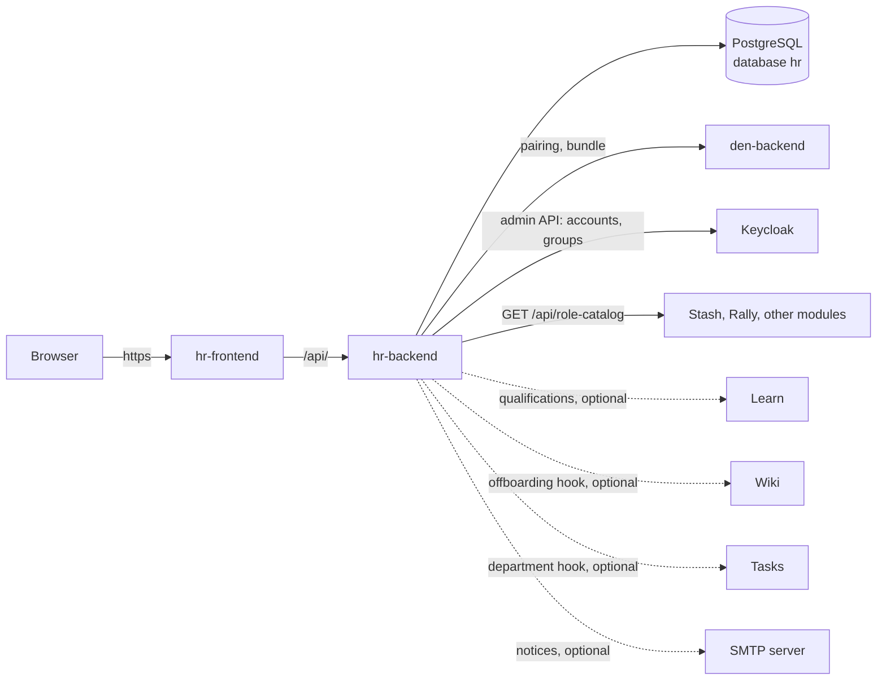

# HR

**HR** is the people module of Con Services. Its goal is that every
person who helps run the convention has **exactly the access they need,
for exactly as long as they help**, without anyone handing out accounts by
hand in each module. HR keeps the register of volunteers and staff, runs
**onboarding** (details, department, which access they get) and
**offboarding**, and creates or removes their sign-in accounts in the
identity provider (Keycloak). It is used by the HR team only; everyone
else just receives the set-password email and signs in to Den and the
other modules. It fits the suite as the **writer of access**: it reads
every module's role catalog and grants roles by adding the person to the
right Keycloak group, which the modules then read from the token. Scripts
and integrations can do the same through its [HTTP API](api.md).

Source: [AGlElectronics/hr](https://github.com/AGlElectronics/hr)

## Who uses it

| Person | Uses HR to |
| --- | --- |
| HR team (members of `hr-admin`) | Onboard people, edit profiles, pause or reactivate them, offboard them, manage departments and the access each department gets by default. |
| Administrators | Settings (username and email templates), the [Den connection](../../concepts/pairing.md), training requirements for roles. |
| Everyone else | Nobody else signs in to HR. People receive the password-setup email HR triggers and then sign in to Den and the other modules. |

## How HR fits into the platform

- **Den first.** HR is added after Den runs and is then **paired** with it;
  the organisation name, email domain and username templates then come from
  Den. See [How the platform starts](../../getting-started/how-the-platform-starts.md).
- **Own namespace.** On Kubernetes HR runs in `conservices-hr`.
- **Own chart.** [`deploy/charts/hr`](https://github.com/AGlElectronics/con-services/tree/main/deploy/charts/hr)
  (first version; see [Setup](setup.md)). There are no Kustomize manifests
  for HR.
- **Own data.** Its own PostgreSQL database (`hr`, created by Den). HR
  stores **no files** yet; the storage settings are read but optional.
- **Talks only over HTTP.** HR calls more of the platform than any other
  module, and each call needs a NetworkPolicy rule on both sides:

## Ways to run HR

| Posture | When | Guide |
| --- | --- | --- |
| **Production cluster with Argo CD** (recommended for production) | Production: Den, Keycloak and every module on a cluster managed from Git. | [Den and the modules](../../deploy/apps.md) |
| Full platform on Kubernetes | A cluster you run yourself, next to Den, Keycloak and the other modules; also the local trial cluster. | [Setup: platform](setup.md#recommended-install-into-the-platform) |
| Standalone on Kubernetes | A people register with your own database and identity provider. | [Setup: standalone](setup.md#standalone-on-kubernetes) |
| Production with Docker | A single server without Kubernetes. | [Setup: Docker](setup.md#production-with-docker) |
| Development with Docker | Trying HR or working on its code. Not for production. | [Setup: development](setup.md#development-with-docker) |

A local Kubernetes cluster (the [quickstart](../../getting-started/den-quickstart.md)) is for trials only; production installations use the Argo CD path.

## How HR is built

| Part | Technology | Runs as |
| --- | --- | --- |
| Backend | Go 1.27, chi, pgx | Deployment `hr-backend` (`/server`, port 8080) |
| Migrations | Goose, separate binary | initContainer `migrate` in `hr-backend` (`hr-migrate` image). The server **never** migrates (ADR-0003). |
| Frontend | React 19, Rsbuild, TanStack Query, Tailwind | Deployment `hr-frontend` (nginx) |
| Database | PostgreSQL 16 | shared server, database `hr` |

## Images

| Image | Built from | Contains |
| --- | --- | --- |
| `ghcr.io/aglelectronics/hr-backend:<tag>` | `infra/Dockerfile.backend` | API server `/server`, port 8080. |
| `ghcr.io/aglelectronics/hr-migrate:<tag>` | `infra/Dockerfile.migrate` | One-shot migrator `/migrate`; needs only `DATABASE_URL`. |
| `ghcr.io/aglelectronics/hr-frontend:<tag>` | `infra/Dockerfile.frontend` | Web app on nginx (non-root as UID 101, port 8080; the chart mounts its own config). |

Use the same tag for all three ([Versions and upgrades](../../operations/versioning.md)).
The images are published with every HR release, starting with `1.0.0-1`.

HR holds personal data (addresses, dates of birth, emergency contacts):
restrict who can read its database and backups.

## In this section

- [Setup](setup.md): install HR in each posture.
- [Admin guide](admin-guide.md): onboarding, offboarding, departments, settings.
- [Configuration](configuration.md): every environment variable.
- [API reference](api.md): every HTTP endpoint.

Design decisions: HR's [ADRs](https://github.com/AGlElectronics/hr/tree/main/docs/adr)
and [domain model](https://github.com/AGlElectronics/hr/blob/main/docs/domain-model.md).
