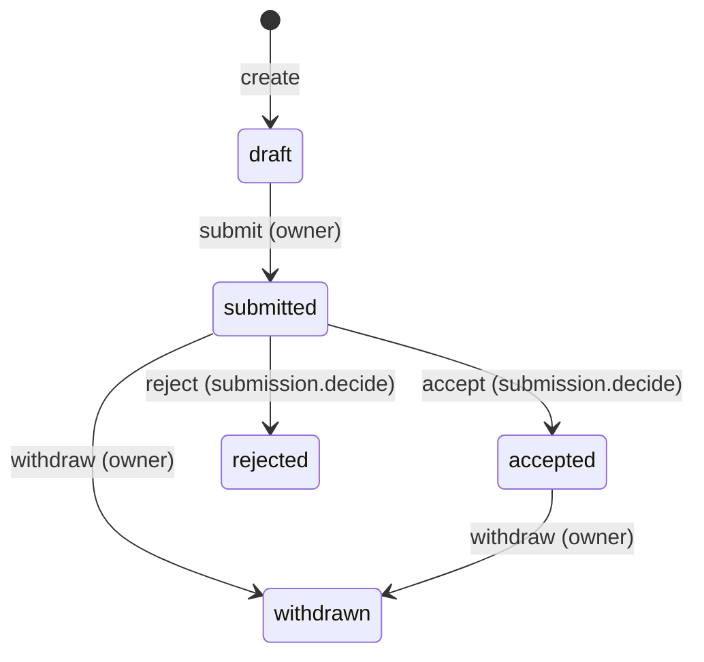

# Rally API reference

Rally's backend is a JSON-over-HTTP API for a convention's programme:
**calls for papers** (CfPs) and their forms, **submissions** from
attendees, staff **review** and decisions, the **schedule** builder with
published versions, **live-day** changes and Telegram announcements, and a
read-only **public schedule** for websites and calendar apps. Three kinds
of client use it: the staff web app, the public **submission site** where
attendees propose talks, and outside systems (the convention website, info
screens, calendar subscriptions) that read the published programme with an
API key. You can script anything the staff app does with the same
endpoints, for example bulk-creating rooms or exporting submissions.

This page lists all **91 endpoints**, taken from
[`backend/internal/http/router.go`](https://github.com/AGlElectronics/rally/blob/main/backend/internal/http/router.go)
and the services behind it. What all modules share (error shape, request
IDs, probes, token checks) is on
[API conventions](../../concepts/api-conventions.md); how sign-in works is
on [Authentication](../../concepts/authentication.md).

## Basics

### Base URL and routing

The API has three parts:

| Prefix | For | Auth |
| --- | --- | --- |
| `/api/v1/…` | The staff app and staff scripts. | Staff token (except `/api/v1/brand`). |
| `/api/public/v1/…` | The submission site, websites, calendars. | None, an attendee token, or a public API key, per endpoint. |
| `/livez`, `/readyz`, `/api/health` | Probes, monitoring. | None. |
| `/api/role-catalog` | HR's access picker. | HR's service token or a staff token. |

Both web apps forward `/api/` to the same backend, so either address works
for every endpoint. The examples use the
[local example installation](../../getting-started/den-quickstart.md):

```sh
RALLY=https://events.conservices.test     # staff app
SUBMIT=https://submit.conservices.test    # submission site (same API)
```

| From | Address |
| --- | --- |
| Your computer, scripts, the web apps | `https://events.conservices.test` or `https://submit.conservices.test` (your own domains in a real installation) |
| Inside the cluster | `https://rally-backend.conservices-rally.svc.cluster.local:8080`, only from namespaces the [network policies](../../operations/network-policies.md) allow |

Inside the platform Rally is called **Events**: its Den slug, database,
Keycloak client (`events-spa`) and groups use `events`.

### Authenticating to Rally

| Caller | What to send | Accepted on |
| --- | --- | --- |
| **Staff** | `Authorization: Bearer <access token>` from the staff issuer (`OIDC_ISSUER_URL`, realm `conservices`) with audience `OIDC_AUDIENCE` (default `events-api`). | `/api/v1/*`, `/api/role-catalog` |
| **Attendees** | `Authorization: Bearer <access token>` from the attendee issuer (`ATTENDEE_OIDC_ISSUER_URL`, realm `attendees`) with audience `ATTENDEE_OIDC_AUDIENCE` (default `events-public-api`). | Signed-in routes under `/api/public/v1` |
| **HR's backend** | `Authorization: Bearer <HR_SERVICE_TOKEN>`. | `/api/role-catalog` only |
| **Websites, calendars** | A public API key: `Authorization: Bearer rsk_…`, or `?key=rsk_…` for calendar feeds that cannot send headers. | `/api/public/v1/schedules…` only |
| Local development (`AUTH_MODE=dev` with `APP_ENV=development`) | `X-Dev-User: <name>`, or nothing (staff: `DEV_DEFAULT_USER`, default `dev-admin`; attendees: `dev-attendee`). | everything |

**ID tokens are refused** everywhere, whatever their audience, and so are
access tokens for another module's API (for example `aud: hr-api`); see the
[token contract](../../concepts/authentication.md#tokens-the-10-contract).
Keycloak adds Rally's audience with an audience mapper on each client
([Set up Rally](setup.md#2-prepare-keycloak)).

Staff tokens never work on attendee routes and attendee tokens never work
on staff routes: each side has its own verifier, a token from the other
realm is refused before anything else is checked (`401 attendee accounts
cannot use the staff API`, or `401 staff accounts cannot use the submission
site; sign in with an attendee account`), and attendees never get staff
memberships or permissions: their group claims are ignored.

Staff groups come only from the claim named by `OIDC_GROUPS_CLAIM`
(default `groups`) and are compared with the shared rule
([How groups are matched](../../concepts/authentication.md#how-groups-are-matched));
the `roles` claim never grants anything.

**Permissions.** A staff member's Keycloak groups are bound to Rally roles
in the access configuration, and roles carry permissions (see
[Admin guide](admin-guide.md#roles-and-groups) and
[`GET /api/role-catalog`](#get-apirole-catalog)). The built-in roles:

| Permission | `organization_admin` | `edition_organizer` | `programme_manager` | `reviewer` | `submitter`, `viewer` |
| --- | --- | --- | --- | --- | --- |
| `org.view`, `edition.view` | ✓ | ✓ | ✓ | ✓ | ✓ |
| `org.manage`, `member.manage` | ✓ | | | | |
| `edition.edit`, `cfp.manage`, `audit.view` | ✓ | ✓ | | | |
| `member.view` | ✓ | ✓ | ✓ | | |
| `submission.review` | ✓ | ✓ | ✓ | ✓ | |
| `submission.decide`, `schedule.edit`, `schedule.publish` | ✓ | ✓ | ✓ | | |

Most checks run **per edition**: an organisation-wide grant or a grant on
that edition satisfies them. Two shorthands are used below:

- **CfP staff**: `cfp.manage` or `submission.review` for the edition.
- **Programme staff**: CfP staff, or `schedule.edit` or `schedule.publish`.

Reads restricted to CfP or programme staff answer **404** (not 403) to
everyone else, so an edition's draft data does not reveal that it exists.
Writes without the permission answer **403** `missing permission: <name>`.

#### Getting a staff token for testing

!!! danger "Local development only"
    This uses Keycloak's password grant and the local realm's dev account
    `admin` / `adminadmin` (a member of `events-admin`). Real installations
    must turn off direct access grants, and the dev accounts must not exist
    there. See [Secrets](../../operations/secrets.md).

Take the **access token**; it carries `events-api` once `events-spa` has
the audience mapper ([Set up Rally](setup.md#2-prepare-keycloak)).

=== "macOS / Linux"

    ```sh
    TOKEN=$(curl -s https://auth.conservices.test/realms/conservices/protocol/openid-connect/token \
      -d grant_type=password -d client_id=events-spa \
      -d username=admin -d password=adminadmin -d scope=openid \
      | jq -r .access_token)
    ```

=== "Windows (PowerShell)"

    ```powershell
    $TOKEN = (Invoke-RestMethod -Method Post `
      -Uri https://auth.conservices.test/realms/conservices/protocol/openid-connect/token `
      -Body @{ grant_type='password'; client_id='events-spa'; username='admin'; password='adminadmin'; scope='openid' }).access_token
    ```

To check the audience, decode the token's middle part, for example on
<https://jwt.io> (local tokens only): `"aud"` must contain `events-api`.

The attendee client `rally-submit` does **not** allow password grants. To
call attendee endpoints, sign in to the submission site and copy the
`Authorization` header of any `/api/public/v1` request from the browser's
developer tools into `$ATTENDEE`, or use dev mode
(`-H "X-Dev-User: dev-attendee"`).

### Requests, responses and errors

- Bodies are JSON, at most 1 MiB; unknown fields give `400 unknown field "…"`,
  broken JSON `400 request body is not valid JSON (at byte 17)`, and a larger
  body `413 request_too_large`.
- A malformed id in the path gives `400 invalid <name> id: <value>`.
- Times are RFC 3339 with offset (`2027-03-13T10:00:00Z`).
- Lists answer `{"items": [...]}`; some also include `"total"`. Nothing is paginated.
- Every response carries `X-Request-ID` and the security headers
  `X-Content-Type-Options: nosniff`, `X-Frame-Options: DENY`,
  `Referrer-Policy: no-referrer` and
  `Content-Security-Policy: default-src 'none'; frame-ancestors 'none'`.
  Requests are cut off after 60 seconds.
- **Rate limits** apply to everything under `/api/public/v1` (per client
  IP, `PUBLIC_RATE_LIMIT`, default 120 a minute with bursts of 30) and,
  additionally, to creating and submitting submissions, inviting
  co-presenters, invite codes and starting uploads (per person,
  `SUBMISSION_RATE_LIMIT`, default 20 a minute with bursts of 10). Over the
  limit the answer is `429` with `Retry-After` in seconds; wait that long.
  Limits count per backend replica ([Rate limits](configuration.md#rate-limits)).

```text
HTTP/1.1 429 Too Many Requests
Retry-After: 3
Content-Type: application/json

{"error":{"code":"rate_limited","message":"Too many requests; try again in 3 seconds."}}
```

Errors use `{"error":{"code","message","details"}}`:

| Status | `code` | Typical cause in Rally |
| --- | --- | --- |
| 400 | `bad_request` | Malformed JSON, unknown field, bad id or version number. |
| 401 | `unauthorized` | `missing bearer token`, `invalid token` (also an ID token or a token for another API), a token from the other realm, or a missing/revoked public API key. |
| 403 | `forbidden` | `missing permission: cfp.manage`, `only the submitter can do this`, `you cannot decide your own submission`. |
| 404 | `not_found` | The thing does not exist **or you may not see it**; also the public schedule while it is switched off. |
| 409 | `conflict` | Not allowed in the current state: a state-machine move (`invalid submission transition: cannot accept a draft submission`), a closed call, a blocking schedule rule (with `details.conflicts`). |
| 413 | `request_too_large` | The JSON body is larger than 1 MiB. |
| 422 | `validation_failed` | Field errors in `details`, keyed by path (`title`, `answers.bio`, `form.fields[2].id`, `speakers[0].name`). |
| 429 | `rate_limited` | Too many requests from one client; retry after `Retry-After` seconds. |
| 503 | `service_unavailable` | A feature is not configured here: file storage (`S3_ENABLED=false`) or attendee sign-in. |
| 500 | `internal` | A bug or database failure; details only in Rally's log. |

The Den pairing endpoints use their own codes (`pairing_failed`,
`sync_failed`), described with them.

---

## Endpoint summary

| Method | Path | Access | Section |
| --- | --- | --- | --- |
| GET | `/livez`, `/readyz`, `/api/health` | public | [Health](#health-and-catalog) |
| GET | `/api/role-catalog` | HR service token or staff | [Health](#health-and-catalog) |
| GET | `/api/den/state`, `/api/v1/den/state` | public | [Den pairing](#den-pairing) |
| GET | `/api/v1/brand`, `/api/v1/brand/{role}` | public | [Brand](#brand-and-preferences) |
| GET | `/api/public/v1/brand`, `/api/public/v1/brand/{role}` | public | [Brand](#brand-and-preferences) |
| GET | `/api/v1/me` | staff | [You](#you) |
| GET, PUT | `/api/v1/me/preferences` | staff | [Brand](#brand-and-preferences) |
| GET, POST, DELETE | `/api/v1/den/…` (4 endpoints) | `org.manage` | [Den pairing](#den-pairing) |
| GET | `/api/v1/organizations`, `/api/v1/organizations/{id}` | staff (member) | [Organisations](#organisations-and-editions) |
| GET | `/api/v1/editions` | staff | [Organisations](#organisations-and-editions) |
| PUT | `/api/v1/editions/{edition}/dates` | `edition.edit` or `schedule.edit` | [Organisations](#organisations-and-editions) |
| GET, POST | `/api/v1/editions/{edition}/event-types` | CfP staff / `cfp.manage` | [Event types](#event-types) |
| PUT, DELETE | `/api/v1/event-types/{eventType}` | `cfp.manage` | [Event types](#event-types) |
| GET, POST | `/api/v1/editions/{edition}/cfps` | staff / `cfp.manage` | [Calls for papers](#calls-for-papers) |
| GET, PUT, DELETE | `/api/v1/cfps/{cfp}` | CfP staff / `cfp.manage` | [Calls for papers](#calls-for-papers) |
| GET | `/api/v1/editions/{edition}/submissions` | staff | [Submissions](#submissions) |
| POST | `/api/v1/cfps/{cfp}/submissions` | staff | [Submissions](#submissions) |
| GET, PATCH | `/api/v1/submissions/{submission}` | viewer / owner | [Submissions](#submissions) |
| POST | `/api/v1/submissions/{submission}/submit`, `/withdraw` | owner | [Submissions](#submissions) |
| POST | `/api/v1/submissions/{submission}/accept`, `/reject` | `submission.decide` | [Review](#review-and-decisions) |
| GET, POST | `/api/v1/submissions/{submission}/notes` | `submission.review` | [Review](#review-and-decisions) |
| GET, PUT | `/api/v1/submissions/{submission}/scores` | `submission.review` | [Review](#review-and-decisions) |
| POST | `/api/v1/uploads`, `/api/v1/uploads/{file}/complete` | staff | [Files](#file-uploads) |
| GET | `/api/v1/files/{file}/download` | staff | [Files](#file-uploads) |
| GET, POST | `/api/v1/editions/{edition}/rooms` | programme staff / `schedule.edit` | [Rooms](#rooms) |
| PUT, DELETE | `/api/v1/rooms/{room}` | `schedule.edit` | [Rooms](#rooms) |
| GET | `/api/v1/editions/{edition}/schedule` | programme staff | [Schedule](#schedule-builder) |
| PUT | `/api/v1/editions/{edition}/schedule/settings` | `schedule.edit` | [Schedule](#schedule-builder) |
| POST | `/api/v1/editions/{edition}/schedule/items` | `schedule.edit` | [Schedule](#schedule-builder) |
| PATCH, DELETE | `/api/v1/schedule-items/{item}` | `schedule.edit` | [Schedule](#schedule-builder) |
| POST | `/api/v1/editions/{edition}/schedule/publish` | `schedule.publish` | [Publishing](#publishing-and-versions) |
| GET | `/api/v1/editions/{edition}/schedule/versions`, `/versions/{version}` | programme staff | [Publishing](#publishing-and-versions) |
| POST | `/api/v1/editions/{edition}/schedule/versions/{version}/restore` | `schedule.edit` | [Publishing](#publishing-and-versions) |
| POST | `/api/v1/editions/{edition}/schedule/live/{item}` | `schedule.publish` | [Live day](#live-day-changes) |
| GET, POST | `/api/v1/editions/{edition}/announcements` | programme staff / `schedule.publish` | [Announcements](#announcements-and-telegram) |
| PUT | `/api/v1/announcements/{announcement}` | `schedule.publish` | [Announcements](#announcements-and-telegram) |
| POST | `/api/v1/announcements/{announcement}/send`, `/discard` | `schedule.publish` | [Announcements](#announcements-and-telegram) |
| GET, POST | `/api/v1/editions/{edition}/telegram-chats` | programme staff / `schedule.publish` | [Announcements](#announcements-and-telegram) |
| PUT, DELETE | `/api/v1/telegram-chats/{chat}` | `schedule.publish` | [Announcements](#announcements-and-telegram) |
| GET, POST | `/api/v1/public-api-keys` | `schedule.publish` | [API keys](#public-schedule-api-keys) |
| DELETE | `/api/v1/public-api-keys/{key}` | `schedule.publish` | [API keys](#public-schedule-api-keys) |
| GET | `/api/public/v1/calls`, `/calls/{cfp}` | public | [Submission site](#submission-site-api) |
| GET | `/api/public/v1/schedules`, `/schedules/{edition}`, `/schedules/{edition}/calendar.ics` | API key | [Public schedule](#public-schedule-api) |
| GET | `/api/public/v1/me`, `/api/public/v1/submissions` | attendee | [Submission site](#submission-site-api) |
| POST | `/api/public/v1/calls/{cfp}/submissions` | attendee | [Submission site](#submission-site-api) |
| GET, PATCH | `/api/public/v1/submissions/{submission}` | attendee | [Submission site](#submission-site-api) |
| POST | `/api/public/v1/submissions/{submission}/submit`, `/withdraw`, `/leave` | attendee | [Submission site](#submission-site-api) |
| POST, DELETE | `/api/public/v1/submissions/{submission}/people[/{person}]` | attendee (owner) | [Co-presenters](#co-presenters-and-invites) |
| POST | `/api/public/v1/submissions/{submission}/people/{person}/reissue` | attendee (owner) | [Co-presenters](#co-presenters-and-invites) |
| GET | `/api/public/v1/invites/{code}` | attendee | [Co-presenters](#co-presenters-and-invites) |
| POST | `/api/public/v1/invites/{code}/accept`, `/decline` | attendee | [Co-presenters](#co-presenters-and-invites) |
| POST | `/api/public/v1/uploads`, `/uploads/{file}/complete` | attendee | [Files](#file-uploads) |
| GET | `/api/public/v1/files/{file}/download` | attendee | [Files](#file-uploads) |

---

## Health and catalog

### `GET /livez`, `GET /readyz`

Kubernetes probes; not routed through the Gateway. **Access:** public.

```sh
kubectl -n conservices-rally port-forward deploy/rally-backend 8080:8080
curl -sk https://localhost:8080/readyz
```

The backend serves HTTPS with a certificate for its service name, not for
`localhost`, so `-k` skips the name check for this local test only.

```json
{"status":"ok","database":"ok"}
```

`/livez` always answers `{"status":"ok"}`. `/readyz` answers **503** with
`{"status":"degraded","database":"down"}` (or `"not_configured"`).

### `GET /api/health`

The same check with version and uptime, through the web address.
**Access:** public.

```sh
curl -s $RALLY/api/health
```

```json
{"status":"ok","database":"ok","version":"1.0.0-1","uptime_sec":930}
```

**503** with `"status":"degraded"` when the database is down.

### `GET /api/role-catalog`

Rally's roles for HR's access picker (module `events`), following the
[role catalog contract](../../concepts/role-catalog.md).

**Who may call it:**

- HR's backend, with `Authorization: Bearer <HR_SERVICE_TOKEN>`. Rally
  compares it in constant time with its own `HR_SERVICE_TOKEN`; the token
  allows nothing else.
- Anyone signed in to the **staff** realm, with a staff access token (any
  role, or none: the catalog names roles, not who holds them). Attendee
  tokens are refused.

The path stays open while Rally waits for Den (`DEN_MODE=required`).

**Request body:** none. Send `If-None-Match` with the last `ETag` to get
`304 Not Modified` while the catalog is unchanged.

**Response:** `200` with the catalog. Each role appears **once**:

| Field | Meaning in Rally |
| --- | --- |
| `revision` | A hash of the catalog's content; also the `ETag`. It changes only when the access configuration changes, and is the same on every replica. |
| `roles[].key` | The role name from the access configuration. Rally has no dynamic roles (`dynamic` is always `false`). |
| `roles[].group`, `roles[].group_display` | The group of the role's **first** binding in the access configuration: normalised (`group`, lower case, no leading `/`) and as written (`group_display`). Empty for a role without a binding. |
| `roles[].assignable`, `roles[].scope` | `true` and `organization` for a role with a group binding; `false` and `edition` for one that is assigned per edition inside Rally. |
| `roles[].privileged` | `true` for a role that can change settings, grant access or see other people's data: any of `org.manage`, `edition.edit`, `member.view`, `member.manage`, `audit.view`, `cfp.manage`, `submission.review`, `submission.decide`, `schedule.publish`. Reviewers are privileged because they read speakers' submissions. A role in the access configuration may set `privileged = true` or `false` to override this. |
| `roles[].default` | Always `false`: HR gives no Rally role by default. |
| `roles[].permissions` | The role's permissions, sorted. |

**Errors:**

| Status | Code | When |
| --- | --- | --- |
| `401` | `unauthorized` | No token (`authentication required`), a wrong service token or an invalid token (`invalid token`), or an attendee token. |

```sh
curl -s https://rally-backend.conservices-rally.svc.cluster.local:8080/api/role-catalog \
  -H "Authorization: Bearer $HR_SERVICE_TOKEN"
```

```json
{
  "module": "events",
  "display_name": "Events",
  "description": "Editions, calls for papers and the programme.",
  "revision": "sha256-3f9c2a71d0b4e8a5",
  "roles": [
    {
      "key": "organization_admin",
      "label": "Organization Admin",
      "description": "Full control of the organization: editions, CfPs, members.",
      "group": "events-admin",
      "group_display": "events-admin",
      "assignable": true,
      "default": false,
      "scope": "organization",
      "privileged": true,
      "dynamic": false,
      "permissions": ["audit.view", "cfp.manage", "edition.edit", "edition.view", "member.manage", "member.view",
                      "org.manage", "org.view", "schedule.edit", "schedule.publish", "submission.decide", "submission.review"]
    },
    {
      "key": "viewer",
      "label": "Viewer",
      "description": "Read-only access to the organization and editions.",
      "group": "",
      "group_display": "",
      "assignable": false,
      "default": false,
      "scope": "edition",
      "privileged": false,
      "dynamic": false,
      "permissions": ["edition.view", "org.view"],
      "note": "Assigned per edition inside Rally, not via an IdP group."
    }
  ]
}
```

Without a token:

```sh
curl -s -i $RALLY/api/role-catalog
```

```text
HTTP/2 401
content-type: application/json; charset=utf-8

{"error":{"code":"unauthorized","message":"authentication required"}}
```

Revalidating:

```sh
curl -s -o /dev/null -w '%{http_code}\n' https://rally-backend.conservices-rally.svc.cluster.local:8080/api/role-catalog \
  -H "Authorization: Bearer $HR_SERVICE_TOKEN" -H 'If-None-Match: "sha256-3f9c2a71d0b4e8a5"'
```

```text
304
```

---

## Brand and preferences

### `GET /api/v1/brand` and `GET /api/public/v1/brand`

The active brand for the sign-in screens of the staff app and the
submission site. Same answer on both paths. **Access:** public.
`Cache-Control: no-cache`.

```sh
curl -s $RALLY/api/v1/brand
```

```json
{
  "revision": 10,
  "source": "den",
  "productName": "Rally",
  "organizationName": "Example Con e.V.",
  "logoUrl": "/api/v1/brand/logo?v=9e8d7c6b-5a4f-4e3d-2c1b-0a9f8e7d6c5b",
  "loginBackgroundUrl": "/api/v1/brand/login-background?v=1a2b3c4d-5e6f-4a7b-8c9d-0e1f2a3b4c5d",
  "loginLayout": "panel",
  "colors": { "primary": "#e44763" },
  "theme": { "primary": "#e44763" }
}
```

!!! note "camelCase"
    This is the only Rally response with camelCase field names; it keeps
    the shape of the local brand file. `source` is `standalone` when Rally
    is not paired, and the values then come from the brand file.

### `GET /api/v1/brand/{role}` and `GET /api/public/v1/brand/{role}`

A brand file copied from Den: `logo` or `login-background`. **Access:**
public. `Cache-Control: public, max-age=86400`. **404**
`no such brand asset` when not paired or Den has none.

```sh
curl -s -o logo.svg $RALLY/api/v1/brand/logo
```

### `GET /api/v1/me/preferences` and `PUT /api/v1/me/preferences`

Your theme (`system`, `light`, `dark`), stored in Den when paired so every
app shares it. **Access:** staff. Same behaviour as in
[HR](../hr/api.md#get-apimepreferences): answers include `synced`, never
fail because of Den, and `PUT` gives **422**
`theme must be system, light or dark` for other values.

```sh
curl -s -X PUT -H "Authorization: Bearer $TOKEN" -H "Content-Type: application/json" \
  -d '{"theme":"dark"}' $RALLY/api/v1/me/preferences
```

```json
{"theme":"dark","updated_at":"2026-11-06T09:15:02Z","synced":true}
```

---

## You

### `GET /api/v1/me`

Who Rally thinks you are, your memberships and your effective permissions.
The first thing to check when someone gets 403. **Access:** staff.

```sh
curl -s -H "Authorization: Bearer $TOKEN" $RALLY/api/v1/me
```

```json
{
  "id": "6f1e2d3c-4b5a-4978-8a6b-5c4d3e2f1a0b",
  "display_name": "Dev Admin",
  "email": "admin@conservices.local",
  "issuer": "https://auth.conservices.test/realms/conservices",
  "subject": "0b6e2c4d-8f1a-4b3c-9d7e-5a6b7c8d9e0f",
  "memberships": [
    {"organization_id": "00000000-0000-0000-0000-000000000010", "edition_id": null, "role": "organization_admin"}
  ],
  "permissions": ["audit.view", "cfp.manage", "edition.edit", "edition.view", "member.manage", "member.view",
                  "org.manage", "org.view", "schedule.edit", "schedule.publish", "submission.decide", "submission.review"]
}
```

An empty `memberships` list means no group in your token matches a binding
in the access configuration. `permissions` is the union over all
memberships; the server still checks each request per edition.

---

## Den pairing

Connects Rally to Den so it follows Den's brand, organisation name and the
`events_public_schedule` switch. See [Pairing](../../concepts/pairing.md).
**Access:** staff with `org.manage` (anywhere); otherwise **403**
`missing permission: org.manage`.

| Method | Path | What it does |
| --- | --- | --- |
| GET | `/api/v1/den` | Status: `{"paired":true,"den_base_url":"https://den.conservices.test","module_id":"…","paired_at":"…","synced_at":"…","revoked":false}`, or `{"paired":false,"revoked":false}`. After Den rejected the credential: `"revoked":true`, `"revoked_at"` and the reason in `last_error`. |
| POST | `/api/v1/den/pair` | Body `{"pairing_url":"…"}`. Redeems it and syncs; also clears a revoked state. **422** `pairing_failed` when the URL is malformed, Den is unreachable, Den refuses it, or the host is not allowed (`pairing with Den at … is not allowed here; add the host to DEN_ALLOWED_HOSTS or set DEN_INTERNAL_URL`; outside `APP_ENV=development` the URL must use `https://`). |
| POST | `/api/v1/den/sync` | Fetch Den's brand and settings now (Rally also does this every minute). **409** `sync_failed` when not paired, **409** `den_credential_revoked` when Den rejected the credential (pair again), **502** `sync_failed` when Den fails. |
| DELETE | `/api/v1/den/pair` | Forget the credential; back to standalone. **204**. |

The credential Den hands out is stored **encrypted** with
`DEN_LINK_ENCRYPTION_KEY` ([Configuration](configuration.md#den-and-branding)).

### `GET /api/den/state`

Also at `/api/v1/den/state`. Whether Rally waits for Den, is paired, and
whether Den rejected its credential, so the web app can show *Waiting for
Den* or *pair again* before anyone signs in. **Access:** public.
**Request body:** none. **Errors:** none.

```sh
curl -s $RALLY/api/den/state
```

```json
{"mode":"required","paired":true,"revoked":false}
```

| Field | Meaning |
| --- | --- |
| `mode` | `DEN_MODE`: `required` or `standalone`. |
| `paired` | Rally holds a pairing (also while it is revoked). |
| `revoked` | Den rejected the credential (`401`); an admin must pair again. Rally keeps Den's last brand and settings meanwhile and stays unlocked. |

```sh
curl -s -X POST -H "Authorization: Bearer $TOKEN" -H "Content-Type: application/json" \
  $RALLY/api/v1/den/pair \
  -d '{"pairing_url": "https://den.conservices.test/api/v1/integrations/pairing/redeem?token=change-me"}'
```

```json
{"paired":true,"den_base_url":"https://den.conservices.test","module_id":"4e5f6a7b-8c9d-4e0f-a1b2-c3d4e5f6a7b8","paired_at":"2026-11-06T09:30:00Z","synced_at":"2026-11-06T09:30:01Z"}
```

---

## Organisations and editions

An **organisation** runs conventions; an **edition** is one occurrence (for
example "Example Con 2027"). Rally has no API to create either yet; the
first migration seeds `demo-org` and the edition `next`
(`00000000-0000-0000-0000-000000000030`). See
[Admin guide](admin-guide.md#organisations-and-editions).

### `GET /api/v1/organizations`

Organisations you are an active member of, with your highest role there.
**Access:** staff.

```sh
curl -s -H "Authorization: Bearer $TOKEN" $RALLY/api/v1/organizations
```

```json
{"items":[{"id":"00000000-0000-0000-0000-000000000010","slug":"demo-org","display_name":"Demo Organization","role":"organization_admin"}],"total":1}
```

### `GET /api/v1/organizations/{id}`

One organisation (without `role`). **404** `organization not found` if you
are not a member.

### `GET /api/v1/editions`

Editions you can see: every edition of your organisations, plus any
edition with an open call (so would-be speakers can find it). Sorted by
start date. **Access:** staff.

```sh
curl -s -H "Authorization: Bearer $TOKEN" $RALLY/api/v1/editions
```

```json
{
  "items": [
    {
      "id": "00000000-0000-0000-0000-000000000030",
      "organization_id": "00000000-0000-0000-0000-000000000010",
      "convention_id": "00000000-0000-0000-0000-000000000020",
      "slug": "next",
      "title": "Example Con 2027",
      "timezone": "Europe/Vienna",
      "status": "planning",
      "start_at": "2027-03-13T08:00:00Z",
      "end_at": "2027-03-14T22:00:00Z"
    }
  ],
  "total": 1
}
```

`status` is `draft`, `planning`, `live`, `archived` or `cancelled`; the
seeded edition starts as `planning` with time zone `UTC`.

### `PUT /api/v1/editions/{edition}/dates`

Set the edition's time zone and first and last day (the schedule grid
uses them). **Access:** `edition.edit` or `schedule.edit` for the edition
(else **403** `permission denied`).

| Field | Type | Required | Rules |
| --- | --- | --- | --- |
| `timezone` | string | yes | An IANA zone such as `Europe/Vienna`. |
| `start_at`, `end_at` | time | no | `end_at` after `start_at`; at most 31 days. |

```sh
curl -s -X PUT -H "Authorization: Bearer $TOKEN" -H "Content-Type: application/json" \
  $RALLY/api/v1/editions/00000000-0000-0000-0000-000000000030/dates \
  -d '{"timezone":"Europe/Vienna","start_at":"2027-03-13T08:00:00+01:00","end_at":"2027-03-14T23:00:00+01:00"}'
```

**200** with the edition. Errors: **422** `timezone: is not a known timezone (e.g. Europe/Vienna)`,
`end_at: an edition can last at most 31 days`; **404** `edition not found`.

---

## Event types

An **event type** (Talk, Workshop, Panel) gives submissions a default
length, a colour on the schedule, a gap to keep after it, and optionally a
list of rooms it may use.

```json
{
  "id": "7c8d9e0f-1a2b-4c3d-8e4f-5a6b7c8d9e0f",
  "organization_id": "00000000-0000-0000-0000-000000000010",
  "edition_id": "00000000-0000-0000-0000-000000000030",
  "name": "Workshop",
  "color": "#2f855a",
  "default_minutes": 90,
  "gap_after_minutes": 15,
  "sort_order": 2,
  "room_ids": ["5a6b7c8d-9e0f-4a1b-8c2d-3e4f5a6b7c8d"],
  "created_at": "2026-10-01T12:00:00Z",
  "updated_at": "2026-10-01T12:00:00Z"
}
```

| Endpoint | Access | Notes |
| --- | --- | --- |
| `GET /api/v1/editions/{edition}/event-types` | CfP staff (else **404** `edition not found`) | `{"items": [...]}` |
| `POST /api/v1/editions/{edition}/event-types` | `cfp.manage` | **201** |
| `PUT /api/v1/event-types/{eventType}` | `cfp.manage` | Full replace. `room_ids` omitted keeps the current list. |
| `DELETE /api/v1/event-types/{eventType}` | `cfp.manage` | **204**; **409** `submissions use this event type; rename it instead`. |

Body:

| Field | Type | Default | Rules |
| --- | --- | --- | --- |
| `name` | string | required | At most 80 characters, unique in the edition. |
| `color` | string | `#6366f1` | `#rrggbb`. |
| `default_minutes` | int | 60 | 5–1440. |
| `gap_after_minutes` | int | 0 | 0–720. |
| `sort_order` | int | 0 | |
| `room_ids` | UUID[] | `[]` | Rooms of this edition (empty = any room). |

```sh
curl -s -X POST -H "Authorization: Bearer $TOKEN" -H "Content-Type: application/json" \
  $RALLY/api/v1/editions/00000000-0000-0000-0000-000000000030/event-types \
  -d '{"name":"Workshop","color":"#2f855a","default_minutes":90,"gap_after_minutes":15}'
```

---

## Calls for papers

A **call for papers** (CfP) is an invitation to submit, with its own
**form**, review mode, offered event types and time window. It accepts
submissions while `status` is `open` and now is inside
`opens_at`…`closes_at` (both optional).

### The CfP object

```json
{
  "id": "1c2d3e4f-5a6b-4c7d-8e9f-0a1b2c3d4e5f",
  "organization_id": "00000000-0000-0000-0000-000000000010",
  "edition_id": "00000000-0000-0000-0000-000000000030",
  "title": "Talks and workshops",
  "description": "Share what you love with the community.",
  "status": "open",
  "opens_at": "2026-10-01T00:00:00Z",
  "closes_at": "2027-01-15T23:59:00Z",
  "form": {
    "fields": [
      {"id": "description", "type": "long_text", "label": "Description", "help": "What is it about, and who is it for?", "required": true},
      {"id": "level", "type": "single_choice", "label": "Level", "options": ["Beginner", "Advanced"], "required": true},
      {"id": "slides", "type": "file", "label": "Slides", "accept": ["application/pdf"], "max_files": 1, "max_size_mb": 20}
    ]
  },
  "review_mode": "scored",
  "event_type_ids": ["7c8d9e0f-1a2b-4c3d-8e4f-5a6b7c8d9e0f"],
  "status_labels": {"submitted": "Under review"},
  "created_by": "6f1e2d3c-4b5a-4978-8a6b-5c4d3e2f1a0b",
  "created_at": "2026-09-20T10:00:00Z",
  "updated_at": "2026-10-01T08:00:00Z"
}
```

| Field | Notes |
| --- | --- |
| `status` | `draft` (staff only), `open`, `closed`. |
| `review_mode` | `lead` (reviewers leave notes, the lead decides) or `scored` (reviewers also score 1–5). |
| `event_type_ids` | Event types submitters may pick; empty = none asked. |
| `status_labels` | Wording shown to submitters per submission state, for example `{"submitted":"Under review"}`; at most 60 characters each. |

### Form fields

Up to 50 fields. `id` must match `^[a-z][a-z0-9_]{0,39}$`, be unique, and
not be `title`, `event_type`, `duration` or `people` (built-in).
`archived: true` hides a field but keeps old answers readable.

| `type` | Answer in a submission | Extra options |
| --- | --- | --- |
| `short_text`, `long_text` | string | `min`, `max` (length; defaults 200 / 10000) |
| `number`, `duration` | number (duration in minutes) | `min`, `max` |
| `single_choice` | one of `options` | `options` (≤ 50, unique, ≤ 200 chars) |
| `multi_choice` | array of `options` | `options` |
| `checkbox` | bool | |
| `email`, `url` | string (http/https for `url`) | |
| `datetime` | RFC 3339 string | |
| `file` | array of file ids from [uploads](#file-uploads) | `accept` (MIME patterns like `image/*`), `max_files` (1–10, default 1), `max_size_mb` (default 10, at most 100) |

### Endpoints

| Endpoint | Access | Notes |
| --- | --- | --- |
| `GET /api/v1/editions/{edition}/cfps` | staff | CfP staff see every status; everyone else only `open` ones. `{"items","total"}`. |
| `POST /api/v1/editions/{edition}/cfps` | `cfp.manage` | **201**. |
| `GET /api/v1/cfps/{cfp}` | staff | Non-staff get **404** for non-open calls. |
| `PUT /api/v1/cfps/{cfp}` | `cfp.manage` | Full replace of `title`, `description`, `status`, `opens_at`, `closes_at`; `form`, `review_mode`, `event_type_ids`, `status_labels` are kept when omitted. |
| `DELETE /api/v1/cfps/{cfp}` | `cfp.manage` | **204**; **409** `call for papers has submissions; close it instead of deleting`. |

Body (create and update):

| Field | Type | Default on create | Rules |
| --- | --- | --- | --- |
| `title` | string | required | At most 200 characters. |
| `description` | string | `""` | At most 10000 characters. |
| `status` | string | `draft` | `draft`, `open`, `closed`. |
| `opens_at`, `closes_at` | time or null | null | `closes_at` after `opens_at`. |
| `form` | object | one required `description` long-text field | See above. |
| `review_mode` | string | `lead` | `lead` or `scored`. |
| `event_type_ids` | UUID[] | `[]` | Event types of this edition (≤ 100). |
| `status_labels` | object | `{}` | Keys must be submission states. |

```sh
curl -s -X POST -H "Authorization: Bearer $TOKEN" -H "Content-Type: application/json" \
  $RALLY/api/v1/editions/00000000-0000-0000-0000-000000000030/cfps -d '{
    "title": "Talks and workshops",
    "description": "Share what you love with the community.",
    "status": "open",
    "closes_at": "2027-01-15T23:59:00Z",
    "review_mode": "scored",
    "event_type_ids": ["7c8d9e0f-1a2b-4c3d-8e4f-5a6b7c8d9e0f"],
    "form": {"fields": [
      {"id": "description", "type": "long_text", "label": "Description", "required": true},
      {"id": "level", "type": "single_choice", "label": "Level", "options": ["Beginner", "Advanced"]}
    ]}
  }'
```

**201** with the CfP. Validation errors arrive together:

```json
{"error":{"code":"validation_failed","message":"invalid call for papers","details":{
  "form.fields[1].id":"is reserved for a built-in field",
  "closes_at":"must be after opens_at"}}}
```

---

## Submissions

A **submission** is one proposal to a CfP. It belongs to its submitter
(the **owner**) and may have co-presenters.



`rejected` and `withdrawn` are final.

### The submission object

```json
{
  "id": "9b8a7c6d-5e4f-4a3b-8c2d-1e0f9a8b7c6d",
  "organization_id": "00000000-0000-0000-0000-000000000010",
  "edition_id": "00000000-0000-0000-0000-000000000030",
  "cfp_id": "1c2d3e4f-5a6b-4c7d-8e9f-0a1b2c3d4e5f",
  "cfp_title": "Talks and workshops",
  "edition_title": "Example Con 2027",
  "submitter_user_id": "2a3b4c5d-6e7f-4a8b-9c0d-1e2f3a4b5c6d",
  "submitter_name": "Alex Sample",
  "title": "Soldering for beginners",
  "abstract": "Build a blinking badge in 90 minutes.",
  "speakers": [{"name": "Alex Sample", "email": "alex@mail.example", "bio": "Hardware tinkerer."}],
  "answers": {"description": "Hands-on workshop for 12 people.", "level": "Beginner", "slides": ["4d5e6f7a-…"]},
  "event_type_id": "7c8d9e0f-1a2b-4c3d-8e4f-5a6b7c8d9e0f",
  "event_type_name": "Workshop",
  "duration_minutes": 90,
  "state": "submitted",
  "submitted_at": "2026-12-02T18:11:00Z",
  "decided_at": null,
  "decision_note": "",
  "people": [
    {"id": "aa11…", "user_id": "2a3b4c5d-…", "display_name": "Alex Sample", "role": "owner", "status": "accepted", "created_at": "2026-12-01T20:00:00Z"},
    {"id": "bb22…", "user_id": null, "display_name": "", "role": "presenter", "status": "invited",
     "invite_email": "kim@mail.example", "invite_code": "K7QM4XPZ", "created_at": "2026-12-01T20:05:00Z"}
  ],
  "files": [{"id": "4d5e6f7a-…", "field_id": "slides", "filename": "slides.pdf", "content_type": "application/pdf", "size_bytes": 482113}],
  "status_labels": {"submitted": "Under review"},
  "cfp_accepting": true,
  "score_avg": 4.5,
  "score_count": 2,
  "created_at": "2026-12-01T20:00:00Z",
  "updated_at": "2026-12-02T18:11:00Z"
}
```

- `invite_email` and `invite_code` are only shown to the owner.
- `score_avg` and `score_count` are only shown to reviewers.
- `cfp_accepting` says whether the call still takes submissions and edits.

**Who can see a submission:** the owner, an accepted co-presenter, and
staff with `submission.review` for the edition. Everyone else gets **404**.

### `GET /api/v1/editions/{edition}/submissions`

**Access:** staff. With `submission.review` you see every submission of
the edition; otherwise only your own.

| Query | Meaning |
| --- | --- |
| `state` | `draft`, `submitted`, `accepted`, `rejected`, `withdrawn` (422 for others). |
| `cfp_id` | Only one call. |
| `mine=1` | Only your own, even as a reviewer. |

```sh
curl -s -H "Authorization: Bearer $TOKEN" \
  "$RALLY/api/v1/editions/00000000-0000-0000-0000-000000000030/submissions?state=submitted"
```

```json
{"items":[{"id":"9b8a7c6d-…","title":"Soldering for beginners","state":"submitted","score_avg":4.5,"score_count":2,"people":[],"files":[],"…":"…"}],"total":1}
```

In this list, `people` and `files` are empty; fetch one submission for them.

### Create, edit, submit, withdraw

These work the same for staff (`/api/v1/…`) and attendees
(`/api/public/v1/…`); only the token differs.

| Endpoint | Who | Notes |
| --- | --- | --- |
| `POST …/cfps/{cfp}/submissions` (staff) or `POST /api/public/v1/calls/{cfp}/submissions` | signed in | Creates a **draft** owned by you. The call must accept submissions (**409** `call for papers is not accepting submissions`); non-staff get **404** for non-open calls. **201**. |
| `GET …/submissions/{submission}` | can see it | |
| `PATCH …/submissions/{submission}` | owner | Only fields you send change. Drafts and submitted ones, while the call accepts submissions. A submitted one must stay complete. |
| `POST …/submissions/{submission}/submit` | owner | `draft` → `submitted`. Checks required answers and, when the call offers event types, that one is picked. |
| `POST …/submissions/{submission}/withdraw` | owner | `submitted` or `accepted` → `withdrawn`. |

Body (create and patch):

| Field | Type | Rules |
| --- | --- | --- |
| `title` | string | Required, at most 200 characters. |
| `abstract` | string | At most 10000 characters. |
| `speakers` | array of `{name, email, bio}` | At most 20; `name` required (≤ 200), `bio` ≤ 2000. |
| `answers` | object | Keyed by form field id; see [form fields](#form-fields). On patch, answers to archived fields are kept. |
| `event_type_id` | UUID | One of the call's event types. |
| `duration_minutes` | int | 5–1440; on patch `0` clears it. |

```sh
curl -s -X POST -H "Authorization: Bearer $ATTENDEE" -H "Content-Type: application/json" \
  $SUBMIT/api/public/v1/calls/1c2d3e4f-5a6b-4c7d-8e9f-0a1b2c3d4e5f/submissions -d '{
    "title": "Soldering for beginners",
    "abstract": "Build a blinking badge in 90 minutes.",
    "speakers": [{"name": "Alex Sample", "bio": "Hardware tinkerer."}],
    "event_type_id": "7c8d9e0f-1a2b-4c3d-8e4f-5a6b7c8d9e0f",
    "answers": {"description": "Hands-on workshop for 12 people.", "level": "Beginner"}
  }'

curl -s -X POST -H "Authorization: Bearer $ATTENDEE" \
  $SUBMIT/api/public/v1/submissions/9b8a7c6d-5e4f-4a3b-8c2d-1e0f9a8b7c6d/submit
```

Both return the submission (**201**, then **200** with `"state":"submitted"`).

| Status | Message |
| --- | --- |
| 422 | `invalid submission` with e.g. `answers.level: is not one of the options`, `event_type_id: is not offered in this call` |
| 422 | `submission is incomplete` with e.g. `answers.description: is required`, `event_type_id: pick what kind of event this is` |
| 403 | `only the submitter can do this` |
| 409 | `this submission can no longer be edited`; `the call for papers is closed; changes are no longer possible`; `invalid submission transition: cannot submit a submitted submission` |

---

## Review and decisions

### `POST /api/v1/submissions/{submission}/accept` and `/reject`

Decide a **submitted** submission. **Access:** `submission.decide` for the
edition, and not your own submission. Optional body `{"note": "…"}` (≤ 5000
characters), shown to the submitter as `decision_note`.

```sh
curl -s -X POST -H "Authorization: Bearer $TOKEN" -H "Content-Type: application/json" \
  $RALLY/api/v1/submissions/9b8a7c6d-5e4f-4a3b-8c2d-1e0f9a8b7c6d/accept \
  -d '{"note": "Welcome aboard! We will schedule you on Saturday."}'
```

**200** with the submission (`"state":"accepted"`, `decided_at`,
`decision_note`). Errors: **403** `missing permission: submission.decide`,
`you cannot decide your own submission`; **409**
`invalid submission transition: cannot accept a draft submission`; **404**
if you cannot see it.

### Notes

Staff-only discussion, never shown to submitters. **Access:**
`submission.review` for the edition (else **404**).

| Endpoint | Body | Answer |
| --- | --- | --- |
| `GET /api/v1/submissions/{submission}/notes` | | `{"items":[{"id","author_id","author_name","body","created_at"}]}` |
| `POST /api/v1/submissions/{submission}/notes` | `{"body": "…"}` (1–5000 characters) | **201** with the note |

```sh
curl -s -X POST -H "Authorization: Bearer $TOKEN" -H "Content-Type: application/json" \
  $RALLY/api/v1/submissions/9b8a7c6d-5e4f-4a3b-8c2d-1e0f9a8b7c6d/notes \
  -d '{"body":"Needs a room with power at every table."}'
```

### Scores

Only for calls with `review_mode: "scored"`. **Access:** `submission.review`.

```sh
curl -s -X PUT -H "Authorization: Bearer $TOKEN" -H "Content-Type: application/json" \
  $RALLY/api/v1/submissions/9b8a7c6d-5e4f-4a3b-8c2d-1e0f9a8b7c6d/scores \
  -d '{"score":5,"note":"Great fit for newcomers."}'
```

`GET` and `PUT` both answer with the summary:

```json
{
  "review_mode": "scored",
  "average": 4.5,
  "scores": [
    {"reviewer_id": "6f1e2d3c-…", "reviewer_name": "Dev Admin", "score": 5, "note": "Great fit for newcomers.", "updated_at": "2026-12-03T10:00:00Z"},
    {"reviewer_id": "7a8b9c0d-…", "reviewer_name": "Robin Example", "score": 4, "note": "", "updated_at": "2026-12-03T11:00:00Z"}
  ],
  "mine": {"reviewer_id": "6f1e2d3c-…", "reviewer_name": "Dev Admin", "score": 5, "note": "Great fit for newcomers.", "updated_at": "2026-12-03T10:00:00Z"}
}
```

`PUT` body: `score` 1–5 (required), `note` ≤ 5000. Each reviewer has one
score; sending again replaces it. Errors: **422** `score: must be 1 to 5`;
**409** `this call doesn't use scores; leave a note instead`,
`only submissions waiting for a decision can be scored`; **403**
`you cannot score your own submission`.

---

## File uploads

Files for `file` form fields go **directly from the browser to S3** with a
presigned POST; Rally only checks and records them. Same endpoints for
staff (`/api/v1/…`) and attendees (`/api/public/v1/…`). All answer **503**
`file uploads are not available (object storage is disabled)` when
`S3_ENABLED=false`.

1. **Start** — `POST …/uploads`:

    | Field | Type | Rules |
    | --- | --- | --- |
    | `cfp_id` | UUID | A call that accepts submissions. |
    | `field_id` | string | A `file` field of its form. |
    | `filename` | string | Required. |
    | `content_type` | string | Must match the field's `accept`. |
    | `size_bytes` | int | > 0 and ≤ the field's `max_size_mb`. |

    ```sh
    curl -s -X POST -H "Authorization: Bearer $ATTENDEE" -H "Content-Type: application/json" \
      $SUBMIT/api/public/v1/uploads -d '{"cfp_id":"1c2d3e4f-5a6b-4c7d-8e9f-0a1b2c3d4e5f","field_id":"slides",
        "filename":"slides.pdf","content_type":"application/pdf","size_bytes":482113}'
    ```

    **201**:

    ```json
    {
      "file_id": "4d5e6f7a-8b9c-4d0e-9f1a-2b3c4d5e6f7a",
      "url": "https://s3.conservices.test/events-data",
      "fields": {"key": "submissions/1c2d…/4d5e…/slides.pdf", "policy": "…", "x-amz-signature": "…", "Content-Type": "application/pdf"},
      "expires_at": "2026-12-01T20:20:00Z"
    }
    ```

2. **Upload** the file to `url` as `multipart/form-data` with every entry
   of `fields` plus `file` last, within 15 minutes:

    ```sh
    curl -s -X POST "$URL" -F key=… -F policy=… -F x-amz-signature=… -F Content-Type=application/pdf -F file=@slides.pdf
    ```

3. **Complete** — `POST …/uploads/{file}/complete` (no body, uploader
   only). Rally checks the object arrived and records its real size.
   **200** with `{"id","field_id","filename","content_type","size_bytes"}`;
   **409** `the file hasn't arrived in storage yet; upload it first`.

4. Put the `file_id` in the submission's answer for that field, for
   example `"answers": {"slides": ["4d5e6f7a-…"]}`. Files never attached
   are removed after 24 hours.

**Download** — `GET …/files/{file}/download` returns
`{"url": "<presigned link, valid 5 minutes>"}` to the uploader or anyone
who can see the submission; everyone else gets **404** `file not found`.

---

## Rooms

```json
{"id":"5a6b7c8d-9e0f-4a1b-8c2d-3e4f5a6b7c8d","organization_id":"00000000-0000-0000-0000-000000000010",
 "edition_id":"00000000-0000-0000-0000-000000000030","name":"Main hall","capacity":400,"sort_order":1,
 "created_at":"2026-10-01T12:00:00Z","updated_at":"2026-10-01T12:00:00Z"}
```

| Endpoint | Access | Notes |
| --- | --- | --- |
| `GET /api/v1/editions/{edition}/rooms` | programme staff (else **404**) | `{"items": [...]}` |
| `POST /api/v1/editions/{edition}/rooms` | `schedule.edit` | **201** |
| `PUT /api/v1/rooms/{room}` | `schedule.edit` | Full replace. |
| `DELETE /api/v1/rooms/{room}` | `schedule.edit` | **204**; **409** `items are scheduled in this room; move them first`. |

Body: `name` (required, ≤ 80, unique in the edition), `capacity` (positive
int or null), `sort_order` (int).

```sh
curl -s -X POST -H "Authorization: Bearer $TOKEN" -H "Content-Type: application/json" \
  $RALLY/api/v1/editions/00000000-0000-0000-0000-000000000030/rooms \
  -d '{"name":"Main hall","capacity":400,"sort_order":1}'
```

---

## Schedule builder

The **draft schedule** is what staff edit. Publishing freezes it as a
numbered **version**, which is what the public sees. Every write below
returns the whole draft (the schedule view) so the app can redraw.

### The schedule view

```json
{
  "edition": {"id": "00000000-0000-0000-0000-000000000030", "slug": "next", "title": "Example Con 2027", "timezone": "Europe/Vienna", "…": "…"},
  "settings": {"day_start_minute": 540, "day_end_minute": 1380, "snap_minutes": 15,
               "rules": {"no_overlap": "block", "gap": "block", "person": "warn", "room_fit": "block"}},
  "rooms": [ { "id": "5a6b…", "name": "Main hall", "capacity": 400, "…": "…" } ],
  "event_types": [ { "id": "7c8d…", "name": "Workshop", "…": "…" } ],
  "items": [
    {"id": "8e9f0a1b-…", "submission_id": "9b8a7c6d-…", "room_id": "5a6b…", "event_type_id": "7c8d…",
     "title": "Soldering for beginners", "description": "Build a blinking badge in 90 minutes.",
     "starts_at": "2027-03-13T09:00:00Z", "ends_at": "2027-03-13T10:30:00Z", "staff_only": false,
     "status": "scheduled", "people": [{"user_id": "2a3b…", "name": "Alex Sample"}], "updated_at": "2026-12-10T10:00:00Z"}
  ],
  "unscheduled": [
    {"id": "0c1d2e3f-…", "title": "Intro to lock picking", "cfp_title": "Talks and workshops", "event_type_id": null, "duration_minutes": 60, "people": []}
  ],
  "conflicts": [
    {"rule": "person", "severity": "warn", "item_id": "9f0a…", "other_id": "8e9f…", "message": "Alex Sample would be in “Soldering for beginners” and “Badge hacking panel” at the same time"}
  ],
  "published": {"version": 3, "kind": "publish", "note": "Saturday finalised", "published_at": "2026-12-10T12:00:00Z"},
  "draft_changed": true,
  "public_enabled": true,
  "telegram_configured": true
}
```

- `unscheduled`: accepted submissions not yet on the grid.
- `conflicts`: broken rules; `severity` is the rule's mode.
- `draft_changed`: the draft differs from the last published version.
- `public_enabled`: whether the [public schedule API](#public-schedule-api) is switched on.

### Rules

| Rule | Checks | Default |
| --- | --- | --- |
| `no_overlap` | Two items in one room at once. | `block` |
| `gap` | The event type's `gap_after_minutes` is kept. | `block` |
| `person` | One person in two places at once. | `warn` |
| `room_fit` | The event type allows the room. | `block` |

`block` refuses a change (**409**, with all conflicts in
`details.conflicts`), `warn` only reports, `off` ignores.

### `GET /api/v1/editions/{edition}/schedule`

**Access:** programme staff (else **404** `edition not found`).

```sh
curl -s -H "Authorization: Bearer $TOKEN" $RALLY/api/v1/editions/00000000-0000-0000-0000-000000000030/schedule
```

### `PUT /api/v1/editions/{edition}/schedule/settings`

**Access:** `schedule.edit`.

| Field | Rules |
| --- | --- |
| `day_start_minute` | 0–1439 (minutes after midnight, edition time zone). |
| `day_end_minute` | 1–1440, after the start. |
| `snap_minutes` | 5, 10, 15 or 30. |
| `rules` | Object of rule → `block`/`warn`/`off`; omitted rules use the defaults. |

```sh
curl -s -X PUT -H "Authorization: Bearer $TOKEN" -H "Content-Type: application/json" \
  $RALLY/api/v1/editions/00000000-0000-0000-0000-000000000030/schedule/settings \
  -d '{"day_start_minute":540,"day_end_minute":1380,"snap_minutes":15,"rules":{"person":"block"}}'
```

### `POST /api/v1/editions/{edition}/schedule/items`

Put an accepted submission, or a staff item (a break, the opening), on the
grid. **Access:** `schedule.edit`. **201** with the schedule view.

| Field | Type | Notes |
| --- | --- | --- |
| `room_id` | UUID | Required; a room of this edition. |
| `starts_at` | time | Required. |
| `submission_id` | UUID | An **accepted** submission not yet scheduled. Its title, description, event type and people are copied. |
| `title` | string | Required without `submission_id`. |
| `description` | string | |
| `event_type_id` | UUID or null | |
| `ends_at` / `duration_minutes` | time / int | Length: `ends_at`, else `duration_minutes`, else the event type's default, else 60. At most 24 hours. |
| `staff_only` | bool | Hidden from the public schedule. |

```sh
curl -s -X POST -H "Authorization: Bearer $TOKEN" -H "Content-Type: application/json" \
  $RALLY/api/v1/editions/00000000-0000-0000-0000-000000000030/schedule/items \
  -d '{"submission_id":"9b8a7c6d-5e4f-4a3b-8c2d-1e0f9a8b7c6d","room_id":"5a6b7c8d-9e0f-4a1b-8c2d-3e4f5a6b7c8d","starts_at":"2027-03-13T10:00:00+01:00"}'
```

A blocking rule:

```json
{"error":{"code":"conflict","message":"“Opening ceremony” and “Soldering for beginners” overlap in Main hall","details":{"conflicts":[
  {"rule":"no_overlap","severity":"block","item_id":"8e9f…","other_id":"9f0a…","message":"“Opening ceremony” and “Soldering for beginners” overlap in Main hall"}]}}}
```

Other errors: **409** `only accepted submissions can be scheduled`,
`this submission is already on the schedule`; **422** `room_id: is not a room of this edition`,
`ends_at: an item can last at most 24 hours`.

### `PATCH /api/v1/schedule-items/{item}` and `DELETE /api/v1/schedule-items/{item}`

Move, resize or edit an item (send only what changes; `"event_type_id": null`
clears it; `submission_id` cannot change), or remove it. **Access:**
`schedule.edit`. Both answer **200** with the schedule view.

```sh
curl -s -X PATCH -H "Authorization: Bearer $TOKEN" -H "Content-Type: application/json" \
  $RALLY/api/v1/schedule-items/8e9f0a1b-2c3d-4e5f-8a6b-7c8d9e0f1a2b -d '{"starts_at":"2027-03-13T11:00:00+01:00"}'
```

---

## Publishing and versions

### `POST /api/v1/editions/{edition}/schedule/publish`

Freeze the draft as the next version; the public API serves it at once.
**Access:** `schedule.publish`. A JSON body is required (`{}` is fine);
optional `note` (≤ 500 characters) is shown in the version list.

```sh
curl -s -X POST -H "Authorization: Bearer $TOKEN" -H "Content-Type: application/json" \
  $RALLY/api/v1/editions/00000000-0000-0000-0000-000000000030/schedule/publish -d '{"note":"Saturday finalised"}'
```

**200** with the schedule view (`published.version` increased). **409**
`fix the blocking conflicts before publishing` with `details.conflicts`.

### `GET /api/v1/editions/{edition}/schedule/versions`

Published versions, newest first. **Access:** programme staff.

```json
{"items":[
  {"version":4,"kind":"live","note":"Soldering for beginners delayed by 15 min","published_at":"2027-03-13T09:50:00Z","published_by":"Dev Admin","item_count":38,"is_current":true},
  {"version":3,"kind":"publish","note":"Saturday finalised","published_at":"2026-12-10T12:00:00Z","published_by":"Dev Admin","item_count":38,"is_current":false}
]}
```

`kind` is `publish` or `live` (a [live-day change](#live-day-changes)).

### `GET /api/v1/editions/{edition}/schedule/versions/{version}`

One version with its frozen data (including staff-only items):
the summary fields plus `data` with `edition`, `rooms`, `event_types`,
`items`. **400** `invalid version`; **404** `published schedule not found`.

### `POST /api/v1/editions/{edition}/schedule/versions/{version}/restore`

Replace the draft with an old version, to check and publish again.
**Access:** `schedule.edit`. No body.

```json
{"schedule": { "…": "the schedule view" }, "skipped": ["Intro to lock picking (no longer accepted)", "Late talk (its room was deleted)"]}
```

---

## Live day changes

### `POST /api/v1/editions/{edition}/schedule/live/{item}`

Change one item on the **published** schedule during the event. Rally
writes a new version (`kind: "live"`) so the public API shows it
immediately, mirrors the change into the draft, and drafts a Telegram
announcement. **Access:** `schedule.publish`. `{item}` is the item id.

| Field | Type | Used by | Notes |
| --- | --- | --- | --- |
| `action` | string | all | `delay`, `cancel`, `restore` (undo cancel) or `move`. |
| `minutes` | int | `delay` | −720…720, not 0; negative moves earlier. |
| `push_room` | bool | `delay` | Also shift every later scheduled item that day in the same room. |
| `room_id`, `starts_at` | UUID, time | `move` | At least one; the length is kept. |
| `force` | bool | all | Apply even if a blocking rule breaks. |
| `announce` | bool | all | Draft an announcement (default `true`). |

```sh
curl -s -X POST -H "Authorization: Bearer $TOKEN" -H "Content-Type: application/json" \
  $RALLY/api/v1/editions/00000000-0000-0000-0000-000000000030/schedule/live/8e9f0a1b-2c3d-4e5f-8a6b-7c8d9e0f1a2b \
  -d '{"action":"delay","minutes":15,"push_room":true}'
```

```json
{
  "schedule": { "…": "the schedule view" },
  "version": 4,
  "moved": 3,
  "conflicts": [],
  "announcement": {
    "id": "6a7b8c9d-…", "edition_id": "00000000-0000-0000-0000-000000000030", "item_id": "8e9f0a1b-…",
    "body": "Delayed: “Soldering for beginners” in Main hall is delayed by 15 min and now runs 10:15–11:45.\nThe rest of the day in Main hall moves by 15 min too.",
    "status": "draft", "result": null, "created_by": "Dev Admin", "created_at": "2027-03-13T09:50:00Z", "sent_by": "", "sent_at": null
  }
}
```

| Status | Message |
| --- | --- |
| 409 | `publish the schedule before making live changes` |
| 404 | `published item not found` |
| 409 | `this item is already cancelled`, `this item isn't cancelled` |
| 409 | A blocking rule (with `details.conflicts`); send `"force": true` to apply anyway. |
| 422 | `minutes: must be between -720 and 720, not 0`; `room_id: give a new room and/or start time`; `room_id: is not a published room` |

---

## Announcements and Telegram

An **announcement** is a message for the edition's Telegram chats. It
starts as a `draft`; a person sends or discards it. `status` is `draft`,
`sent` or `discarded`.

| Endpoint | Access | Notes |
| --- | --- | --- |
| `GET /api/v1/editions/{edition}/announcements` | programme staff | Newest 200: `{"items": [...]}` |
| `POST /api/v1/editions/{edition}/announcements` | `schedule.publish` | `{"body": "…"}` (1–4000 characters). **201**. |
| `PUT /api/v1/announcements/{announcement}` | `schedule.publish` | Edit a draft's `body`. |
| `POST /api/v1/announcements/{announcement}/send` | `schedule.publish` | Post to every **enabled** chat. |
| `POST /api/v1/announcements/{announcement}/discard` | `schedule.publish` | Mark `discarded`. |

Changing a non-draft answers **409** `this announcement was already sent`
(or `discarded`).

```sh
curl -s -X POST -H "Authorization: Bearer $TOKEN" \
  $RALLY/api/v1/announcements/6a7b8c9d-0e1f-4a2b-8c3d-4e5f6a7b8c9d/send
```

```json
{"id":"6a7b8c9d-…","status":"sent","result":[{"chat":"Attendees channel","ok":true},{"chat":"Crew chat","ok":false,"error":"telegram unreachable"}],
 "sent_by":"Dev Admin","sent_at":"2027-03-13T09:51:00Z","…":"…"}
```

The announcement is marked `sent` when at least one chat got it; if none
did it stays a `draft` with `result` filled in. Without `TELEGRAM_BOT_TOKEN`
every result has `"dry_run": true` and nothing is posted. **409**
`no Telegram chats are switched on for this edition`.

**Telegram chats:**

| Endpoint | Access | Notes |
| --- | --- | --- |
| `GET /api/v1/editions/{edition}/telegram-chats` | programme staff | `{"items":[{"id","edition_id","name","chat_id","enabled","created_at"}]}` |
| `POST /api/v1/editions/{edition}/telegram-chats` | `schedule.publish` | **201** |
| `PUT /api/v1/telegram-chats/{chat}` | `schedule.publish` | Full replace. |
| `DELETE /api/v1/telegram-chats/{chat}` | `schedule.publish` | **204** |

Body: `name` (required), `chat_id` (required: a number such as
`-1001234567890` or `@channelname`, no spaces, unique per edition),
`enabled` (bool).

```sh
curl -s -X POST -H "Authorization: Bearer $TOKEN" -H "Content-Type: application/json" \
  $RALLY/api/v1/editions/00000000-0000-0000-0000-000000000030/telegram-chats \
  -d '{"name":"Attendees channel","chat_id":"@examplecon_live","enabled":true}'
```

---

## Public schedule API keys

Outside systems need a **public API key** to read the
[public schedule](#public-schedule-api). Create one key per consumer (the
website, each info screen) so you can revoke them separately. Rally stores
only a SHA-256 hash; the value is shown once. **Access:** `schedule.publish`
(anywhere).

### `POST /api/v1/public-api-keys`

| Field | Type | Rules |
| --- | --- | --- |
| `name` | string | Required, at most 120 characters. |

```sh
curl -s -X POST -H "Authorization: Bearer $TOKEN" -H "Content-Type: application/json" \
  $RALLY/api/v1/public-api-keys -d '{"name": "Convention website"}'
```

**201**:

```json
{
  "key": {
    "id": "3e4f5a6b-7c8d-4e9f-a0b1-c2d3e4f5a6b7",
    "name": "Convention website",
    "prefix": "rsk_Q2xvdWRm…",
    "builtin": false,
    "created_by": "Dev Admin",
    "created_at": "2026-11-06T09:00:00Z",
    "last_used_at": null,
    "revoked_at": null
  },
  "token": "rsk_change-me-this-is-shown-only-once"
}
```

Store `token` in your website's secret manager (see
[Secrets](../../operations/secrets.md)). **422** `name: required, at most 120 characters`.

### `GET /api/v1/public-api-keys`

Every key, newest first, without values: `{"items": [ … ]}`. Use
`last_used_at` to find unused keys; `revoked_at` marks revoked ones.

### `DELETE /api/v1/public-api-keys/{key}`

Revoke a key for good. **204** (also when it was already revoked).
**404** `API key not found`. The builtin `programme-page` key (created from
`PUBLIC_API_BUILTIN_KEY`, used by Rally's own programme page) answers
**409** `the builtin key is rotated by changing PUBLIC_API_BUILTIN_KEY`.

---

## Public schedule API

The published programme for websites, apps and calendars.

- **Switch.** Answers **404** `public schedule not found` while switched
  off. The switch is Den's organisation setting `events_public_schedule`
  when Rally is paired and the setting exists, otherwise
  `PUBLIC_SCHEDULE_ENABLED` (default `false`).
- **Key.** Then needs a [public API key](#public-schedule-api-keys) as
  `Authorization: Bearer <key>` (takes precedence) or `?key=<key>`.
  Missing, wrong or revoked: **401** with
  `WWW-Authenticate: Bearer realm="public schedule API"`.
- **Caching.** `Cache-Control: private, max-age=60` and
  `Vary: Authorization`. The edition endpoints also send an `ETag` per
  published version; send it back as `If-None-Match` to get **304** when
  nothing changed.
- **Content.** Only the latest published version, without staff-only
  items. Live-day changes appear as soon as they are made.

### `GET /api/public/v1/schedules` { #get-apipublicv1schedules-and-get-apipublicv1schedulesedition }

Every edition with a published schedule, by title.

```sh
curl -s -H "Authorization: Bearer rsk_change-me" $RALLY/api/public/v1/schedules
```

```json
{"items":[{"edition_id":"00000000-0000-0000-0000-000000000030","slug":"next","title":"Example Con 2027","version":4,"published_at":"2027-03-13T09:50:00Z"}]}
```

### `GET /api/public/v1/schedules/{edition}`

`{edition}` is the edition id, or its slug when only one edition with a
published schedule uses it (else **409**
`several editions use this slug; use the edition id`).

```sh
curl -s -i -H "Authorization: Bearer rsk_change-me" $RALLY/api/public/v1/schedules/next
```

```json
{
  "edition": {"id": "00000000-0000-0000-0000-000000000030", "slug": "next", "title": "Example Con 2027", "timezone": "Europe/Vienna"},
  "version": 4,
  "published_at": "2027-03-13T09:50:00Z",
  "days": ["2027-03-13", "2027-03-14"],
  "rooms": [{"id": "5a6b7c8d-9e0f-4a1b-8c2d-3e4f5a6b7c8d", "name": "Main hall", "capacity": 400}],
  "event_types": [{"id": "7c8d9e0f-1a2b-4c3d-8e4f-5a6b7c8d9e0f", "name": "Workshop", "color": "#2f855a"}],
  "items": [
    {
      "id": "8e9f0a1b-2c3d-4e5f-8a6b-7c8d9e0f1a2b",
      "title": "Soldering for beginners",
      "description": "Build a blinking badge in 90 minutes.",
      "day": "2027-03-13",
      "starts_at": "2027-03-13T09:15:00Z",
      "ends_at": "2027-03-13T10:45:00Z",
      "room_id": "5a6b7c8d-9e0f-4a1b-8c2d-3e4f5a6b7c8d",
      "room": "Main hall",
      "event_type_id": "7c8d9e0f-1a2b-4c3d-8e4f-5a6b7c8d9e0f",
      "event_type": "Workshop",
      "color": "#2f855a",
      "status": "scheduled",
      "people": ["Alex Sample"]
    }
  ]
}
```

`day` is the date in the edition's time zone; `status` is `scheduled` or
`cancelled`. Conditional request:

```sh
curl -s -o /dev/null -w "%{http_code}\n" -H "Authorization: Bearer rsk_change-me" \
  -H 'If-None-Match: "00000000-0000-0000-0000-000000000030-v4"' $RALLY/api/public/v1/schedules/next
# 304
```

### `GET /api/public/v1/schedules/{edition}/calendar.ics`

The same programme as an iCalendar feed for calendar apps, which cannot
send headers, so pass the key in the query. `Content-Type: text/calendar`.

```sh
curl -s "$RALLY/api/public/v1/schedules/next/calendar.ics?key=rsk_change-me"
```

```text
BEGIN:VCALENDAR
VERSION:2.0
PRODID:-//Example Con e.V.//Rally//EN
CALSCALE:GREGORIAN
X-WR-CALNAME:Example Con 2027
BEGIN:VEVENT
SUMMARY:Soldering for beginners
…
END:VCALENDAR
```

!!! warning "Keys in URLs"
    A `?key=` value ends up in proxy logs and browser history. Give
    calendar feeds their own key so you can revoke it without breaking the
    website.

---

## Submission site API

The attendee-facing endpoints under `/api/public/v1`. The submission site
is the main client; you can build your own.

### `GET /api/public/v1/calls` and `GET /api/public/v1/calls/{cfp}`

Open calls (status `open`, not yet closed), and one published call.
**Access:** public. Draft calls give **404**; closed calls stay readable
so submitters can see their answers in context.

```sh
curl -s $SUBMIT/api/public/v1/calls
```

```json
{"items":[{
  "id": "1c2d3e4f-5a6b-4c7d-8e9f-0a1b2c3d4e5f",
  "edition_id": "00000000-0000-0000-0000-000000000030",
  "edition_title": "Example Con 2027",
  "edition_timezone": "Europe/Vienna",
  "title": "Talks and workshops",
  "description": "Share what you love with the community.",
  "opens_at": "2026-10-01T00:00:00Z",
  "closes_at": "2027-01-15T23:59:00Z",
  "accepting_now": true,
  "form": {"fields": [{"id": "description", "type": "long_text", "label": "Description", "required": true}]},
  "event_types": [{"id": "7c8d9e0f-…", "name": "Workshop", "color": "#2f855a", "default_minutes": 90}],
  "status_labels": {"submitted": "Under review"}
}]}
```

Archived form fields are left out.

### Attendee endpoints

All need an attendee token. In OIDC mode without
`ATTENDEE_OIDC_ISSUER_URL` they answer **503** `attendee sign-in is not configured`.

#### `GET /api/public/v1/me`

Your attendee profile, including your **presenter code**, which others
use to add you to their submission.

```sh
curl -s -H "Authorization: Bearer $ATTENDEE" $SUBMIT/api/public/v1/me
```

```json
{"id":"2a3b4c5d-6e7f-4a8b-9c0d-1e2f3a4b5c6d","display_name":"Alex Sample","email":"alex@mail.example","email_verified":true,"presenter_code":"K7QM4XPZ"}
```

#### `GET /api/public/v1/submissions`

Every submission you own or co-present (accepted), most recently changed
first, with people and files: `{"items": [...]}`.

#### Create, read, edit, submit, withdraw

`POST /api/public/v1/calls/{cfp}/submissions`,
`GET`/`PATCH /api/public/v1/submissions/{submission}`,
`POST …/submit` and `POST …/withdraw` behave exactly like
[the staff versions](#create-edit-submit-withdraw).

#### `POST /api/public/v1/submissions/{submission}/leave`

Remove yourself as a co-presenter. **204**. **409**
`the owner can't leave; withdraw the submission instead`.

### Co-presenters and invites

The owner adds co-presenters while the submission is editable (draft or
submitted, call still open). At most 20 people per submission.

#### `POST /api/public/v1/submissions/{submission}/people`

Send **exactly one** of:

| Field | Effect |
| --- | --- |
| `presenter_code` | Links that attendee straight away (`status: "accepted"`). |
| `email` | Links the attendee if exactly one verified account has that email; otherwise creates an **invite** (`status: "invited"`) with an 8-character `invite_code`. |

```sh
curl -s -X POST -H "Authorization: Bearer $ATTENDEE" -H "Content-Type: application/json" \
  $SUBMIT/api/public/v1/submissions/9b8a7c6d-5e4f-4a3b-8c2d-1e0f9a8b7c6d/people -d '{"email":"kim@mail.example"}'
```

**200** with the submission; the new entry is in `people`. Rally does
**not** email the invite: share the code (or the submission site's invite
link with it) with the person yourself.

| Status | Message |
| --- | --- |
| 422 | `email: give an email or a presenter code`; `email: must be an email address`; `presenter_code: no one has this presenter code`; `email: at most 20 people` |
| 409 | `this person is already on the submission`; `this email already has an open invite` |
| 403 | `only the submitter can do this` |

#### `DELETE /api/public/v1/submissions/{submission}/people/{person}`

Remove a co-presenter or open invite (not the owner). **200** with the
submission. **404** `person not found`.

#### `POST /api/public/v1/submissions/{submission}/people/{person}/reissue`

Give an open invite a new code; the old one stops working. **200** with
the submission. **404** `invite not found`.

#### `GET /api/public/v1/invites/{code}`

Preview an invite before accepting (codes are case-insensitive).

```json
{"code":"K7QM4XPZ","submission_id":"9b8a7c6d-…","title":"Soldering for beginners","cfp_title":"Talks and workshops",
 "edition_title":"Example Con 2027","invited_by":"Alex Sample","already_on_it":false,"submission_open":true}
```

#### `POST /api/public/v1/invites/{code}/accept` and `/decline`

Accept links you to the submission (**200** with it); decline deletes the
invite (**204**). **404** `invite not found`; **409**
`this submission is no longer active`, `you are already on this submission`.

---

## Troubleshooting

**`403 missing permission: …` although you are an admin.**
Call [`GET /api/v1/me`](#get-apiv1me). Empty `memberships` means none of
your Keycloak groups is bound to a role in the access configuration. Group
changes apply with your next token.

**`401 invalid token` with a token from another module, or with an ID token.**
Rally takes access tokens whose `aud` contains `OIDC_AUDIENCE` (staff,
default `events-api`) or `ATTENDEE_OIDC_AUDIENCE` (attendees, default
`events-public-api`). A Den or HR token does not work here, and neither does
an ID token (`jq -r .id_token`); use `.access_token`. If the access token
has no `events-api` in `aud`, the audience mapper on `events-spa` is missing
([Set up Rally](setup.md#2-prepare-keycloak)).

**`401 authentication required` from `/api/role-catalog`.**
The catalog needs `HR_SERVICE_TOKEN` or a staff token; it is no longer public.

**`429 rate_limited`.**
Wait the seconds in `Retry-After`. Scripts that create many submissions or
invitations at once should pace themselves, or the operator raises
`SUBMISSION_RATE_LIMIT` ([Rate limits](configuration.md#rate-limits)).

**`413 request_too_large`.**
The JSON body is over 1 MiB. Files never go through the API: upload them
with the signed link from `POST …/uploads`.

**A call or edition answers `404` but exists.**
Draft calls and staff data are hidden as 404 from people without CfP or
programme permissions. Check the permission, not the id.

**Public schedule answers `404 public schedule not found`.**
The switch is off. Turn on `events_public_schedule` in Den's
[organisation settings](../den/api.md#organisation-settings) (paired) or
set `PUBLIC_SCHEDULE_ENABLED=true` (standalone), then sync.

**Public schedule answers `401`.**
The key is missing, mistyped, revoked, or the builtin key was rotated. A
`Bearer` header wins over `?key=`, so a wrong header hides a right query key.

**`409 fix the blocking conflicts before publishing`.**
Read `details.conflicts`, move the items, or switch that rule to `warn`
in the schedule settings.

**Uploads answer `503`.**
Object storage is off (`S3_ENABLED=false`). If the start works but the
browser upload fails, the S3 address in `url` must be reachable from the
browser, and the bucket's CORS must allow the submission site's origin.
