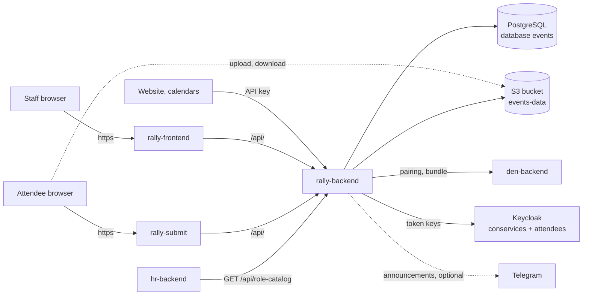

# Rally (Events)

**Rally** is the events module of Con Services. Its goal is to take a
convention's programme **from "call for papers" to "what is on in Main
hall right now" in one tool**, so the programme team, attendees and the
public website always see the same, current schedule. It covers **calls
for papers** (CfPs) with their own forms, a public **submission site**
where attendees propose talks and workshops, staff **review** and
decisions, the **schedule builder** with published versions and a public
schedule API, and **live-day** changes (delays, cancellations) with
Telegram announcements. Programme staff use the staff app, attendees the
submission site, and websites and calendars read the published schedule
with an API key. In the suite Rally follows Den's brand and settings, and
HR grants its staff roles through Keycloak groups; its full
[HTTP API](api.md) is open to scripts and integrations too.

Inside the platform Rally is also called **Events**: its short name in Den,
its database, Keycloak client and groups all use `events`. The code,
images and namespace use `rally`.

Source: [AGlElectronics/rally](https://github.com/AGlElectronics/rally)

## Who uses it

| Person | Uses Rally to |
| --- | --- |
| Events leads and programme team (`events-admin`, `events-organizer`, `events-programme`) | Open calls for papers, decide on submissions, build and publish the schedule, post live-day announcements. |
| Reviewers (`events-reviewer`) | Read, comment on and score submissions. |
| Attendees | Sign in to the **submission site** with an attendee account (a separate realm), submit ideas, invite co-presenters, see the programme. |
| The convention website, info screens | Read the published schedule through the public schedule API with an API key. |

## How Rally fits into the platform

- **Den first.** Rally is added after Den runs and is then **paired** with
  it (short name `events`); brand, organisation name and the
  `events_public_schedule` switch then come from Den. See
  [How the platform starts](../../getting-started/how-the-platform-starts.md).
- **Own namespace.** On Kubernetes Rally runs in `conservices-rally`.
- **Own chart.** [`deploy/charts/rally`](https://github.com/AGlElectronics/con-services/tree/main/deploy/charts/rally)
  (first version; see [Setup](setup.md)).
- **Own data.** Its own PostgreSQL database (`events`) and S3 bucket
  (`events-data`) for submission attachments. Browsers upload and download
  **directly** from S3 with short-lived signed links, so the storage
  address must be reachable from the internet.
- **Two sign-in realms.** Staff sign in through the `conservices` realm;
  attendees through the separate `attendees` realm, so a public account
  can never act as staff.

## Ways to run Rally

| Posture | When | Guide |
| --- | --- | --- |
| **Production cluster with Argo CD** (recommended for production) | Production: Den, Keycloak and every module on a cluster managed from Git. | [Den and the modules](../../deploy/apps.md) |
| Full platform on Kubernetes | A cluster you run yourself, next to Den, Keycloak and the other modules; also the local trial cluster. | [Setup: platform](setup.md#recommended-install-into-the-platform) |
| Standalone on Kubernetes | A CfP and schedule tool with your own database, storage and identity provider. | [Setup: standalone](setup.md#standalone-on-kubernetes) |
| Production with Docker | A single server without Kubernetes. | [Setup: Docker](setup.md#production-with-docker) |
| Development with Docker | Trying Rally or working on its code. Not for production. | [Setup: development](setup.md#development-with-docker) |

A local Kubernetes cluster (the [quickstart](../../getting-started/den-quickstart.md)) is for trials only; production installations use the Argo CD path.

## How Rally is built

| Part | Technology | Runs as |
| --- | --- | --- |
| Backend | Go 1.27, chi, pgx | Deployment `rally-backend` (`/server`, port 8080) |
| Migrations | Goose, separate binary | initContainer `migrate` in `rally-backend` (`rally-migrate` image). The server **never** migrates (ADR-0003). |
| Staff app | React 19, Rsbuild, TanStack Router and Query, Tailwind | Deployment `rally-frontend` (nginx) |
| Submission site | Same code, built with `RALLY_APP=submit` | Deployment `rally-submit` (nginx), optional |
| Database | PostgreSQL 16 | shared server, database `events` |
| Files | S3-compatible storage | bucket `events-data`, created by the backend if missing |

## Images

| Image | Built from | Contains |
| --- | --- | --- |
| `ghcr.io/aglelectronics/rally-backend:<tag>` | `infra/Dockerfile.backend` | API server `/server`, port 8080. |
| `ghcr.io/aglelectronics/rally-migrate:<tag>` | `infra/Dockerfile.migrate` | One-shot migrator `/migrate`; needs only `DATABASE_URL`. |
| `ghcr.io/aglelectronics/rally-frontend:<tag>` | `infra/Dockerfile.frontend` | Staff app on nginx (non-root as UID 101, port 8080; the chart mounts its own config). |
| `ghcr.io/aglelectronics/rally-submit:<tag>` | `infra/Dockerfile.frontend` with `--build-arg RALLY_APP=submit` | Submission site. The published image is built with the example sign-in settings (realm `attendees`, client `rally-submit`); for your own domain, build it yourself (see [Setup](setup.md#build-the-submission-site) and [CI and releases](../../contributing/ci.md#frontend-images-and-sign-in-settings)). |

Use the same tag for all of them ([Versions and upgrades](../../operations/versioning.md)).
The images are published with every Rally release, starting with
`1.0.0-1`.

!!! warning "Known limitation: one organisation, one edition"
    Rally has no screen or API yet to create organisations or editions. The
    first migration creates the organisation `demo-org` with the edition
    `next` ("Demo Convention — Next Edition"). Rename them, or add
    editions, with SQL: see [Admin guide](admin-guide.md#organisations-and-editions).

## In this section

- [Setup](setup.md): install Rally in each posture.
- [Admin guide](admin-guide.md): roles, calls for papers, review, schedule, live day.
- [Configuration](configuration.md): every environment variable.
- [API reference](api.md): every HTTP endpoint.

Design decisions: Rally's [ADRs](https://github.com/AGlElectronics/rally/tree/main/docs/adr).
