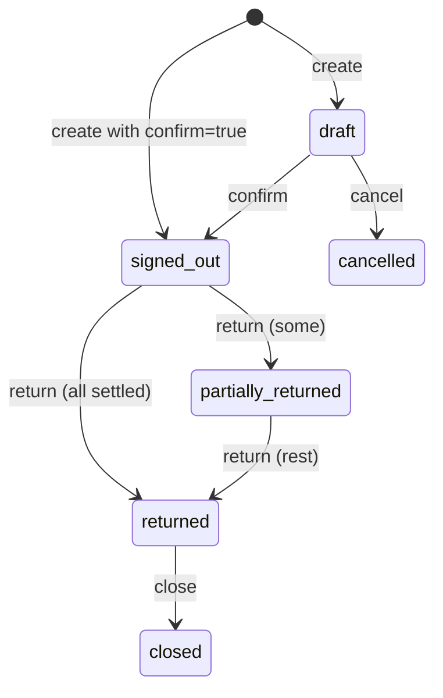

# Stash API reference

Stash's backend serves a JSON API over HTTP. The web app is built on it,
and you can use it too: from a barcode-scanner kiosk, a script that imports
an equipment spreadsheet, a nightly CSV export, or a screen at the Lost &
Found desk. This page documents **every endpoint** with who may call it,
what to send, what comes back and which errors to expect.

The route list is taken from
[`backend/internal/http/router.go`](https://github.com/AGlElectronics/stash/blob/main/backend/internal/http/router.go)
and the per-resource handler files next to it. Conventions shared by every
module (error shape, request ids, time formats) are described once in
[API conventions](../../concepts/api-conventions.md); this page only repeats
what is specific to Stash.

## Basics

### Base address

Stash's paths start with **`/api`** (there is no `/v1` segment).

| Where you call from | Base URL |
| --- | --- |
| A browser or script outside the cluster | `https://stash.example.org` (the web app's nginx forwards `/api/` to the backend) |
| Another pod inside the cluster | `http://stash-backend.conservices-stash.svc.cluster.local:8080` |

All examples below use these shell variables:

```sh
STASH=https://stash.example.org
TOKEN=...   # see "Getting a token" below
```

### Words used on this page

| Term | Meaning |
| --- | --- |
| **Item** | A thing Stash tracks. `item_type` is `asset` (individually tracked, usually quantity 1), `consumable` (counted stock), `container` (holds other items, like a flight case) or `grouped` (a set). |
| **Location** | Where things are; locations nest (Warehouse → Shelf B → Bin 3). |
| **Department** | A team that **manages** items or **needs** them, and receives sign-outs. |
| **Sign-out** | Lending items to a department, with a number like `SO-2026-00042`, and returning them later. |
| **Lost & Found report** | A `lost` (a guest lost something) or `found` (someone handed something in) entry, with a number like `LF-0042`. |
| **Asset tag** | The barcode printed on an item, for example `ST000042`. |

### Authentication

| Mode | How to call |
| --- | --- |
| `AUTH_MODE=oidc` (production) | `Authorization: Bearer <access token>` from Keycloak (client `stash-spa`). |
| `AUTH_MODE=dev` (local only) | `X-Dev-User: dev-admin`, or nothing (then `DEV_DEFAULT_USER`). Never on a reachable server. |

People are created in Stash on their first request. Their permissions are
recomputed **on every request** from the token's `groups` (or `roles`)
claim and the access config file, so removing someone from a group takes
effect immediately. See [Authentication](../../concepts/authentication.md).

**Global and department permissions.** A role is granted either
**globally** or **in one department**. On this page:

| Phrase | Meaning |
| --- | --- |
| *any* | You hold the permission globally or in at least one department. |
| *global* | You hold it globally. |
| *scoped* | You hold it globally, **or** in the department that manages the item (`managed_by_department_id`). |

**Built-in roles** (an access config may redefine them; see
[Admin guide](admin-guide.md#who-can-do-what)):

| Role | Main permissions |
| --- | --- |
| `admin` | Everything. |
| `inventory_manager` | All `item.*` and `signout.*`, `department/location/category.manage`, `audit.view`, `export.create`, `file.upload`. |
| `dept_lead` | `item.view`, `item.damage`, `item.lose`, all `signout.*`, `file.upload`, `audit.view`, `export.create`. |
| `volunteer` | `item.view`, `signout.view`, `signout.create`, `signout.return`. |
| `readonly` | `item.view`, `signout.view`, `audit.view`. |
| `frontdesk` | `lostfound.view`, `lostfound.create`, `lostfound.resolve`, `file.upload`. |
| `conops_lead` | All `lostfound.*`, `audit.view`, `export.create`, `file.upload`. |

### Getting a token

With the platform's Keycloak (a client that allows password grants is
needed; the web app's public client may not, and never use this in
production):

```sh
TOKEN=$(curl -s https://auth.example.org/realms/conservices/protocol/openid-connect/token \
  -d grant_type=password -d client_id=stash-spa \
  -d username=logistics -d password=change-me | jq -r .access_token)
```

### Errors

```json
{"error":{"code":"validation_failed","message":"quantity must be > 0"}}
```

| HTTP | `code` | Meaning |
| --- | --- | --- |
| 400 | `bad_request` | Malformed JSON, an **unknown JSON field** (bodies are decoded strictly), a bad id or date format. |
| 401 | `unauthorized` | Missing or invalid token. |
| 403 | `forbidden` | Signed in, but missing the permission (globally or in the item's department). |
| 404 | `not_found` | No such object. |
| 409 | `conflict` | The state does not allow it: not enough stock for a sign-out, confirming a returned sign-out, retiring a retired item, editing a setting Den manages, a duplicate name or barcode. |
| 422 | `validation_failed` | Field problems; sometimes with `details`. |
| 500 | `internal` | Server error; the log line has the same `X-Request-ID` as the response header. |

Requests time out after 60 seconds.

### Lists and paging

Item, sign-out and Lost & Found lists are paged with `limit` (default 50)
and `offset`, and return `{"items": [...], "total": N}`. Departments,
categories, locations, files and the audit log return `{"items": [...]}`.

### Common objects

**Item**

```json
{
  "id": "6f1c2a4e-0b7d-4a7e-9a51-2f7e9c1d0a11",
  "name": "Power strip 6-way",
  "description": "",
  "category_id": "c4d5e6f7-…",
  "item_type": "consumable",
  "size": "",
  "quantity_owned": 15,
  "quantity_damaged": 0,
  "quantity_lost": 2,
  "unit": "pcs",
  "condition": "good",
  "status": "available",
  "location_id": "1b9d6bcd-bbfd-4b2d-9b5d-ab8dfbbd4bed",
  "managed_by_department_id": "0c5e3e57-8f0a-4d0f-9a43-61f2b1d1c0a2",
  "asset_tag": "ST000042",
  "owner": "",
  "purchase_price": "12.50",
  "purchase_currency": "EUR",
  "purchase_date": "2026-03-01",
  "minimum_quantity": 5,
  "primary_image_file_id": "e1f2…",
  "notes": "",
  "created_at": "2026-10-02T09:14:00Z",
  "updated_at": "2026-11-01T17:40:12Z"
}
```

| Field | Notes |
| --- | --- |
| `status` | `available`, `in_use`, `retired`. |
| `quantity_owned` | Units owned in total, including damaged and lost ones. |
| `parent_container_id` | The container item it sits in, if any. |
| `parent_group_id` | The group item it belongs to, if any. |
| `managed_by_department_id` | The department responsible for it; decides *scoped* permissions. |
| `needed_by_department_id` | The department that uses it. |
| `serial_number`, `asset_tag`, `qr_code` | Codes a scanner can find it by. |
| `purchase_price`, `replacement_cost` | Decimal strings. |
| `minimum_quantity` | Below this the item counts as "low stock" on the dashboard. |
| `retired_at` | Set while retired. |

Optional fields are left out when empty. Dates are `YYYY-MM-DD`; times are
RFC 3339 in UTC.

---

## Health and discovery (no sign-in)

### `GET /api/health`

Who may call: anyone. Used by the readiness probe.

```sh
curl -s $STASH/api/health
```

```json
{"status":"ok","database":"ok","version":"1.0.0-1","uptime_sec":5231}
```

Answers **503** with `"status":"degraded","database":"down"` when the
database is unreachable.

### `GET /api/role-catalog`

Who may call: anyone. HR reads it to offer Stash roles when onboarding
someone. It lists every role from the access config with its permissions
and the identity provider group that grants it.

```sh
curl -s $STASH/api/role-catalog
```

```json
{
  "module": "stash",
  "display_name": "Stash",
  "description": "Inventory, sign-outs and Lost & Found.",
  "roles": [
    {"key": "admin", "label": "Admin",
     "description": "Everything in Stash, including access and settings.",
     "group": "stash-admin", "assignable": true, "scope": "global",
     "permissions": ["access.manage", "audit.view", "category.manage", "..."]},
    {"key": "readonly", "label": "Readonly",
     "description": "Read-only view of inventory, sign-outs and the audit log.",
     "group": "stash-readonly", "assignable": true, "scope": "global",
     "permissions": ["audit.view", "item.view", "signout.view"]}
  ]
}
```

A role with no bound group has `"assignable": false` and a `note`.

### `GET /api/brand`, `GET /api/brand/{role}`

Who may call: anyone (the login screen needs it). `/api/brand` returns the
brand for the web app: `"source": "den"` with Den's theme, copy and logo
URLs once paired, otherwise `"source": "standalone"`.

```json
{"source":"den","revision":7,"organization_name":"Example Con",
 "logo_url":"/api/brand/logo?v=5f2c…","login_background_url":"/api/brand/login-background?v=a91e…",
 "theme":{"primary":"#7c3aed"},"copy":{"login_layout":"panel","login_caption":"Welcome, crew!"}}
```

`/api/brand/{role}` streams an asset copied from Den: `logo` or
`login-background`; `404` when there is none. See
[Pairing](../../concepts/pairing.md).

---

## Public Lost & Found (no sign-in, optional)

Lets guests check whether their lost item was handed in. These routes
**only exist** when `PUBLIC_LOSTFOUND_CLAIM_ENABLED=true`; otherwise every
path is `404`. They only ever show reports that are `type = found`,
`status = open` and not deleted, and only these fields: no contact details,
no internal notes.

| Method and path | Returns |
| --- | --- |
| `GET /api/public/lostfound/?q=&limit=&offset=` | `{"items":[…],"total":N}`; `q` matches item name, description and location; `limit` default 20, max 50; newest first. |
| `GET /api/public/lostfound/{reportNumber}` | One report, or `404`. |
| `GET /api/public/lostfound/{reportNumber}/photo` | Its photo (`Cache-Control: public, max-age=3600`), or `404`. |

```sh
curl -s "$STASH/api/public/lostfound/?q=umbrella"
```

```json
{"items":[{"report_number":"LF-0042","item_name":"Blue umbrella","description":"Folding, wooden handle",
  "location":"Hall B entrance","date_reported":"2026-11-06T10:15:00Z",
  "photo_url":"/api/public/lostfound/LF-0042/photo"}],"total":1}
```

---

## You and settings

### `GET /api/me`

Who may call: signed in. Your identity, department memberships and
**effective permissions** (global and department ones combined), so the web
app can hide what you cannot do. Precise department checks stay on the
server.

```sh
curl -s $STASH/api/me -H "Authorization: Bearer $TOKEN"
```

```json
{
  "id": "4a5b6c7d-…",
  "display_name": "Lena Logistics",
  "email": "lena@example.org",
  "oidc_subject": "6f1d2a7e-1c8b-4f0e-9d55-8c1b2f9a0e11",
  "memberships": [
    {"department_id": null, "role": "inventory_manager"},
    {"department_id": "0c5e3e57-…", "role": "dept_lead"}
  ],
  "permissions": ["audit.view", "item.create", "item.edit", "item.view", "signout.create", "..."],
  "primary_department_id": "0c5e3e57-…"
}
```

`department_id: null` means a global membership.

### `GET /api/me/preferences`, `PUT /api/me/preferences`

Who may call: signed in. Your theme, shared across modules through Den:
`{"theme": "system" | "light" | "dark"}`; anything else is `422`. Without
Den the value is echoed back and kept in the browser.

### `GET /api/dashboard`

Who may call: signed in. Pre-computed counts for the home screen. A section
you have no permission for is **left out** (not `0`), so the web app can
tell "nothing" from "not allowed".

| Field | Shown with |
| --- | --- |
| `overdue_signouts`, `active_signouts`, `partially_returned_signouts`, `recent_signouts` (last 5) | `signout.view` (any) |
| `low_stock_items`, `damaged_items` | `item.view` (any) |
| `open_lostfound_reports` | `lostfound.view` (any) |

```json
{"overdue_signouts":2,"active_signouts":14,"partially_returned_signouts":3,"recent_signouts":[…],
 "low_stock_items":5,"damaged_items":1}
```

### `GET /api/settings`, `PATCH /api/settings`

`GET`: any signed-in person (the web app adapts to them). `PATCH`:
`access.manage` (global). `PATCH` merges the JSON object you send into the
stored settings; keys you leave out keep their value.

| Key | Default | Meaning |
| --- | --- | --- |
| `force_barcode_on_signout` | `false` | Every sign-out line must carry a scanned code that belongs to the item. |
| `organization_name` | `""` | Label for exports. **Managed by Den** while paired (read-only here). |
| `default_item_owner` | `""` | Owner filled in on new items. |
| `default_currency` | `EUR` | ISO 4217 code used as the item form default. |
| `barcode_prefix`, `barcode_width` | `ST`, `6` | Format of generated asset tags (`ST000042`). |
| `preserve_sacred_lostfound` | `false` | Protects report `LF-0001` (the event's running joke) from edits and deletion. |
| `managed_by`, `managed_keys` | | Read-only: `"den"` and the keys Den controls, while paired. |

```sh
curl -s -X PATCH $STASH/api/settings -H "Authorization: Bearer $TOKEN" \
  -H "Content-Type: application/json" -d '{"force_barcode_on_signout":true}'
```

Response `200`: the full settings. Errors: `400` invalid JSON; `403`;
`409 "organization_name is managed in Den (Admin → Organisation)"`.

---

## Departments, categories, locations

These three are simple lookup lists with the same shape. Reads need
`item.view` (any).

| Resource | Object | Create also accepts |
| --- | --- | --- |
| `/api/departments` | `{"id","name","description","created_at","updated_at"}` | |
| `/api/categories` | same | |
| `/api/locations` | same plus `parent_id` | `parent_id` (nest it) |

| Method and path | Who | Response |
| --- | --- | --- |
| `GET /api/<resource>` | `item.view` (any) | `{"items":[…]}` |
| `GET /api/<resource>/{id}` | `item.view` (any) | the object |
| `POST /api/<resource>` | global `<resource>.manage`, **or** global `item.create` or `item.edit` (so the item form can create one on the fly) | `201` the object |
| `PATCH /api/<resource>/{id}` | global `department.manage` / `category.manage` / `location.manage` | `200` the object |
| `DELETE /api/<resource>/{id}` | same | `204` |

Bodies: `{"name": "…", "description": "…"}` (create requires `name`).
Locations also take `parent_id`, and on `PATCH` `clear_parent: true` moves
a location to the top level.

```sh
curl -s -X POST $STASH/api/locations -H "Authorization: Bearer $TOKEN" \
  -H "Content-Type: application/json" \
  -d '{"name":"Shelf B","parent_id":"1b9d6bcd-bbfd-4b2d-9b5d-ab8dfbbd4bed"}'
```

```json
{"id":"7e8f9a0b-…","parent_id":"1b9d6bcd-bbfd-4b2d-9b5d-ab8dfbbd4bed","name":"Shelf B","description":"","created_at":"2026-11-06T09:00:00Z","updated_at":"2026-11-06T09:00:00Z"}
```

Errors: `422 "name is required"` / `"name cannot be empty"`; for locations
also `"parent location does not exist"`, `"location cannot be its own
parent"`, `"location parent would create a cycle"`, `"location hierarchy is
too deep"`; `409` for a duplicate name or deleting something still in use
(`"referenced or referencing record exists"`).

---

## Items

### `GET /api/items`

Who may call: `item.view` (any).

| Query | Meaning |
| --- | --- |
| `q` | Substring search in name, serial number and asset tag (case-insensitive). |
| `category_id`, `location_id` | Filter. `include_sublocations=true` also matches locations under `location_id`. |
| `managed_dept_id`, `needed_dept_id` | Filter by department. |
| `parent_container_id`, `parent_group_id` | Contents of a container or group. |
| `item_type`, `status` | Filter by value. |
| `include_retired` | `true` to include retired items. |
| `limit`, `offset` | Paging (default 50). |

```sh
curl -s -H "Authorization: Bearer $TOKEN" "$STASH/api/items?q=power%20strip&limit=1"
```

```json
{"items":[{"id":"6f1c2a4e-…","name":"Power strip 6-way","item_type":"consumable","quantity_owned":15,"…":"…"}],"total":1}
```

Errors: `401`, `403`, `400` when a filter id is not a UUID.

### `POST /api/items`

Who may call: `item.create`, globally or in the department you set as
`managed_by_department_id`.

| Field | Required | Notes |
| --- | --- | --- |
| `name` | yes | |
| `item_type` | yes | `asset`, `consumable`, `container`, `grouped`. |
| `quantity_owned` | no | Not negative. |
| `description`, `size`, `unit`, `condition`, `status`, `owner`, `notes` | no | `status` defaults to `available`; `owner` to the `default_item_owner` setting. |
| `category_id` **or** `category_name` | no | A name creates the category if it does not exist. |
| `location_id` **or** `location_name` | no | Same. |
| `managed_by_department_id` **or** `managed_by_department_name` | no | Same. |
| `needed_by_department_id` **or** `needed_by_department_name` | no | Same. |
| `parent_container_id`, `parent_group_id` | no | Item ids. |
| `serial_number`, `asset_tag`, `qr_code` | no | Unique when set. |
| `purchase_price`, `replacement_cost` | no | Decimal strings, e.g. `"12.50"`. |
| `purchase_currency` | no | Default from settings (`EUR`). |
| `purchase_date`, `expiry_date` | no | `YYYY-MM-DD`. |
| `supplier`, `purchase_url` | no | |
| `minimum_quantity` | no | Low-stock threshold. |

```sh
curl -s -X POST $STASH/api/items -H "Authorization: Bearer $TOKEN" \
  -H "Content-Type: application/json" -d '{
    "name": "Power strip 6-way",
    "item_type": "consumable",
    "quantity_owned": 15,
    "unit": "pcs",
    "category_name": "Electrical",
    "location_id": "1b9d6bcd-bbfd-4b2d-9b5d-ab8dfbbd4bed",
    "managed_by_department_id": "0c5e3e57-8f0a-4d0f-9a43-61f2b1d1c0a2",
    "minimum_quantity": 5
  }'
```

Response `201`: the [Item](#common-objects). A `created` history event is
written.

| Status | When |
| --- | --- |
| `400` | `"date must be YYYY-MM-DD"`, bad JSON. |
| `403` | No `item.create` for that department. |
| `409` | Duplicate code (`asset_tag`, `serial_number`, `qr_code`). |
| `422` | `"name is required"`, `"item_type must be asset, consumable, container or grouped"`, `"quantity_owned cannot be negative"`. |

### `GET /api/items/{id}`

Who may call: `item.view` (any). The Item, or `404`.

### `PATCH /api/items/{id}`

Who may call: `item.edit` (scoped). Moving the item to another managing
department also needs `item.edit` in **that** department. Send only what
changes; fields are the same as create (except `quantity_owned` and
`status`, which change through the [lifecycle actions](#lifecycle-actions)).
To **clear** an optional field send its clear flag, because an empty value
means "leave unchanged":

`clear_category`, `clear_location`, `clear_container`, `clear_group`,
`clear_managed_by`, `clear_needed_by`, `clear_purchase_price`,
`clear_purchase_date`, `clear_expiry_date`, `clear_replacement_cost`.

```sh
curl -s -X PATCH $STASH/api/items/6f1c2a4e-0b7d-4a7e-9a51-2f7e9c1d0a11 \
  -H "Authorization: Bearer $TOKEN" -H "Content-Type: application/json" \
  -d '{"minimum_quantity":8,"clear_needed_by":true}'
```

Response `200`: the Item.

### `GET /api/items/{id}/availability`

Who may call: `item.view` (any). How many units can be signed out right
now.

```json
{"quantity_owned":15,"quantity_damaged":0,"quantity_lost":2,"quantity_signed_out":3,"quantity_available":10}
```

### `GET /api/items/{id}/history`

Who may call: `item.view` (any). The item's event log, newest first.

| Query | Meaning |
| --- | --- |
| `event_type` | `created`, `moved`, `quantity_adjusted`, `signed_out`, `returned`, `consumed`, `marked_damaged`, `repaired`, `marked_lost`, `marked_found`, `condition_changed`, `retired`, `restored`. |
| `signout_id` | Only events of one sign-out. |
| `since` | RFC 3339 time. |
| `limit`, `offset` | Default 100. |

```json
{"events":[{"id":"ev1…","item_id":"6f1c2a4e-…","event_type":"signed_out","quantity":3,
  "to_department_id":"0c5e3e57-…","related_signout_id":"9a7b0f4e-…",
  "actor_user_id":"4a5b6c7d-…","actor_display_name":"Lena Logistics","note":"",
  "occurred_at":"2026-11-06T10:02:11Z"}],"total":12}
```

### Barcodes

| Method and path | Who | Body | Response |
| --- | --- | --- | --- |
| `GET /api/items/by-barcode/{code}` | `item.view` (any) | none | The Item whose `asset_tag`, `qr_code` or `serial_number` is `{code}` (URL-encode it), asset tag first. `404` when none. |
| `GET /api/items/barcodes/peek-next` | `item.create` or `item.edit` (any) | none | `{"next":"ST000043","format":"AW######"}`: the next generated code, **without** using it. (`format` is a fixed legacy label; the real format comes from the `barcode_prefix`/`barcode_width` settings.) |
| `POST /api/items/{id}/assign-barcode` | `item.edit` (scoped) | none | `{"item": Item, "code": "ST000043"}`: generates the next code and stores it as `asset_tag`. |
| `POST /api/items/{id}/set-barcode` | `item.edit` (scoped) | `{"code":"ST000099"}` | The Item: stores a pre-printed sticker's code as `asset_tag`. |

```sh
curl -s "$STASH/api/items/by-barcode/ST000042" -H "Authorization: Bearer $TOKEN"
```

Errors for `set-barcode`: `422 "barcode is required"`, `"barcode must not
contain spaces or tabs"`, `"barcode is too long (max 64 chars)"`; `409` when
another item already has the code.

### Lifecycle actions

Each action changes quantities or state, writes a history event and
returns the updated Item (`200`). All are **scoped** to the item's
managing department.

| Method and path | Permission | Body | Effect |
| --- | --- | --- | --- |
| `POST /api/items/{id}/move` | `item.move` | `to_location_id`, `clear_location`, `to_container_id`, `clear_container`, `note` | New location and/or container. |
| `POST /api/items/{id}/adjust-quantity` | `item.adjust` | `{"delta": -2, "note": "..."}` | Stock count correction; `delta` non-zero; may not go below 0. |
| `POST /api/items/{id}/damage` | `item.damage` | `{"quantity": 1, "note": "..."}` | Units become damaged (not available). |
| `POST /api/items/{id}/repair` | `item.damage` | `quantity`, `note`, `related_event_id` (the damage event) | Damaged units become usable again. |
| `POST /api/items/{id}/lost` | `item.lose` | `{"quantity": 1, "note": "..."}` | Units are lost. |
| `POST /api/items/{id}/found` | `item.lose` | `{"quantity": 1, "note": "..."}` | Lost units are back. |
| `POST /api/items/{id}/retire` | `item.retire` | `{"note": "..."}` (optional) | `status` becomes `retired`; hidden from lists by default. |
| `POST /api/items/{id}/restore` | `item.retire` | `{"note": "..."}` (optional) | Back from retired. |

```sh
curl -s -X POST $STASH/api/items/6f1c2a4e-0b7d-4a7e-9a51-2f7e9c1d0a11/damage \
  -H "Authorization: Bearer $TOKEN" -H "Content-Type: application/json" \
  -d '{"quantity":1,"note":"Burnt socket after load-in"}'
```

| Status | When |
| --- | --- |
| `403` | Missing the permission globally and in the item's department. |
| `404` | Unknown item. |
| `409` | `"item is already retired"`, `"item is not retired"`. |
| `422` | `"quantity must be > 0"`, `"delta must be non-zero"`, `"damaged quantity would exceed available units"`, `"repair quantity exceeds damaged units"`, `"lost quantity exceeds owned units"`, `"found quantity exceeds lost units"`, `"adjustment would result in negative quantity_owned"`. |

### Primary image

| Method and path | Who | Body | Response |
| --- | --- | --- | --- |
| `POST /api/items/{id}/primary-image` | `item.edit` (scoped) | `{"file_id": "…"}` | `204` |
| `DELETE /api/items/{id}/primary-image` | `item.edit` (scoped) | none | `204` |

The file must be an `image` file attached to this item (see [Files](#files));
otherwise `422 "file does not belong to this item"` or `"only image files
can be set as primary"`. Uploading with `set_as_primary=true` does both
steps at once.

---

## Sign-outs

A **sign-out** lends items to a department. Its lifecycle:



(`prepared` behaves like `draft`: it can be confirmed or cancelled.)
Availability drops when a sign-out becomes `signed_out`. A line is
**settled** when returned + consumed + lost + damaged equals what was signed
out.

**Sign-out object** (all endpoints return it with its `items`):

```json
{
  "id": "9a7b0f4e-2c11-4f62-8d0e-5b3f8e7a6c10",
  "signout_number": "SO-2026-00042",
  "from_department_id": null,
  "to_department_id": "0c5e3e57-8f0a-4d0f-9a43-61f2b1d1c0a2",
  "from_location_id": "1b9d6bcd-…",
  "status": "signed_out",
  "purpose": "Stage B setup",
  "signed_out_by_user_id": "4a5b6c7d-…",
  "received_by_name": "Alex",
  "expected_return_at": "2026-11-08T18:00:00Z",
  "signed_out_at": "2026-11-06T10:02:11Z",
  "notes": "scanned: ST000042",
  "created_by": "4a5b6c7d-…",
  "created_at": "2026-11-06T10:02:11Z",
  "updated_at": "2026-11-06T10:02:11Z",
  "items": [
    {"id": "d2f0e3a1-…", "signout_id": "9a7b0f4e-…", "item_id": "6f1c2a4e-…",
     "quantity_signed_out": 3, "quantity_returned": 0, "quantity_consumed": 0,
     "quantity_lost": 0, "quantity_damaged": 0, "notes": "",
     "created_at": "2026-11-06T10:02:11Z", "updated_at": "2026-11-06T10:02:11Z"}
  ]
}
```

### `GET /api/signouts`

Who may call: `signout.view` (any). Query: `q`, `status`,
`to_department_id`, `from_department_id`, `limit`, `offset`. Returns
`{"items":[sign-out without items…],"total":N}`.

### `GET /api/signouts/{id}`

Who may call: `signout.view` (any). The sign-out with its lines.

### `POST /api/signouts`

Who may call: `signout.create` (any). With `"confirm": true` the sign-out
goes straight to `signed_out` and availability drops immediately (the "fast
sign-out").

| Field | Type | Required | Notes |
| --- | --- | --- | --- |
| `to_department_id` | UUID | yes | Receiving department. |
| `from_department_id`, `from_location_id` | UUID | no | Where it comes from. |
| `purpose` | string | no | Shown on the sign-out. |
| `received_by_name` | string | no | Person who took it. |
| `received_by_user_id` | UUID | no | Stash user who took it. |
| `expected_return_at` | RFC 3339 time | no | Drives "overdue". |
| `notes` | string | no | |
| `items` | array | yes | `{"item_id", "quantity", "condition_on_signout"?, "notes"?, "scanned_codes"?}` |
| `confirm` | bool | no | `true` = sign out now. |

`scanned_codes` lists the codes the operator scanned for that line. Each
must belong to the item. With the `force_barcode_on_signout` setting on,
every line needs at least one.

```sh
curl -s -X POST $STASH/api/signouts -H "Authorization: Bearer $TOKEN" \
  -H "Content-Type: application/json" -d '{
    "to_department_id": "0c5e3e57-8f0a-4d0f-9a43-61f2b1d1c0a2",
    "purpose": "Stage B setup",
    "received_by_name": "Alex",
    "expected_return_at": "2026-11-08T18:00:00Z",
    "items": [{"item_id": "6f1c2a4e-0b7d-4a7e-9a51-2f7e9c1d0a11", "quantity": 3, "scanned_codes": ["ST000042"]}],
    "confirm": true
  }'
```

Response `201`: the sign-out (see above).

| Status | When |
| --- | --- |
| `403` | No `signout.create`. |
| `409` | Not enough units available for a line. |
| `422` | `"at least one item is required"`, `"invalid to_department_id"`, `"invalid expected_return_at (use RFC3339)"`, `"invalid item_id at items[0]"`, `"each line item quantity must be > 0"`, `"item \"…\" is retired"`, `"scanned code \"…\" does not belong to item \"…\""`, `"a barcode scan is required for \"…\""`. |

### Sign-out actions

| Method and path | Permission (any) | Body | From status | Response |
| --- | --- | --- | --- | --- |
| `POST /api/signouts/{id}/confirm` | `signout.confirm` | none | `draft`, `prepared` | `200`, now `signed_out` |
| `POST /api/signouts/{id}/return` | `signout.return` | see below | `signed_out`, `partially_returned` | `200` |
| `POST /api/signouts/{id}/cancel` | `signout.cancel` | `{"note": "..."}` (optional) | `draft`, `prepared` | `200`, now `cancelled` |
| `POST /api/signouts/{id}/close` | `signout.close` | none | `returned` | `200`, now `closed` |

Any other starting status is `409 "cannot confirm a returned sign-out"`
(and so on).

**Returning.** Send **deltas** per line: how many came back now, were used
up, lost or damaged. Lost and damaged units update the item's counts.

```sh
curl -s -X POST $STASH/api/signouts/9a7b0f4e-2c11-4f62-8d0e-5b3f8e7a6c10/return \
  -H "Authorization: Bearer $TOKEN" -H "Content-Type: application/json" -d '{
    "lines": [{"signout_item_id": "d2f0e3a1-7b8c-4e5d-9f60-1a2b3c4d5e6f",
               "returned": 2, "consumed": 0, "lost": 0, "damaged": 1,
               "condition_on_return": "one socket burnt"}]
  }'
```

The sign-out becomes `returned` when every line is settled, otherwise
`partially_returned`. Errors: `422 "no return lines provided"`, `"return
deltas must be non-negative"`, `"signout item does not belong to this
signout"`, `"settled quantity would exceed signed-out quantity"`.

---

## Lost & Found

**Report object:**

```json
{
  "id": "b1c2d3e4-…", "report_number": "LF-0042", "type": "found", "status": "open",
  "item_name": "Blue umbrella", "description": "Folding, wooden handle",
  "photo_file_id": "f9e8…", "location": "Hall B entrance",
  "date_reported": "2026-11-06T10:15:00Z", "reported_by_user_id": "4a5b…",
  "contact_name": "", "contact_info": "", "returned_to": "",
  "resolution_note": "", "created_at": "2026-11-06T10:15:00Z", "updated_at": "2026-11-06T10:15:00Z"
}
```

`type` is `lost` or `found`; `status` is `open`, `returned` (handed back to
its owner) or `closed` (unclaimed, disposed, donated).

| Method and path | Permission (any) | Response |
| --- | --- | --- |
| `GET /api/lostfound/?type=&status=&q=&limit=&offset=` | `lostfound.view` | `{"items":[…],"total":N}` |
| `GET /api/lostfound/by-number/{reportNumber}` | `lostfound.view` | the report |
| `GET /api/lostfound/{id}` | `lostfound.view` | the report |
| `POST /api/lostfound/` | `lostfound.create` | `201` the report |
| `PATCH /api/lostfound/{id}` | `lostfound.view`, plus the checks below | `200` the report |
| `DELETE /api/lostfound/{id}` | `lostfound.delete` | `204`; the report is removed from every list but kept in the audit log. `403` for `LF-0001` while `preserve_sacred_lostfound` is on. |

**Create.** `type` (required), `item_name` (required), `description`,
`location`, `date_reported` (RFC 3339; default now), `contact_name`,
`contact_info`, `photo_file_id` (an image file).

```sh
curl -s -X POST $STASH/api/lostfound/ -H "Authorization: Bearer $TOKEN" \
  -H "Content-Type: application/json" \
  -d '{"type":"found","item_name":"Blue umbrella","description":"Folding, wooden handle","location":"Hall B entrance"}'
```

**Update.** Every field is optional. What you need depends on what you
change:

| Change | Also needs |
| --- | --- |
| `type`, `item_name`, `description`, `location`, `contact_name`, `contact_info`, `photo_file_id` (`""` removes the photo) | `lostfound.edit` |
| `status` to `returned` or `closed` | `lostfound.resolve`; sets who resolved it and when |
| `status` back to `open` | `lostfound.reopen`; clears the resolution |
| `returned_to`, `resolution_note` without a status change | `lostfound.resolve` |

```sh
curl -s -X PATCH $STASH/api/lostfound/b1c2d3e4-… -H "Authorization: Bearer $TOKEN" \
  -H "Content-Type: application/json" \
  -d '{"status":"returned","returned_to":"Sam (badge 1234)","resolution_note":"ID checked"}'
```

Errors: `403` (missing one of the permissions above, or `"LF-0001 is the
sacred test item and cannot be edited"` with `preserve_sacred_lostfound`
on), `404`, `422` (`"type must be 'lost' or 'found'"`, `"status must be
'open', 'returned' or 'closed'"`, `"item_name is required"`, `"photo_file_id
must reference an image file"`).

---

## Files

Photos and documents attached to an **item** or a **Lost & Found report**,
stored in the module's bucket. Limits: **25 MB** for `file_type=image`
(which must have an `image/*` content type), **50 MB** for other types.

`file_type` is one of `image` (default), `receipt`, `invoice`, `manual`,
`warranty`, `attachment`. `entity_type` is `item` or `lostfound`; anything
else is `400 "unsupported entity_type"`.

Access follows the entity: reading needs `item.view` / `lostfound.view`
(any); writing needs `file.upload` plus `item.create` or `item.edit` /
`lostfound.create` or `lostfound.edit` (any).

**File object:**

```json
{"id":"e1f2a3b4-…","entity_type":"item","entity_id":"6f1c2a4e-…","file_type":"image",
 "storage_key":"items/6f1c2a4e-…/e1f2a3b4-….jpg","original_filename":"power-strip.jpg",
 "content_type":"image/jpeg","size_bytes":482113,"uploaded_by":"4a5b…","created_at":"2026-11-06T09:30:00Z"}
```

### `POST /api/files/upload` (recommended)

Multipart form, streamed through the backend:

| Form field | Required | Notes |
| --- | --- | --- |
| `file` | yes | The file. |
| `entity_type`, `entity_id` | yes | What it belongs to. |
| `file_type` | no | Default `image`. |
| `set_as_primary` | no | `true` makes it the item's primary image (items and images only). |

```sh
curl -s -X POST $STASH/api/files/upload -H "Authorization: Bearer $TOKEN" \
  -F "file=@power-strip.jpg;type=image/jpeg" \
  -F entity_type=item -F entity_id=6f1c2a4e-0b7d-4a7e-9a51-2f7e9c1d0a11 \
  -F set_as_primary=true
```

Response `201`: the File. Errors: `400` (no `file`, no `entity_type`,
`entity_id` not a UUID, bad form), `403`, `422` (`"file too large (max …
bytes)"`, `"file_type=image requires an image/* content_type"`, `"invalid
file_type"`).

### Direct-to-storage upload (two steps)

For large files the browser can upload straight to the bucket:

1. `POST /api/files/presign-upload` with
   `{"entity_type","entity_id","file_type","original_filename"}` returns
   `{"upload_url","storage_key","expires_at"}`.
2. `PUT` the bytes to `upload_url`.
3. `POST /api/files/` with `{"entity_type","entity_id","file_type",
   "storage_key","original_filename","content_type","size_bytes",
   "set_as_primary"}` registers it and returns `201` with the File.

The bucket must be reachable from the browser for this path; when it is
not (the usual Kubernetes setup), use `/api/files/upload`.

### Reading and deleting

| Method and path | Who | Response |
| --- | --- | --- |
| `GET /api/files/?entity_type=&entity_id=&file_type=` | view access on the entity | `{"items":[File…]}`; `entity_type` and `entity_id` required |
| `GET /api/files/{id}/raw` | view access on its entity | The bytes, streamed through the backend, `inline`, `Cache-Control: private, max-age=300` |
| `GET /api/files/{id}/download` | view access on its entity | `{"url","expires_at"}`: a short-lived presigned link to the bucket |
| `DELETE /api/files/{id}` | `file.upload` and write access on its entity | `204` |

---

## Audit log and exports

### `GET /api/audit-log/`

Who may call: `audit.view` (**global**). Every change in Stash with before
and after values, newest first.

| Query | Meaning |
| --- | --- |
| `action` | For example `item.update`, `signout.create`, `lostfound.return`. |
| `entity_type`, `entity_id` | What was changed. |
| `actor` | A user id. |
| `limit`, `offset` | Default 100. |

```sh
curl -s "$STASH/api/audit-log/?entity_type=item&limit=1" -H "Authorization: Bearer $TOKEN"
```

```json
{"items":[{"id":"a1…","actor_user_id":"4a5b…","actor_oidc_subject":"6f1d…","actor_display_name":"Lena Logistics",
  "action":"item.update","entity_type":"item","entity_id":"6f1c2a4e-…",
  "before":{"minimum_quantity":5},"after":{"minimum_quantity":8},"note":"","created_at":"2026-11-06T11:00:00Z"}]}
```

### `GET /api/export/items.csv`, `GET /api/export/signouts.csv`

Who may call: `export.create` (**global**). CSV downloads
(`Content-Disposition: attachment; filename="items-20261106.csv"`).
`items.csv` contains every non-retired item with department names and
location paths resolved (`?parent_container_id=` limits it to one
container's contents). `signouts.csv` contains every sign-out.

```sh
curl -s -OJ $STASH/api/export/items.csv -H "Authorization: Bearer $TOKEN"
```

---

## Den connection: `/api/den`

Who may call: `access.manage` (**global**, admins). The same pairing API as
every module; see [Pairing](../../concepts/pairing.md).

```sh
curl -s -X POST $STASH/api/den/pair -H "Authorization: Bearer $TOKEN" \
  -H "Content-Type: application/json" \
  -d '{"pairing_url":"https://den.example.org/api/v1/integrations/pairing/redeem?token=change-me"}'
```

```json
{
  "paired": true,
  "den_base_url": "http://den-backend.conservices-den.svc.cluster.local:8080",
  "module_id": "3d1f9b7e-4c2a-4e8b-a1f0-6b5c4d3e2a10",
  "paired_at": "2026-11-06T10:05:00Z",
  "synced_at": "2026-11-06T10:05:01Z"
}
```

| Request | Result |
| --- | --- |
| `GET /api/den/` | Status as above; `{"paired": false}` when standalone. |
| `POST /api/den/pair` | Pair. **422** `pairing_failed` with the reason (expired token, Den unreachable). |
| `POST /api/den/sync` | Sync now. **409** when not paired, **502** when Den fails. |
| `DELETE /api/den/pair` | Unpair, **204**. Stash returns to its own settings. |

---

## All endpoints at a glance

75 routes. *any* = globally or in any department; *scoped* = globally or in
the item's managing department; *global* = globally only.

### Public

| Method | Path | Notes |
| --- | --- | --- |
| GET | `/api/health` | |
| GET | `/api/role-catalog` | |
| GET | `/api/brand`, `/api/brand/{role}` | |
| GET | `/api/public/lostfound/`, `/{reportNumber}`, `/{reportNumber}/photo` | Only with `PUBLIC_LOSTFOUND_CLAIM_ENABLED=true`. |

### Signed in

| Method | Path | Permission |
| --- | --- | --- |
| GET | `/api/me` | signed in |
| GET, PUT | `/api/me/preferences` | signed in |
| GET | `/api/dashboard` | signed in (sections per permission) |
| GET | `/api/settings` | signed in |
| PATCH | `/api/settings` | `access.manage` (global) |
| GET | `/api/departments`, `/api/departments/{id}` | `item.view` (any) |
| POST | `/api/departments` | `department.manage`, `item.create` or `item.edit` (global) |
| PATCH, DELETE | `/api/departments/{id}` | `department.manage` (global) |
| GET | `/api/categories`, `/api/categories/{id}` | `item.view` (any) |
| POST | `/api/categories` | `category.manage`, `item.create` or `item.edit` (global) |
| PATCH, DELETE | `/api/categories/{id}` | `category.manage` (global) |
| GET | `/api/locations`, `/api/locations/{id}` | `item.view` (any) |
| POST | `/api/locations` | `location.manage`, `item.create` or `item.edit` (global) |
| PATCH, DELETE | `/api/locations/{id}` | `location.manage` (global) |
| GET | `/api/items`, `/api/items/{id}` | `item.view` (any) |
| POST | `/api/items` | `item.create` (in the managing department, or global) |
| GET | `/api/items/by-barcode/{code}` | `item.view` (any) |
| GET | `/api/items/barcodes/peek-next` | `item.create` or `item.edit` (any) |
| GET | `/api/items/{id}/availability`, `/history` | `item.view` (any) |
| PATCH | `/api/items/{id}` | `item.edit` (scoped) |
| POST | `/api/items/{id}/assign-barcode`, `/set-barcode` | `item.edit` (scoped) |
| POST | `/api/items/{id}/move` | `item.move` (scoped) |
| POST | `/api/items/{id}/adjust-quantity` | `item.adjust` (scoped) |
| POST | `/api/items/{id}/damage`, `/repair` | `item.damage` (scoped) |
| POST | `/api/items/{id}/lost`, `/found` | `item.lose` (scoped) |
| POST | `/api/items/{id}/retire`, `/restore` | `item.retire` (scoped) |
| POST, DELETE | `/api/items/{id}/primary-image` | `item.edit` (scoped) |
| GET | `/api/signouts`, `/api/signouts/{id}` | `signout.view` (any) |
| POST | `/api/signouts` | `signout.create` (any) |
| POST | `/api/signouts/{id}/confirm` | `signout.confirm` (any) |
| POST | `/api/signouts/{id}/return` | `signout.return` (any) |
| POST | `/api/signouts/{id}/cancel` | `signout.cancel` (any) |
| POST | `/api/signouts/{id}/close` | `signout.close` (any) |
| GET | `/api/lostfound/`, `/by-number/{reportNumber}`, `/{id}` | `lostfound.view` (any) |
| PATCH | `/api/lostfound/{id}` | `lostfound.view`, plus `.edit` / `.resolve` / `.reopen` depending on the change |
| POST | `/api/lostfound/` | `lostfound.create` (any) |
| DELETE | `/api/lostfound/{id}` | `lostfound.delete` (any) |
| GET | `/api/files/` | view access on the entity |
| POST | `/api/files/upload`, `/api/files/presign-upload`, `/api/files/` | `file.upload` and write access on the entity |
| GET | `/api/files/{id}/raw`, `/api/files/{id}/download` | view access on the entity |
| DELETE | `/api/files/{id}` | `file.upload` and write access on the entity |
| GET | `/api/audit-log/` | `audit.view` (global) |
| GET | `/api/export/items.csv`, `/api/export/signouts.csv` | `export.create` (global) |
| GET | `/api/den/` | `access.manage` (global) |
| POST | `/api/den/pair`, `/api/den/sync` | `access.manage` (global) |
| DELETE | `/api/den/pair` | `access.manage` (global) |

## Troubleshooting

**`403` on an item action although my role has the permission.** Your
role is probably granted **in a department**. Item actions are scoped to
the item's managing department; check `managed_by_department_id` on the
item and the `memberships` in `GET /api/me`.

**`409` when creating a sign-out.** Not enough units are available: check
`GET /api/items/{id}/availability`. Units already signed out, damaged or
lost are not available.

**`422 a barcode scan is required for "…"`.** The
`force_barcode_on_signout` setting is on. Send the scanned code in the
line's `scanned_codes`.

**`409 organization_name is managed in Den`.** Stash is paired; change the
organisation name in Den.

**`/api/public/lostfound/` answers `404`.** Set
`PUBLIC_LOSTFOUND_CLAIM_ENABLED=true` ([Configuration](configuration.md)).
Only `found` reports that are still `open` are shown.

**`GET /api/files/{id}/download` links do not open.** Presigned links point
at the bucket, which is usually not reachable from browsers on Kubernetes.
Use `/api/files/{id}/raw` instead.
