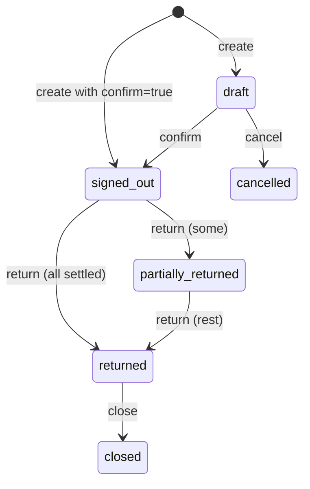

# Stash API reference

Stash's backend serves a JSON API over HTTP. The web app is built on it,
and you can use it too: from a barcode-scanner kiosk, a script that imports
an equipment spreadsheet, a nightly CSV export, or a screen at the Lost &
Found desk. This page documents **every endpoint** with who may call it,
what to send, what comes back and which errors to expect.

The route list is taken from
[`backend/internal/http/router.go`](https://github.com/AGlElectronics/stash/blob/main/backend/internal/http/router.go)
and the per-resource handler files next to it. Conventions shared by every
module (error shape, request ids, time formats) are described once in
[API conventions](../../concepts/api-conventions.md); this page only repeats
what is specific to Stash.

## Basics

### Base address

Stash's paths start with **`/api`** (there is no `/v1` segment).

| Where you call from | Base URL |
| --- | --- |
| A browser or script outside the cluster | `https://stash.example.org` (the web app's nginx forwards `/api/` to the backend) |
| Another pod inside the cluster | `https://stash-backend.conservices-stash.svc.cluster.local:8080` |

All examples below use these shell variables:

```sh
STASH=https://stash.example.org
TOKEN=...   # see "Getting a token" below
```

### Words used on this page

| Term | Meaning |
| --- | --- |
| **Item** | A thing Stash tracks. `item_type` is `asset` (individually tracked, usually quantity 1), `consumable` (counted stock), `container` (holds other items, like a flight case) or `grouped` (a set). |
| **Location** | Where things are; locations nest (Warehouse → Shelf B → Bin 3). |
| **Department** | A team that **manages** items or **needs** them, and receives sign-outs. |
| **Sign-out** | Lending items to a department, with a number like `SO-2026-00042`, and returning them later. |
| **Lost & Found report** | A `lost` (a guest lost something) or `found` (someone handed something in) entry, with a number like `LF-0042`. |
| **Asset tag** | The barcode printed on an item, for example `ST000042`. |

### Authentication

| Mode | How to call |
| --- | --- |
| `AUTH_MODE=oidc` (production) | `Authorization: Bearer <access token>` from Keycloak (client `stash-spa`). |
| `AUTH_MODE=dev` (local only) | `X-Dev-User: dev-admin`, or nothing (then `DEV_DEFAULT_USER`). Never on a reachable server. |

People are created in Stash on their first request. Their permissions are
recomputed **on every request** from the token's `groups` (or `roles`)
claim and the access config file, so removing someone from a group takes
effect immediately. See [Authentication](../../concepts/authentication.md).

**Roles are global.** A role's permissions apply to every department and
every item; no permission is limited to one department.

**Built-in roles** (an access config may redefine them; see
[Admin guide](admin-guide.md#who-can-do-what)):

| Role (catalog key) | Main permissions |
| --- | --- |
| `admin` (`stash_admin`) | Everything. |
| `inventory_manager` (`stash_inventory_manager`) | All `item.*` and `signout.*`, `department/location/category.manage`, `audit.view`, `export.create`, `file.upload`, `request.create`, `request.manage`. |
| `dept_lead` (`stash_dept_lead`) | `item.view`, `item.damage`, `item.lose`, all `signout.*`, `file.upload`, `audit.view`, `export.create`, `request.create`. |
| `volunteer` (`stash_volunteer`) | `item.view`, `signout.view`, `signout.create`, `signout.return`, `request.create`. |
| `readonly` (`stash_readonly`) | `item.view`, `signout.view`, `audit.view`. |
| `frontdesk` (`stash_frontdesk`) | `lostfound.view`, `lostfound.create`, `lostfound.resolve`, `lostfound.notify`, `file.upload`. |
| `conops_lead` (`stash_conops_lead`) | All `lostfound.*`, `audit.view`, `export.create`, `file.upload`. |
| `conops_readonly` (`stash_conops_readonly`) | `lostfound.view`. |

### Getting a token

With the platform's Keycloak (a client that allows password grants is
needed; the web app's public client may not, and never use this in
production):

```sh
TOKEN=$(curl -s https://auth.example.org/realms/conservices/protocol/openid-connect/token \
  -d grant_type=password -d client_id=stash-spa \
  -d username=logistics -d password=change-me | jq -r .access_token)
```

### Errors

```json
{"error":{"code":"validation_failed","message":"quantity must be > 0"}}
```

| HTTP | `code` | Meaning |
| --- | --- | --- |
| 400 | `bad_request` | Malformed JSON, an **unknown JSON field** (bodies are decoded strictly), a bad id or date format. |
| 401 | `unauthorized` | Missing or invalid token. |
| 403 | `forbidden` | Signed in, but missing the permission (globally or in the item's department). |
| 404 | `not_found` | No such object. |
| 409 | `conflict` | The state does not allow it: not enough stock for a sign-out, confirming a returned sign-out, retiring a retired item, editing a setting Den manages, a duplicate name or barcode. |
| 422 | `validation_failed` | Field problems; sometimes with `details`. |
| 500 | `internal` | Server error; the log line has the same `X-Request-ID` as the response header. |

Requests time out after 60 seconds.

### Lists and paging

Item, sign-out and Lost & Found lists are paged with `limit` (default 50)
and `offset`, and return `{"items": [...], "total": N}`. Departments,
categories, locations, files and the audit log return `{"items": [...]}`.

### Common objects

**Item**

```json
{
  "id": "6f1c2a4e-0b7d-4a7e-9a51-2f7e9c1d0a11",
  "name": "Power strip 6-way",
  "description": "",
  "category_id": "c4d5e6f7-…",
  "item_type": "consumable",
  "size": "",
  "quantity_owned": 15,
  "quantity_damaged": 0,
  "quantity_lost": 2,
  "unit": "pcs",
  "condition": "good",
  "status": "available",
  "location_id": "1b9d6bcd-bbfd-4b2d-9b5d-ab8dfbbd4bed",
  "managed_by_department_id": "0c5e3e57-8f0a-4d0f-9a43-61f2b1d1c0a2",
  "asset_tag": "ST000042",
  "owner": "",
  "purchase_price": "12.50",
  "purchase_currency": "EUR",
  "purchase_date": "2026-03-01",
  "minimum_quantity": 5,
  "primary_image_file_id": "e1f2…",
  "notes": "",
  "created_at": "2026-10-02T09:14:00Z",
  "updated_at": "2026-11-01T17:40:12Z"
}
```

| Field | Notes |
| --- | --- |
| `status` | `available`, `in_use`, `retired`. |
| `quantity_owned` | Units owned in total, including damaged and lost ones. |
| `parent_container_id` | The container item it sits in, if any. |
| `parent_group_id` | The group item it belongs to, if any. |
| `managed_by_department_id` | The department responsible for it (for filtering and reports; it does not limit who may change the item). |
| `needed_by_department_id` | The department that uses it. |
| `serial_number`, `asset_tag`, `qr_code` | Codes a scanner can find it by. |
| `purchase_price`, `replacement_cost` | Decimal strings. |
| `minimum_quantity` | Below this the item counts as "low stock" on the dashboard. |
| `retired_at` | Set while retired. |

Optional fields are left out when empty. Dates are `YYYY-MM-DD`; times are
RFC 3339 in UTC.

---

## Health and discovery (no sign-in)

### `GET /api/health`

Who may call: anyone. Used by the readiness probe.

```sh
curl -s $STASH/api/health
```

```json
{"status":"ok","database":"ok","version":"1.0.0-1","uptime_sec":5231}
```

Answers **503** with `"status":"degraded","database":"down"` when the
database is unreachable.

### `GET /api/role-catalog`

Who may call: anyone. HR reads it to offer Stash roles when onboarding
someone. It lists every role once, with key `stash_<role>`, scope `global`
(roles are never limited to a department), its permissions, and the group
that grants it: the first group bound to the role in `access-config.toml`,
otherwise the key itself (a group named `stash_<role>` always grants the
role).

```sh
curl -s $STASH/api/role-catalog
```

```json
{
  "module": "stash",
  "display_name": "Stash",
  "description": "Inventory, sign-outs and Lost & Found.",
  "roles": [
    {"key": "stash_admin", "label": "Admin",
     "description": "Everything in Stash, including access and settings.",
     "group": "stash-admin", "assignable": true, "scope": "global",
     "permissions": ["access.manage", "audit.view", "category.manage", "..."]},
    {"key": "stash_readonly", "label": "Readonly",
     "description": "Read-only view of inventory, sign-outs and the audit log.",
     "group": "stash-readonly", "assignable": true, "scope": "global",
     "permissions": ["audit.view", "item.view", "signout.view"]}
  ]
}
```

### `GET /api/brand`, `GET /api/brand/{role}`

Who may call: anyone (the login screen needs it). `/api/brand` returns the
brand for the web app: `"source": "den"` with Den's theme, copy and logo
URLs once paired, otherwise `"source": "standalone"`.

```json
{"source":"den","revision":7,"organization_name":"Example Con",
 "logo_url":"/api/brand/logo?v=5f2c…","login_background_url":"/api/brand/login-background?v=a91e…",
 "theme":{"primary":"#7c3aed"},"copy":{"login_layout":"panel","login_caption":"Welcome, crew!"}}
```

`/api/brand/{role}` streams an asset copied from Den: `logo` or
`login-background`; `404` when there is none. See
[Pairing](../../concepts/pairing.md).

---

## Public Lost & Found (no sign-in, optional)

Lets guests check whether their lost item was handed in. These routes
**only exist** when `PUBLIC_LOSTFOUND_CLAIM_ENABLED=true`; otherwise every
path is `404`. They only ever show reports that are `type = found`,
`status = open` and not deleted, and only three fields: the report number,
the item name and the day it was reported. Description, location, photo,
contact details and notes stay private, so the guest proves ownership by
describing the item at the desk.

| Method and path | Returns |
| --- | --- |
| `GET /api/public/lostfound/?q=&limit=&offset=` | `{"items":[…],"total":N}`; `q` matches the item name only; `limit` default 20, max 50; newest first. |
| `GET /api/public/lostfound/{reportNumber}` | One report, or `404`. |

```sh
curl -s "$STASH/api/public/lostfound/?q=umbrella"
```

```json
{"items":[{"report_number":"LF-0042","item_name":"Blue umbrella","date_reported":"2026-11-06"}],"total":1}
```

---

## You and settings

### `GET /api/me`

Who may call: signed in. Your identity, your roles (catalog keys) and the
**permissions** they give you, so the web app can hide what you cannot do.
The server checks every request anyway. Roles are global.

```sh
curl -s $STASH/api/me -H "Authorization: Bearer $TOKEN"
```

```json
{
  "id": "4a5b6c7d-…",
  "display_name": "Lena Logistics",
  "email": "lena@example.org",
  "oidc_subject": "6f1d2a7e-1c8b-4f0e-9d55-8c1b2f9a0e11",
  "roles": ["stash_inventory_manager"],
  "permissions": ["audit.view", "item.create", "item.edit", "item.view", "signout.create", "..."]
}
```

In dev mode, `X-Dev-User: bob:volunteer` signs in with only that role
(`"roles": ["stash_volunteer"]`); an unknown role answers `403`.

### `GET /api/me/preferences`, `PUT /api/me/preferences`

Who may call: signed in. Your theme, shared across modules through Den:
`{"theme": "system" | "light" | "dark"}`; anything else is `422`. Without
Den the value is echoed back and kept in the browser.

### `GET /api/dashboard`

Who may call: signed in. Pre-computed counts for the home screen. A section
you have no permission for is **left out** (not `0`), so the web app can
tell "nothing" from "not allowed".

| Field | Shown with |
| --- | --- |
| `overdue_signouts`, `active_signouts`, `partially_returned_signouts`, `recent_signouts` (last 5) | `signout.view` |
| `low_stock_items`, `damaged_items` | `item.view` |
| `open_lostfound_reports` | `lostfound.view` |

```json
{"overdue_signouts":2,"active_signouts":14,"partially_returned_signouts":3,"recent_signouts":[…],
 "low_stock_items":5,"damaged_items":1}
```

### `GET /api/settings`, `PATCH /api/settings`

`GET`: any signed-in person (the web app adapts to them). `PATCH`:
`access.manage`. `PATCH` validates every key of the JSON object you send and
merges it into the stored settings; keys you leave out keep their value. A
change is audited as `settings.update` (entity type `settings`) with the
stored values before and after.

| Key | Default | Meaning |
| --- | --- | --- |
| `force_barcode_on_signout` | `false` | Every sign-out line must carry a scanned code that belongs to the item. |
| `organization_name` | `""` | Label for exports, up to 120 characters. Managed by Den while paired. |
| `default_item_owner` | `""` | Owner filled in on new items. |
| `default_currency` | `EUR` | Three capital letters (ISO 4217). |
| `barcode_prefix`, `barcode_width` | `ST`, `6` | Generated asset tags (`ST000042`): prefix up to 8 letters, digits or `-`; width 3 to 12. |
| `preserve_sacred_lostfound` | `false` | Easter egg: report `LF-0001` can no longer be edited or removed, and retention skips it. |
| `con_end_date` | `""` | Last day of the convention, `YYYY-MM-DD`. Den: `stash_con_end_date`. |
| `lostfound_retention_mode` | `after_close` | `after_close`, `after_con` or `off` ([Retention](admin-guide.md#lost-found-retention)). Den: `stash_lostfound_retention_mode`. |
| `lostfound_retention_hours` | `720` | 1 to 87600. Den: `stash_lostfound_retention_hours`. |
| `lostfound_retention_days` | `30` | 1 to 3650. Den: `stash_lostfound_retention_days`. |
| `user_inactive_days` | `0` | Anonymise people who have not signed in for this many days; 0 = never. |
| `telegram_enabled` | `false` | The Lost & Found Telegram bot (also needs `TELEGRAM_BOT_TOKEN`). |
| `overdue_email_enabled` | `false` | Daily overdue-return emails. |
| `overdue_notify_emails` | `""` | Comma-separated addresses for the daily digest, at most 20. |
| `smtp_host`, `smtp_port`, `smtp_username`, `smtp_from`, `smtp_tls` | `""`, `587`, `""`, `""`, `starttls` | Email server; `smtp_tls` is `starttls`, `tls` or `none`. Den: `stash_smtp_*`. The password is `SMTP_PASSWORD`. |
| `managed_by`, `managed_keys` | | Read-only: `"den"` and the keys Den controls, while paired. Ignored in `PATCH`. |

```sh
curl -s -X PATCH $STASH/api/settings -H "Authorization: Bearer $TOKEN" \
  -H "Content-Type: application/json" \
  -d '{"lostfound_retention_mode":"after_con","con_end_date":"2026-08-16","lostfound_retention_days":14}'
```

Response `200`: the full effective settings.

Errors: `400` the body is not a JSON object or is larger than 64 KiB; `403`
without `access.manage`; `422 validation_failed` with one message per key in
`details`, for unknown keys, wrong values and keys managed in Den:

```json
{"error":{"code":"validation_failed","message":"invalid settings: default_currency, is_admin",
  "details":{"default_currency":"must be a three-letter ISO 4217 code such as EUR","is_admin":"unknown setting"}}}
```

---

## Departments, categories, locations

These three are simple lookup lists with the same shape. Reads need
`item.view` or `signout.view`. Only their manage permission may create,
rename or delete them; item roles pick existing entries.

| Resource | Object | Create also accepts |
| --- | --- | --- |
| `/api/departments` | `{"id","name","description","created_at","updated_at"}` | |
| `/api/categories` | same | |
| `/api/locations` | same plus `parent_id` | `parent_id` (nest it) |

| Method and path | Who | Response |
| --- | --- | --- |
| `GET /api/<resource>` | `item.view` or `signout.view` | `{"items":[…]}` |
| `GET /api/<resource>/{id}` | `item.view` or `signout.view` | the object |
| `POST /api/<resource>` | `department.manage` / `category.manage` / `location.manage` | `201` the object |
| `PATCH /api/<resource>/{id}` | same | `200` the object |
| `DELETE /api/<resource>/{id}` | same | `204` |

Bodies: `{"name": "…", "description": "…"}` (create requires `name`).
Locations also take `parent_id`, and on `PATCH` `clear_parent: true` moves
a location to the top level.

```sh
curl -s -X POST $STASH/api/locations -H "Authorization: Bearer $TOKEN" \
  -H "Content-Type: application/json" \
  -d '{"name":"Shelf B","parent_id":"1b9d6bcd-bbfd-4b2d-9b5d-ab8dfbbd4bed"}'
```

```json
{"id":"7e8f9a0b-…","parent_id":"1b9d6bcd-bbfd-4b2d-9b5d-ab8dfbbd4bed","name":"Shelf B","description":"","created_at":"2026-11-06T09:00:00Z","updated_at":"2026-11-06T09:00:00Z"}
```

Errors: `422 "name is required"` / `"name cannot be empty"`; for locations
also `"parent location does not exist"`, `"location cannot be its own
parent"`, `"location parent would create a cycle"`, `"location hierarchy is
too deep"`; `409` for a duplicate name or deleting something still in use
(`"referenced or referencing record exists"`).

---

## Items

### `GET /api/items`

Who may call: `item.view`.

| Query | Meaning |
| --- | --- |
| `q` | Substring search in name, serial number and asset tag (case-insensitive). |
| `category_id`, `location_id` | Filter. `include_sublocations=true` also matches locations under `location_id`. |
| `managed_dept_id`, `needed_dept_id` | Filter by department. |
| `parent_container_id`, `parent_group_id` | Contents of a container or group. |
| `item_type`, `status` | Filter by value. |
| `include_retired` | `true` to include retired items. |
| `limit`, `offset` | Paging (default 50). |

```sh
curl -s -H "Authorization: Bearer $TOKEN" "$STASH/api/items?q=power%20strip&limit=1"
```

```json
{"items":[{"id":"6f1c2a4e-…","name":"Power strip 6-way","item_type":"consumable","quantity_owned":15,"…":"…"}],"total":1}
```

Errors: `401`, `403`, `400` when a filter id is not a UUID.

### `POST /api/items`

Who may call: `item.create`.

| Field | Required | Notes |
| --- | --- | --- |
| `name` | yes | |
| `item_type` | yes | `asset`, `consumable`, `container`, `grouped`. |
| `quantity_owned` | no | Not negative. |
| `description`, `size`, `unit`, `condition`, `status`, `owner`, `notes` | no | `status` defaults to `available`; `owner` to the `default_item_owner` setting. |
| `category_id` **or** `category_name` | no | A name matches an existing category (case-insensitive). If none exists it is created only for people with `category.manage`; others get `422 "category \"X\" does not exist; pick an existing one or ask someone with category.manage to add it"`. |
| `location_id` **or** `location_name` | no | Same, with `location.manage`. |
| `managed_by_department_id` **or** `managed_by_department_name` | no | Same, with `department.manage`. |
| `needed_by_department_id` **or** `needed_by_department_name` | no | Same, with `department.manage`. |
| `parent_container_id`, `parent_group_id` | no | Item ids. |
| `serial_number`, `asset_tag`, `qr_code` | no | Unique when set. |
| `purchase_price`, `replacement_cost` | no | Decimal strings, e.g. `"12.50"`. |
| `purchase_currency` | no | Default from settings (`EUR`). |
| `purchase_date`, `expiry_date` | no | `YYYY-MM-DD`. |
| `supplier`, `purchase_url` | no | |
| `minimum_quantity` | no | Low-stock threshold. |

```sh
curl -s -X POST $STASH/api/items -H "Authorization: Bearer $TOKEN" \
  -H "Content-Type: application/json" -d '{
    "name": "Power strip 6-way",
    "item_type": "consumable",
    "quantity_owned": 15,
    "unit": "pcs",
    "category_name": "Electrical",
    "location_id": "1b9d6bcd-bbfd-4b2d-9b5d-ab8dfbbd4bed",
    "managed_by_department_id": "0c5e3e57-8f0a-4d0f-9a43-61f2b1d1c0a2",
    "minimum_quantity": 5
  }'
```

Response `201`: the [Item](#common-objects). A `created` history event is
written.

| Status | When |
| --- | --- |
| `400` | `"date must be YYYY-MM-DD"`, bad JSON. |
| `403` | No `item.create`. |
| `409` | Duplicate code (`asset_tag`, `serial_number`, `qr_code`). |
| `422` | `"name is required"`, `"item_type must be asset, consumable, container or grouped"`, `"quantity_owned cannot be negative"`, a department, category or location name that does not exist (see above). |

### `POST /api/items/import`

Who may call: `item.create` or `item.edit`; each row is checked again
(`item.create` for new items, `item.edit` for changes, `item.adjust` for a
different `quantity_owned`).

Creates and changes many items from a CSV file: as the request body
(`Content-Type: text/csv`) or as the field `file` of a
`multipart/form-data` form. At most 5 MiB and 5,000 rows. The first line
names the columns (any order, case-insensitive):

| Column | Meaning |
| --- | --- |
| `id` | Empty: create a new item. An item id: change that item. |
| `name`, `description`, `item_type` (or `type`), `size`, `unit`, `condition`, `owner`, `notes`, `supplier`, `purchase_url`, `serial_number`, `asset_tag`, `qr_code`, `purchase_currency` | As in `POST /api/items`. |
| `quantity_owned`, `minimum_quantity` | Whole numbers, 0 or more. On a change, a different `quantity_owned` is recorded as an adjustment (`CSV import`). New items default to 1. |
| `purchase_price`, `replacement_cost` | Amounts, `12.50` or `12,50`. |
| `purchase_date`, `expiry_date` | `YYYY-MM-DD`. |
| `category` (or `category_name`), `location` (or `location_path`, last segment used), `managed_by_department` (or `managed_by_department_name`), `needed_by_department` (or `needed_by_department_name`) | Names of existing entries (created only with the manage permission). |
| `category_id`, `location_id`, `managed_by_department_id`, `needed_by_department_id` | Ids instead of names. |

The other columns of `GET /api/export/items.csv` (`status`,
`quantity_damaged`, `quantity_lost`, `created_at`, `parent_container_id`,
`parent_container_name`) are ignored, so an export can be edited and
imported again; any other column is refused. An empty cell leaves the field
as it is. A leading `'` that the export put before `=`, `+`, `-` or `@` is
removed.

`?dry_run=true` checks every row in a transaction that is then rolled back:
nothing is saved. Without it, all rows are saved, or none when any row has a
problem.

```sh
curl -s -X POST "$STASH/api/items/import?dry_run=true" -H "Authorization: Bearer $TOKEN" \
  -H "Content-Type: text/csv" --data-binary @items.csv
```

```json
{"dry_run":true,"applied":false,"created":12,"updated":3,"failed":1,
 "rows":[{"row":2,"action":"create","item_id":"…","name":"Cable drum"},
         {"row":7,"action":"error","name":"Ladder","errors":["purchase_date must be a date like 2026-08-14"]}]}
```

`row` is the spreadsheet line (2 is the first data line). With
`dry_run=true` the item ids are the ones the rows would have had.

| Status | When |
| --- | --- |
| `200` | Dry run (with or without problems), or a successful import (`"applied": true`). |
| `413 payload_too_large` | The file is larger than 5 MiB. |
| `422` | `unknown columns: colour` (with `details.unknown_columns`), no `name` or `id` column, more than 5,000 rows, or (real import only) `"2 of 40 rows have problems; nothing was saved"` with the report in `details`. |

### `GET /api/items/{id}/purchases`, `POST /api/items/{id}/purchases`

Who may call: `GET` `item.view`; `POST` `item.adjust`. What was bought for
an item. With `add_to_stock: true` the quantity is added to
`quantity_owned` (recorded as an adjustment in the item's history). Audited
as `item.purchase`.

| Field | Required | Notes |
| --- | --- | --- |
| `quantity` | yes | 1 or more. |
| `purchased_on` | no | `YYYY-MM-DD`, default today. |
| `unit_price` | no | Amount, `7.50` or `7,50`. |
| `currency` | no | Three letters, default `EUR`. |
| `supplier`, `reference` (invoice or order number), `note` | no | |
| `add_to_stock` | no | Default `false`. |

```sh
curl -s -X POST $STASH/api/items/$ITEM/purchases -H "Authorization: Bearer $TOKEN" \
  -H "Content-Type: application/json" \
  -d '{"quantity":10,"unit_price":"7.50","supplier":"Tape Co","reference":"INV-1","add_to_stock":true}'
```

```json
{"id":"…","item_id":"…","purchased_on":"2026-11-11","quantity":10,"unit_price":"7.50","currency":"EUR",
 "supplier":"Tape Co","reference":"INV-1","added_to_stock":true,"note":"","created_at":"2026-11-11T16:00:00Z"}
```

`GET` returns `{"items":[…]}`, newest first. Errors: `404` unknown item;
`422` quantity, date, price or currency invalid.

### `GET /api/items/{id}`

Who may call: `item.view`. The Item, or `404`.

### `PATCH /api/items/{id}`

Who may call: `item.edit`. Send only what changes; fields are the same as create (except `quantity_owned` and
`status`, which change through the [lifecycle actions](#lifecycle-actions)).
To **clear** an optional field send its clear flag, because an empty value
means "leave unchanged":

`clear_category`, `clear_location`, `clear_container`, `clear_group`,
`clear_managed_by`, `clear_needed_by`, `clear_purchase_price`,
`clear_purchase_date`, `clear_expiry_date`, `clear_replacement_cost`.

```sh
curl -s -X PATCH $STASH/api/items/6f1c2a4e-0b7d-4a7e-9a51-2f7e9c1d0a11 \
  -H "Authorization: Bearer $TOKEN" -H "Content-Type: application/json" \
  -d '{"minimum_quantity":8,"clear_needed_by":true}'
```

Response `200`: the Item.

### `GET /api/items/{id}/availability`

Who may call: `item.view`. How many units can be signed out right
now.

```json
{"quantity_owned":15,"quantity_damaged":0,"quantity_lost":2,"quantity_signed_out":3,"quantity_available":10}
```

### `GET /api/items/{id}/history`

Who may call: `item.view`. The item's event log, newest first.

| Query | Meaning |
| --- | --- |
| `event_type` | `created`, `moved`, `quantity_adjusted`, `signed_out`, `returned`, `consumed`, `marked_damaged`, `repaired`, `marked_lost`, `marked_found`, `condition_changed`, `retired`, `restored`. |
| `signout_id` | Only events of one sign-out. |
| `since` | RFC 3339 time. |
| `limit`, `offset` | Default 100. |

```json
{"events":[{"id":"ev1…","item_id":"6f1c2a4e-…","event_type":"signed_out","quantity":3,
  "to_department_id":"0c5e3e57-…","related_signout_id":"9a7b0f4e-…",
  "actor_user_id":"4a5b6c7d-…","actor_display_name":"Lena Logistics","note":"",
  "occurred_at":"2026-11-06T10:02:11Z"}],"total":12}
```

### Barcodes

| Method and path | Who | Body | Response |
| --- | --- | --- | --- |
| `GET /api/items/by-barcode/{code}` | `item.view` | none | The Item whose `asset_tag`, `qr_code` or `serial_number` is `{code}` (URL-encode it), asset tag first. `404` when none. |
| `GET /api/items/barcodes/peek-next` | `item.create` or `item.edit` | none | `{"next":"ST000043","format":"AW######"}`: the next generated code, **without** using it. (`format` is a fixed legacy label; the real format comes from the `barcode_prefix`/`barcode_width` settings.) |
| `POST /api/items/{id}/assign-barcode` | `item.edit` | none | `{"item": Item, "code": "ST000043"}`: generates the next code and stores it as `asset_tag`. |
| `POST /api/items/{id}/set-barcode` | `item.edit` | `{"code":"ST000099"}` | The Item: stores a pre-printed sticker's code as `asset_tag`. |

```sh
curl -s "$STASH/api/items/by-barcode/ST000042" -H "Authorization: Bearer $TOKEN"
```

Errors for `set-barcode`: `422 "barcode is required"`, `"barcode must not
contain spaces or tabs"`, `"barcode is too long (max 64 chars)"`; `409` when
another item already has the code.

### Lifecycle actions

Each action changes quantities or state, writes a history event and
returns the updated Item (`200`).

| Method and path | Permission | Body | Effect |
| --- | --- | --- | --- |
| `POST /api/items/{id}/move` | `item.move` | `to_location_id`, `clear_location`, `to_container_id`, `clear_container`, `note` | New location and/or container. |
| `POST /api/items/{id}/adjust-quantity` | `item.adjust` | `{"delta": -2, "note": "..."}` | Stock count correction; `delta` non-zero; may not go below 0. |
| `POST /api/items/{id}/damage` | `item.damage` | `{"quantity": 1, "note": "..."}` | Units become damaged (not available). |
| `POST /api/items/{id}/repair` | `item.damage` | `quantity`, `note`, `related_event_id` (the damage event) | Damaged units become usable again. |
| `POST /api/items/{id}/lost` | `item.lose` | `{"quantity": 1, "note": "..."}` | Units are lost. |
| `POST /api/items/{id}/found` | `item.lose` | `{"quantity": 1, "note": "..."}` | Lost units are back. |
| `POST /api/items/{id}/retire` | `item.retire` | `{"note": "..."}` (optional) | `status` becomes `retired`; hidden from lists by default. |
| `POST /api/items/{id}/restore` | `item.retire` | `{"note": "..."}` (optional) | Back from retired. |

```sh
curl -s -X POST $STASH/api/items/6f1c2a4e-0b7d-4a7e-9a51-2f7e9c1d0a11/damage \
  -H "Authorization: Bearer $TOKEN" -H "Content-Type: application/json" \
  -d '{"quantity":1,"note":"Burnt socket after load-in"}'
```

| Status | When |
| --- | --- |
| `403` | Missing the permission globally and in the item's department. |
| `404` | Unknown item. |
| `409` | `"item is already retired"`, `"item is not retired"`. |
| `422` | `"quantity must be > 0"`, `"delta must be non-zero"`, `"damaged quantity would exceed available units"`, `"repair quantity exceeds damaged units"`, `"lost quantity exceeds owned units"`, `"found quantity exceeds lost units"`, `"adjustment would result in negative quantity_owned"`. |

### Primary image

| Method and path | Who | Body | Response |
| --- | --- | --- | --- |
| `POST /api/items/{id}/primary-image` | `item.edit` | `{"file_id": "…"}` | `204` |
| `DELETE /api/items/{id}/primary-image` | `item.edit` | none | `204` |

The file must be an `image` file attached to this item (see [Files](#files));
otherwise `422 "file does not belong to this item"` or `"only image files
can be set as primary"`. Uploading with `set_as_primary=true` does both
steps at once.

---

## Sign-outs

A **sign-out** lends items to a department. Its lifecycle:



(`prepared` behaves like `draft`: it can be confirmed or cancelled.)
Availability drops when a sign-out becomes `signed_out`. A line is
**settled** when returned + consumed + lost + damaged equals what was signed
out.

**Sign-out object** (all endpoints return it with its `items`):

```json
{
  "id": "9a7b0f4e-2c11-4f62-8d0e-5b3f8e7a6c10",
  "signout_number": "SO-2026-00042",
  "from_department_id": null,
  "to_department_id": "0c5e3e57-8f0a-4d0f-9a43-61f2b1d1c0a2",
  "from_location_id": "1b9d6bcd-…",
  "status": "signed_out",
  "purpose": "Stage B setup",
  "signed_out_by_user_id": "4a5b6c7d-…",
  "received_by_name": "Alex",
  "expected_return_at": "2026-11-08T18:00:00Z",
  "signed_out_at": "2026-11-06T10:02:11Z",
  "notes": "scanned: ST000042",
  "created_by": "4a5b6c7d-…",
  "created_at": "2026-11-06T10:02:11Z",
  "updated_at": "2026-11-06T10:02:11Z",
  "items": [
    {"id": "d2f0e3a1-…", "signout_id": "9a7b0f4e-…", "item_id": "6f1c2a4e-…",
     "quantity_signed_out": 3, "quantity_returned": 0, "quantity_consumed": 0,
     "quantity_lost": 0, "quantity_damaged": 0, "notes": "",
     "created_at": "2026-11-06T10:02:11Z", "updated_at": "2026-11-06T10:02:11Z"}
  ]
}
```

### `GET /api/signouts`

Who may call: `signout.view`. Query: `q`, `status`,
`to_department_id`, `from_department_id`, `limit`, `offset`. Returns
`{"items":[sign-out without items…],"total":N}`.

### `GET /api/signouts/{id}`

Who may call: `signout.view`. The sign-out with its lines.

### `POST /api/signouts`

Who may call: `signout.create`. With `"confirm": true` the sign-out
goes straight to `signed_out` and availability drops immediately (the "fast
sign-out").

| Field | Type | Required | Notes |
| --- | --- | --- | --- |
| `to_department_id` | UUID | yes | Receiving department. |
| `from_department_id`, `from_location_id` | UUID | no | Where it comes from. |
| `purpose` | string | no | Shown on the sign-out. |
| `received_by_name` | string | no | Person who took it. |
| `received_by_user_id` | UUID | no | Stash user who took it. |
| `expected_return_at` | RFC 3339 time | no | Drives "overdue". |
| `notes` | string | no | |
| `items` | array | yes | `{"item_id", "quantity", "condition_on_signout"?, "notes"?, "scanned_codes"?}` |
| `confirm` | bool | no | `true` = sign out now. |

`scanned_codes` lists the codes the operator scanned for that line. Each
must belong to the item. With the `force_barcode_on_signout` setting on,
every line needs at least one.

```sh
curl -s -X POST $STASH/api/signouts -H "Authorization: Bearer $TOKEN" \
  -H "Content-Type: application/json" -d '{
    "to_department_id": "0c5e3e57-8f0a-4d0f-9a43-61f2b1d1c0a2",
    "purpose": "Stage B setup",
    "received_by_name": "Alex",
    "expected_return_at": "2026-11-08T18:00:00Z",
    "items": [{"item_id": "6f1c2a4e-0b7d-4a7e-9a51-2f7e9c1d0a11", "quantity": 3, "scanned_codes": ["ST000042"]}],
    "confirm": true
  }'
```

Response `201`: the sign-out (see above).

| Status | When |
| --- | --- |
| `403` | No `signout.create`. |
| `409` | Not enough units available for a line. |
| `422` | `"at least one item is required"`, `"invalid to_department_id"`, `"invalid expected_return_at (use RFC3339)"`, `"invalid item_id at items[0]"`, `"each line item quantity must be > 0"`, `"item \"…\" is retired"`, `"scanned code \"…\" does not belong to item \"…\""`, `"a barcode scan is required for \"…\""`. |

### Sign-out actions

| Method and path | Permission | Body | From status | Response |
| --- | --- | --- | --- | --- |
| `POST /api/signouts/{id}/confirm` | `signout.confirm` | none | `draft`, `prepared` | `200`, now `signed_out` |
| `POST /api/signouts/{id}/return` | `signout.return` | see below | `signed_out`, `partially_returned` | `200` |
| `POST /api/signouts/{id}/cancel` | `signout.cancel` | `{"note": "..."}` (optional) | `draft`, `prepared` | `200`, now `cancelled` |
| `POST /api/signouts/{id}/close` | `signout.close` | none | `returned` | `200`, now `closed` |

Any other starting status is `409 "cannot confirm a returned sign-out"`
(and so on).

**Returning.** Send **deltas** per line: how many came back now, were used
up, lost or damaged. Lost and damaged units update the item's counts.

```sh
curl -s -X POST $STASH/api/signouts/9a7b0f4e-2c11-4f62-8d0e-5b3f8e7a6c10/return \
  -H "Authorization: Bearer $TOKEN" -H "Content-Type: application/json" -d '{
    "lines": [{"signout_item_id": "d2f0e3a1-7b8c-4e5d-9f60-1a2b3c4d5e6f",
               "returned": 2, "consumed": 0, "lost": 0, "damaged": 1,
               "condition_on_return": "one socket burnt"}]
  }'
```

The sign-out becomes `returned` when every line is settled, otherwise
`partially_returned`. Errors: `422 "no return lines provided"`, `"return
deltas must be non-negative"`, `"signout item does not belong to this
signout"`, `"settled quantity would exceed signed-out quantity"`.

---

## Lost & Found

**Report object:**

```json
{
  "id": "b1c2d3e4-…", "report_number": "LF-0042", "type": "found", "status": "open",
  "item_name": "Blue umbrella", "description": "Folding, wooden handle",
  "photo_file_id": "f9e8…", "location": "Hall B entrance",
  "date_reported": "2026-11-06T10:15:00Z", "reported_by_user_id": "4a5b…",
  "contact_name": "", "contact_info": "", "returned_to": "",
  "resolution_note": "", "telegram_linked": false,
  "created_at": "2026-11-06T10:15:00Z", "updated_at": "2026-11-06T10:15:00Z"
}
```

`type` is `lost` or `found`; `status` is `open`, `returned` (handed back to
its owner) or `closed` (unclaimed, disposed, donated). `telegram_linked` is
`true` once the guest linked the report to the Telegram bot; the chat id
itself never leaves the backend. Reports are deleted by the
[retention](admin-guide.md#lost-found-retention) job.

| Method and path | Permission | Response |
| --- | --- | --- |
| `GET /api/lostfound/?type=&status=&q=&limit=&offset=` | `lostfound.view` | `{"items":[…],"total":N}` |
| `GET /api/lostfound/by-number/{reportNumber}` | `lostfound.view` | the report |
| `GET /api/lostfound/{id}` | `lostfound.view` | the report |
| `POST /api/lostfound/` | `lostfound.create` | `201` the report |
| `PATCH /api/lostfound/{id}` | `lostfound.view`, plus the checks below | `200` the report |
| `DELETE /api/lostfound/{id}` | `lostfound.delete` | `204`; the report is removed from every list (retention deletes it for good later). `403` for `LF-0001` while `preserve_sacred_lostfound` is on. |
| `GET /api/lostfound/telegram` | `lostfound.view` | `{"enabled":true,"configured":true,"bot_username":"examplecon_lostfound_bot"}` |
| `POST /api/lostfound/{id}/notify` | `lostfound.notify` | `{"sent":true}` |

**Create.** `type` (required), `item_name` (required), `description`,
`location`, `date_reported` (RFC 3339; default now), `contact_name`,
`contact_info`. Upload the photo after creating the report (to
`entity_type=lostfound`, `entity_id=<report id>`), then set
`photo_file_id` with `PATCH`; `photo_file_id` on create is `422`.

```sh
curl -s -X POST $STASH/api/lostfound/ -H "Authorization: Bearer $TOKEN" \
  -H "Content-Type: application/json" \
  -d '{"type":"found","item_name":"Blue umbrella","description":"Folding, wooden handle","location":"Hall B entrance"}'
```

**Update.** Every field is optional. What you need depends on what you
change:

| Change | Also needs |
| --- | --- |
| `type`, `item_name`, `description`, `location`, `contact_name`, `contact_info`, `photo_file_id` (`""` removes the photo) | `lostfound.edit` |
| `status` to `returned` or `closed` | `lostfound.resolve`; sets who resolved it and when |
| `status` back to `open` | `lostfound.reopen`; clears the resolution |
| `returned_to`, `resolution_note` without a status change | `lostfound.resolve` |

```sh
curl -s -X PATCH $STASH/api/lostfound/b1c2d3e4-… -H "Authorization: Bearer $TOKEN" \
  -H "Content-Type: application/json" \
  -d '{"status":"returned","returned_to":"Sam (badge 1234)","resolution_note":"ID checked"}'
```

Errors: `403` (missing one of the permissions above, or `"LF-0001 is the
sacred test item and cannot be edited"` with `preserve_sacred_lostfound`
on), `404`, `422` (`"type must be 'lost' or 'found'"`, `"status must be
'open', 'returned' or 'closed'"`, `"item_name is required"`, `"photo_file_id
must reference an image file"`, `"photo_file_id must be a photo uploaded to
this report"`).

### `POST /api/lostfound/{id}/notify`

Who may call: `lostfound.notify`. Sends a Telegram message to the guest who
linked the report (they sent `/start LF0042` to Stash's bot). The body is
optional; without `message` (or with an empty one) the standard text is
sent: *News about your Lost & Found report LF-0042 (Blue umbrella): please
come to the Lost & Found desk.* Audited as `lostfound.notify` with the
message length, not its text.

```sh
curl -s -X POST $STASH/api/lostfound/b1c2d3e4-…/notify -H "Authorization: Bearer $TOKEN" \
  -H "Content-Type: application/json" -d '{"message":"Your umbrella is at the info desk in Hall A."}'
```

```json
{"sent":true}
```

| Status | When |
| --- | --- |
| `404` | No such report. |
| `409` | `"the Telegram bot is off (Settings → Privacy and notifications) or TELEGRAM_BOT_TOKEN is not set"`, `"the guest has not linked this report on Telegram yet"`, or `"Telegram did not accept the message; the guest may have blocked the bot"`. |
| `422` | `message` longer than 1,000 characters. |

**The bot.** Guests talk to the bot, not to the API: `/start LF0042` (also
`LF-0042`, `lf42`, or the number alone) links the report and answers
*Linked to Lost & Found report LF-0042…*; an unknown number answers *We could
not find report …*; `/stop` unlinks the chat from every report. Only private
chats are served. Audited as `lostfound.telegram_link` and
`lostfound.telegram_unlink`.

---

## Files

Photos and documents attached to an **item** or a **Lost & Found report**,
stored in the module's bucket under `stash/<entity_type>/<entity_id>/`.
Limits: **25 MB** for `file_type=image`, **50 MB** for other types; a
multipart upload larger than 51 MiB is refused with `413
payload_too_large` before it is read. An image must really be a PNG, JPEG,
GIF, WebP, AVIF or BMP: Stash checks the bytes, not the name, and stores the
detected type. SVG is not accepted as an image (upload it as `attachment`).

`file_type` is one of `image` (default), `receipt`, `invoice`, `manual`,
`warranty`, `attachment`. `entity_type` is `item` or `lostfound`; anything
else is `400 "unsupported entity_type"`.

Access follows the entity: reading needs `item.view` / `lostfound.view`
(any); writing needs `file.upload` plus `item.create` or `item.edit` /
`lostfound.create` or `lostfound.edit`.

**File object:**

```json
{"id":"e1f2a3b4-…","entity_type":"item","entity_id":"6f1c2a4e-…","file_type":"image",
 "storage_key":"stash/item/6f1c2a4e-…/9d8c7b6a-….jpg","original_filename":"power-strip.jpg",
 "content_type":"image/jpeg","size_bytes":482113,"uploaded_by":"4a5b…","created_at":"2026-11-06T09:30:00Z"}
```

### `POST /api/files/upload` (recommended)

Multipart form, streamed through the backend:

| Form field | Required | Notes |
| --- | --- | --- |
| `file` | yes | The file. |
| `entity_type`, `entity_id` | yes | What it belongs to. |
| `file_type` | no | Default `image`. |
| `set_as_primary` | no | `true` makes it the item's primary image (items and images only). |

```sh
curl -s -X POST $STASH/api/files/upload -H "Authorization: Bearer $TOKEN" \
  -F "file=@power-strip.jpg;type=image/jpeg" \
  -F entity_type=item -F entity_id=6f1c2a4e-0b7d-4a7e-9a51-2f7e9c1d0a11 \
  -F set_as_primary=true
```

Response `201`: the File. Errors: `400` (no `file`, no `entity_type`,
`entity_id` not a UUID, bad form), `403`, `404` (no such item or report),
`413` (larger than 51 MiB), `422` (`"file too large (max … bytes)"`,
`"file_type=image requires an image/* content_type"`, `"images must be PNG,
JPEG, GIF, WebP, AVIF or BMP"`, `"invalid file_type"`).

### Direct-to-storage upload (two steps)

For large files the browser can upload straight to the bucket:

1. `POST /api/files/presign-upload` with
   `{"entity_type","entity_id","file_type","original_filename"}` returns
   `{"upload_url","storage_key","expires_at"}`.
2. `PUT` the bytes to `upload_url`.
3. `POST /api/files/` with `{"entity_type","entity_id","file_type",
   "storage_key","original_filename","content_type","size_bytes",
   "set_as_primary"}` registers it and returns `201` with the File. The
   `storage_key` must be the one from step 1: a key outside
   `stash/<entity_type>/<entity_id>/` is refused with `422 "storage_key does
   not belong to this item; use the key from presign-upload"`, so nobody can
   attach (and later delete) another entity's object.

The bucket must be reachable from the browser for this path; when it is
not (the usual Kubernetes setup), use `/api/files/upload`.

### Reading and deleting

| Method and path | Who | Response |
| --- | --- | --- |
| `GET /api/files/?entity_type=&entity_id=&file_type=` | view access on the entity | `{"items":[File…]}`; `entity_type` and `entity_id` required |
| `GET /api/files/{id}/raw` | view access on its entity | The bytes, streamed through the backend, `Cache-Control: private, max-age=300` (see below) |
| `GET /api/files/{id}/download` | view access on its entity | `{"url","expires_at"}`: a short-lived presigned link to the bucket |
| `DELETE /api/files/{id}` | `file.upload` and write access on its entity | `204`; the stored object is removed only if it lies in the entity's own folder |

`/raw` sends PNG, JPEG, GIF, WebP, AVIF and BMP images inline (so
`` works) with their type. Everything else, PDFs, SVG and HTML
included, comes as `Content-Type: application/octet-stream` with
`Content-Disposition: attachment`. Every response has
`X-Content-Type-Options: nosniff` and `Content-Security-Policy:
default-src 'none'; sandbox`, so nothing uploaded can run in the browser.

```sh
curl -sI $STASH/api/files/e1f2a3b4-…/raw -H "Authorization: Bearer $TOKEN"
```

```text
HTTP/1.1 200 OK
Content-Type: application/octet-stream
Content-Disposition: attachment; filename="manual.pdf"
X-Content-Type-Options: nosniff
Content-Security-Policy: default-src 'none'; sandbox
```

---

## Audit log and exports

### `GET /api/audit-log/`

Who may call: `audit.view`. Every change in Stash with before and after
values (JSON objects, or `null`), newest first. For people **without**
`lostfound.view`, guest data in Lost & Found entries (names, contacts,
notes, descriptions, photo filenames) shows as `"[redacted]"`.

| Query | Meaning |
| --- | --- |
| `action` | For example `item.update`, `signout.create`, `lostfound.return`, `settings.update`, `den.pair`, `export.items`. |
| `entity_type`, `entity_id` | What was changed: `item`, `signout`, `lostfound`, `file`, `department`, `category`, `location`, `settings`, `den`, `export`, `user`, `request`, `packing_list`. Settings, Den and export entries use the id `00000000-0000-0000-0000-000000000000`. |
| `actor` | A user id. |
| `limit`, `offset` | Default 100; `limit` is capped at 500 and below 1 counts as 1; a negative `offset` counts as 0. The response echoes the values used. |

```sh
curl -s "$STASH/api/audit-log/?entity_type=item&limit=1" -H "Authorization: Bearer $TOKEN"
```

```json
{"items":[{"id":"a1…","actor_user_id":"4a5b…","actor_oidc_subject":"6f1d…","actor_display_name":"Lena Logistics",
  "action":"item.update","entity_type":"item","entity_id":"6f1c2a4e-…",
  "before":{"minimum_quantity":5},"after":{"minimum_quantity":8},"note":"","created_at":"2026-11-06T11:00:00Z"}],
 "limit":1,"offset":0}
```

### Exports

Who may call: `export.create` (the Lost & Found datasheet also needs
`lostfound.view`). CSV downloads with `Content-Disposition: attachment`.
Every download is audited (`export.items`, `export.signouts`,
`export.lostfound`, `export.report`) with the number of rows. Text cells
starting with `=`, `+`, `-`, `@`, a tab or a carriage return get a leading
`'` so spreadsheets do not run them as formulas (plain numbers such as `-5`
are left alone).

| Method and path | Contents |
| --- | --- |
| `GET /api/export/items.csv` | Every non-retired item with department names and location paths (`?parent_container_id=` limits it to one container's contents). Can be imported again. |
| `GET /api/export/signouts.csv` | Every sign-out. |
| `GET /api/export/lostfound.csv` | The Lost & Found datasheet, including guest contacts. |
| `GET /api/export/reports` | `{"items":[{"key","title","description"}]}`: the reports below. |
| `GET /api/export/reports/{report}.csv` | `low-stock` (available below minimum), `damaged`, `lost`, `expiring` (expiry within 60 days or past), `retired`, `overdue-signouts`. Unknown report: `404`. |

```sh
curl -s -OJ $STASH/api/export/reports/low-stock.csv -H "Authorization: Bearer $TOKEN"
```

```text
id,name,asset_tag,category,managed_by_department,quantity_owned,quantity_damaged,quantity_lost,quantity_signed_out,quantity_available,minimum_quantity,expiry_date,condition
6f1c2a4e-…,Power strip 6-way,ST000042,Electrical,Tech,15,1,0,11,3,5,,good
```

---

## Requests: `/api/requests`

People ask logistics for gear. Who may call: `request.create` or
`request.manage` to list; `request.create` to ask; deciding needs
`request.manage`, except that the person who asked may cancel their own
open request. Every step is audited (`request.create`, `request.approved`,
…).

| Method and path | Body | Response |
| --- | --- | --- |
| `GET /api/requests?status=` | | `{"items":[…]}`, open ones first; `status` filters |
| `POST /api/requests` | `{"title","item_id","quantity","department_id","needed_by","reason"}`; `title` or `item_id` required; `needed_by` `YYYY-MM-DD` | `201` the request |
| `POST /api/requests/{id}/decide` | `{"status","note"}`; `status` is `approved`, `ordered`, `fulfilled`, `rejected` or `cancelled` | `200` the request |

```sh
curl -s -X POST $STASH/api/requests -H "Authorization: Bearer $TOKEN" \
  -H "Content-Type: application/json" \
  -d '{"title":"Extra radios","quantity":4,"department_id":"0c5e3e57-…","needed_by":"2026-08-14","reason":"Second stage"}'
```

```json
{"id":"…","title":"Extra radios","quantity":4,"department_id":"0c5e3e57-…","department_name":"Stage",
 "needed_by":"2026-08-14","reason":"Second stage","status":"open","requested_by":"4a5b…",
 "requested_by_name":"Robin","decision_note":"","created_at":"…","updated_at":"…"}
```

Errors: `403` (deciding without `request.manage`), `404`, `409 "the request
is already fulfilled"` (fulfilled, rejected and cancelled are final), `422`.

## Packing lists: `/api/packing-lists`

What goes to an event or department. Reading needs `signout.view`;
everything else `signout.create`. Changes are audited (`packing.create`,
`packing.update`, `packing.items`, `packing.delete`).

| Method and path | Body | Response |
| --- | --- | --- |
| `GET /api/packing-lists` | | `{"items":[…]}` with `item_count` and `packed_count` |
| `POST /api/packing-lists` | `{"name","department_id","event_date","notes"}` | `201` the list |
| `GET /api/packing-lists/{id}` | | the list with `items`: `item_id`, `item_name`, `asset_tag`, `quantity`, `packed`, `note`, `available` |
| `PATCH /api/packing-lists/{id}` | same as `POST` | `200` the list |
| `PUT /api/packing-lists/{id}/items` | `{"items":[{"item_id","quantity","packed","note"}]}` replaces every line; `packed` 0 to `quantity`, each item once | `200` the list |
| `POST /api/packing-lists/{id}/signout` | optional `{"to_department_id","purpose"}` (defaults: the list's department and name) | `201` a **draft** sign-out with one line per item; confirm it with `POST /api/signouts/{id}/confirm` |
| `DELETE /api/packing-lists/{id}` | | `204`; a sign-out made from it stays |

```sh
curl -s -X PUT $STASH/api/packing-lists/$LIST/items -H "Authorization: Bearer $TOKEN" \
  -H "Content-Type: application/json" \
  -d '{"items":[{"item_id":"6f1c2a4e-…","quantity":4,"packed":4,"note":""}]}'
```

With *Require barcode scan to sign out* on, creating the draft fails with
`422 "a barcode scan is required for …"`; build that sign-out on the
sign-out page instead.

## People: `/api/users`

Who may call: `user.manage`.

| Method and path | Response |
| --- | --- |
| `GET /api/users?limit=&offset=` | `{"items":[{"id","display_name","email","last_login_at","anonymised_at","created_at"}],"total":N}`; `limit` max 500 |
| `POST /api/users/{id}/anonymise` | `204`. Name becomes *Former user*, email and IdP subject are removed, also from the audit log and item history. `404` unknown, `409` already anonymised or yourself. Audited as `user.anonymise`. |

```sh
curl -s -X POST $STASH/api/users/4a5b6c7d-…/anonymise -H "Authorization: Bearer $TOKEN"
```

## Notifications: `GET /api/notifications`

Who may call: signed in. What needs attention now. With `signout.view`:
overdue sign-outs (oldest first); otherwise an empty list.

```json
{"overdue_signouts":[{"id":"…","signout_number":"SO-2026-00012","to_department_name":"Stage",
  "received_by_name":"Robin","expected_return_at":"2026-08-15T18:00:00Z"}]}
```

---

## Den connection: `/api/den`

Who may call: `access.manage` (**global**, admins). The same pairing API as
every module; see [Pairing](../../concepts/pairing.md).

```sh
curl -s -X POST $STASH/api/den/pair -H "Authorization: Bearer $TOKEN" \
  -H "Content-Type: application/json" \
  -d '{"pairing_url":"https://den.example.org/api/v1/integrations/pairing/redeem?token=change-me"}'
```

```json
{
  "paired": true,
  "den_base_url": "https://den-backend.conservices-den.svc.cluster.local:8080",
  "module_id": "3d1f9b7e-4c2a-4e8b-a1f0-6b5c4d3e2a10",
  "paired_at": "2026-11-06T10:05:00Z",
  "synced_at": "2026-11-06T10:05:01Z"
}
```

| Request | Result |
| --- | --- |
| `GET /api/den/` | Status as above; `{"paired": false}` when standalone. |
| `POST /api/den/pair` | Pair. **422** `pairing_failed` with the reason (expired token, Den unreachable). |
| `POST /api/den/sync` | Sync now. **409** when not paired, **502** when Den fails. |
| `DELETE /api/den/pair` | Unpair, **204**. Stash returns to its own settings. |

---

## All endpoints at a glance

Every permission is global: roles are not limited to a department.

### Public

| Method | Path | Notes |
| --- | --- | --- |
| GET | `/api/health` | |
| GET | `/api/role-catalog` | |
| GET | `/api/brand`, `/api/brand/{role}` | |
| GET | `/api/public/lostfound/`, `/{reportNumber}` | Only with `PUBLIC_LOSTFOUND_CLAIM_ENABLED=true`. |

### Signed in

| Method | Path | Permission |
| --- | --- | --- |
| GET | `/api/me` | signed in |
| GET, PUT | `/api/me/preferences` | signed in |
| GET | `/api/dashboard` | signed in (sections per permission) |
| GET | `/api/settings` | signed in |
| PATCH | `/api/settings` | `access.manage` |
| GET | `/api/notifications` | signed in (overdue sign-outs with `signout.view`) |
| GET | `/api/departments`, `/api/departments/{id}` | `item.view` or `signout.view` |
| POST, PATCH, DELETE | `/api/departments`, `/api/departments/{id}` | `department.manage` |
| GET | `/api/categories`, `/api/categories/{id}` | `item.view` or `signout.view` |
| POST, PATCH, DELETE | `/api/categories`, `/api/categories/{id}` | `category.manage` |
| GET | `/api/locations`, `/api/locations/{id}` | `item.view` or `signout.view` |
| POST, PATCH, DELETE | `/api/locations`, `/api/locations/{id}` | `location.manage` |
| GET | `/api/items`, `/api/items/{id}` | `item.view` |
| POST | `/api/items` | `item.create` |
| POST | `/api/items/import` | `item.create` or `item.edit` (per row: create, edit, adjust) |
| GET | `/api/items/by-barcode/{code}` | `item.view` |
| GET | `/api/items/barcodes/peek-next` | `item.create` or `item.edit` |
| GET | `/api/items/{id}/availability`, `/history`, `/purchases` | `item.view` |
| POST | `/api/items/{id}/purchases` | `item.adjust` |
| PATCH | `/api/items/{id}` | `item.edit` |
| POST | `/api/items/{id}/assign-barcode`, `/set-barcode` | `item.edit` |
| POST | `/api/items/{id}/move` | `item.move` |
| POST | `/api/items/{id}/adjust-quantity` | `item.adjust` |
| POST | `/api/items/{id}/damage`, `/repair` | `item.damage` |
| POST | `/api/items/{id}/lost`, `/found` | `item.lose` |
| POST | `/api/items/{id}/retire`, `/restore` | `item.retire` |
| POST, DELETE | `/api/items/{id}/primary-image` | `item.edit` |
| GET | `/api/signouts`, `/api/signouts/{id}` | `signout.view` |
| POST | `/api/signouts` | `signout.create` |
| POST | `/api/signouts/{id}/confirm` | `signout.confirm` |
| POST | `/api/signouts/{id}/return` | `signout.return` |
| POST | `/api/signouts/{id}/cancel` | `signout.cancel` |
| POST | `/api/signouts/{id}/close` | `signout.close` |
| GET | `/api/packing-lists`, `/api/packing-lists/{id}` | `signout.view` |
| POST, PATCH, PUT, DELETE | `/api/packing-lists…` (create, change, lines, sign-out, delete) | `signout.create` |
| GET | `/api/requests` | `request.create` or `request.manage` |
| POST | `/api/requests` | `request.create` |
| POST | `/api/requests/{id}/decide` | `request.manage` (or cancel your own open request) |
| GET | `/api/lostfound/`, `/by-number/{reportNumber}`, `/{id}`, `/telegram` | `lostfound.view` |
| PATCH | `/api/lostfound/{id}` | `lostfound.view`, plus `.edit` / `.resolve` / `.reopen` depending on the change |
| POST | `/api/lostfound/` | `lostfound.create` |
| POST | `/api/lostfound/{id}/notify` | `lostfound.notify` |
| DELETE | `/api/lostfound/{id}` | `lostfound.delete` |
| GET | `/api/files/` | view access on the entity |
| POST | `/api/files/upload`, `/api/files/presign-upload`, `/api/files/` | `file.upload` and write access on the entity |
| GET | `/api/files/{id}/raw`, `/api/files/{id}/download` | view access on the entity |
| DELETE | `/api/files/{id}` | `file.upload` and write access on the entity |
| GET | `/api/audit-log/` | `audit.view` (guest data needs `lostfound.view`) |
| GET | `/api/export/items.csv`, `/signouts.csv`, `/reports`, `/reports/{report}.csv` | `export.create` |
| GET | `/api/export/lostfound.csv` | `export.create` and `lostfound.view` |
| GET | `/api/users` | `user.manage` |
| POST | `/api/users/{id}/anonymise` | `user.manage` |
| GET | `/api/den/` | `access.manage` |
| POST | `/api/den/pair`, `/api/den/sync` | `access.manage` (audited) |
| DELETE | `/api/den/pair` | `access.manage` (audited) |

## Troubleshooting

**`403` although I think my role has the permission.** Call `GET /api/me`:
`roles` and `permissions` show what Stash computed from your token's
groups. Roles are global, so the department of the item does not matter.
If the role is missing, your token lacks the group (sign in again after a
change in Keycloak or HR).

**`422 "department … does not exist"` when creating an item.** You may only
pick existing departments, categories and locations; creating them needs
`department.manage`, `category.manage` or `location.manage`.

**`409` when creating a sign-out.** Not enough units are available: check
`GET /api/items/{id}/availability`. Units already signed out, damaged or
lost are not available.

**`422 a barcode scan is required for "…"`.** The
`force_barcode_on_signout` setting is on. Send the scanned code in the
line's `scanned_codes`.

**`409 organization_name is managed in Den`.** Stash is paired; change the
organisation name in Den.

**`/api/public/lostfound/` answers `404`.** Set
`PUBLIC_LOSTFOUND_CLAIM_ENABLED=true` ([Configuration](configuration.md)).
Only `found` reports that are still `open` are shown.

**`GET /api/files/{id}/download` links do not open.** Presigned links point
at the bucket, which is usually not reachable from browsers on Kubernetes.
Use `/api/files/{id}/raw` instead.
