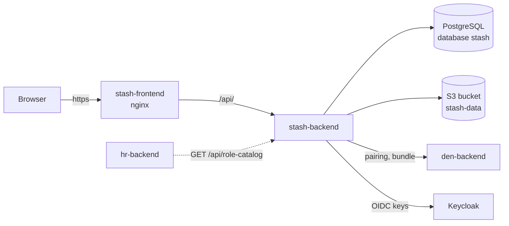

# Stash

**Stash** is the inventory module of Con Services. It tracks what an
organisation owns (items, where they are, which department manages them),
who borrowed what (**sign-outs** and returns), and the convention's
**Lost & Found** desk. Every change is written to an audit log and to a
per-item history.

Source: [AGlElectronics/stash](https://github.com/AGlElectronics/stash)

## The goal

A convention owns hundreds of things that spend most of the year in boxes
and then, for one weekend, are everywhere at once: radios, extension
leads, gaffer tape, staging, cash boxes, signage. Volunteers change every
shift, and nobody remembers on Sunday night who took the third projector on
Friday. Stash exists so that **every piece of equipment can be found,
handed out and brought back without a spreadsheet and without anyone's
memory**.

Concretely, Stash aims to:

- **Answer "where is it and who has it?" in one scan.** Every item has a
  barcode, a location and a managing department; a sign-out records which
  department took how many, when, and when it should be back.
- **Make hand-outs fast at the busiest moment.** A sign-out can be created
  and confirmed in one step at the counter, with optional barcode scanning
  to stop the wrong item leaving.
- **Close the loop after the event.** Returns record what came back, what
  was used up, lost or damaged, so next year's budget and packing list
  start from facts.
- **Run the Lost & Found desk.** Guests' lost items and handed-in finds are
  logged with photos and report numbers, matched, and handed back, with an
  optional public page where guests can check for their item themselves.
- **Keep departments responsible for their own kit.** Permissions can be
  granted per department, so a department lead manages their equipment
  without being able to change everyone else's.
- **Be accountable.** Every change is in an audit log and in the item's
  history, and everything can be exported as CSV.

## Who uses it

| Person | Uses Stash to |
| --- | --- |
| Logistics team | Add items, print barcode labels, move stock between locations, record damage and loss. |
| Department leads and volunteers | Sign equipment out to their department and return it. |
| Front desk (ConOps) | Log found items, look up lost-item reports, hand items back. |
| Guests (optional) | Look up their own Lost & Found report on the public claim page. |
| Administrators | Departments, categories, locations, settings, exports, the audit log and the [Den connection](../../concepts/pairing.md). |

Who may do what is decided by **roles**, granted through groups in the
identity provider (Keycloak). See [Admin guide](admin-guide.md#who-can-do-what).

## How Stash fits into the platform

- **Den first.** Den is the portal and admin console. Stash is added after
  Den runs, and then **paired** with it so it follows the organisation's
  brand and settings. Read [How the platform starts](../../getting-started/how-the-platform-starts.md);
  Stash is the worked example there.
- **Own namespace.** On Kubernetes Stash runs in `conservices-stash`, with
  NetworkPolicies that let it reach only Den, its database, its bucket and
  the sign-in server ([Network policies](../../operations/network-policies.md)).
- **Own chart.** Stash is installed with its own Helm chart,
  [`deploy/charts/stash`](https://github.com/AGlElectronics/con-services/tree/main/deploy/charts/stash)
  (a first version; see [Setup](setup.md)). Ready-made Kustomize manifests
  also exist in `deploy/kubernetes/modules/stash/`.
- **Own data.** Stash has its own PostgreSQL database (`stash`, created by
  Den) and its own S3 bucket (`stash-data`, which Stash creates on first
  start). No other module reads them.
- **Talks only over HTTP.** The only other module that calls Stash is HR,
  which reads `GET /api/role-catalog` to learn which Stash roles it can grant.

## Ways to run Stash

| Posture | When | Guide |
| --- | --- | --- |
| **Production cluster with Argo CD** (recommended for production) | Production: Den, Keycloak and every module on a cluster managed from Git. | [Den and the modules](../../deploy/apps.md) |
| Full platform on Kubernetes | A cluster you run yourself, next to Den and the other modules; also the local trial cluster. | [Setup: platform](setup.md#recommended-install-into-the-platform) |
| Standalone on Kubernetes | You only want inventory, with your own database, storage and sign-in. | [Setup: standalone](setup.md#standalone-on-kubernetes) |
| Production with Docker | A single server without Kubernetes. | [Setup: Docker](setup.md#production-with-docker) |
| Development with Docker | Trying Stash or working on its code. Not for production. | [Setup: development](setup.md#development-with-docker) |

A local Kubernetes cluster (the [quickstart](../../getting-started/den-quickstart.md)) is for trials only; production installations use the Argo CD path.

## How Stash is built

| Part | Technology | Runs as |
| --- | --- | --- |
| Backend | Go 1.27, chi, pgx, sqlc, Goose migrations embedded in the binary | Deployment `stash-backend` (`/server`, port 8080) |
| Frontend | React 19, Rsbuild, TanStack Router and Query, Tailwind, PWA | Deployment `stash-frontend` (nginx) |
| Database | PostgreSQL 16 | shared server, database `stash` |
| File storage | S3-compatible bucket (item photos, Lost & Found photos, attachments) | shared server, bucket `stash-data` |

Stash applies its own database migrations **when the backend starts**, so
run exactly one backend replica.

## Images

| Image | Built from | Contains |
| --- | --- | --- |
| `ghcr.io/aglelectronics/stash-backend:<tag>` | `infra/Dockerfile.backend` | The API server `/server`, listening on 8080. |
| `ghcr.io/aglelectronics/stash-frontend:<tag>` | `infra/Dockerfile.frontend` | The web app served by nginx (non-root as UID 101, port 8080; the Kubernetes manifests mount their own config). |

Tags have the form `MAJOR.MINOR.PATCH-BUILD`, for example `1.0.0-1`; see
[Versions and upgrades](../../operations/versioning.md).

!!! note "The web app's sign-in settings are not part of the image"
    The published `stash-frontend` image names no domain: the web app loads
    its sign-in settings from `/config.json` when it starts. See
    [Web app settings](configuration.md#web-app-settings-configjson).

## In this section

- [Setup](setup.md): install Stash in each of the five postures.
- [Admin guide](admin-guide.md): roles, settings, Den connection, everyday admin tasks.
- [Configuration](configuration.md): every environment variable.
- [API reference](api.md): every HTTP endpoint.

Design decisions: Stash's [ADRs](https://github.com/AGlElectronics/stash/tree/main/docs/adr).
