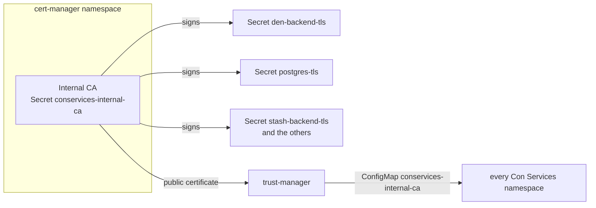

# Internal TLS

**Goal:** every connection *inside* the cluster is encrypted and checked:
the web apps, the backends, PostgreSQL, the S3 server, Keycloak, Den and the calls
between modules. This page explains how it works, how to set it up, how
certificates are renewed and what to do when something goes wrong.

Browsers already reach Con Services over HTTPS: the
[Gateway](../concepts/glossary.md#gateway-api) holds the public certificate.
Internal TLS covers what happens *behind* the Gateway, where requests still
carry people's sign-in tokens, database passwords and all the data.

## Terms used on this page

**TLS**
:   Transport Layer Security, the encryption behind `https://`. It also lets
    the client check that it talks to the right server.

**Certificate**
:   A file that says "this key belongs to `den-backend.conservices-den.svc`",
    signed by a certificate authority. The server keeps the matching private
    key secret.

**Certificate authority (CA)**
:   Whoever signs certificates. Con Services runs its own private CA for
    the cluster, the **internal CA**. Its certificates are trusted only by
    Con Services' own pods, never by browsers.

**cert-manager**
:   A Kubernetes add-on that creates certificates from `Certificate`
    objects, stores them in Secrets and renews them before they expire.
    See <https://cert-manager.io>.

**trust-manager**
:   A companion add-on from the cert-manager project. It copies the internal
    CA's *public* certificate into a ConfigMap in every Con Services
    namespace, so every pod can check the others' certificates.

## What is encrypted

| From | To | Port | Checked against the internal CA by |
| --- | --- | --- | --- |
| gateway (Cilium Gateway API) | every web app (`<module>-frontend`, `den-frontend`) | 8080 (Service port 443) | Envoy, configured by a `BackendTLSPolicy` ([Gateway API (Cilium)](#gateway-api-cilium)) |
| gateway (Cilium Gateway API) | Keycloak through `keycloak-public` | 8443 (Service port 443) | Envoy, configured by the `BackendTLSPolicy` `keycloak-public` |
| another ingress controller (legacy, Helm `ingress.enabled`) | every web app | 8080 | the controller ([Other ingress controllers](#other-ingress-controllers)) |
| every backend (OIDC discovery and keys) | Keycloak through `keycloak-public` (`auth.<domain>`) | 8443 (Service port 443) | the backend (`SSL_CERT_DIR`); Keycloak's certificate carries `auth.<domain>` |
| web app (nginx) | its backend, `/api/` | 8080 | nginx (`proxy_ssl_verify`) |
| every backend, Keycloak, Den's operator | PostgreSQL | 5432 | the client (`sslmode=verify-full`) |
| every backend, Den's operator | S3 server `s3` (local trial) | 9000 | the client (`https://` endpoint) |
| module backends | Den (pairing, bundle) | 8080 | the module (`DEN_INTERNAL_URL=https://…`) |
| Den | Den's operator, Keycloak admin API | 8080, 8443 | Den |
| HR | Learn, Wiki, Tasks, every module's role catalogue | 8080 | HR |

Every row checks the server's name, not only the encryption: a pod that
pretends to be PostgreSQL without a certificate from the internal CA is
refused.

!!! note "Internal TLS and Cilium encryption"
    Cilium's WireGuard encryption (see [Production](production.md)) encrypts
    traffic *between nodes* without the applications knowing. Internal TLS
    adds what WireGuard cannot do: it proves *which* service answers, it
    still protects traffic if WireGuard is switched off by mistake, and it
    covers traffic that leaves the cluster (a managed database). Use both.

## How it works



1. `deploy/kubernetes/base/pki` creates the internal CA once: a
   self-signed root certificate in the `cert-manager` namespace (valid ten
   years) and a `ClusterIssuer` called `conservices-internal-ca` that signs
   with it.
2. Every server has a `Certificate` next to its Deployment, for example
   `den-backend-tls` with the names `den-backend`,
   `den-backend.conservices-den`, `den-backend.conservices-den.svc` and
   `den-backend.conservices-den.svc.cluster.local`. cert-manager writes the
   key and certificate into a Secret of the same name. Certificates are
   valid 90 days and renewed 30 days before they expire.
3. A trust-manager `Bundle` copies the CA's public certificate into a
   ConfigMap `conservices-internal-ca` (key `ca.crt`) in every namespace
   labelled `app.kubernetes.io/part-of: conservices`.
4. Every pod mounts its own Secret at `/etc/conservices-tls` (`tls.crt`,
   `tls.key`, `ca.crt`) and the ConfigMap at
   `/etc/conservices-internal-ca`.
5. The backends serve HTTPS because `TLS_CERT_FILE` and `TLS_KEY_FILE` are
   set, and trust the internal CA because `SSL_CERT_DIR` points at the
   ConfigMap. Database URLs carry
   `sslmode=verify-full&sslrootcert=/etc/conservices-internal-ca/ca.crt`.

The private key of the CA never leaves the `cert-manager` namespace, and
each service's private key stays in its own namespace. Nothing about this
is stored in your secret manager: cert-manager makes the keys inside the
cluster.

## Set it up

Internal TLS is part of the platform manifests and on by default in every
module's Helm chart. You only need cert-manager and trust-manager in the
cluster **before** you apply Con Services.

1. **Install cert-manager** (once per cluster) and wait until it is ready:

    ```sh
    kubectl apply -f https://github.com/cert-manager/cert-manager/releases/download/v1.21.3/cert-manager.yaml
    kubectl wait --namespace cert-manager --for=condition=Available deployment --all --timeout=180s
    ```

    You should see three lines ending in `condition met`
    (`cert-manager`, `cert-manager-cainjector`, `cert-manager-webhook`).

2. **Install trust-manager** into the same namespace with
   [Helm](https://helm.sh/docs/intro/install/):

    ```sh
    helm upgrade --install trust-manager oci://quay.io/jetstack/charts/trust-manager --namespace cert-manager --version v0.26.0 --wait
    ```

    You should see `STATUS: deployed`. Check the published versions of
    both projects and pin the newest stable ones in your own runbook.

3. **Apply the platform** as usual, for example
   `kubectl apply -k deploy/kubernetes/overlays/example`. Among the output
   you should see:

    ```text
    clusterissuer.cert-manager.io/conservices-internal-ca created
    clusterissuer.cert-manager.io/conservices-selfsigned created
    bundle.trust.cert-manager.io/conservices-internal-ca created
    certificate.cert-manager.io/conservices-internal-ca created
    certificate.cert-manager.io/den-backend-tls created
    ...
    ```

    Pods stay in `ContainerCreating` for a few seconds until cert-manager
    has written their certificate. That is expected.

4. **Check the certificates**:

    ```sh
    kubectl get certificate -A
    ```

    ```text
    NAMESPACE              NAME                      READY   SECRET                    AGE
    cert-manager           conservices-internal-ca   True    conservices-internal-ca   2m
    conservices-data       postgres-tls              True    postgres-tls              2m
    conservices-data       s3-tls                    True    s3-tls                    2m
    conservices-den        den-backend-tls           True    den-backend-tls           2m
    conservices-den        den-frontend-tls          True    den-frontend-tls          2m
    conservices-den        den-operator-tls          True    den-operator-tls          2m
    conservices-identity   keycloak-tls              True    keycloak-tls              2m
    ```

    Every line must say `True`.

5. **Check that the database only sees encrypted connections.** This lists
   every client connected over the network and whether it uses TLS:

    ```sh
    kubectl exec -n conservices-data postgres-0 -c postgres -- psql -U postgres -c "SELECT a.usename, a.client_addr, s.ssl, s.version FROM pg_stat_ssl s JOIN pg_stat_activity a USING (pid) WHERE a.client_addr IS NOT NULL;"
    ```

    ```text
     usename  | client_addr | ssl | version
    ----------+-------------+-----+---------
     den      | 10.1.0.42   | t   | TLSv1.3
     keycloak | 10.1.0.39   | t   | TLSv1.3
    ```

    `ssl` must be `t` (true) on every line.

6. **Check a backend's log** for the line that shows it serves HTTPS:

    ```sh
    kubectl logs -n conservices-den deploy/den-backend | Select-String "tls enabled"
    ```

    (`grep "tls enabled"` instead of `Select-String` on macOS and Linux.)

    ```json
    {"level":"info","cert_file":"/etc/conservices-tls/tls.crt","not_after":"2027-02-05T13:12:09Z","message":"tls enabled"}
    ```

Modules applied later (Kustomize or Helm) bring their own `Certificate`
objects and use the same CA. Their namespace must carry the label
`app.kubernetes.io/part-of=conservices`, because that is how trust-manager
finds the namespaces to copy the CA into. The Kustomize manifests set it;
when you create a namespace by hand for a Helm chart, add it yourself:

```sh
kubectl label namespace conservices-stash app.kubernetes.io/part-of=conservices
```

## Settings

The backends read these environment variables:

| Name | Default | Required | What it does |
| --- | --- | --- | --- |
| `TLS_CERT_FILE` | none | no | Path to the server certificate (PEM). With `TLS_KEY_FILE`, the backend serves HTTPS; without both, plain HTTP (Docker Compose development). Kubernetes: `/etc/conservices-tls/tls.crt`. |
| `TLS_KEY_FILE` | none | no | Path to the private key (PEM). Must be set together with `TLS_CERT_FILE`, otherwise the backend refuses to start. Kubernetes: `/etc/conservices-tls/tls.key`. |
| `SSL_CERT_DIR` | the system folders | no | Folders with extra CA certificates to trust, separated by `:`. The system bundle file stays trusted ([public certificates](#public-certificates-stay-trusted)). Kubernetes: `/etc/conservices-internal-ca`. The local example overlay also adds mkcert's root: `/etc/conservices-internal-ca:/etc/conservices-ca` (sign-in itself only needs the internal CA, because backends reach Keycloak through `keycloak-public`). |
| `MODULE_DB_PARAMS` (Den's operator) | the query of `PG_ADMIN_URL`, else `sslmode=disable` | no | Query string of every database URL the operator hands out for a new module. Kubernetes: `sslmode=verify-full&sslrootcert=/etc/conservices-internal-ca/ca.crt`. |

Every module's Helm chart has an `internalTLS` block:

| Value | Default | What it does |
| --- | --- | --- |
| `internalTLS.enabled` | `true` | Serve HTTPS inside the cluster and check other services' certificates. With `false`, change the `https://` URLs in `config` back to `http://`, and in the module's Secret remove `sslrootcert=/etc/conservices-internal-ca/ca.crt` from `DATABASE_URL` (the CA is no longer mounted) and switch hook addresses (HR's `OFFBOARD_HOOKS`, `DEPARTMENT_HOOKS`) back to `http://`. |
| `internalTLS.createCertificates` | `true` | Ask cert-manager for `<module>-backend-tls` and `<module>-frontend-tls`. With `false`, create those Secrets yourself (keys `tls.crt`, `tls.key`, `ca.crt`). |
| `internalTLS.issuerRef` | `ClusterIssuer/conservices-internal-ca` | Which cert-manager issuer signs them. |
| `internalTLS.duration`, `internalTLS.renewBefore` | `2160h`, `720h` | Lifetime (90 days) and how early to renew (30 days). |
| `internalTLS.caConfigMap` | `conservices-internal-ca` | ConfigMap (key `ca.crt`) with the CA the module trusts. The `BackendTLSPolicy` points the gateway at the same ConfigMap. |
| `internalTLS.ingressNginxAnnotations` | `false` | Legacy, only with `ingress.enabled: true`: add the ingress-nginx annotations for HTTPS to the web app. Only for installations still moving off ingress-nginx, which is no longer maintained; for other controllers see [Other ingress controllers](#other-ingress-controllers). |

The Den chart has the same block and asks for a third certificate,
`den-operator-tls`. Two more values decide how the web app is exposed and
are explained in [Gateway API (Cilium)](#gateway-api-cilium):

| Value | Default | What it does with internal TLS |
| --- | --- | --- |
| `route.enabled` | `true` | Render the `HTTPRoute` and, with `internalTLS.enabled`, a `BackendTLSPolicy` for each web app. |
| `ingress.enabled` | `false` | Render a plain `Ingress` (legacy path through an ingress controller). |

## Gateway API (Cilium)

With the Gateway API, the **Gateway** holds the public certificate and the
web app's **HTTPRoute** says where to send requests. To make the gateway
use HTTPS towards the web app *and* check its certificate, every chart
renders a **BackendTLSPolicy** next to the route. The Kustomize manifests
contain the same objects (`route.yaml` in `base/den`, `base/identity` and
`modules/stash`), including one for Keycloak's Service `keycloak-public`:

```yaml
apiVersion: gateway.networking.k8s.io/v1
kind: BackendTLSPolicy
metadata:
  name: stash-frontend
  namespace: conservices-stash
spec:
  targetRefs:
    - group: ""
      kind: Service
      name: stash-frontend
      sectionName: https          # the Service port named "https" (443)
  validation:
    caCertificateRefs:
      - group: ""
        kind: ConfigMap
        name: conservices-internal-ca   # trust-manager's copy of the internal CA
    hostname: stash-frontend.conservices-stash.svc.cluster.local
```

- `targetRefs` names the web app's Service and its `https` port; the
  `HTTPRoute` sends traffic to port 443 of the same Service.
- `validation.caCertificateRefs` is the CA the gateway trusts: the
  `conservices-internal-ca` ConfigMap (key `ca.crt`) that trust-manager
  copies into the namespace.
- `validation.hostname` is the name the gateway sends (SNI) and expects in
  the certificate. It must be one of the certificate's names; the charts'
  certificates carry `<service>`, `<service>.<namespace>`,
  `<service>.<namespace>.svc` and `<service>.<namespace>.svc.cluster.local`,
  and the policy uses the last one.

Check that Cilium accepted it:

```sh
kubectl get backendtlspolicy -n conservices-stash stash-frontend -o jsonpath="{.status.ancestors[0].conditions[*].type}={.status.ancestors[0].conditions[*].status}"
```

```text
Accepted ResolvedRefs=True True
```

!!! danger "Cilium: ConfigMap references only, never `wellKnownCACertificates`"
    Cilium (1.20) only supports `caCertificateRefs` of kind **ConfigMap**.
    A reference to a Secret is not used. `validation.wellKnownCACertificates:
    System` is silently ignored, and the gateway then talks **plain HTTP**
    to the backend, which fails against our HTTPS-only web apps or, worse,
    hides a misconfiguration. Never use it; keep the ConfigMap reference
    the charts render.

The NetworkPolicy side: Cilium's Envoy reaches the web app with the
reserved identity `ingress`, so the charts and the Kustomize manifests add
a `CiliumNetworkPolicy` with `fromEntities: [ingress]`; see
[Network policies](network-policies.md#every-allowed-flow).

Backends reach the OIDC issuer without the gateway: CoreDNS rewrites
`auth.<domain>` to the Service `keycloak-public` in `conservices-identity`
(port 443 to Keycloak's 8443), and Keycloak's internal certificate carries
`auth.<domain>` as a name. The backends check it against the internal CA
through `SSL_CERT_DIR`, so `OIDC_ISSUER_URL` stays the public
`https://auth.<domain>/realms/conservices`. The local trial does the same
with `hostAliases` instead of CoreDNS: `overlays/example` gives
`keycloak-public` the fixed address `10.96.0.100` and points
`auth.conservices.test` at it in each backend.

## Renewal

cert-manager renews every certificate 30 days before it expires and
updates the Secret in place. Each server picks up the new files by itself:

| Server | Picks up a renewed certificate |
| --- | --- |
| Den, Den's operator, every module backend | within a minute (re-reads the files) |
| nginx in every web app | within six hours (`/docker-entrypoint.d/90-reload-tls.sh` reloads nginx) |
| PostgreSQL | within five minutes (the `tls-reload` sidecar runs `pg_reload_conf()`) |
| S3 server `s3` (SeaweedFS, local trial) | within about two minutes: SeaweedFS reads its certificate only at start, so its liveness check compares the files with a checksum taken at start and restarts the container when they change |
| Keycloak | within an hour (built-in reload) |

To renew one certificate now, for example after a suspected leak, delete
its Secret; cert-manager makes a new key and certificate within seconds:

```sh
kubectl delete secret -n conservices-den den-backend-tls
kubectl get certificate -n conservices-den den-backend-tls -w
```

Wait until `READY` is `True` again. With the
[cmctl](https://cert-manager.io/docs/reference/cmctl/) tool installed,
`cmctl renew -n conservices-den den-backend-tls` does the same.

### Rotating the internal CA

The root certificate is valid ten years. Replace it earlier only if its
key may have leaked. Swapping it in one step would break every connection
until all certificates are re-issued, so do it in this order:

1. Copy the current root's public certificate into a new Secret in the
   `cert-manager` namespace:

    ```sh
    kubectl get secret -n cert-manager conservices-internal-ca -o jsonpath="{.data.tls\.crt}" > old-ca.b64
    ```

    Decode it and create the Secret `conservices-internal-ca-previous`
    with the key `tls.crt` (for example with
    `kubectl create secret generic conservices-internal-ca-previous -n cert-manager --from-file=tls.crt=old-ca.crt`).
2. Add it as a second source to the `Bundle` in
   `deploy/kubernetes/base/pki/bundle.yaml` and apply. Now both roots are
   trusted.
3. Delete the Secret `conservices-internal-ca` in `cert-manager`.
   cert-manager creates a new root with a new key.
4. Re-issue every service certificate by deleting its Secret (see above),
   namespace by namespace. Then restart the backends
   (`kubectl rollout restart deploy -n <namespace>`), because Go programs
   read the trusted CA list once at start.
5. When every `Certificate` is `True` again, remove the previous root from
   the `Bundle` and delete `conservices-internal-ca-previous`.

## Managed database and external S3

Internal TLS only signs certificates for services in the cluster. For a
managed PostgreSQL or S3 service outside the cluster:

- **PostgreSQL:** use `sslmode=verify-full` with your provider's CA
  certificate, for example
  `?sslmode=verify-full&sslrootcert=/etc/provider-ca/ca.pem`. Mount the
  provider's CA file from a ConfigMap at that path (Helm:
  `backend.extraVolumes` and `backend.extraVolumeMounts`). Never use
  `sslmode=disable` for a database outside the cluster.
- **S3:** use a managed S3 service (any S3-compatible one works, for
  example AWS S3, Hetzner Object Storage, Cloudflare R2 or Backblaze B2)
  and its `https://` endpoint, for example Hetzner Object Storage at
  `https://<location>.your-objectstorage.com`. Public
  providers have certificates from public CAs, which the backends keep
  trusting (see below). Allow the egress with
  `networkPolicy.data.s3.external` ([Helm](helm.md#external-s3-hetzner-object-storage)).

### Public certificates stay trusted

Setting `SSL_CERT_DIR` to the internal CA does **not** remove the public
CAs. The backends and Den's operator are Go programs, and Go builds its list
of trusted CAs on Linux in two steps:

1. It reads **one bundle file**: the file named in `SSL_CERT_FILE`, or, when
   that is not set, the first that exists of the system paths such as
   `/etc/ssl/certs/ca-certificates.crt`.
2. It then reads every certificate in the **folders** listed in
   `SSL_CERT_DIR`, or the system folders when that is not set.

`SSL_CERT_DIR` replaces only the folder list in step 2. The bundle file from
step 1 is still read, so the backend trusts the public CAs *and* the
internal CA. The images ship that bundle file: the backend and `migrate`
images are built on `gcr.io/distroless/static-debian12`, and Den's operator
on `alpine` (Alpine's `ca-certificates-bundle`); both have
`/etc/ssl/certs/ca-certificates.crt`.

!!! warning "Do not set `SSL_CERT_FILE` to the internal CA"
    `SSL_CERT_FILE` replaces the bundle file of step 1. Pointing it at
    `/etc/conservices-internal-ca/ca.crt` drops every public CA, and calls
    to external S3, SMTP or webhooks fail with
    `x509: certificate signed by unknown authority`. Add folders to
    `SSL_CERT_DIR` (separated by `:`) instead.

To check from a running pod, call the external endpoint (the distroless
backend has no shell, so use a debug container):

```powershell
kubectl -n conservices-stash debug -it deploy/stash-backend --image=curlimages/curl:8.11.1 --target=backend -- curl -sI https://fsn1.your-objectstorage.com
```

You should see an HTTP status line (often `403` without credentials), not a
certificate error. A timeout means the network policy blocks the call.

## Other ingress controllers

The supported path is the [Gateway API](#gateway-api-cilium); the
Kustomize manifests contain no `Ingress` objects any more. The charts can
still render a plain `Ingress` (`ingress.enabled: true`) for a cluster that
only has an ingress controller. ingress-nginx is no longer maintained; do
not use it (the chart value `internalTLS.ingressNginxAnnotations` only
exists for installations still moving off it). Other controllers need their
own settings to talk HTTPS to the web apps and check their certificates.

For **Traefik** (the default controller of k3s), set
`internalTLS.ingressNginxAnnotations: false` in the Helm values, then for
each module create a `ServersTransport` that trusts the internal CA and
point the web app's Service at it:

```yaml
apiVersion: traefik.io/v1alpha1
kind: ServersTransport
metadata:
  name: internal-ca
  namespace: conservices-stash
spec:
  serverName: stash-frontend.conservices-stash.svc.cluster.local
  rootCAs:
    - secret: stash-frontend-tls   # cert-manager puts ca.crt in it
```

```sh
kubectl annotate service -n conservices-stash stash-frontend \
  traefik.ingress.kubernetes.io/service.serversscheme=https \
  traefik.ingress.kubernetes.io/service.serverstransport=conservices-stash-internal-ca@kubernetescrd
```

Older Traefik versions call the field `rootCAsSecrets: [stash-frontend-tls]`.
The NetworkPolicies must also admit the controller's namespace
(`kube-system` on k3s; Helm: `networkPolicy.ingressControllerNamespace`).

## Docker Compose and Docker production

The Docker Compose development stack does not use internal TLS: no
`TLS_*` variables are set, so every backend speaks plain HTTP inside the
Compose network, and database URLs keep `sslmode=disable`. The
[Full stack on Docker](docker-production.md) guide is not covered by this
page yet; keep that host's Docker network private.

## Troubleshooting

**Pods stay in `ContainerCreating` and `kubectl describe pod` says `secret "den-backend-tls" not found` or `configmap "conservices-internal-ca" not found`**
: cert-manager or trust-manager is missing or not ready, or (for the
  ConfigMap) the namespace lacks the label
  `app.kubernetes.io/part-of=conservices`; check with
  `kubectl get namespace <name> --show-labels`. Otherwise check
  `kubectl get pods -n cert-manager` (all `Running`), then
  `kubectl get certificate -A` and `kubectl get bundle`. Install the
  missing add-on as in [Set it up](#set-it-up); the pods start by
  themselves once the Secret and ConfigMap exist.

**`kubectl apply` fails with `no matches for kind "Certificate" in version "cert-manager.io/v1"` or `no matches for kind "Bundle"`**
: cert-manager or trust-manager is not installed, so Kubernetes does not
  know these object types. Install them first, then apply again.

**A `Certificate` stays `READY False`**
: Read the reason: `kubectl describe certificate -n <namespace> <name>`.
  `issuer not found` or `secret "conservices-internal-ca" not found`
  means the platform's `base/pki` was not applied or the root certificate
  is not ready yet (`kubectl get certificate -n cert-manager`).

**The backend crashes with `tls: TLS_CERT_FILE and TLS_KEY_FILE must be set together`**
: Only one of the two variables is set. Set both, or neither for plain HTTP.

**The web app answers `502 Bad Gateway` and nginx logs `upstream SSL certificate verify error` or `wrong version number`**
: nginx expects HTTPS from the backend but gets something else.
  `wrong version number`: the backend speaks plain HTTP, so `TLS_CERT_FILE`
  and `TLS_KEY_FILE` are missing from its ConfigMap or the image is older
  than internal TLS. `certificate verify error`: the backend's certificate
  is not from the internal CA, or its names do not include
  `<module>-backend.<namespace>.svc.cluster.local`.

**The browser gets `503` from the gateway (Gateway API)**
: Envoy cannot complete TLS to the web app. Check the `BackendTLSPolicy`
  is `Accepted` (command in [Gateway API (Cilium)](#gateway-api-cilium)),
  that `validation.hostname` is one of the names of `<module>-frontend-tls`
  (`kubectl get certificate -n <namespace> <module>-frontend-tls -o jsonpath="{.spec.dnsNames}"`),
  and that the ConfigMap `conservices-internal-ca` exists in the namespace.
  A policy that references a Secret or uses `wellKnownCACertificates` does
  not work with Cilium.

**The sign-in page at `auth.<domain>` gives `503` from the gateway**
: The same check for Keycloak: the `BackendTLSPolicy` `keycloak-public` in
  `conservices-identity` must be `Accepted`, and Keycloak's certificate must
  carry `keycloak-public.conservices-identity.svc.cluster.local`
  (`kubectl get certificate -n conservices-identity keycloak-tls -o jsonpath="{.spec.dnsNames}"`).

**The browser shows `502 Bad Gateway` from another ingress controller (Helm `ingress.enabled`)**
: The controller cannot reach the web app over HTTPS. Check the
  controller's HTTPS settings in
  [Other ingress controllers](#other-ingress-controllers) and that the
  Secret `<module>-frontend-tls` contains `ca.crt`:
  `kubectl get secret -n <namespace> <module>-frontend-tls -o jsonpath="{.data.ca\.crt}"`
  must print a long text.

**A backend logs `x509: certificate signed by unknown authority`**
: It does not trust the internal CA. Check `SSL_CERT_DIR` is set to
  `/etc/conservices-internal-ca` (or includes it) and the ConfigMap is
  mounted there. After rotating the CA, restart the pod.

**A backend or Keycloak cannot connect to PostgreSQL: `no pg_hba.conf entry for host "10.1.0.42", user "stash", database "stash", no encryption`**
: The database URL still says `sslmode=disable`. PostgreSQL in the cluster
  refuses unencrypted connections. Change the end of the URL to
  `?sslmode=verify-full&sslrootcert=/etc/conservices-internal-ca/ca.crt`
  in the Secret (your secret manager) and restart the pod.

**PostgreSQL does not start: `private key file "/etc/conservices-tls/tls.key" has group or world access`**
: The Secret volume's `defaultMode` or the pod's `fsGroup` was changed.
  PostgreSQL accepts the key only owned by root with mode `0640` and its
  group set to the postgres group: keep `defaultMode: 0640` and
  `fsGroup: 70` as in `base/data/postgres.yaml`.

**A certificate expired anyway**
: The server did not reload. Check the table in [Renewal](#renewal): for
  nginx, check `/docker-entrypoint.d/90-reload-tls.sh` is mounted; for
  PostgreSQL, read the sidecar's log with
  `kubectl logs -n conservices-data postgres-0 -c tls-reload`. Restarting
  the pod always loads the current certificate.

## Related pages

- [Network policies and isolation](network-policies.md): which pod may
  connect to which.
- [Secrets](secrets.md#inventory): where every TLS Secret lives.
- [Production and security](production.md): Cilium WireGuard encryption
  between nodes.
