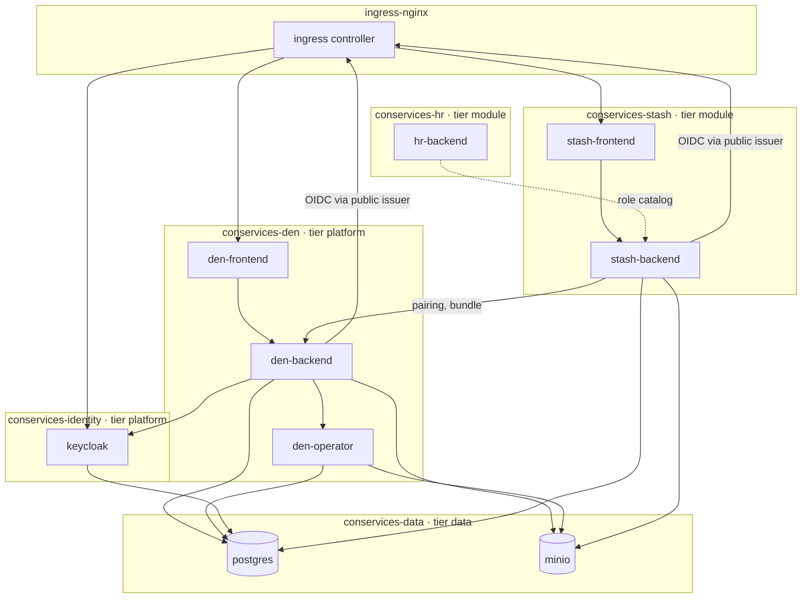

# Network policies and isolation

Con Services keeps its parts apart. Each part runs in its own Kubernetes
**namespace**, every namespace refuses all network traffic that is not
explicitly allowed, containers run with the strictest Pod Security level,
and each namespace has only the secrets it needs. This page explains the
layout, lists every allowed connection, and shows how to check that your
cluster actually enforces it.

!!! info "What a NetworkPolicy is"
    A **NetworkPolicy** is a Kubernetes rule that says which pods may open
    connections to which other pods. Once any policy selects a pod, all
    traffic not allowed by some policy is dropped. Con Services starts every
    namespace with a `default-deny` policy and then allows only what each
    part needs.

## Namespace layout



| Namespace | Labels | Contains |
| --- | --- | --- |
| `conservices-identity` | `conservices.io/tier: platform` | Keycloak. |
| `conservices-data` | `conservices.io/tier: data` | PostgreSQL and MinIO (only when you run them in the cluster). |
| `conservices-den` | `conservices.io/tier: platform` | `den-backend`, `den-frontend`, `den-operator`. |
| `conservices-<module>` | `conservices.io/tier: module`, `conservices.io/module: <module>` | One module's backend and frontend, for example `conservices-stash`. |

All of them also carry `pod-security.kubernetes.io/enforce: restricted` and
`pod-security.kubernetes.io/warn: restricted` (see [Pod Security](#pod-security)).

The policies select pods by two labels that every Con Services pod has:
`app.kubernetes.io/name` (`den`, `stash`, `keycloak`, `postgres`, `minio`)
and `app.kubernetes.io/component` (`backend`, `frontend`, `operator`, …).
Platform policies admit *any* module with one rule: pods labelled
`app.kubernetes.io/component: backend` in a namespace labelled
`conservices.io/tier: module`. That is why a new module only needs those two
labels to reach Den, PostgreSQL and storage.

## Every allowed flow

Everything not in this table is blocked. "Module backend" means a pod with
`app.kubernetes.io/component: backend` in a namespace with
`conservices.io/tier: module`.

| From | To | Port | Why |
| --- | --- | --- | --- |
| every pod | `kube-dns` in `kube-system` | 53 UDP/TCP | Looking up service names. |
| ingress controller (`ingress-nginx`) | `den-frontend` | 8080 | Serving Den's web app and passing `/api/` on. |
| ingress controller | `stash-frontend` (each module frontend) | 8080 | Serving the module's web app. |
| ingress controller | `keycloak` | 8080 | The sign-in pages at `auth.<domain>`. |
| `den-frontend` | `den-backend` | 8080 | nginx proxies `/api/` to the backend. |
| `stash-frontend` | `stash-backend` | 8080 | nginx proxies `/api/` to the backend. |
| `den-backend` | ingress controller | 443 | OIDC discovery and signing keys through the public issuer address (`https://auth.<domain>`). |
| module backend | ingress controller | 443 | The same, for the module. |
| `den-backend` | `keycloak` | 8080 | Keycloak admin API for [Keycloak sync](../modules/den/admin-guide.md#keycloak-sync). |
| `den-backend` | `den-operator` | 8080 | Backups and module databases (bearer `OPERATOR_TOKEN`). |
| `den-backend` | `postgres` | 5432 | Den's own database (also the `migrate` initContainer). |
| `den-backend` | `minio` | 9000 | Den's bucket (branding assets). |
| `den-operator` | `postgres` | 5432 | Admin login: create and drop module databases, `pg_dump` for backups. |
| `den-operator` | `minio` | 9000 | Writing backups; copying module buckets into backups. |
| `keycloak` | `postgres` | 5432 | Keycloak's own database. |
| module backend | `den-backend` | 8080 | [Pairing](../concepts/pairing.md), the bundle every minute, user preferences. |
| module backend | `postgres` | 5432 | The module's own database. |
| module backend | `minio` | 9000 | The module's own bucket. |
| HR backend (`conservices-hr`) | `stash-backend` | 8080 | HR reads `GET /api/role-catalog` (see below). |

Not listed, so blocked: one module calling another (except the documented
integrations below), the operator being reached by anything but
`den-backend`, any pod reaching the internet, and the ingress controller
reaching backends directly.

## Calls between modules

Modules do not talk to each other by default. A few integrations need a
direct call. Each one needs **two** rules: an *egress* rule in the caller's
namespace and an *ingress* rule in the target's namespace.

| Caller | Target | Path | Status in the manifests |
| --- | --- | --- | --- |
| HR | every module | `GET /api/role-catalog` (roles HR can grant) | Ingress rule on Stash done; HR's manifests (egress) not written yet. |
| HR | Learn | `/api/qualification-catalog`, `/api/internal/holdings` (with `LEARN_SERVICE_TOKEN`) | Planned with HR and Learn manifests. |
| HR | Wiki | `/api/internal/offboarded` (offboarding hook) | Planned. |
| HR | Tasks | `/api/internal/departments` (department hook) | Planned. |
| HR, Learn | Keycloak admin API | creating accounts, reading groups | Planned: needs egress to `keycloak:8080` and an ingress rule on Keycloak. |

Calls that come from the **browser**, not from a pod, go through the
ingress controller and need no policy: Den's portal fetching
`/api/portal/todos` from each module, and Den's web app calling Learn's API.

Example: HR's egress rule to call Stash (goes into `conservices-hr`):

```yaml
apiVersion: networking.k8s.io/v1
kind: NetworkPolicy
metadata:
  name: hr-backend-to-stash
  namespace: conservices-hr
spec:
  podSelector:
    matchLabels:
      app.kubernetes.io/name: hr
      app.kubernetes.io/component: backend
  policyTypes: ["Egress"]
  egress:
    - to:
        - namespaceSelector:
            matchLabels:
              kubernetes.io/metadata.name: conservices-stash
          podSelector:
            matchLabels:
              app.kubernetes.io/name: stash
              app.kubernetes.io/component: backend
      ports:
        - protocol: TCP
          port: 8080
```

## External services

Out of the box, pods may reach nothing outside the cluster. When you use
managed PostgreSQL or S3, an external identity provider, or email (SMTP),
add egress rules for them. For a fixed address range use `ipBlock`:

```yaml
apiVersion: networking.k8s.io/v1
kind: NetworkPolicy
metadata:
  name: den-to-managed-postgres
  namespace: conservices-den
spec:
  podSelector:
    matchLabels:
      app.kubernetes.io/name: den
  policyTypes: ["Egress"]
  egress:
    - to:
        - ipBlock:
            cidr: 10.20.0.0/24   # your database subnet
      ports:
        - protocol: TCP
          port: 5432
```

Standard NetworkPolicies cannot match host names. For cloud services
without fixed addresses (S3, a hosted identity provider), either allow
`0.0.0.0/0` on port 443 for the pods that need it, or use your CNI's
DNS-aware policies (Cilium `toFQDNs`, Calico `domains`).

For managed S3 (AWS S3 or Hetzner Object Storage, as recommended in
[Production](production.md#object-storage-use-managed-s3)), allow port 443
to the provider: with Cilium, a `toFQDNs` rule for the endpoint host;
otherwise an `ipBlock` for the provider's ranges.

### Example: managed S3 by host name with Cilium

A `CiliumNetworkPolicy` adds to the standard policies (it does not replace
them). `toFQDNs` only works when Cilium also sees the DNS answers, so the
policy includes a DNS rule:

```yaml
apiVersion: cilium.io/v2
kind: CiliumNetworkPolicy
metadata:
  name: den-to-hetzner-s3
  namespace: conservices-den
spec:
  endpointSelector:
    matchLabels:
      app.kubernetes.io/name: den
  egress:
    - toEndpoints:
        - matchLabels:
            k8s:io.kubernetes.pod.namespace: kube-system
            k8s-app: kube-dns
      toPorts:
        - ports: [{ port: "53", protocol: ANY }]
          rules:
            dns:
              - matchPattern: "*"
    - toFQDNs:
        - matchPattern: "*.your-objectstorage.com"   # Hetzner; AWS: "*.s3.eu-central-1.amazonaws.com"
      toPorts:
        - ports: [{ port: "443", protocol: TCP }]
```

This one policy covers both `den-backend` and `den-operator` (both carry
`app.kubernetes.io/name: den`). Add the same in each module namespace that
uses S3, with that module's selector.

## Rules for a new module

When you deploy a module (by hand, with Kustomize or with its
[Helm chart](helm.md)):

1. Label its namespace `conservices.io/tier=module` and
   `conservices.io/module=<module>`. The platform policies (Den,
   PostgreSQL, MinIO) then admit its backend without any change on their
   side.
2. Make sure its own namespace has `default-deny`, DNS, ingress-controller →
   frontend, frontend → backend, and backend → Den / data / issuer rules.
   The Helm charts and `modules/stash/networkpolicies.yaml` contain exactly
   these.
3. For each [integration with another module](#calls-between-modules), add
   the egress rule in the caller's namespace **and** the ingress rule in the
   target's namespace.
4. For each external service it uses (managed database, S3, SMTP, Telegram),
   add an [egress rule](#external-services).
5. Run the [enforcement test](#checking-that-your-cluster-enforces-policies)
   against the new backend, and add a row to [Every allowed flow](#every-allowed-flow)
   if you added a new kind of connection.

With an external identity provider, also replace the rules that allow
backends to reach the ingress controller on port 443 with egress to the
provider.

## Checking that your cluster enforces policies

NetworkPolicies are enforced by the cluster's network plugin (**CNI**), not
by Kubernetes itself.

!!! tip "Recommended CNI: Cilium"
    We recommend [Cilium](https://cilium.io). NetworkPolicy is first-class
    there, it adds DNS-aware egress rules (`toFQDNs`) for external services,
    and its **Hubble** observability shows every allowed and dropped flow,
    for example `hubble observe --namespace conservices-den --verdict DROPPED`.
    Any CNI that enforces Kubernetes NetworkPolicy works too (Calico,
    Antrea, k3s' built-in policy controller).

**Docker Desktop's built-in Kubernetes and kind's default plugin may accept
the policies but not enforce them**, so everything still works there even
when a rule is missing. Whatever the cluster, verify enforcement yourself
with the test below, and test on a cluster like your production one.

To test, start a throwaway pod in the `default` namespace and try to reach
Den's operator, which only `den-backend` may reach:

```sh
kubectl run np-test --rm -it --restart=Never --image=busybox:1.36 -n default -- wget -qO- -T 3 http://den-operator.conservices-den.svc.cluster.local:8080/livez
```

- **Enforced:** after three seconds, `wget: download timed out`.
- **Not enforced:** it returns at once without an error (the operator
  answers `/livez` with an empty `204`), and the pod exits normally.

Then check that an **allowed** path still works, from Den's backend to the
operator. The backend image has no shell, so use an ephemeral debug
container that joins its pod (it meets the restricted Pod Security rules
because it runs as the pod's user):

```sh
kubectl debug -n conservices-den deploy/den-backend -it --image=busybox:1.36 --profile=restricted -- wget -qO- -S -T 3 http://den-operator:8080/livez
```

```text
  HTTP/1.1 204 No Content
```

### Installing Cilium

On a new cluster, install Cilium **before** anything else, because the CNI
is chosen when the cluster's networking starts. Managed clusters often offer
it directly (GKE Dataplane V2, AKS with Azure CNI powered by Cilium, EKS
add-on); otherwise, with Helm:

1. Install the Cilium command-line tool from
   <https://docs.cilium.io/en/stable/gettingstarted/k8s-install-default/>.
2. Install Cilium with Hubble turned on:

    ```sh
    helm repo add cilium https://helm.cilium.io
    helm install cilium cilium/cilium --version 1.16.5 -n kube-system \
      --set hubble.relay.enabled=true --set hubble.ui.enabled=true
    ```

3. Wait for it to be healthy:

    ```sh
    cilium status --wait
    ```

    ```text
        /¯¯\
     /¯¯\__/¯¯\    Cilium:             OK
     \__/¯¯\__/    Operator:           OK
     /¯¯\__/¯¯\    Envoy DaemonSet:    OK
     \__/¯¯\__/    Hubble Relay:       OK
        \__/       ClusterMesh:        disabled
    ```

4. Install Con Services and run the enforcement test above.
5. Watch dropped connections while you use the suite:

    ```sh
    cilium hubble port-forward &
    hubble observe --namespace conservices-den --verdict DROPPED -f
    ```

    ```text
    Nov  6 14:12:03.120: default/np-test:41234 (ID:9811) <> conservices-den/den-operator-5c6f9d7b84-mn2rs:8080 (ID:2271) policy-verdict:none INGRESS DENIED (TCP Flags: SYN)
    ```

Pin the Cilium version like any other image and follow Cilium's upgrade
guide; Con Services only relies on standard NetworkPolicy plus, optionally,
`CiliumNetworkPolicy` for `toFQDNs`.

## Pod Security

Every Con Services namespace has the labels:

```yaml
pod-security.kubernetes.io/enforce: restricted
pod-security.kubernetes.io/warn: restricted
```

Kubernetes then refuses pods that do not meet the **restricted** Pod
Security Standard. All Con Services containers:

- run as a non-root user (`runAsNonRoot: true` with a fixed user id);
- cannot gain privileges (`allowPrivilegeEscalation: false`);
- drop all Linux capabilities;
- use the `RuntimeDefault` seccomp profile;
- where the program allows it, have a read-only root filesystem, with small
  writable `emptyDir` volumes for temporary files.

If you add a sidecar or debug container, it must meet the same rules.

## Service accounts and Kubernetes API access

No Con Services component talks to the Kubernetes API. Den's operator,
despite its name, is not a Kubernetes operator: it manages PostgreSQL
databases and backups over the network, and creates no Kubernetes objects.
So:

- there are **no Roles, ClusterRoles or RoleBindings**;
- each Deployment uses its namespace's `default` service account, or a
  dedicated one, with `automountServiceAccountToken: false`, so no API token
  is mounted into the containers.

## Secrets per namespace

Each namespace holds only its own secrets. A module never sees Den's
storage keys or the database admin password.

| Namespace | Secret | Contains |
| --- | --- | --- |
| `conservices-identity` | `keycloak-secrets` | Keycloak's database password, the bootstrap admin login. |
| `conservices-identity`, `conservices-den`, `conservices-<module>` | `conservices-tls` | The HTTPS certificate for that namespace's Ingress. |
| `conservices-data` | `postgres-secrets` | PostgreSQL superuser password, initial `den` and `keycloak` passwords. |
| `conservices-data` | `minio-secrets` | MinIO root login. |
| `conservices-den` | `den-secrets` | Den's database URL, S3 keys, Keycloak client secret, operator token. |
| `conservices-den` | `den-operator-secrets` | Operator token, PostgreSQL **admin** URL, backup and file-copy S3 keys. |
| `conservices-stash` | `stash-secrets` | Stash's database URL (from Den) and S3 keys. |

The example overlay uses one MinIO root login for everything for
simplicity. In production give each module its own storage keys limited to
its bucket.

## Troubleshooting

**A connection times out** (`i/o timeout`, `context deadline exceeded`)
between two parts: check that both sides have a rule (egress at the caller,
ingress at the target), and that the namespace and pod labels match. See
[Troubleshooting](../getting-started/troubleshooting.md#timeouts-between-namespaces).

**Everything works on Docker Desktop but not in production:** your local
cluster does not enforce policies, so a missing rule went unnoticed. Use the
test above on both clusters.

**The ingress controller lives in another namespace:** the policies admit
`kubernetes.io/metadata.name: ingress-nginx`. Change that selector in your
overlay if your controller runs elsewhere, for example `kube-system` for
k3s' Traefik. Symptom: every site returns *502 Bad Gateway* or *504
Gateway Time-out* although the pods are ready.

**Den's backend crashes with `oidc discovery … i/o timeout` after you moved
to an external identity provider:** the backend may only reach the issuer
through the in-cluster ingress controller. Add egress on port 443 to the
provider (an `ipBlock`, or a `toFQDNs` rule with Cilium).

**A `toFQDNs` rule allows nothing:** Cilium did not see the DNS answer.
The `CiliumNetworkPolicy` must contain the DNS rule shown in
[the example](#example-managed-s3-by-host-name-with-cilium), and the pod
must look the name up again after the policy exists (restart it).

**Find which rule is missing, with Cilium:**

```sh
hubble observe --verdict DROPPED --namespace conservices-stash --last 50
```

The output names source, destination and port. Without Cilium, compare the
connection with [Every allowed flow](#every-allowed-flow) and list the
policies on both sides:

```sh
kubectl get networkpolicy -n conservices-stash
kubectl get networkpolicy -n conservices-den -o yaml | less
```

## Related pages

- [Production and security](production.md): CNI choice and the production shape.
- [Secrets](secrets.md): which secret lives in which namespace.
- [Installing modules with Helm](helm.md): the `networkPolicy.*` values.
- [Logs, health and monitoring](observability.md): Hubble metrics and scraping rules.
