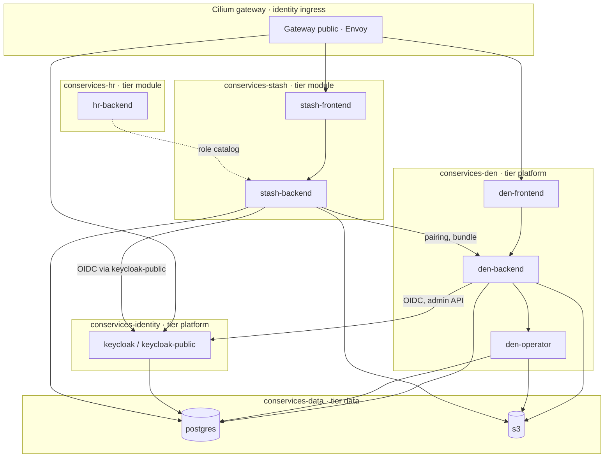

# Network policies and isolation

Con Services keeps its parts apart. Each part runs in its own Kubernetes
**namespace**, every namespace refuses all network traffic that is not
explicitly allowed, containers run with the strictest Pod Security level,
and each namespace has only the secrets it needs. This page explains the
layout, lists every allowed connection, and shows how to check that your
cluster actually enforces it.

!!! info "What a NetworkPolicy is"
    A **NetworkPolicy** is a Kubernetes rule that says which pods may open
    connections to which other pods. Once any policy selects a pod, all
    traffic not allowed by some policy is dropped. Con Services starts every
    namespace with a `default-deny` policy and then allows only what each
    part needs.

## Namespace layout



| Namespace | Labels | Contains |
| --- | --- | --- |
| `conservices-gateway` | `app.kubernetes.io/part-of: conservices` | The Gateway `public` and its certificate. No pods: Cilium's Envoy runs in `kube-system`. |
| `conservices-identity` | `conservices.io/tier: platform` | Keycloak. |
| `conservices-data` | `conservices.io/tier: data` | PostgreSQL, and the S3 server `s3` (SeaweedFS) for a local trial (production: CloudNativePG, and a managed S3 service outside the cluster). |
| `conservices-den` | `conservices.io/tier: platform` | `den-backend`, `den-frontend`, `den-operator`. |
| `conservices-<module>` | `conservices.io/tier: module`, `conservices.io/module: <module>` | One module's backend and frontend, for example `conservices-stash`. |

All of them also carry `pod-security.kubernetes.io/enforce: restricted` and
`pod-security.kubernetes.io/warn: restricted` (see [Pod Security](#pod-security)).

The policies select pods by two labels that every Con Services pod has:
`app.kubernetes.io/name` (`den`, `stash`, `keycloak`, `postgres`, `s3`)
and `app.kubernetes.io/component` (`backend`, `frontend`, `operator`, …).
Platform policies admit *any* module with one rule: pods labelled
`app.kubernetes.io/component: backend` in a namespace labelled
`conservices.io/tier: module`. That is why a new module only needs those two
labels to reach Den, PostgreSQL and storage.

## Every allowed flow

Everything not in this table is blocked. "Module backend" means a pod with
`app.kubernetes.io/component: backend` in a namespace with
`conservices.io/tier: module`.

Two deployment shapes exist, and both bring traffic in through the
**Cilium Gateway API** and reach the OIDC issuer in-cluster through the
Service `keycloak-public`. They differ in the data services: the
**Kustomize manifests** (`deploy/kubernetes/`, local trial) select the
in-cluster `postgres` and `s3` pods; the **Helm charts** (Den and every
module, used by the [Argo CD path](../deploy/index.md)) select CloudNativePG
and, optionally, an external S3 service. The "Shape" column says which rows
belong to which.

| From | To | Port | Shape | Why |
| --- | --- | --- | --- | --- |
| every pod | `kube-dns` in `kube-system` | 53 UDP/TCP | both | Looking up service names. |
| Cilium gateway (reserved identity `ingress`) | `den-frontend`, each module frontend, `rally-submit` | 8080 (Service port 443) | both | Serving the web apps. Allowed by the `CiliumNetworkPolicy` `<name>-web-from-gateway` (`fromEntities: [ingress]`); a Kubernetes NetworkPolicy cannot select this identity. |
| Cilium gateway (reserved identity `ingress`) | `keycloak` in `conservices-identity` | 8443 (Service `keycloak-public` port 443) | Kustomize (`keycloak-from-gateway`); GitOps repository (`keycloak-gateway`) | The sign-in pages at `auth.<domain>`. |
| another ingress controller (for example Traefik) | each web app | 8080 | Helm with `ingress.enabled` only | Legacy path for clusters without the Gateway API; admits `networkPolicy.ingressControllerNamespace`. |
| `den-frontend` | `den-backend` | 8080 | both | nginx proxies `/api/` to the backend. |
| `stash-frontend` | `stash-backend` | 8080 | both | nginx proxies `/api/` to the backend. |
| `den-backend`, module backend | Keycloak pods in `conservices-identity`, through the Service `keycloak-public` | 8443 (Service port 443) | both (Helm: `networkPolicy.oidc`) | OIDC discovery and signing keys. Pods resolve `auth.<domain>` to `keycloak-public` (production: a CoreDNS rewrite; local trial: `hostAliases` to its fixed address `10.96.0.100`). Keycloak's policy admits Den's backend and every module backend on 8443. Kustomize selects `app.kubernetes.io/name: keycloak`; the charts select `app: keycloak`, which both the Keycloak Operator and the Kustomize Keycloak set. |
| module backend | ingress controller | 443 | Helm with `oidcViaIngressController` only | Legacy: OIDC through an ingress controller. |
| `den-backend`, `den-operator`, module backend | CloudNativePG pods (`cnpg.io/cluster: conservices-pg`) in `conservices-data` | 5432 | Helm (`networkPolicy.data.postgres`) | Own database (Den's operator: admin login). |
| `den-backend`, `den-operator`, module backend with a bucket | Garage pods (`app.kubernetes.io/name: garage`) in `conservices-data` | 3900 | Helm (`networkPolicy.data.s3`) | Buckets, through Garage's TLS sidecar. |
| `den-backend`, `den-operator`, module backend | external S3 (for example `*.your-objectstorage.com`) | 443 | Helm, only when `networkPolicy.data.s3.external` is set | Buckets at a managed S3 provider. Cilium: the `CiliumNetworkPolicy` `<name>-external-s3` (`toFQDNs` plus a DNS rule to `kube-dns`); other CNIs: `ipBlock` rules from `external.cidrs`. Checked against public CAs, not the internal CA. |
| `den-backend` | `keycloak` | 8443 | both (Helm: `networkPolicy.keycloakAdmin`, merged with the OIDC rule when it targets the same pods) | Keycloak admin API for [Keycloak sync](../modules/den/admin-guide.md#keycloak-sync). |
| `den-backend` | `den-operator` | 8080 | both | Backups and module databases (bearer `OPERATOR_TOKEN`). |
| `den-backend` | `postgres` | 5432 | Kustomize | Den's own database (also the `migrate` initContainer). |
| `den-backend` | `s3` | 9000 | Kustomize | Den's bucket (branding assets). |
| `den-operator` | `postgres` | 5432 | Kustomize | Admin login: create and drop module databases, `pg_dump` for backups. |
| `den-operator` | `s3` | 9000 | Kustomize | Writing backups; copying module buckets into backups. |
| `keycloak` | `postgres` | 5432 | Kustomize | Keycloak's own database. |
| module backend | `den-backend` | 8080 | both | [Pairing](../concepts/pairing.md), the bundle every minute, user preferences. |
| module backend | `postgres` | 5432 | Kustomize | The module's own database. |
| module backend | `s3` | 9000 | Kustomize | The module's own bucket. |
| HR backend (`conservices-hr`) | `stash-backend` | 8080 | both | HR reads `GET /api/role-catalog` (see below). |
| HR backend (`conservices-hr`) | every other module backend (Learn, Wiki, Tasks, Desk, Finance, Rally) | 8080 | Helm (`networkPolicy.moduleEgressNamespaces`) | Role catalogs, Learn holdings, offboarding and department hooks (see below). |
| Wiki backend (`conservices-wiki`) | `hr-backend` | 8080 | Helm (HR: `networkPolicy.allowFromNamespaces`; Wiki: `networkPolicy.extraEgress` for now) | The Wiki's share dialog lists HR's groups (`GET /api/internal/directory/groups`). |
| HR backend | Photon (`photon.komoot.io`) | 443 | Helm (`networkPolicy.addressLookup`, on unless address search is unused) | Address suggestions. The browser calls HR; the backend calls Photon. |
| HR backend | Google's APIs (`admin.googleapis.com`, `oauth2.googleapis.com`) | 443 | Helm, only with `googleWorkspace.enabled` (`networkPolicy.googleApis`) | Google Workspace connector. |
| HR, Learn backends | `keycloak` | 8443 | Helm (`networkPolicy.keycloak` / `keycloakAdmin`) | Keycloak admin API (accounts, groups); merged with the OIDC rule when it targets the same pods. |

Rules in *other* namespaces that these flows need (Keycloak admitting the
backends on 8443, CloudNativePG admitting them on 5432, an in-cluster S3
service, if you run one, on its port) belong to the platform's own
policies, not to the module charts.

### Platform flows in the GitOps reference

The [GitOps reference deployment](../deploy/index.md) adds these policies
for the platform namespaces (`components/platform-namespaces`,
`charts/postgres` and `charts/keycloak` in `con-services-gitops`; the S3
host names come from `s3.fqdns` and `s3.backup.fqdns` in `cluster.yaml`). Both
namespaces start from a default deny with only DNS allowed.

| From | To | Port | Policy | Why |
| --- | --- | --- | --- | --- |
| module namespaces (`conservices.io/tier: module`), `conservices-den`, `conservices-identity` | PostgreSQL pods (`conservices.io/postgres: "true"`) | 5432 | NetworkPolicy `conservices-pg` | Applications, Den's operator and Keycloak reach their databases. |
| PostgreSQL pods | PostgreSQL pods | 5432, 8000 | `conservices-pg` | Streaming replication and the instance manager's status API. |
| CloudNativePG operator (namespace from `postgres.operatorNamespace`, default `cnpg-system`) | PostgreSQL pods | 8000, 5432 | `conservices-pg` | Status checks, switchovers, managing roles and databases. The operator is a prerequisite; if its own namespace has a default deny, its egress to `conservices-data` is the cluster admin's rule. |
| PostgreSQL pods | Kubernetes API (`toEntities: kube-apiserver`) | 6443 | CiliumNetworkPolicy `conservices-pg-kube-apiserver` | The instance manager watches its `Cluster` object. |
| PostgreSQL pods | external S3 by host name | 443 | CiliumNetworkPolicy `conservices-pg-s3` | WAL archive and base backups ([Data](../deploy/data.md#network-policy-for-s3)). |
| Cilium gateway (reserved identity `ingress`) | Keycloak pods | 8443 | CiliumNetworkPolicy in `conservices-identity` (`fromEntities: [ingress]`) | `auth.<domain>` (public) and `auth-admin.<domain>` (internal Gateway). |
| `den-backend`, module backends | Keycloak pods | 8443 | NetworkPolicy in `conservices-identity` | OIDC, Den's Keycloak sync, HR and Learn provisioning. |
| Keycloak pods | Keycloak pods | 7800, 57800 | NetworkPolicy in `conservices-identity` | Shared session cache between the instances. |
| Keycloak operator | Keycloak pods; Kubernetes API | 8443, 9000; 6443 | NetworkPolicy `keycloak-operator` and CiliumNetworkPolicy `keycloak-operator-apiserver` in `conservices-identity`, from `components/keycloak-operator/networkpolicies.yaml` (Application `keycloak-operator`, wave 2, so they exist before the operator starts) | Health checks and managing the StatefulSet and realm imports. Keycloak's ingress rule admits the operator on 8443 and 9000 (`charts/keycloak`). |
| Keycloak pods | PostgreSQL pods | 5432 | NetworkPolicy in `conservices-identity` | Keycloak's database. |
| Keycloak pods | internet outside the private ranges | 587, 465 | NetworkPolicy in `conservices-identity` | Password-reset and verification mail through your SMTP provider. |
| setup Job (`app.kubernetes.io/name: conservices-openbao-setup`, ESO's namespace) | `kube-dns`; any pod in `openbao.namespace` (default `openbao`) | 53; all | NetworkPolicy `conservices-openbao-setup` (`charts/openbao-setup`, only with `openbao.setup.enabled`) | The Job enables the KV engine and writes External Secrets' role. It accepts no connections. If OpenBao's namespace has a default deny, admitting the Job on 8200 is the OpenBao operator's rule. |

Not listed, so blocked: one module calling another (except the documented
integrations below), the operator being reached by anything but
`den-backend`, any pod reaching the internet (except external S3 and HR's
Google Workspace connector when you allow them), and the gateway reaching
backends directly.

Every flow in this table except DNS is encrypted with TLS and checked against
the internal certificate authority (external S3: against public CAs); see
[Internal TLS](internal-tls.md).
cert-manager and trust-manager need no flows of their own: they only talk to
the Kubernetes API, which NetworkPolicies do not cover. External Secrets
reaching OpenBao (`openbao.server`, port 8200) runs between two
prerequisites outside the Con Services namespaces, so the template adds no
policy for it; if your cluster restricts that traffic, allow it there.

## Calls between modules

Modules do not talk to each other by default. A few integrations need a
direct call. Each one needs **two** rules: an *egress* rule in the caller's
namespace and an *ingress* rule in the target's namespace.

| Caller | Target | Path | Status in the manifests |
| --- | --- | --- | --- |
| HR | every module | `GET /api/role-catalog` (roles HR can grant) | Done in the Helm charts: HR's egress (`networkPolicy.moduleEgressNamespaces`, every module namespace) and each module's ingress (`allowFromNamespaces` includes `conservices-hr`); Stash also in Kustomize. |
| HR | Learn | `/api/qualification-catalog`, `/api/internal/holdings` (with `LEARN_SERVICE_TOKEN`) | Done in the HR and Learn charts. |
| HR | Wiki | `/api/internal/offboarded` (offboarding hook) | Done in the HR and Wiki charts. |
| HR | Tasks | `/api/internal/departments` (department hook) | Done in the HR and Tasks charts. |
| Wiki | HR | `GET /api/internal/directory/groups` (with `HR_DIRECTORY_TOKEN`) | HR's ingress in its chart (`allowFromNamespaces: [conservices-wiki]`); the Wiki's egress through its `networkPolicy.extraEgress` until the Wiki chart has its own value ([Set up HR, step 5](../modules/hr/setup.md#5-open-the-network-paths-hr-needs)). |
| HR, Learn | Keycloak admin API | creating accounts, reading groups | Egress in the HR and Learn Helm charts (`networkPolicy.keycloak` / `keycloakAdmin`); the ingress rule on Keycloak is the platform's. |
| Den backend | every paired module | `GET /api/portal/todos` (server to server, [token contract](../concepts/authentication.md#tokens-the-10-contract)) | Planned for 1.0: egress in `conservices-den`, ingress in each module's namespace, both on port 8080, added with the Den and module releases that implement it. |
| HR | Den backend | `GET /api/v1/integrations/modules` ([role catalog discovery](../concepts/role-catalog.md#how-hr-finds-the-catalogs)) | Covered by the existing rule from every module backend to Den's backend on port 8080. |
| Modules using `gworkspace` | Google APIs (outside the cluster) | `oauth2.googleapis.com`, `admin.googleapis.com`, `gmail.googleapis.com` on 443 | Planned: an [external egress rule](#external-services) in the module's chart, added with the module release that adopts it ([Shared code](../concepts/shared-code.md#what-adopting-a-package-involves)). |

Calls that come from the **browser**, not from a pod, go through the
Gateway and need no policy of their own: Den's portal fetching
`/api/portal/todos` from each module (until the server-to-server call
above replaces it), and Den's web app calling Learn's API.

Example: HR's egress rule to call Stash (goes into `conservices-hr`):

```yaml
apiVersion: networking.k8s.io/v1
kind: NetworkPolicy
metadata:
  name: hr-backend-to-stash
  namespace: conservices-hr
spec:
  podSelector:
    matchLabels:
      app.kubernetes.io/name: hr
      app.kubernetes.io/component: backend
  policyTypes: ["Egress"]
  egress:
    - to:
        - namespaceSelector:
            matchLabels:
              kubernetes.io/metadata.name: conservices-stash
          podSelector:
            matchLabels:
              app.kubernetes.io/name: stash
              app.kubernetes.io/component: backend
      ports:
        - protocol: TCP
          port: 8080
```

## External services

Out of the box, pods may reach nothing outside the cluster. When you use
managed PostgreSQL or S3, an external identity provider, or email (SMTP),
add egress rules for them. For a fixed address range use `ipBlock`:

```yaml
apiVersion: networking.k8s.io/v1
kind: NetworkPolicy
metadata:
  name: den-to-managed-postgres
  namespace: conservices-den
spec:
  podSelector:
    matchLabels:
      app.kubernetes.io/name: den
  policyTypes: ["Egress"]
  egress:
    - to:
        - ipBlock:
            cidr: 10.20.0.0/24   # your database subnet
      ports:
        - protocol: TCP
          port: 5432
```

Standard NetworkPolicies cannot match host names. For cloud services
without fixed addresses (S3, a hosted identity provider), either allow
`0.0.0.0/0` on port 443 for the pods that need it, or use your CNI's
DNS-aware policies (Cilium `toFQDNs`, Calico `domains`).

For managed S3 (recommended in
[Production](production.md#object-storage-use-managed-s3); any
S3-compatible service works, for example AWS S3, Hetzner Object Storage,
Cloudflare R2 or Backblaze B2), allow port 443
to the provider: with Cilium, a `toFQDNs` rule for the endpoint host;
otherwise an `ipBlock` for the provider's ranges.

With the Helm charts you do not write this policy yourself: set
`networkPolicy.data.s3.external.fqdns` (Cilium) or
`networkPolicy.data.s3.external.cidrs` (any CNI), and the chart renders the
`<module>-external-s3` CiliumNetworkPolicy or `ipBlock` rule for the
backend (Den: backend and operator). See
[External S3 in the Helm guide](helm.md#external-s3-hetzner-object-storage).
The example below is what the chart renders, for Kustomize installs.

### Example: managed S3 by host name with Cilium

A `CiliumNetworkPolicy` adds to the standard policies (it does not replace
them). `toFQDNs` only works when Cilium also sees the DNS answers, so the
policy includes a DNS rule:

```yaml
apiVersion: cilium.io/v2
kind: CiliumNetworkPolicy
metadata:
  name: den-to-hetzner-s3
  namespace: conservices-den
spec:
  endpointSelector:
    matchLabels:
      app.kubernetes.io/name: den
  egress:
    - toEndpoints:
        - matchLabels:
            k8s:io.kubernetes.pod.namespace: kube-system
            k8s-app: kube-dns
      toPorts:
        - ports: [{ port: "53", protocol: ANY }]
          rules:
            dns:
              - matchPattern: "*"
    - toFQDNs:
        - matchPattern: "*.your-objectstorage.com"   # Hetzner; AWS: "*.s3.eu-central-1.amazonaws.com"
      toPorts:
        - ports: [{ port: "443", protocol: TCP }]
```

This one policy covers both `den-backend` and `den-operator` (both carry
`app.kubernetes.io/name: den`). Add the same in each module namespace that
uses S3, with that module's selector.

## Rules for a new module

When you deploy a module (by hand, with Kustomize or with its
[Helm chart](helm.md)):

1. Label its namespace `conservices.io/tier=module` and
   `conservices.io/module=<module>`. The platform policies (Den,
   PostgreSQL, the S3 server) then admit its backend without any change on their
   side.
2. Make sure its own namespace has `default-deny`, DNS, gateway →
   frontend, frontend → backend, and backend → Den / data / Keycloak
   rules. The Helm charts and `modules/stash/networkpolicies.yaml` contain
   exactly these. With Cilium's Gateway API the gateway rule must be a
   `CiliumNetworkPolicy` with `fromEntities: [ingress]`:

    ```yaml
    apiVersion: cilium.io/v2
    kind: CiliumNetworkPolicy
    metadata:
      name: stash-web-from-gateway
      namespace: conservices-stash
    spec:
      endpointSelector:
        matchLabels:
          app.kubernetes.io/name: stash
          app.kubernetes.io/component: frontend
      ingress:
        - fromEntities: ["ingress"]
          toPorts:
            - ports: [{ port: "8080", protocol: TCP }]
    ```
3. For each [integration with another module](#calls-between-modules), add
   the egress rule in the caller's namespace **and** the ingress rule in the
   target's namespace.
4. For each external service it uses (managed database, S3, SMTP, Telegram),
   add an [egress rule](#external-services).
5. Run the [enforcement test](#checking-that-your-cluster-enforces-policies)
   against the new backend, and add a row to [Every allowed flow](#every-allowed-flow)
   if you added a new kind of connection.

With an external identity provider, also replace the rules that allow
backends to reach Keycloak (Helm: `networkPolicy.oidc.inCluster: false`)
with egress on port 443 to the provider.

## Checking that your cluster enforces policies

NetworkPolicies are enforced by the cluster's network plugin (**CNI**), not
by Kubernetes itself.

!!! tip "Recommended CNI: Cilium"
    We recommend [Cilium](https://cilium.io). NetworkPolicy is first-class
    there, it adds DNS-aware egress rules (`toFQDNs`) for external services,
    and its **Hubble** observability shows every allowed and dropped flow,
    for example `hubble observe --namespace conservices-den --verdict DROPPED`.
    Cilium also runs the Gateway, and the manifests and charts include
    `CiliumNetworkPolicy` objects for it, so Con Services expects Cilium.
    The local trial's kind cluster and the [Argo CD path](../deploy/index.md)
    both use it. On another CNI that enforces NetworkPolicy (Calico,
    Antrea), you also need another Gateway API implementation or ingress
    controller, and must remove the Cilium objects and admit that
    controller's namespace instead.

**Docker Desktop's built-in Kubernetes and kind's default plugin may accept
the policies but not enforce them**, so everything still works there even
when a rule is missing. The quickstart's kind cluster replaces kind's
plugin with Cilium and therefore enforces them. Whatever the cluster,
verify enforcement yourself with the test below, and test on a cluster like
your production one.

To test, start a throwaway pod in the `default` namespace and try to reach
Den's operator, which only `den-backend` may reach:

```sh
kubectl run np-test --rm -it --restart=Never --image=curlimages/curl:8.11.1 -n default -- curl -sk -o /dev/null -w "%{http_code}\n" --max-time 3 https://den-operator.conservices-den.svc.cluster.local:8080/livez
```

- **Enforced:** after three seconds it prints `000` (curl gave up: the
  connection was dropped).
- **Not enforced:** it prints `204` at once (the operator answers `/livez`
  with an empty `204`).

`-k` skips the certificate check because this test is only about whether
the connection gets through.

Then check that an **allowed** path still works, from Den's backend to the
operator. The backend image has no shell, so use an ephemeral debug
container that joins its pod (it meets the restricted Pod Security rules
because it runs as the pod's user):

```sh
kubectl debug -n conservices-den deploy/den-backend -it --image=curlimages/curl:8.11.1 --profile=restricted -- curl -sk -o /dev/null -w "%{http_code}\n" --max-time 3 https://den-operator:8080/livez
```

```text
204
```

### What Con Services needs from Cilium

Cilium is part of the cluster, not of Con Services; installing and
upgrading it is up to whoever runs the cluster
([Cilium documentation](https://docs.cilium.io/en/stable/installation/k8s-install-helm/)).
Con Services relies on:

- standard `NetworkPolicy`, enforced;
- Cilium's Gateway API support (which needs its kube-proxy replacement);
- `CiliumNetworkPolicy` for the gateway (`fromEntities: [ingress]`) and for
  `toFQDNs` egress rules to S3.

The exact settings are on
[Prerequisites](../deploy/prerequisites.md#2-cilium). After installing
Con Services, run the enforcement test above. If Hubble is turned on, it
shows the connections a policy drops while you use the suite:

```sh
hubble observe --namespace conservices-den --verdict DROPPED -f
```

```text
Nov  6 14:12:03.120: default/np-test:41234 (ID:9811) <> conservices-den/den-operator-5c6f9d7b84-mn2rs:8080 (ID:2271) policy-verdict:none INGRESS DENIED (TCP Flags: SYN)
```

## Pod Security

Every Con Services namespace has the labels:

```yaml
pod-security.kubernetes.io/enforce: restricted
pod-security.kubernetes.io/warn: restricted
```

Kubernetes then refuses pods that do not meet the **restricted** Pod
Security Standard. All Con Services containers:

- run as a non-root user (`runAsNonRoot: true` with a fixed user id);
- cannot gain privileges (`allowPrivilegeEscalation: false`);
- drop all Linux capabilities;
- use the `RuntimeDefault` seccomp profile;
- where the program allows it, have a read-only root filesystem, with small
  writable `emptyDir` volumes for temporary files.

If you add a sidecar or debug container, it must meet the same rules.

## Service accounts and Kubernetes API access

No Con Services component talks to the Kubernetes API. Den's operator,
despite its name, is not a Kubernetes operator: it manages PostgreSQL
databases and backups over the network, and creates no Kubernetes objects.
So:

- there are **no Roles, ClusterRoles or RoleBindings**;
- each Deployment uses its namespace's `default` service account, or a
  dedicated one, with `automountServiceAccountToken: false`, so no API token
  is mounted into the containers.

## Secrets per namespace

Each namespace holds only its own secrets. A module never sees Den's
storage keys or the database admin password.

| Namespace | Secret | Contains |
| --- | --- | --- |
| `conservices-identity` | `keycloak-secrets` | Keycloak's database password, the bootstrap admin login. |
| `conservices-gateway` | `conservices-tls` (local trial), `wildcard-tls` (GitOps repository) | The public HTTPS certificate the Gateway presents to browsers. |
| `conservices-data` | `postgres-secrets` | PostgreSQL superuser password, initial `den` and `keycloak` passwords. |
| `conservices-data` | `s3-secrets` | Admin key of the trial S3 server (`AWS_ACCESS_KEY_ID`, `AWS_SECRET_ACCESS_KEY`). |
| `conservices-den` | `den-secrets` | Den's database URL, S3 keys, Keycloak client secret, operator token. |
| `conservices-den` | `den-operator-secrets` | Operator token, PostgreSQL **admin** URL, backup and file-copy S3 keys. |
| `conservices-stash` | `stash-secrets` | Stash's database URL (from Den) and S3 keys. |

The example overlay uses one S3 admin key for everything for
simplicity. In production give each module its own storage keys limited to
its bucket.

## Troubleshooting

**A connection times out** (`i/o timeout`, `context deadline exceeded`)
between two parts: check that both sides have a rule (egress at the caller,
ingress at the target), and that the namespace and pod labels match. See
[Troubleshooting](../getting-started/troubleshooting.md#timeouts-between-namespaces).

**Everything works on Docker Desktop but not in production:** your local
cluster does not enforce policies, so a missing rule went unnoticed. Use the
test above on both clusters.

**You use another gateway or ingress controller instead of Cilium's:** the
`CiliumNetworkPolicy` objects only admit Cilium's Envoy. Admit your
controller's namespace in the web apps' policies instead (Helm:
`networkPolicy.gateway.namespace`, or `networkPolicy.ingressControllerNamespace`
with `ingress.enabled`; Kustomize: an ingress rule in an overlay), for
example `kube-system` for k3s' Traefik. Symptom: every site returns *502*,
*503* or a gateway time-out although the pods are ready.

**With Cilium's Gateway API every site gives `connection reset` or a
gateway timeout although the pods are ready:** the gateway's Envoy arrives
with Cilium's reserved identity `ingress`, which no Kubernetes
NetworkPolicy can admit, so `default-deny` drops it. Check that the
`CiliumNetworkPolicy` `<name>-web-from-gateway` exists in the namespace
(`kubectl get cnp -n conservices-stash`); Hubble shows the drops with
`hubble observe --namespace conservices-stash --verdict DROPPED --from-identity 8`.

**Den's backend crashes with `oidc discovery … i/o timeout` after you moved
to an external identity provider:** the backend may only reach Keycloak
inside the cluster. Add egress on port 443 to the provider (an `ipBlock`,
or a `toFQDNs` rule with Cilium).

**Den's backend crashes with `oidc discovery … i/o timeout` with the
in-cluster Keycloak:** check that `auth.<domain>` resolves to
`keycloak-public` inside the cluster (production: the CoreDNS rewrite;
local trial: `kubectl get service -n conservices-identity keycloak-public`
must show `10.96.0.100`), and that Keycloak's policy admits the backend
(`kubectl describe networkpolicy -n conservices-identity keycloak`).

**A `toFQDNs` rule allows nothing:** Cilium did not see the DNS answer.
The `CiliumNetworkPolicy` must contain the DNS rule shown in
[the example](#example-managed-s3-by-host-name-with-cilium), and the pod
must look the name up again after the policy exists (restart it).

**Find which rule is missing, with Cilium:**

```sh
hubble observe --verdict DROPPED --namespace conservices-stash --last 50
```

The output names source, destination and port. Without Cilium, compare the
connection with [Every allowed flow](#every-allowed-flow) and list the
policies on both sides:

```sh
kubectl get networkpolicy -n conservices-stash
kubectl get networkpolicy -n conservices-den -o yaml | less
```

## Related pages

- [Production and security](production.md): CNI choice and the production shape.
- [Secrets](secrets.md): which secret lives in which namespace.
- [Installing modules with Helm](helm.md): the `networkPolicy.*` values.
- [Logs, health and monitoring](observability.md): Hubble metrics and scraping rules.
