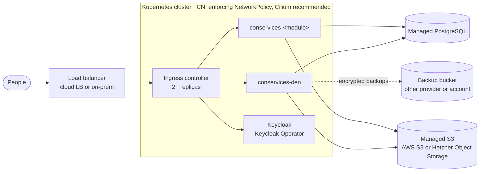

# Production and security

**Goal:** turn a working trial into an installation real people can rely
on: behind a load balancer, with enforced network policies, managed
PostgreSQL and S3, secrets in a secret manager, and backups you have
restored once. The [go-live procedure](#go-live-procedure) at the end
puts it in order.

The example overlay is built to be easy, not safe: it uses public test
passwords, plain Kubernetes Secrets, a development Keycloak, in-cluster
MinIO and a self-made certificate. This page describes the shape of a real
installation, what to change before real people use Con Services, and the
security properties worth knowing.

## The production shape



### Load balancer in front of the ingress controller

Large installations sit **behind a load balancer**: a cloud load balancer
(AWS NLB/ALB, Hetzner Load Balancer, Azure or GCP equivalents) or an on-prem
one (MetalLB, F5, HAProxy, keepalived pair). It is the one public address,
spreads traffic across several ingress controller replicas on several nodes,
and keeps the site reachable when a node goes away. This is the normal
production shape whenever more than a handful of people use the suite.

- Run the ingress controller with **two or more replicas** on different
  nodes, exposed as a `Service` of type `LoadBalancer` (cloud) or through
  your on-prem load balancer.
- Terminate TLS either at the load balancer or at the ingress controller,
  not half-way. If the load balancer terminates TLS, it must pass
  `X-Forwarded-Proto: https` on, because Keycloak runs with
  `KC_PROXY_HEADERS=xforwarded` and Den's nginx forwards that header.
- Put **rate limiting** at the load balancer or ingress controller; Den has
  none built in (see [Security notes](#security-notes)).
- Only the web apps (`den.`, `auth.`, `<module>.` host names) are published.
  PostgreSQL, S3, the operator and the backends are never behind the load
  balancer.

The local quickstart has no load balancer: Docker Desktop maps the ingress
controller to `localhost` directly, which is fine for a trial.

### The cluster and its network plugin

Every Con Services namespace relies on **NetworkPolicies** for isolation, and
those only work if the cluster's network plugin (CNI) enforces them.

!!! tip "Recommended CNI: Cilium"
    We recommend [Cilium](https://cilium.io): NetworkPolicy is first-class,
    it offers DNS-aware egress rules (`toFQDNs`, handy for managed S3 and
    identity providers), and **Hubble** shows every allowed and dropped
    connection, which makes policy problems quick to find.

    Any CNI that enforces Kubernetes NetworkPolicy works, for example
    Calico or Antrea. What does **not** work is a CNI that ignores the
    policies: some default local setups, such as Docker Desktop's built-in
    Kubernetes, accept them but may not enforce them. **Verify enforcement
    on every cluster** with the test in
    [Network policies](network-policies.md#checking-that-your-cluster-enforces-policies).

## Object storage: use managed S3

For real installations use a managed, S3-compatible object storage service.
The most sensible choices are:

| Service | When it fits |
| --- | --- |
| **AWS S3** | You run on AWS, or want the reference S3 implementation. Use IAM users or roles with a policy per bucket. |
| **Hetzner Object Storage** | You run on Hetzner or want EU hosting at low cost. S3-compatible; set the endpoint (for example `https://fsn1.your-objectstorage.com`) and region. |

Point Den's `S3_*`, the operator's `BACKUP_S3_*` and `FILES_S3_*`, and each
module's `S3_*` at it. With AWS S3 set `S3_USE_PATH_STYLE=false` if your
bucket names require virtual-host style.

=== "Hetzner Object Storage"

    1. In the Hetzner Console, create a bucket per module in your location
       (for example `fsn1`), with globally unique names such as
       `example-den`, `example-stash`.
    2. Under **Security → S3 credentials**, create credentials. Hetzner
       credentials apply to the whole project, so put backups in a
       **separate project** (or another provider).
    3. Settings, for example for Den:

        ```text
        S3_ENDPOINT=https://fsn1.your-objectstorage.com
        S3_REGION=fsn1
        S3_BUCKET=example-den
        S3_USE_PATH_STYLE=false
        ```

=== "AWS S3"

    1. Create one bucket per module (Block Public Access on, default
       encryption on) and one IAM user or role per module.
    2. Attach a policy that allows only that bucket:

        ```json
        {
          "Version": "2012-10-17",
          "Statement": [
            { "Effect": "Allow", "Action": ["s3:ListBucket", "s3:GetBucketLocation"],
              "Resource": "arn:aws:s3:::example-stash" },
            { "Effect": "Allow", "Action": ["s3:GetObject", "s3:PutObject", "s3:DeleteObject"],
              "Resource": "arn:aws:s3:::example-stash/*" }
          ]
        }
        ```

    3. Settings, for example for Stash:

        ```text
        S3_ENDPOINT=https://s3.eu-central-1.amazonaws.com
        S3_REGION=eu-central-1
        S3_BUCKET=example-stash
        S3_USE_PATH_STYLE=false
        ```

    The operator's backup user needs `s3:PutObject`, `s3:GetObject`,
    `s3:ListBucket` and `s3:DeleteObject` (pruning) on the backup bucket;
    its file-copy user needs `s3:GetObject` and `s3:ListBucket` on every
    module bucket.

Create the buckets yourself before the first start: with scoped keys, a
module cannot create its own bucket.

!!! warning "In-cluster MinIO is for local trials"
    The MinIO in `conservices-data` exists so the quickstart works with no
    accounts anywhere. It has one root login for everything, a single
    volume, no replication and no encryption. Do not run it, or your own
    MinIO, in production unless you have a strong reason (for example no
    managed S3 allowed) and the time to operate, upgrade and back it up.

Two rules regardless of provider:

- **One bucket per module, one set of keys per module**, limited to that
  bucket. The example overlay's shared MinIO login is for trials only.
- **Backups go somewhere else**: a different provider, or at least a
  different account, from the live data (see
  [Databases, backups and restore](databases-and-backups.md#backups)).
  For example live data in Hetzner Object Storage, backups in AWS S3.

Remember to add egress rules for the storage endpoint; out of the box, pods
may only reach the in-cluster MinIO (see
[Network policies](network-policies.md#external-services)).

## Database

Use a managed PostgreSQL 16 service, or the
[CloudNativePG](https://cloudnative-pg.io) operator, instead of the single
in-cluster `postgres` StatefulSet. Give Den's operator a superuser (or a
role with `CREATEDB` and `CREATEROLE`) in `PG_ADMIN_URL`, set
`MODULE_DB_HOST` to the address modules use, and use `sslmode=require` (or
stricter) in every URL. Then remove `base/data` from your overlay.

## Keycloak

The example runs Keycloak in development mode (`start-dev`) as a single pod.
For production run it with the
[Keycloak Operator](https://www.keycloak.org/operator/installation) (or your
existing identity provider), in production mode, with two or more replicas
and its own database backups. Then:

- **Turn off direct access grants** (the password grant) on every `*-spa`
  client. The test realm allows them so scripts can get tokens.
- **Remove `localhost` redirect URIs** and keep only your real addresses,
  for example `https://den.example.org/*` for `den-spa`.
- **Delete the test accounts** `admin`, `alice` and `bob`, and replace the
  bootstrap admin login.
- **Configure real SMTP** on the realm; the test realm points at Mailpit,
  which does not exist on Kubernetes.
- **Install the `conservices` login theme** if you want Den's branding on the
  sign-in page, and give the `den-keycloak` service account the
  `realm-management` role `manage-realm`. That role can change every realm
  setting, so keep its secret as safe as an admin password.
- Decide on **session lengths**. The test realm uses 5-minute access tokens,
  a 10-hour idle session and a 24-hour maximum.

## Secrets

Never use the example's plain Secrets beyond a local trial. Keep every
secret in a secret manager and let the External Secrets Operator create the
Kubernetes Secrets; `overlays/production-external-secrets` shows the
structure. The full inventory, provider examples and rotation steps are on
[Secrets](secrets.md).

Every test value in the repository is public and must be replaced:

| Test value | Where it is used | Replace with |
| --- | --- | --- |
| `postgres-dev-password` and the other `*-dev-password` values | PostgreSQL logins, `PG_ADMIN_URL`, `DATABASE_URL`s | Long random passwords, or databases created by Den's operator, which generates them. |
| `conservices` / `conservicesdev` | MinIO keys used by every backend and the operator | Your S3 provider's keys, one set per bucket. |
| `den-keycloak-dev-secret` | `KEYCLOAK_CLIENT_SECRET`, client `den-keycloak` | A new secret, generated in Keycloak. |
| `den-operator-dev-token` | `OPERATOR_TOKEN` on the backend and the operator | A long random value, for example `openssl rand -hex 32`. |
| The age key in `infra/operator/dev-backup-identity.txt` | `BACKUP_AGE_RECIPIENTS` | Your own key pair; see [The encryption key](databases-and-backups.md#the-encryption-key). |

## Den settings

- **`AUTH_MODE=oidc`** on the backend (the base sets it) and your own
  `den-frontend` build with **`VITE_AUTH_MODE=oidc`** and your issuer (see
  [Configuration](../modules/den/configuration.md#frontend-build-settings)).

    !!! danger "Dev mode makes everyone an admin"
        `AUTH_MODE` defaults to `dev`. In dev mode Den believes whatever name
        is in the `X-Dev-User` header and makes that person an admin. A Den
        reachable from a network in dev mode is open to anyone.

- **`APP_BASE_URL`** is Den's real `https://` address. It ends up in pairing
  URLs and on the sign-in page.
- **`CORS_ALLOWED_ORIGINS`** only lists origins that really call Den's API
  from a browser on another address; never `*`.
- **`DEN_ADMIN_GROUPS`** and **`DEN_MEMBER_GROUPS`** name the groups you
  actually use in your identity provider.
- Remove the example's `den-backend-local.yaml` patch (`hostAliases` and
  `SSL_CERT_DIR`). They only exist for the local mkcert setup; a real
  issuer resolves through DNS and has a publicly trusted certificate.

All variables are in the [configuration reference](../modules/den/configuration.md).

## Pod security

Every Con Services namespace enforces the Pod Security Standard
`restricted`; keep it that way. All containers run as non-root, without
privilege escalation, with all capabilities dropped and the
`RuntimeDefault` seccomp profile. No component uses the Kubernetes API, so
there is no RBAC to grant and no service account token is mounted. Details
are in [Network policies and isolation](network-policies.md#pod-security).

## Backups

Work through the backup checklist in
[Databases, backups and restore](databases-and-backups.md#production-checklist).
The most important points:

- Your own age key, with the secret half stored **offline**, in two places.
- Backups stored at a **different provider or account** from the live data.
- One test restore, before you need it.
- Modules not on the operator's server are backed up by someone else.

## Security notes

These are properties of Den worth knowing when you assess it.

**Public endpoints.** Without signing in, anyone can read: the health
endpoints, the role catalog, the brand bundle and brand assets (they are
shown on sign-in pages anyway). Treat everything you put in branding and the
organisation name as public. Organisation settings are **not** public.

**Pairing URLs are secrets for 15 minutes.** Whoever redeems one first gets a
credential for that module. Share them only through the admin's own screen,
not by email or chat. Den stores only a hash of the token.

**Module credentials do not expire.** A paired module's credential works
until the module is removed from Den. There is no button or endpoint to
revoke a single credential, and pairing a module again gives it a new
credential without invalidating the old one. To cut off a module whose
credential may have leaked, remove the module in Den (choose to keep its
data) and add and pair it again.

**Backup download links need no sign-in.** An admin creates them; each one
works once, for 5 minutes. Backups are encrypted, so a leaked link exposes
only an encrypted file.

**Roles follow the identity provider.** Den recomputes a person's role from
their groups on every request, so removing someone from `den-admin` takes
effect as soon as their current token expires. See
[Authentication](../concepts/authentication.md#from-groups-to-roles).

**No built-in rate limiting.** Den does not limit how often an address may
call it. Rate-limit at the load balancer or ingress controller.

## Checklist

- [ ] A load balancer in front of two or more ingress controller replicas;
  only the web apps are published.
- [ ] A CNI that enforces NetworkPolicy (Cilium recommended), and the
  enforcement test passes.
- [ ] Managed S3 (AWS S3 or Hetzner Object Storage); no in-cluster MinIO;
  one bucket and one key set per module.
- [ ] Managed PostgreSQL or CloudNativePG; `sslmode=require`.
- [ ] Keycloak in production mode (Keycloak Operator): no test accounts, no
  password grant on app clients, no `localhost` redirect URIs, real SMTP.
- [ ] All secrets in a secret manager via External Secrets; no plain
  Secrets with test values; etcd encryption at rest turned on.
- [ ] Own `den-frontend` build for your issuer; `AUTH_MODE=oidc`.
- [ ] Image tags pinned to `MAJOR.MINOR.PATCH-BUILD`, never `latest`.
- [ ] Real TLS certificates (cert-manager or your platform).
- [ ] Egress rules added for every external service (database, S3, identity
  provider, SMTP).
- [ ] The [backup checklist](databases-and-backups.md#production-checklist)
  is done, including one test restore.
- [ ] Logs are collected and the [basic alerts](observability.md#alerts-worth-having)
  are in place.

## Go-live procedure

Do these in order; each step builds on the previous one.

1. **Cluster:** Cilium (or another enforcing CNI), ingress controller with
   two or more replicas behind a load balancer, cert-manager, External
   Secrets Operator. Run the
   [enforcement test](network-policies.md#checking-that-your-cluster-enforces-policies):
   it must time out.
2. **Outside services:** managed PostgreSQL 16, buckets and scoped keys at
   AWS S3 or Hetzner, a backup bucket at a second provider or account, DNS
   names, SMTP.
3. **Secrets:** your own age key pair (secret half offline), every secret
   from the [inventory](secrets.md#inventory) in your secret manager.
4. **Identity:** Keycloak with the Keycloak Operator (or your identity
   provider), the realm with the sign-in clients, test accounts removed,
   real redirect URIs.
5. **Your overlay:** host names, pinned tags, own `den-frontend` build,
   `base/data` removed, egress rules for the database, S3, identity
   provider and SMTP. Apply it ([Running on Kubernetes](running.md#set-up-your-own-installation)).
6. **Den check:** sign in, **Backups → Back up now** succeeds.
7. **Modules:** add them one by one ([Add a module](running.md#add-a-module)).
8. **Restore test:** restore last night's backup into a scratch database
   ([Restore](databases-and-backups.md#restore)).
9. **Monitoring:** logs collected, alerts firing to someone who reads them
   ([Logs, health and monitoring](observability.md)).
10. Go through the [checklist](#checklist) once more and record the
    versions you run.

## Troubleshooting

**Signing in loops or fails only in production, behind the load balancer**
: The load balancer terminates TLS but does not pass
  `X-Forwarded-Proto: https`, so Keycloak builds `http://` addresses. Turn
  on forwarding headers at the load balancer, or terminate TLS at the
  ingress controller instead.

**Every request appears to come from the load balancer's address**
: The client address is lost. Enable the PROXY protocol on both the load
  balancer and the ingress controller (ingress-nginx: `use-proxy-protocol:
  "true"` in its ConfigMap), or `externalTrafficPolicy: Local` on its
  Service.

**A module cannot write files: `AccessDenied` or `NoSuchBucket`**
: The bucket does not exist (create it, modules with scoped keys cannot),
  the key's policy names another bucket, or `S3_REGION` does not match the
  bucket's region.

**`x509: certificate signed by unknown authority` against managed PostgreSQL**
: The provider's certificate is signed by its own authority. Use
  `sslmode=require` (encrypted, no certificate check), or mount the
  provider's CA and use `sslmode=verify-full&sslrootcert=/path/ca.pem`.

**Keycloak with several replicas logs people out at random**
: The replicas do not share their cache. Use the Keycloak Operator, which
  sets up clustering, instead of scaling the example Deployment.

## Related pages

- [Running on Kubernetes](running.md)
- [Network policies and isolation](network-policies.md)
- [Secrets](secrets.md)
- [Databases, backups and restore](databases-and-backups.md)
- [Disaster recovery](disaster-recovery.md)
- [Logs, health and monitoring](observability.md)
