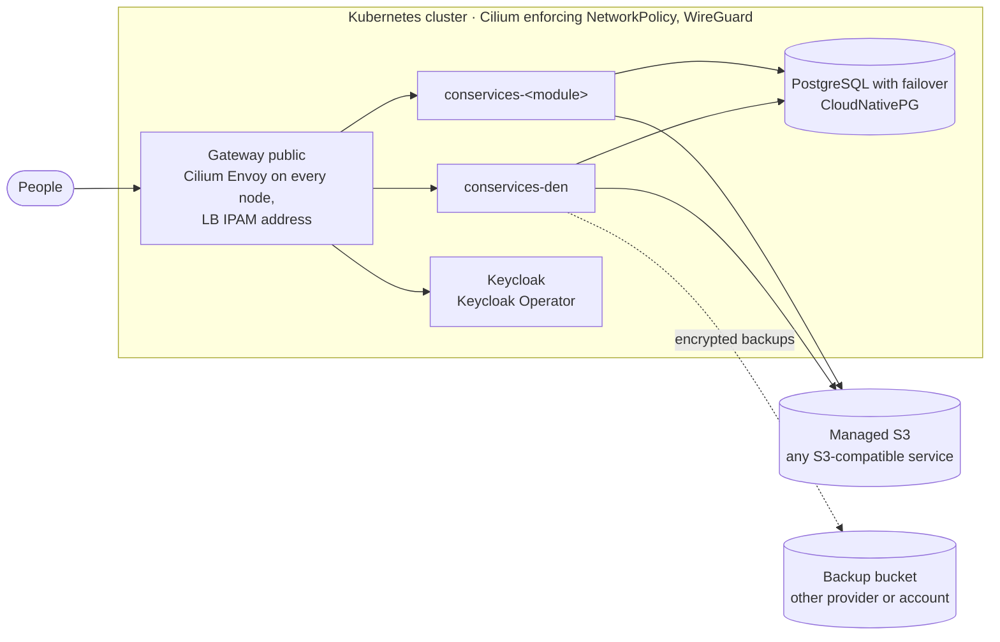

# Production and security

**Goal:** turn a working trial into an installation real people can rely
on: behind a load balancer, with enforced network policies, managed
PostgreSQL and S3, secrets in a secret manager, and backups you have
restored once. The [go-live procedure](#go-live-procedure) at the end
puts it in order.

The tested way to build all of this is
[Deploy with Argo CD](../deploy/index.md): a k3s cluster with Cilium,
Longhorn, OpenBao, CloudNativePG, the Keycloak Operator and managed S3,
managed from a Git repository. This page explains the requirements behind
it and the security properties worth knowing, whatever tool you use.

The local example overlay is built to be easy, not safe: it uses public
test passwords, plain Kubernetes Secrets, a development Keycloak,
an in-cluster S3 server (SeaweedFS) and a self-made certificate. Do not grow it into
production.

## The production shape



### A load-balancer address for the Gateway

Browsers reach Con Services through one **Gateway**
([Gateway API](../concepts/glossary.md#gateway-api)), served by Cilium's
Envoy proxy on every node. The Gateway gets one public address:

- **Your own servers:** Cilium's **LB IPAM** hands the Gateway's Service an
  address from a pool you define and announces it on your network (L2
  announcements); your router forwards ports 80 and 443 to it. This is the
  setup of [Deploy with Argo CD](../deploy/index.md).
- **A cloud provider:** the Gateway's Service of type `LoadBalancer` gets
  the provider's load balancer (AWS NLB, Hetzner Load Balancer, Azure or
  GCP equivalents).

Either way the address keeps working when a node goes away, because every
node runs Envoy. Then:

- Terminate TLS at the Gateway (it holds the certificate). If a load
  balancer in front terminates TLS instead, it must pass
  `X-Forwarded-Proto: https` on, because Keycloak runs with
  `KC_PROXY_HEADERS=xforwarded` and Den's nginx forwards that header.
- Put **rate limiting** in front of the Gateway, for example at your
  provider's load balancer or a CDN; Den has none built in (see
  [Security notes](#security-notes)).
- Only the web apps (`den.`, `auth.`, `<module>.` host names) are published.
  PostgreSQL, S3, the operator and the backends are never behind the
  Gateway. Keycloak's public route only carries `/realms/` and
  `/resources/`; its admin console stays on an internal address.

The local quickstart has no load balancer: kind publishes the node's ports
80 and 443 on `localhost`, which is fine for a trial.

### The cluster and its network plugin

Every Con Services namespace relies on **NetworkPolicies** for isolation, and
those only work if the cluster's network plugin (CNI) enforces them.

!!! tip "The CNI: Cilium"
    Con Services uses [Cilium](https://cilium.io): NetworkPolicy is
    first-class, it runs the Gateway, it offers DNS-aware egress rules
    (`toFQDNs`, handy for managed S3 and identity providers), and
    **Hubble** shows every allowed and dropped connection, which makes
    policy problems quick to find. The manifests and charts include
    `CiliumNetworkPolicy` objects for the Gateway.

    Another CNI that enforces Kubernetes NetworkPolicy (Calico, Antrea)
    can work, but then you need another Gateway API implementation or
    ingress controller and must adapt the policies; see
    [Network policies](network-policies.md#checking-that-your-cluster-enforces-policies).
    What does **not** work is a CNI that ignores the policies: some default
    local setups, such as Docker Desktop's built-in Kubernetes, accept them
    but may not enforce them. **Verify enforcement on every cluster** with
    the test on that page.

### Encryption inside the cluster

Con Services encrypts its own connections inside the cluster with TLS and a
private certificate authority run by cert-manager and trust-manager. Both
must run before you apply the platform; see [Internal TLS](internal-tls.md).

When the nodes share a network with other machines, the cluster should also
encrypt traffic between nodes, for example with Cilium's
[transparent encryption with WireGuard](https://docs.cilium.io/en/stable/security/network/encryption-wireguard/).
That is part of running the cluster
([Prerequisites](../deploy/prerequisites.md#12-how-the-cluster-is-run)).
The two layers complement each other: WireGuard covers every
packet between nodes, internal TLS proves *which* service answers and also
protects connections that leave the cluster.

## Object storage: use managed S3

For real installations use a managed object storage service. Any
S3-compatible service works; for example:

| Service | When it fits |
| --- | --- |
| **AWS S3** | You run on AWS, or want the reference S3 implementation. Use IAM users or roles with a policy per bucket. |
| **Hetzner Object Storage** | You run on Hetzner or want EU hosting at low cost (the reference cluster uses it). S3-compatible; set the endpoint (for example `https://fsn1.your-objectstorage.com`) and region. |
| **Cloudflare R2** | No fees for downloads. S3-compatible; endpoint `https://<account-id>.r2.cloudflarestorage.com`, region `auto`. |
| **Backblaze B2** | Low storage price, good as the second provider for backups. S3-compatible; endpoint `https://s3.<region>.backblazeb2.com`. |

Point Den's `S3_*`, the operator's `BACKUP_S3_*` and `FILES_S3_*`, and each
module's `S3_*` at it. With AWS S3 set `S3_USE_PATH_STYLE=false` if your
bucket names require virtual-host style.

=== "Hetzner Object Storage"

    1. In the Hetzner Console, create a bucket per module in your location
       (for example `fsn1`), with globally unique names such as
       `example-den`, `example-stash`.
    2. Under **Security → S3 credentials**, create credentials. Hetzner
       credentials apply to the whole project, so put backups in a
       **separate project** (or another provider).
    3. Settings, for example for Den:

        ```text
        S3_ENDPOINT=https://fsn1.your-objectstorage.com
        S3_REGION=fsn1
        S3_BUCKET=example-den
        S3_USE_PATH_STYLE=false
        ```

=== "AWS S3"

    1. Create one bucket per module (Block Public Access on, default
       encryption on) and one IAM user or role per module.
    2. Attach a policy that allows only that bucket:

        ```json
        {
          "Version": "2012-10-17",
          "Statement": [
            { "Effect": "Allow", "Action": ["s3:ListBucket", "s3:GetBucketLocation"],
              "Resource": "arn:aws:s3:::example-stash" },
            { "Effect": "Allow", "Action": ["s3:GetObject", "s3:PutObject", "s3:DeleteObject"],
              "Resource": "arn:aws:s3:::example-stash/*" }
          ]
        }
        ```

    3. Settings, for example for Stash:

        ```text
        S3_ENDPOINT=https://s3.eu-central-1.amazonaws.com
        S3_REGION=eu-central-1
        S3_BUCKET=example-stash
        S3_USE_PATH_STYLE=false
        ```

    The operator's backup user needs `s3:PutObject`, `s3:GetObject`,
    `s3:ListBucket` and `s3:DeleteObject` (pruning) on the backup bucket;
    its file-copy user needs `s3:GetObject` and `s3:ListBucket` on every
    module bucket.

Create the buckets yourself before the first start: with scoped keys, a
module cannot create its own bucket.

!!! warning "The in-cluster S3 server is for local trials"
    The S3 server `s3` (SeaweedFS) in `conservices-data` exists so the
    quickstart works with no accounts anywhere. It has one admin key for
    everything, a single volume, no replication and no encryption. Do not
    run object storage inside the cluster (SeaweedFS, MinIO, Garage or
    similar) for production; use a managed S3 service.

Two rules regardless of provider:

- **One bucket per module, one set of keys per module**, limited to that
  bucket. The example overlay's shared S3 key is for trials only.
- **Backups go somewhere else**: a different provider, or at least a
  different account, from the live data (see
  [Databases, backups and restore](databases-and-backups.md#backups)).
  For example live data in Hetzner Object Storage, backups in AWS S3.

Remember to add egress rules for the storage endpoint; out of the box, pods
may only reach the in-cluster S3 server (see
[Network policies](network-policies.md#external-services)).

## Database

Use a managed PostgreSQL 16 service, or the
[CloudNativePG](https://cloudnative-pg.io) operator, instead of the single
in-cluster `postgres` StatefulSet. Give Den's operator a superuser (or a
role with `CREATEDB` and `CREATEROLE`) in `PG_ADMIN_URL`, set
`MODULE_DB_HOST` to the address modules use, and use `sslmode=verify-full`
with your provider's CA certificate in every URL, including the operator's
`MODULE_DB_PARAMS` (see
[Internal TLS](internal-tls.md#managed-database-and-external-s3)). Then
remove `base/data` from your overlay.

## Keycloak

The example runs Keycloak in development mode (`start-dev`) as a single pod.
For production run it with the
[Keycloak Operator](https://www.keycloak.org/operator/installation) (or your
existing identity provider), in production mode, with two or more replicas
and its own database backups. Then:

- **Turn off direct access grants** (the password grant) on every `*-spa`
  client. The test realm allows them so scripts can get tokens.
- **Remove `localhost` redirect URIs** and keep only your real addresses,
  for example `https://den.example.org/*` for `den-spa`.
- **Delete the test accounts** `admin`, `alice` and `bob`, and replace the
  bootstrap admin login.
- **Configure real SMTP** on the realm; the test realm points at Mailpit,
  which does not exist on Kubernetes.
- **Install the `conservices` login theme** if you want Den's branding on the
  sign-in page, and set `DEN_PUBLIC_URL` on Keycloak to Den's public
  address; the theme fetches the brand from there. Den needs no access to
  the realm for this. Only if Keycloak's own e-mails should use the
  organisation name, give the `den-keycloak` service account the
  `realm-management` role `manage-realm`. That role can change every realm
  setting, so keep its secret as safe as an admin password, or leave the
  client out.
- **Put the operations staff into `den-ops`** (or your `DEN_OPS_GROUPS`):
  only they can run and download backups and delete module databases.
- Decide on **session lengths**. The test realm uses 5-minute access tokens,
  a 10-hour idle session and a 24-hour maximum.

## Secrets

Never use the example's plain Secrets beyond a local trial. Keep every
secret in a secret manager and let the External Secrets Operator create the
Kubernetes Secrets; `overlays/production-external-secrets` shows the
structure. The full inventory, provider examples and rotation steps are on
[Secrets](secrets.md).

Every test value in the repository is public and must be replaced:

| Test value | Where it is used | Replace with |
| --- | --- | --- |
| `postgres-dev-password` and the other `*-dev-password` values | PostgreSQL logins, `PG_ADMIN_URL`, `DATABASE_URL`s | Long random passwords, or databases created by Den's operator, which generates them. |
| `conservices` / `conservicesdev` | Keys of the trial S3 server (`s3-secrets`), used by every backend and the operator | Your S3 provider's keys, one set per bucket. |
| `den-keycloak-dev-secret` | `KEYCLOAK_CLIENT_SECRET`, client `den-keycloak` | A new secret, generated in Keycloak. |
| `den-operator-dev-token` | `OPERATOR_TOKEN` on the backend and the operator | A long random value, for example `openssl rand -hex 32`. |
| The age key in `infra/operator/dev-backup-identity.txt` | `BACKUP_AGE_RECIPIENTS` | Your own key pair; see [The encryption key](databases-and-backups.md#the-encryption-key). |

## Den settings

- **`AUTH_MODE=oidc`** on the backend (the base sets it) and
  **`"authMode": "oidc"`** with your issuer in the web app's `/config.json`
  (the ConfigMap `den-frontend-config`; see
  [Web app settings](../modules/den/configuration.md#web-app-settings-configjson)).

    !!! danger "Dev mode makes everyone an admin"
        `AUTH_MODE` defaults to `dev`. In dev mode Den believes whatever name
        is in the `X-Dev-User` header and makes that person an admin. A Den
        reachable from a network in dev mode is open to anyone.

- **`APP_BASE_URL`** is Den's real `https://` address. It ends up in pairing
  URLs and on the sign-in page.
- **`CORS_ALLOWED_ORIGINS`** only lists origins that really call Den's API
  from a browser on another address; never `*`.
- **`DEN_ADMIN_GROUPS`** and **`DEN_MEMBER_GROUPS`** name the groups you
  actually use in your identity provider.
- Remove the example's `den-backend-local.yaml` and `keycloak-local.yaml`
  patches (`hostAliases`, the fixed `keycloak-public` address and
  `SSL_CERT_DIR`). They only exist for the local trial; in production a
  CoreDNS rewrite points `auth.<domain>` at `keycloak-public` inside the
  cluster (see [Deploy with Argo CD](../deploy/index.md)).

All variables are in the [configuration reference](../modules/den/configuration.md).

## Pod security

Every Con Services namespace enforces the Pod Security Standard
`restricted`; keep it that way. All containers run as non-root, without
privilege escalation, with all capabilities dropped and the
`RuntimeDefault` seccomp profile. No component uses the Kubernetes API, so
there is no RBAC to grant and no service account token is mounted. Details
are in [Network policies and isolation](network-policies.md#pod-security).

## Backups

Work through the backup checklist in
[Databases, backups and restore](databases-and-backups.md#production-checklist).
The most important points:

- Your own age key, with the secret half stored **offline**, in two places.
- Backups stored at a **different provider or account** from the live data.
- One test restore, before you need it.
- Modules not on the operator's server are backed up by someone else.

## Client IP addresses

Some module APIs limit how often one address may call them (for example
Learn's public certificate check and Wiki's public share links), so each
backend must know the real address of the browser. Behind the Gateway the
backend only sees the address of the proxy that called it, so it reads the
`X-Forwarded-For` header instead. That header lists every address the
request passed through: the Gateway (Envoy) adds the browser's address, and
the web app's nginx adds the Gateway's.

Anyone can send their own `X-Forwarded-For`, so the backends only believe
the entries that **trusted proxies** added:

1. If the connection does not come from an address in
   `TRUSTED_PROXY_CIDRS`, that address is the client and all forwarding
   headers are ignored.
2. Otherwise the backend reads `X-Forwarded-For` from right to left,
   skips trusted addresses, and takes the first address that is not
   trusted. Entries a client wrote itself sit further left and are never
   reached.
3. `X-Real-IP` and `True-Client-IP` are never read.

`TRUSTED_PROXY_CIDRS` is a comma-separated list of address ranges in CIDR
notation (`10.0.0.0/8` means every address starting with `10.`). The
default is the private and loopback ranges,
`10.0.0.0/8,172.16.0.0/12,192.168.0.0/16,127.0.0.0/8,::1/128,fc00::/7`,
because the Gateway, nginx and Caddy always run inside the cluster or on
the Docker network. Change it only when:

- a proxy in front of the backend has a public address (for example a
  load balancer that connects with its public IP): add its range;
- your cluster uses private addresses for outside clients (for example a
  company network where browsers have `10.x` addresses): narrow the list
  to the pod and node ranges, for example `10.42.0.0/16,10.43.0.0/16`;
- the backend is reachable without any proxy: set it to `none`.

The Gateway must see the browser's real address in the first place; see
[Every request appears to come from one internal address](#troubleshooting).

**Check it.** Learn allows 30 certificate checks per minute per address.
From outside the cluster, send 35 requests that each claim a different
address:

```bash
for i in $(seq 1 35); do
  curl -s -o /dev/null -w '%{http_code}\n' \
    -H "X-Forwarded-For: 198.51.100.$i" \
    https://learn.con.example.org/api/public/verify/TEST
done | sort | uniq -c
```

You should see some `404` (no such certificate) and at least five `429`
(too many requests). If every line is `404`, the forged header was believed:
check `TRUSTED_PROXY_CIDRS`.

## Security notes

These are properties of Den worth knowing when you assess it.

**Public endpoints.** Without signing in, anyone can read: the health
endpoints, the role catalog, the brand bundle and brand assets (they are
shown on sign-in pages anyway). Treat everything you put in branding and the
organisation name as public. Organisation settings are **not** public.

**Pairing URLs are secrets for 15 minutes.** Whoever redeems one first gets a
credential for that module. Share them only through the admin's own screen,
not by email or chat. Den stores only a hash of the token.

**Module credentials do not expire.** A paired module's credential works
until the module is removed from Den. There is no button or endpoint to
revoke a single credential, and pairing a module again gives it a new
credential without invalidating the old one. To cut off a module whose
credential may have leaked, remove the module in Den (choose to keep its
data) and add and pair it again.

**Backup download links need no sign-in.** An admin creates them; each one
works once, for 5 minutes. Backups are encrypted, so a leaked link exposes
only an encrypted file.

**Roles follow the identity provider.** Den recomputes a person's role from
their groups on every request, so removing someone from `den-admin` takes
effect as soon as their current token expires. See
[Authentication](../concepts/authentication.md#from-groups-to-roles).

**No built-in rate limiting.** Den does not limit how often an address may
call it. Rate-limit in front of the Gateway.

## Checklist

- [ ] The Gateway has a load-balancer address (Cilium LB IPAM or your
  cloud's load balancer); only the web apps are published.
- [ ] Cilium enforces NetworkPolicy, and the enforcement test passes.
- [ ] Managed S3 (any S3-compatible service, for example AWS S3, Hetzner
  Object Storage, Cloudflare R2 or Backblaze B2); no object storage in the
  cluster; one bucket and one key set per module.
- [ ] Managed PostgreSQL or CloudNativePG; `sslmode=verify-full`.
- [ ] Keycloak in production mode (Keycloak Operator): no test accounts, no
  password grant on app clients, no `localhost` redirect URIs, real SMTP.
- [ ] All secrets in a secret manager via External Secrets; no plain
  Secrets with test values; etcd encryption at rest turned on.
- [ ] Own `den-frontend` build for your issuer; `AUTH_MODE=oidc`.
- [ ] Image tags pinned to `MAJOR.MINOR.PATCH-BUILD`, never `latest`.
- [ ] Real TLS certificates (cert-manager or your platform).
- [ ] cert-manager and trust-manager installed; `kubectl get certificate -A`
  shows every certificate `True` ([Internal TLS](internal-tls.md)).
- [ ] Cilium WireGuard encryption on (`cilium encrypt status`).
- [ ] Egress rules added for every external service (database, S3, identity
  provider, SMTP).
- [ ] Rate limits see the real client address: the
  [client IP check](#client-ip-addresses) answers `429`.
- [ ] The [backup checklist](databases-and-backups.md#production-checklist)
  is done, including one test restore.
- [ ] Logs are collected and the [basic alerts](observability.md#alerts-worth-having)
  are in place.

## Go-live procedure

Do these in order; each step builds on the previous one.

1. **Cluster:** Cilium with the Gateway API and a load-balancer address
   for the Gateway, cert-manager and trust-manager, External Secrets
   Operator ([Deploy with Argo CD](../deploy/index.md) sets all of this
   up). Run the
   [enforcement test](network-policies.md#checking-that-your-cluster-enforces-policies):
   it must time out.
2. **Outside services:** buckets and scoped keys at a managed S3 service
   (AWS S3, Hetzner Object Storage, Cloudflare R2, Backblaze B2, ...), a
   backup bucket at a second provider or account, DNS names, SMTP; managed
   PostgreSQL 16 unless you run CloudNativePG.
3. **Secrets:** your own age key pair (secret half offline), every secret
   from the [inventory](secrets.md#inventory) in your secret manager.
4. **Identity:** Keycloak with the Keycloak Operator (or your identity
   provider), the realm with the sign-in clients, test accounts removed,
   real redirect URIs.
5. **Your overlay:** host names, pinned tags, own `den-frontend` build,
   `base/data` removed, egress rules for the database, S3, identity
   provider and SMTP. Apply it ([Running on Kubernetes](running.md#set-up-your-own-installation)).
6. **Den check:** sign in, **Backups → Back up now** succeeds.
7. **Modules:** add them one by one ([Add a module](running.md#add-a-module)).
8. **Restore test:** restore last night's backup into a scratch database
   ([Restore](databases-and-backups.md#restore)).
9. **Monitoring:** logs collected, alerts firing to someone who reads them
   ([Logs, health and monitoring](observability.md)).
10. Go through the [checklist](#checklist) once more and record the
    versions you run.

## Troubleshooting

**Signing in loops or fails only in production, behind a load balancer**
: A load balancer in front of the Gateway terminates TLS but does not pass
  `X-Forwarded-Proto: https`, so Keycloak builds `http://` addresses. Turn
  on forwarding headers at the load balancer, or let it pass TLS through
  and terminate at the Gateway instead.

**Every request appears to come from one internal address**
: The client address is lost on the way to the Gateway. With Cilium, set
  `gatewayAPI.externalTrafficPolicy: Local` in Cilium's Helm values, or
  enable the PROXY protocol on both the load balancer and the Gateway
  (`gatewayAPI.enableProxyProtocol: true`; then the Gateway accepts only
  PROXY-protocol traffic).

**Rate limits hit everyone at once, or never trigger**
: If all users share one limit, the backend sees a proxy as the client: a
  proxy with a public address is missing from `TRUSTED_PROXY_CIDRS`. If a
  client can avoid limits by sending `X-Forwarded-For`, the range of that
  client is trusted: narrow `TRUSTED_PROXY_CIDRS` to your proxies (see
  [Client IP addresses](#client-ip-addresses)).

**A module cannot write files: `AccessDenied` or `NoSuchBucket`**
: The bucket does not exist (create it, modules with scoped keys cannot),
  the key's policy names another bucket, or `S3_REGION` does not match the
  bucket's region.

**`x509: certificate signed by unknown authority` against managed PostgreSQL**
: The provider's certificate is signed by its own authority. Mount the
  provider's CA and use `sslmode=verify-full&sslrootcert=/path/ca.pem`
  (see [Internal TLS](internal-tls.md#managed-database-and-external-s3)).
  `sslmode=require` also connects, but encrypts without checking the
  certificate, so a fake server would not be noticed; use it only to
  confirm the diagnosis.

**Keycloak with several replicas logs people out at random**
: The replicas do not share their cache. Use the Keycloak Operator, which
  sets up clustering, instead of scaling the example Deployment.

## Related pages

- [Running on Kubernetes](running.md)
- [Network policies and isolation](network-policies.md)
- [Secrets](secrets.md)
- [Databases, backups and restore](databases-and-backups.md)
- [Disaster recovery](disaster-recovery.md)
- [Logs, health and monitoring](observability.md)
