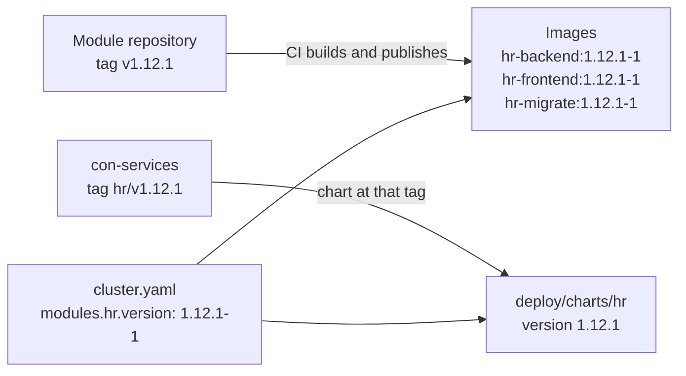

# Versions and upgrades

**Goal:** know what a Con Services version number tells you, upgrade one
app at a time, tell when an upgrade needs a new Den as well, and roll back
when an upgrade goes wrong.

Con Services is not released as one block. Den and every module (HR,
Rally, Stash, Finance, Learn, Wiki, Desk, Tasks) are separate **apps**, and
each app has its own version. A module that did not change gets no
release, so upgrading HR never restarts Stash. Den leads: its MAJOR number
says which modules fit together.

## Terms used on this page

**App**
:   Den or one module. Each app has its own Git repository (the code and
    its images), its own `CHANGELOG.md`, and its own Helm chart in
    `deploy/charts/<app>` of the main repository.

**Version**
:   `MAJOR.MINOR.PATCH`, for example `1.12.1`, following
    [Semantic Versioning](https://semver.org) with the Den-led rules below.

**Den MAJOR**
:   The first number of Den's version. Every module's MAJOR is equal to the
    Den MAJOR it is built for.

**Image tag**
:   `MAJOR.MINOR.PATCH-BUILD`, for example `1.12.1-1`: the version plus a
    rebuild counter.

**Chart release tag**
:   A Git tag `<app>/vMAJOR.MINOR.PATCH` in the main repository
    `con-services`, for example `hr/v1.12.1`. Argo CD and Helm read the
    app's chart at that tag.

## The rules

### Den leads

| Change in Den | Version change | Example | What it means for modules |
| --- | --- | --- | --- |
| Something modules use is removed or changed incompatibly: an endpoint, a field, a pairing step, a header | **MAJOR**, and MINOR keeps counting | `1.4.2` → `2.5.0` | Every module, also one that did not change, needs a new release for the new MAJOR before it can run with this Den. |
| Something is added, nothing removed: a new endpoint, a new optional field, a new page | **MINOR** | `1.4.2` → `1.5.0` | Nothing. Modules keep working. A module release that starts using the addition says so in its changelog: *Needs Den: 1.5.0 or later*. |
| A bug fix | **PATCH** | `1.4.2` → `1.4.3` | Nothing. |

Den's MAJOR changes **only** for a breaking change. Den's numbers never
start again from zero: a breaking release raises the MAJOR and counts on
from the MINOR (`1.4.2` → `2.5.0`, never `2.0.0`), so every Den version
number is used once and the order of releases stays readable.

A Den MINOR or PATCH never removes or deprecates a feature. Removals wait
for the next Den MAJOR, and that release's changelog lists them under
**BREAKING:** with what to do.

### Modules follow Den's MAJOR

| Change in a module | Version change | Example |
| --- | --- | --- |
| A feature, however big | **MINOR** | HR `1.11.451` → `1.12.0` |
| A bug fix | **PATCH** | HR `1.12.0` → `1.12.1` |
| Den released a new MAJOR; the module was checked and needed no change | **MAJOR** = the new Den MAJOR; MINOR and PATCH stay | Finance `1.3.0` → `2.3.0` |
| Den released a new MAJOR; the module was adapted for it | **MAJOR** = the new Den MAJOR, and MINOR + 1 | HR `1.12.1` → `2.13.0` |

A module never raises its MAJOR on its own. Its MAJOR always equals the Den
MAJOR it is built for, and CI refuses a module release or chart whose
MAJOR does not match (see [CI and releases](../contributing/ci.md#the-chart-release-workflow)).

### BUILD: the same version built again

The image tag adds a fourth number, `BUILD`: `1.12.1-1`, `1.12.1-2`, …
It counts rebuilds of the same version, for example to pick up a
security fix in the base image, with no change to Con Services' own code.
It starts at `1` for every new version. All images of one app share the
tag. Always take the highest build of the version you want; changing only
the build is always safe.

## Does this update need Den too?

Compare the MAJOR numbers:

| You want | Den you run | Do you need a new Den? |
| --- | --- | --- |
| HR `1.12.1` | `1.4.2` | No, both are MAJOR 1. Check the release's *Needs Den* line (below); `1.12.1` needs Den `1.0.0` or later. |
| HR `1.13.0`, which needs Den `1.5.0` or later | `1.4.2` | Yes, a Den MINOR: upgrade Den to `1.5.0` first, then HR. |
| HR `2.13.0` | `1.4.2` | Yes, a Den MAJOR (Den `2.5.0`): follow [Den MAJOR upgrades](#den-major-upgrades); every other enabled module moves to MAJOR 2 at the same time, for example Finance `1.3.0` → `2.3.0`. |
| Den `1.5.0` | `1.4.2` | No. A Den MINOR only happens when Den adds a feature, for example a new page or endpoint. Upgrade Den alone; no module has to change. Often a module release follows that uses the new feature (its *Needs Den* line then says `1.5.0 or later`), but that is not required. |
| Den `2.5.0` | `1.4.2` | Every enabled module needs its MAJOR 2 release. |

In short: **Den changed MAJOR means every module needs an update.**
Otherwise, update only the app that changed.

### Compatibility table

Each module states the oldest Den it works with, in two places:

1. **Its changelog.** Every release section starts with a *Needs Den*
   line, right under the heading:

    ```markdown
    ## [1.13.0] - 2027-03-02

    Needs Den: 1.5.0 or later (Den MAJOR 1).

    ### Added

    - Onboarding checklists show the user's Den avatar.
    ```

2. **Its chart.** `deploy/charts/<module>/Chart.yaml` carries the Den
   MAJOR as a machine-readable annotation, checked by CI:

    ```yaml
    version: 1.13.0
    appVersion: "1.13.0"
    annotations:
      conservices.io/den-major: "1"
    ```

The table of current releases (maintainers update it with every release):

| App | Latest release | Den MAJOR | Needs Den |
| --- | --- | --- | --- |
| Den | `1.0.0` | 1 | — |
| HR | `1.0.0` | 1 | `1.0.0` or later |
| Rally | `1.0.0` | 1 | `1.0.0` or later |
| Stash | `1.0.0` | 1 | `1.0.0` or later |
| Finance | `1.0.0` | 1 | `1.0.0` or later |
| Learn | `1.0.0` | 1 | `1.0.0` or later |
| Wiki | `1.0.0` | 1 | `1.0.0` or later |
| Desk | `1.0.0` | 1 | `1.0.0` or later |
| Tasks | `1.0.0` | 1 | `1.0.0` or later |

## Worked examples

### A module feature, then a fix

HR is at `1.11.451` and Den at `1.4.2`.

1. HR adds onboarding checklists: a feature, so HR `1.12.0`. Its
   changelog says *Needs Den: 1.0.0 or later*. You upgrade HR only, by
   setting `modules.hr.version: "1.12.0-1"` in `cluster.yaml`. Den and
   the other modules are untouched.
2. A bug in the checklists is fixed: HR `1.12.1`. You set
   `modules.hr.version: "1.12.1-1"`.

### A Den MINOR

Den adds an endpoint that lists a user's groups, removing nothing: Den
`1.4.2` → `1.5.0`. You set `den.version: "1.5.0-1"`. No module changes,
no module pod restarts.

A month later HR `1.13.0` uses the new endpoint. Its changelog says
*Needs Den: 1.5.0 or later*. Because you already run Den `1.5.0`, you just
upgrade HR.

### A Den MAJOR

Den removes an old pairing endpoint that modules called: Den `1.5.0` →
`2.6.0`, with **BREAKING:** entries in its changelog. Every module is then
checked against Den 2 and released with MAJOR 2, also the ones that need
no change. HR had to be adapted, so `1.13.0` → `2.14.0`; Stash needed no
change, so `1.3.2` → `2.3.2`; and so on. Once every module you run has a MAJOR 2 release, you upgrade
Den and those modules together in one change; see
[Den MAJOR upgrades](#den-major-upgrades).

## How tags, images and charts relate



| What | Where | Example | Created by |
| --- | --- | --- | --- |
| Release of the code | Git tag `vX.Y.Z` in the app's repository | `v1.12.1` in `AGlElectronics/hr` | A maintainer ([Cut a release](../contributing/ci.md#cut-a-release)) |
| Images | `ghcr.io/aglelectronics/<app>-<component>:X.Y.Z-BUILD` | `hr-backend:1.12.1-1` | The app's CI, on that tag |
| Chart | `deploy/charts/<app>` with `version` and `appVersion` = `X.Y.Z` | `deploy/charts/hr`, `version: 1.12.1` | A pull request in `con-services` |
| Chart release | Git tag `<app>/vX.Y.Z` in `con-services` | `hr/v1.12.1` | A maintainer, after the images exist |
| What runs in your cluster | `den.version` or `modules.<app>.version` in `cluster.yaml` | `modules.hr.version: "1.12.1-1"` | You |

The GitOps template turns `modules.hr.version: "1.12.1-1"` into the image
tag `1.12.1-1` for every HR image and the chart revision `hr/v1.12.1`.
`modules.<app>.chartRevision` (or `den.chartRevision`) overrides the chart
revision in the rare case you need another one; leave it empty otherwise.

### The main repository's own tags

`con-services` also has plain tags `vX.Y.Z`, starting at `v1.0.0`. They
version the **shared pieces** only (the Kustomize manifests in
`deploy/kubernetes/`, Docker Compose, the Keycloak realm, the CI workflows
and these docs) and match the releases in its root `CHANGELOG.md`. They
say nothing about Den or module versions, and no workflow builds anything
from them.

The rule for references into `con-services`:

| You reference | Pin it to | Example |
| --- | --- | --- |
| An app's Helm chart (`deploy/charts/<app>`) | the chart release tag `<app>/vX.Y.Z` | `targetRevision: hr/v1.0.0` |
| A Kustomize remote base (`deploy/kubernetes/...`) | the shared-pieces tag `vX.Y.Z` | `https://github.com/AGlElectronics/con-services//deploy/kubernetes/base?ref=v1.0.0` |

Never pin to a branch such as `main`. The image tags in your overlay are
still set per app (`images:` below), independent of the base's tag.

## Image names

Images are published on GitHub's container registry:

```text
ghcr.io/aglelectronics/<app>-<component>:<tag>
```

| App | Images |
| --- | --- |
| Den | `den-backend` (also contains `/den-migrate`), `den-frontend`, `den-operator` |
| Stash | `stash-backend`, `stash-frontend` |
| Rally | `rally-backend`, `rally-migrate`, `rally-frontend`, `rally-submit` (the public submission site) |
| Other modules | `<module>-backend`, `<module>-frontend`, and where the module has a separate migration step, `<module>-migrate` (see `deploy/kubernetes/modules/README.md`) |

All images of one app share the same tag for a release: Den `1.2.0-1`
means `den-backend:1.2.0-1`, `den-frontend:1.2.0-1` and
`den-operator:1.2.0-1`, built from the same commit. Never mix tags within
an app.

The images are built, scanned, published, signed with cosign and given an
SBOM by CI when an app's version tag is pushed; an existing tag is never
overwritten. How to cut a release and how to verify a signature: see
[CI and releases](../contributing/ci.md).

While an app's repository is private, its images are private packages on
GHCR and the cluster needs a pull secret for `ghcr.io`; see
[Den and the modules](../deploy/apps.md).

## Pin exact tags, never `latest`

There is no `latest` tag. Always write the full tag. In the GitOps
template's `cluster.yaml`:

```yaml
den:
  version: "1.0.0-1"
modules:
  hr:
    enabled: true
    version: "1.0.0-1"
```

In a Kustomize overlay:

```yaml
images:
  - name: ghcr.io/aglelectronics/den-backend
    newTag: 1.0.0-1
  - name: ghcr.io/aglelectronics/den-frontend
    newTag: 1.0.0-1
  - name: ghcr.io/aglelectronics/den-operator
    newTag: 1.0.0-1
```

Pinned tags mean your installation only changes when you change this file,
and you can always tell from Git which version was running when.

To see which version is running:

```sh
kubectl get deploy -n conservices-den -o custom-columns=NAME:.metadata.name,IMAGE:.spec.template.spec.containers[0].image
```

```text
NAME           IMAGE
den-backend    ghcr.io/aglelectronics/den-backend:1.0.0-1
den-frontend   ghcr.io/aglelectronics/den-frontend:1.0.0-1
den-operator   ghcr.io/aglelectronics/den-operator:1.0.0-1
```

To list the published tags of an image, use the repository's *Packages*
page on GitHub, or a registry tool such as
[crane](https://github.com/google/go-containerregistry/blob/main/cmd/crane/README.md)
or [skopeo](https://github.com/containers/skopeo):

```sh
crane ls ghcr.io/aglelectronics/den-backend
```

```text
1.0.0-1
1.0.0-2
1.1.0-1
```

Take the highest `BUILD` of the version you want (`1.0.0-2` above).

To list the released charts of an app:

```sh
git ls-remote --tags https://github.com/AGlElectronics/con-services.git 'refs/tags/hr/v*'
```

```text
4c1f0e2…	refs/tags/hr/v1.0.0
9a7d3b1…	refs/tags/hr/v1.1.0
```

For the strictest pinning in Kustomize, add the image **digest** as well;
the cluster then refuses an image that was replaced under the same tag:

```sh
crane digest ghcr.io/aglelectronics/den-backend:1.0.0-2
```

```yaml
images:
  - name: ghcr.io/aglelectronics/den-backend
    newTag: 1.0.0-2
    digest: sha256:4c1f…        # the output of crane digest
```

Den also reports its version in `/api/health` (the backend image's
`VERSION` build argument) and on the admin console's **Settings** page (the
frontend image's `DEN_VERSION`). Both say `dev` for images built without
them.

## Upgrading

Upgrade **one app at a time**, and Den first when Den and modules both
have new versions. Only a Den MAJOR upgrade changes several apps at once.

1. **Read the changelog** of the app, from your version to the new one:
   `CHANGELOG.md` in the app's repository (all of them are linked from the
   [Changelog](../changelog.md) page). Look for **BREAKING** entries,
   anything under *Changed* or *Removed* that affects your settings, and
   the *Needs Den* line: if it names a newer Den than you run, upgrade Den
   first.
2. **Make a backup.** Den admin console → **Backups** → **Back up now**, and
   wait until it shows as succeeded.
3. **Change the version** of that one app:

    - **GitOps template:** in `cluster.yaml`, set `den.version` or
      `modules.<app>.version` to the new `X.Y.Z-BUILD`, check and push:

        ```yaml
        modules:
          hr:
            enabled: true
            version: "1.12.1-1"     # was "1.12.0-1"
        ```

        ```sh
        helm template root charts/root -f cluster.yaml > /dev/null && echo OK
        git commit -am "Upgrade HR to 1.12.1" && git push
        ```

        Argo CD changes only that app's Application: the new chart
        revision `hr/v1.12.1` and the new image tags. Other apps' pods are
        not restarted. See [Argo CD: Upgrading](../deploy/argocd.md#upgrading).

    - **Kustomize:** change the tags of every image of that app in your
      overlay's `kustomization.yaml`, all to the same new tag, then look at
      the difference and apply:

        ```sh
        kubectl diff -k deploy/kubernetes/overlays/<yours>
        kubectl apply -k deploy/kubernetes/overlays/<yours>
        ```

    - **Helm:** use the chart of the new release and the new tag; see
      [Helm: Upgrade](helm.md#upgrade).

4. **Watch the rollout.** For Den, the old backend pod stops, the new pod's
   `migrate` initContainer applies the new migrations, then the new server
   starts:

    ```sh
    kubectl rollout status -n conservices-den deploy/den-backend
    kubectl rollout status -n conservices-den deploy/den-frontend
    kubectl rollout status -n conservices-den deploy/den-operator
    ```

    ```text
    deployment "den-backend" successfully rolled out
    ```

    Modules with a separate `<module>-migrate` image work the same way:
    its `migrate` initContainer runs before the new backend starts.

5. **Check** that `https://<app>/api/health` reports the new version, that
   you can sign in, and that Den's **Backups** page shows no warning.

### Den MAJOR upgrades

A new Den MAJOR (for example `1.5.0` → `2.6.0`) removes or changes
something modules use, so Den and every enabled module move to the new
MAJOR together. The GitOps template refuses a `cluster.yaml` in which an
enabled module's MAJOR differs from Den's, so you cannot push half of it
by accident.

1. **Check that every module you run has a release for the new MAJOR**
   ([compatibility table](#compatibility-table)). If one has none yet,
   wait, or disable it (`enabled: false`) for the time being.
2. **Read the changelogs:** Den's **BREAKING** entries, and the MAJOR 2
   release of each enabled module. Do the manual steps they list, in the
   order given, usually before step 4.
3. **Make a backup** (Den → **Backups** → **Back up now**). Plan a short
   maintenance window: between Den's and the modules' rollout, modules
   still on the old MAJOR can fail calls to Den.
4. **Change all versions in one commit and push:**

    ```yaml
    den:
      version: "2.6.0-1"        # was "1.5.0-1"
    modules:
      hr:
        enabled: true
        version: "2.14.0-1"     # was "1.13.0-1"
      stash:
        enabled: true
        version: "2.3.2-1"      # was "1.3.2-1"
    ```

    ```sh
    helm template root charts/root -f cluster.yaml > /dev/null && echo OK
    git commit -am "Upgrade to Den 2" && git push
    ```

    Argo CD applies Den and the modules together (all in sync wave 5), so a
    module that fails to start never holds back Den or the others.

5. **Check** every app as in step 5 above, and that each module still shows
   as paired on Den's **Modules** page.

Do not skip a Den MAJOR: go from 1.x to 2.x to 3.x, doing each release's
**BREAKING** steps. With Kustomize or Helm, the procedure is the same:
upgrade Den, then every module, without using any app in between.

### When the migration fails

If the new `migrate` initContainer fails, the new server never starts and
Kubernetes keeps retrying (`Init:CrashLoopBackOff`). Because `den-backend`
uses the `Recreate` strategy, the old version has already stopped, so Den is
down until you act. Read the log:

```sh
kubectl logs -n conservices-den deploy/den-backend -c migrate
```

Then either fix the cause (often a database connection problem) or roll
back as below.

## Rolling back

Migrations only go forward. Rolling back the **image** is safe only when
the new version did not change the database structure (no new migration ran
successfully); the changelog says when a release contains migrations.

**If no migration ran** (patch releases usually; or the migration failed
before changing anything): put the old version back and apply again. In
`cluster.yaml`, set the app's `version` back and push; in Kustomize:

```sh
kubectl apply -k deploy/kubernetes/overlays/<yours>
```

`kubectl rollout undo` also works for a quick fix, but the next sync or
apply would bring the new tag back, so always fix `cluster.yaml` or the
overlay too.

**If a migration ran:** the old version may not understand the new database
structure. Restore the app's database from the backup you made in step 2
(see [Restore](databases-and-backups.md#restore)), then deploy the old
version.

To tell whether a migration ran, compare the migration list with the
release's changelog (Den):

```sh
kubectl exec -n conservices-den deploy/den-backend -- /den-migrate -status
```

A migration applied a few minutes ago, at the time of your upgrade, means
the database was changed.

Data written between the upgrade and the restore is lost with the restore.
Decide quickly, and tell people to stop using the app while you do.

Rolling back a **Den MAJOR** means rolling back Den and every module you
upgraded with it, in one commit, restoring each database whose migration
ran.

## Troubleshooting

**`ErrImagePull` with `manifest unknown` right after changing a version**
: The tag does not exist. List the real tags (`crane ls …`, above); there is
  no `latest`, and every tag has a `-BUILD` suffix.

**Argo CD shows `unable to resolve 'hr/v1.12.1' to a commit SHA`**
: The chart release tag does not exist (yet). The images of a version are
  published before its chart is tagged; wait for the chart release, or list
  the released charts with `git ls-remote` (above). If you need a chart
  revision other than the one derived from the version, set
  `modules.<app>.chartRevision`.

**`helm template root charts/root -f cluster.yaml` stops because a module's MAJOR differs from Den's**
: You changed Den's MAJOR without the modules, or a module's MAJOR without
  Den. Change them together ([Den MAJOR upgrades](#den-major-upgrades)),
  or set the module back to the version that matches your Den.

**Den shows the old version on the Settings page after upgrading**
: The frontend Deployment still uses the old tag, or your browser cached
  the old web app. Check all three images with the `kubectl get deploy`
  command above, then reload with ++ctrl+shift+r++.

**`kubectl rollout status` waits forever with `Waiting for deployment "den-backend" rollout to finish: 0 of 1 updated replicas are available`**
: The new pod is stuck. `kubectl get pods -n conservices-den` shows whether
  it is in `Init:` (migration, see [When the migration fails](#when-the-migration-fails))
  or not ready (read its log with `kubectl logs`).

**After a rollback the app logs `relation "…" does not exist` or `column "…" does not exist`**
: The database and the image do not match: a migration ran, then you went
  back without restoring. Restore the pre-upgrade backup, or move forward
  to the new version again.

**A module answers some requests with errors right after a Den upgrade**
: Check the MAJOR numbers: a module on an older MAJOR than Den cannot use
  what Den removed. Upgrade the module to its release for Den's MAJOR. If
  both MAJORs match, check the module's *Needs Den* line: it may need a
  newer Den MINOR.

**Upgrading skipped a Den MAJOR and the backend refuses to start**
: Go back to the backup, then upgrade one MAJOR at a time, doing each
  changelog's **BREAKING** steps.

## Related pages

- [Argo CD and cluster.yaml: Upgrading](../deploy/argocd.md#upgrading): the same procedure from the template's side.
- [Installing modules with Helm](helm.md#roll-back): `helm rollback`.
- [Databases, backups and restore](databases-and-backups.md#restore): restoring before a rollback.
- [Changelog](../changelog.md): what changed in each release, and links to every repository's changelog.
- [Changelogs](../contributing/changelog.md): how releases are described.
- [CI and releases](../contributing/ci.md): how images and charts are built, checked and released.
