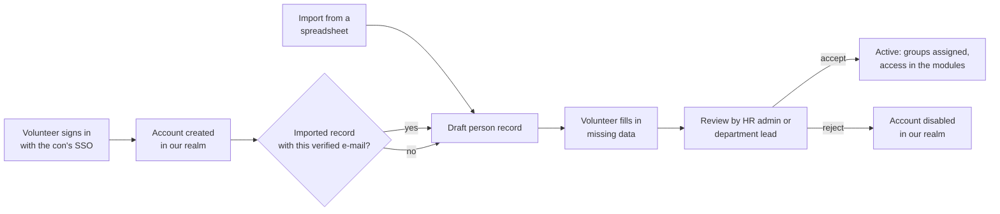

# Using the convention's existing identity provider

**Status:** Agreed (November 2026), not implemented yet. See
[Decisions](#decisions).

## The problem

Today the GitOps template always installs its own Keycloak with two realms:
`conservices` for staff and `attendees` for Rally's submission site. Many
conventions already run an identity provider (IdP):

- a **staff realm** used as general single sign-on (SSO) for other tools,
  with accounts, groups and attributes that are named differently from ours;
- an **attendee realm** shared with the ticketing system and other
  services, often with tens of thousands of accounts (one convention we
  talked to has about 17,000).

Asking such a convention to move its accounts to our realms is not
acceptable: attendees would need new accounts, the ticketing system would
lose its link to them, and staff would have two logins. Running a second
Keycloak next to theirs is also unwanted.

There is also a silent failure today: the Keycloak Operator imports a realm
only if no realm of that name exists. If a convention's Keycloak already has
a realm called `conservices` or `attendees`, the import is skipped without
an error, our clients and groups never appear, and sign-in fails later with
confusing errors.

## The principle

**Con Services adapts to the convention's identity setup; a convention never
moves accounts to adopt Con Services.**

Every module identifies a person by the pair *(issuer, subject)*: the IdP's
address and the IdP's permanent id for the person. As long as that pair stays
the same, nothing has to be migrated. So the convention chooses, at install
time and separately for staff and for attendees, which IdP issues identities,
and Con Services uses that IdP as it is.

## What the code depends on today

A code inventory of all nine modules (November 2026) found:

**Generic OIDC, works with any IdP.** Sign-in (Authorization Code with
PKCE), token checks (signature, issuer, audience, expiry), standard claims
(`sub`, `email`, `email_verified`, `name`, `preferred_username`,
`nickname`), just-in-time user creation, and roles recomputed from groups on
every request. Rally's attendee sign-in is pure OIDC: it needs only an
issuer and a client id, and reads no groups.

**Already configurable.** Issuer and client of every module
(`OIDC_ISSUER_URL`, `OIDC_CLIENT_ID`, `ATTENDEE_OIDC_*`), the group names
that grant access (`DEN_ADMIN_GROUPS`, `HR_ADMIN_GROUPS` / `HR_VIEWER_GROUPS` / `HR_LEAD_GROUPS`,
`FINANCE_ACCESS_GROUPS`, the access configuration files of the other
modules), and the realm name of the three admin integrations
(`KEYCLOAK_REALM`). All three admin integrations are optional.

**Keycloak-specific.** Three backends call Keycloak's admin API:

| Who | What it does | Needs | Without it |
| --- | --- | --- | --- |
| HR (`hr-provisioner`) | Creates, renames and deletes users; writes the attributes `hrPersonId`, `nickname`, `phone`, `orgEmail`, `privateEmail`; creates top-level groups and sets membership; sends the set-password mail | `manage-users` on the realm; the attributes declared in the realm's user profile | HR runs a fake provisioner: onboarding "succeeds" but no account is touched |
| Den (`den-keycloak`) | Every 5 minutes, sets the realm's login theme to `conservices` and writes branding | `manage-realm` (very broad) | Purely cosmetic; off when not configured |
| Learn (`learn-provisioner`) | Reads groups and their members | `view-users`, `query-groups` | Group sync off; group links still work from sign-in |

**Hard assumptions that block reuse** (to be fixed, see [Work items](#work-items)):

1. The groups must arrive in a claim literally named `groups` (or `roles`)
   in the **ID token**, as plain names. The claim name is not configurable.
2. HR looks groups up by top-level name only and creates missing ones, so an
   existing nested group (`/org/den-admin`) is never found and a duplicate
   `den-admin` is created. Department groups are always `dept-<slug>`.
3. HR and Learn assume Keycloak's user id equals the token's `sub`.
4. Stash keys users on `sub` alone, without the issuer (contradicts Den's
   ADR 0001); group matching differs between modules (Stash, Learn links,
   Wiki and Tasks grants compare case and `/` exactly).
5. Every web app sets `monitorSession`, which needs Keycloak's
   `check_session_iframe`; many other IdPs do not offer it.
6. Den's and HR's "open Keycloak" links are built from the issuer
   (`/admin/master/console/#/<realm>`), which is also wrong for our own
   install (the console is on `auth-admin.<domain>`).
7. The template hard-codes the issuers `https://auth.<domain>/realms/conservices`
   and `.../realms/attendees`, always deploys the operator and Keycloak, and
   always imports both realms.
8. Changing the issuer later splits every person into a new user in every
   module except Stash; there is no tool to relink them.

## The modes

Staff and attendees are configured independently.

### Attendees

| Mode | What happens | The convention's IdP admin does |
| --- | --- | --- |
| `own` (default, today) | The template creates the realm `attendees` | nothing |
| `existing` | Rally points at the convention's attendee issuer; the template creates no attendee realm | adds one public client `rally-submit` (below) |

`existing` is the important one for large conventions: every ticket holder
can sign in to the submission site with the account they already have, with
no import and nothing written to their realm. It works with any OIDC IdP,
not only Keycloak.

The client the convention adds:

- public client (no secret), Authorization Code flow with PKCE (`S256`);
- redirect URI `https://submit.<domain>/*`, post-logout redirect the same,
  web origin `https://submit.<domain>`;
- the ID token must contain `sub` and `email`, should contain
  `email_verified` and `name` (scopes `openid profile email`).

The docs will ship this as a Keycloak client JSON to import, plus the
equivalent settings for other IdPs.

### Staff

| Mode | Where staff accounts live | HR | Den branding | Second Keycloak? |
| --- | --- | --- | --- | --- |
| `own` (default, today) | our realm `conservices` | full provisioning | on | yes, ours |
| `brokered` | the convention's IdP; our realm `conservices` links to it | provisions in **our** realm only | on (our realm) | no: our realm is added to **their** Keycloak |
| `existing` | the convention's realm, used directly | link-only (below), or off | off | no |

Both staff modes are supported, with Keycloak and with other OIDC IdPs.

**`brokered`.** Our realm `conservices` is added as one more realm in the
convention's own Keycloak, next to the realms it already has. No second
Keycloak is installed. This is an unusual setup, but it is reversible:
removing Con Services means deleting our realm, and nothing in the
convention's realms was changed. Only when the convention's IdP is not
Keycloak does the template install our own Keycloak for this realm.
The realm gets an *identity
provider link* to the convention's staff IdP: the sign-in page shows "Sign
in with <convention SSO>". On a person's first sign-in, Keycloak creates or
links an account in our realm (matching by verified e-mail, with Keycloak's
"Detect existing broker user" and "Automatically set existing user" steps,
so accounts HR created beforehand are linked, not duplicated). Our groups,
attributes and HR's rights stay inside our realm; the convention's realm is
only read during sign-in. Their groups can optionally be copied in with
mappers. This needs almost no code changes and works with any OIDC or SAML
IdP. Recommended default for conventions with an existing staff SSO.

**`existing`.** Every module points straight at the convention's realm.
Their groups are mapped to our roles with the existing group settings.
HR must not own a shared realm, so it gets a **link-only** mode: it finds
existing accounts (by username or e-mail), manages membership only of groups
under a configured prefix or parent group, never creates, renames or deletes
accounts, and writes attributes only if they are declared. A person without
an account in the convention's realm cannot be onboarded until the
convention's own admins create one; HR shows "no account found" and offers
to try again. Den's branding is
off. Learn's group directory works read-only if the IdP is Keycloak, and is
off otherwise. With a non-Keycloak IdP, HR's provisioner is off and HR keeps
records only.

### Staff and volunteers in `brokered` mode

Conventions with 2,000 or more volunteers are the main case for
`brokered`. The accounts are the easy part (they are created on first
sign-in); access rights and HR's people records are the hard part.
Decisions so far:

**HR is the only source of access.** The convention's SSO is used to sign
in, nothing more. Its groups are **not** copied into our realm (no group
mappers on the identity-provider link); departments, roles and therefore
Keycloak groups are assigned in HR only. One owner per group, no conflicts
between a mapper and HR overwriting each other.

**Offboarding only covers Con Services.** In `brokered` mode, HR disabling
or offboarding a person removes their access to Con Services (their
account in our realm), **not** their account in the convention's SSO or
any other tool that uses it. The other way round, a person disabled in the
convention's SSO can no longer sign in to Con Services either. The
deployment docs, HR's offboarding screen and HR's admin guide must say
this prominently, for example:

!!! warning "Offboarding in HR does not close the SSO account"
    This installation signs people in through your convention's own SSO.
    Offboarding someone in HR removes their access to Con Services only.
    Their SSO account, and every other tool that uses it, stays active.
    Disable the account in your SSO as well, following your convention's
    own offboarding process.

HR's offboarding screen shows the same text (and the name of the SSO) when
the staff mode is `brokered` or `existing`.

**Adopt on first sign-in, with a review.** People records come from two
directions, and both end in one review queue in HR:

1. A volunteer signs in for the first time. Keycloak creates the account in
   our realm (name and e-mail from the SSO). HR finds such accounts itself
   (it already lists users through the admin API): every account without an
   `hrPersonId` becomes a **draft** person record. No new call between
   modules is needed.
2. If an imported record (below) has the same **verified** e-mail address,
   the draft is linked to it. E-mail addresses that the SSO does not mark
   as verified are never matched automatically; they go to the queue as
   "possible match".
3. Until the draft is accepted, the person has no groups: Den shows a
   friendly "your account is waiting for a coordinator" page instead of an
   error.
4. On that page the volunteer fills in their own missing data (phone,
   nickname, ...) on a short form, so 2,000 people do not all have to be
   typed in by a coordinator. The draft is marked "ready for review" once
   the required fields are filled in.
5. An HR admin, or a department lead for their own department, reviews:
   checks and completes the data, picks the department and roles, and
   accepts (HR writes `hrPersonId` and the groups), merges with another
   record, or rejects (account disabled in our realm only). **Every person
   is reviewed by a human**; nothing is accepted automatically, not even a
   complete imported record with a matching verified e-mail.

**Import from a spreadsheet.** Many conventions keep their volunteer lists
in Excel or Google Sheets, so the importer must handle real-world files,
not just clean CSV:

| Topic | Design |
| --- | --- |
| Formats | `.xlsx` (Excel, LibreOffice, Google Sheets export) and `.csv` only. Not the legacy `.xls` or `.ods`: the importer asks to save as `.xlsx`. No direct Google Sheets link |
| CSV quirks | Detect the delimiter (`,`, `;` as written by Excel in many European locales, tab), the encoding (UTF-8 with or without BOM, Windows-1252) and quoted line breaks |
| Sheets and headers | Choose the sheet; choose the header row (lists often have a title row above it) |
| Column mapping | Map columns to HR fields with suggestions from the header names (also common Dutch, German, French names). Save the mapping as a template for next year |
| Value mapping | Map the file's department and role values to HR's ("Sec", "Security team" -> Security); several values in one cell separated by `;` or `,` |
| Excel damage | Phone numbers stored as numbers lose `+` and leading zeros, dates come as serial numbers, e-mail cells contain spaces or `mailto:`: detect and warn per row, never guess silently |
| Preview | Dry run first: per row new / update / unchanged / error, duplicates inside the file, matches with existing people and accounts |
| Result | Valid rows become drafts in the same review queue, never active people; an error report to download as `.xlsx` with an extra "problem" column, fix, upload again |
| Safety | Re-running an import updates, never duplicates (match on e-mail or an id column) and never deletes. Each import is one batch that can be undone while its drafts are not accepted |
| Privacy | Only `hr-admin` may import. The uploaded file is not stored after the import, only the fields that were mapped; the import is in the audit log |
| Limits | Up to 10,000 rows or 10 MB per file |

### Staff and attendees stay separate

Staff and attendees always come from **two different issuers**, so an
attendee token can never carry staff permissions. Rally keeps enforcing
this. One issuer for both is not supported.

A convention that keeps staff and attendees in **one** realm does not have
to split it. It uses that realm as the attendee issuer (`existing`) and
staff mode `brokered`: our realm `conservices` is added next to theirs and
signs staff in through their realm, so staff tokens come from a different
issuer without moving any account.

### When a convention switches later

Switching the issuer after go-live splits every person into a new user in
every module. There is no tool to relink them, and none is planned for
now. The deployment docs must say plainly: **choose the identity modes at
install time; switching later means every person starts again as a new
user.**

## Work items

Phase 1, attendees and safety (small, high value):

1. Template: `identity.attendees.mode: own | existing` with `issuer` and
   `clientId`; no attendee realm import and egress to the issuer's host in
   `existing`.
2. Template: configurable realm names; pre-flight check in `install-root`
   that refuses to continue when a realm we would import already exists.
3. Stash: key users on *(issuer, subject)* like every other module.
4. Every module (Den and all eight modules) gets settings for the identity
   links it shows, instead of guessing them from the sign-in address:
   the IdP admin console URL (the "open Keycloak" button; today Den and HR
   derive it and get it wrong on our own install), the "manage my account"
   URL of the convention's SSO (password, two-factor), and in HR the SSO
   page linked from the offboarding warning. Set once in Den's
   organisation settings and passed to paired modules, with an override in
   each module's own settings. Also make `monitorSession` configurable.
5. Docs: an "Existing identity provider" page with the client JSON, claim
   requirements, troubleshooting, and the warning that the identity modes
   are chosen at install time and cannot be switched later without every
   person starting again as a new user.

Phase 2, staff `brokered`:

6. Template: add our realm to the convention's Keycloak, next to its own
   realms, instead of installing ours (`identity.keycloak.deploy: false`,
   the default for `brokered`; our own Keycloak only when the convention's
   IdP is not Keycloak). The realm is then created by an
   idempotent setup Job (for example keycloak-config-cli) that adds our
   clients, groups and service accounts and never deletes anything, instead
   of a `KeycloakRealmImport` (which only works with an operator-managed
   Keycloak in the same namespace).
7. Realm template: identity-provider link and first-broker-login flow,
   configured from `cluster.yaml`.
8. HR: an option to skip the set-password mail for brokered accounts (they
   have no local password).
9. HR: drafts from accounts without `hrPersonId`, the review queue
   (accept, merge, reject) for HR admins and for department leads limited
   to their own department, matching on verified e-mail only, and no
   automatic acceptance.
10. Den and HR: a "waiting for a coordinator" page for signed-in people
    without a role, with the form where they fill in their own missing
    data.
11. HR: the spreadsheet importer (above), sharing the review queue.
12. HR and docs: the offboarding warning in `brokered` and `existing` mode.
13. HR: page through group members instead of reading at most 1,000
    (`members?max=1000` in `hr/backend/internal/provisioners/keycloak.go`
    cuts a group of 2,000 volunteers in half today).

Phase 3, staff `existing`:

14. All backends: configurable groups claim (`OIDC_GROUPS_CLAIM`) and one
    shared group-matching rule (case, leading `/`, full paths) in every
    module, including Learn links and Wiki/Tasks grants.
15. HR: provisioner modes `manage` (today), `link` and `off`; group lookup by
    full path; configurable group prefix or parent group, including for
    `dept-` groups; the external id stops being assumed equal to `sub`
    (store both).
16. Den: branding sync off by default in `existing`; reduce `manage-realm`
    to what branding needs.
17. Learn: path-aware group lookup.

## Out of scope

- Copying or synchronising accounts between IdPs (no SCIM, no user import).
- Writing anything into a convention's attendee realm.
- Changing a convention's login theme or realm settings in `existing` mode.
- Creating accounts in the convention's realm in `existing` mode.
- One issuer for both staff and attendees.
- A tool to relink people after switching identity modes (not now; may be
  reconsidered later).

## Decisions

Agreed in November 2026:

| Question | Decision |
| --- | --- |
| Source of access in `brokered` mode | HR only. The convention's SSO groups are not copied into our realm |
| Offboarding | HR only cuts access to Con Services; the warning about the SSO account is required in the docs and on HR's offboarding screen |
| How people records are created | Adopted on first sign-in, plus a spreadsheet importer; both end in one review queue |
| Staff modes | Both `brokered` and `existing`, with Keycloak and with other OIDC IdPs |
| HR in `existing` mode | Link-only: HR never creates, renames or deletes accounts in the convention's realm |
| Staff and attendees in one realm | Not supported: always two issuers. A convention with one combined realm uses it for attendees and runs staff in `brokered` mode, so no account moves |
| Switching modes later | No relink tool for now; the docs say to choose at install time |
| Where the `brokered` realm lives | In the convention's own Keycloak, next to its realms (reversible: delete our realm). Our own Keycloak only when the convention's IdP is not Keycloak |
| Importer formats | `.xlsx` and `.csv` only |
| Who reviews drafts | HR admins, and department leads for their own department |
| Automatic acceptance | Never: every person is reviewed by a human |
| Self-service data | Yes: volunteers fill in their own missing data before the review |
