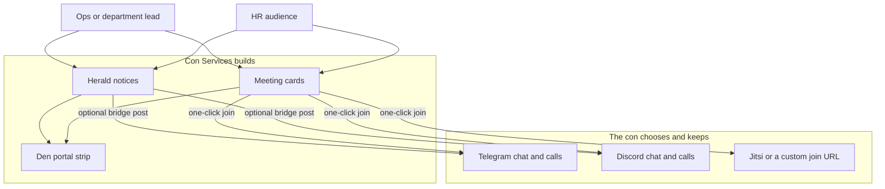

# Staff communications

**Status:** draft proposal. Nothing described here is implemented yet.
This page is the product decision for how Con Services should handle crew
comms. Implementation would land later as a new module and small Den/HR
hooks; this document does not ship code.

Conventions today run staff communication in three different ways that get
mashed into one chat app: official notices (often a quarterly PDF or a
buried channel post), day-to-day chat (Telegram, Discord, and similar),
and live meetings or calls (Discord calls, Telegram calls, or a self-hosted
talk product that is laggy and a chore to join). Furry cons especially
live in Telegram, and that chat culture works. What fails is that
**official notices have no home**, and **finding the right call is
friction**, while replacing chat with an in-suite messenger repeats the
self-hosted talk trap.

## Recommendation

**Build Herald for official notices and thin meeting cards. Do not build
chat or voice/video. Keep Telegram, Discord and similar external, with
optional bridges and one-click join links.**

In one line: Con Services owns the system of record for staff notices and
“where is the meeting?”; the con keeps the chat and call apps people
already have open.

## Three layers, not one app

| Layer | Job | What Con Services does |
| --- | --- | --- |
| **Notices** | Official one-way staff information: ops alerts, policy, department updates, quarterly briefs | **Build Herald** — templates, archive, optional acknowledge, Den unread strip, optional post into the staff chat |
| **Chat** | Conversation, coordination, banter | **Do not build.** Telegram, Discord and similar stay. Herald may *post into* them as a loudspeaker |
| **Meetings** | “There is a call now / at this time; open it” | **Do not build A/V.** Build **meeting cards**: provider, join URL, when, who — one click from Den or Herald |

Self-hosted chat or talk (Matrix-as-product, NextTalk-class stacks, “our own Slack”) is an explicit non-goal. Those products tend to be laggy, costly to run, and high friction to join compared with an app the crew already uses.

## Layer 1 — Official notices (Herald)

Herald is a proposed new module: own database, Den pairing, Keycloak sign-in,
same rules as the rest of the suite (see
[Architecture](../concepts/architecture.md)).

It is **not** Rally’s live-day schedule announcements. Rally already drafts
plain-text posts to edition Telegram chats when the programme changes on
the day; that stays for programme ops. Herald is for **organisation and
crew** notices.

### What a notice is

A typed notice, not a free PDF dump:

- **Template** — a fixed shape, for example `ops_alert`, `policy`,
  `dept_update`, `quarterly_brief`, `call_for_help`
- **Fields** from that template (title, body sections, links, effective
  date). A quarterly brief can still be long; it is a structured page, not
  “upload a PDF and hope”
- **Severity** — `info`, `important`, or `urgent`
- **Audience** — all active staff, one or more departments, or an HR /
  Keycloak role set (audience resolved from HR; Herald does not become an
  HR feature)
- **Channels** — always stored in Herald; optionally fan out to configured
  staff chats
- **Acknowledge** — none, or required (for urgent and policy notices)
- **Lifecycle** — `draft` → `published` → superseded or archived

PDF export can remain an *output* of a quarterly brief for cons that still
want a printable pack. The PDF is not the source of truth.

### Where it shows up

- **Herald** — compose UI, inbox, history, search
- **Den portal** — unread and high-severity items, in the same spirit as
  [portal to-dos](../modules/den/admin-guide.md#portal-to-dos)
- **Staff chat (optional)** — a short, fixed-layout bridge message with a
  link back to the full notice in Herald (Telegram first; Discord webhook
  next; dry-run when no bot token is set, same idea as Rally)

### Permissions (intended)

- Publish organisation-wide: a small Herald announcer role (Keycloak group)
  and/or Den admin
- Publish to own department: department leads, resolved via HR
- Read: any active staff member in the audience
- Audit every publish, edit and acknowledge

## Layer 2 — Day-to-day chat (external)

General chat stays outside Con Services. Furry cons that live in Telegram
keep Telegram. Cons on Discord keep Discord.

Herald’s bridge adapters mean the suite is **not reliant on one vendor for
the official record**, even when the ping lands in Telegram. The archive
and acknowledge state live in Herald; the chat app is a loudspeaker.

Per-organisation setting (sketch): which staff-chat provider the con uses
(`telegram`, `discord`, or none) plus chat targets. There is no fake
universal chat UI inside Con Services.

## Layer 3 — Meetings and calls (cards, not media)

The product answer to laggy self-hosted talk is not a better codec in our
stack. It is **discoverability and one click** into whatever already works
for that con.

A **meeting card** (intended to live in Herald so Den stays a hub, with a
strip on the Den portal) holds:

- Title
- When (start/end, or “open now”)
- Audience (from HR)
- **Provider** — `telegram`, `discord`, `jitsi`, or `custom_url`
- **Join URL** (or deep link) configured by ops

Optional extras later: standing rooms per department (stable join link),
and posting the card into the staff chat through the same bridge as
notices.

What this deliberately skips: recording, screen share, presence mesh, and
any in-suite voice or video server.

## Why not “just use Telegram for everything”

| Need | Telegram (or Discord) alone | This proposal |
| --- | --- | --- |
| Official notice archive and acknowledge | No | Herald |
| Same format every time | No | Templates |
| Con on another chat, or no chat | Stuck | Provider adapters |
| Quarterly brief / policy pack | PDF in a drive | Herald, optional PDF export |
| “Join the 18:00 ops call” | Buried message | Meeting card on Den |
| Avoid NextTalk-class friction | N/A | External call + card |
| Avoid building Matrix / Slack | N/A | Explicit non-goal |

Reliance on Telegram for *chat culture* is fine. Reliance on Telegram as
the *system of record* hurts when a con switches tools, someone leaves the
group, or a ping scrolls away.

## Relation to what already exists

| Existing piece | Role after this proposal |
| --- | --- |
| Rally live-day announcements | Stay: programme delay/cancel/move drafts to edition Telegram chats |
| Learn per-user notify channels | Stay module-local (course reminders); not the staff bulletin |
| HR notify stub (onboarding “account ready”) | Stay person lifecycle mail/notify; not Herald |
| Den portal to-dos | Stay actionable tasks; Herald adds a notices / meeting strip beside them |
| Stash lost-and-found Telegram ideas | Guest-facing ops; out of scope here |

## Suggested phases (when building starts)

These phases are planning only. None of them are in flight from this page.

1. **Herald MVP** — module scaffold, Den pairing, templates
   (`ops_alert`, `dept_update`, `quarterly_brief`), audience all-staff and
   by department, in-app inbox, Den unread strip, Telegram chat bridge
   (dry-run without a token), acknowledge for `urgent`, thin meeting cards
   (provider + join URL).
2. **Multi-con reality** — Discord webhook, email digest for people not in
   chat, standing department rooms, “announce to this department” from HR,
   searchable archive and supersede rules.
3. **Suite glue** — Rally may optionally also open a Herald `ops_alert` for
   portal-only staff; still no self-hosted chat or A/V.

## Explicit non-goals

- Replacing Telegram or Discord as the social staff space
- Building Matrix, NextTalk, Slack, or any in-suite chat product
- Building voice, video, SFU or recording inside Con Services
- Folding notices into HR’s people lifecycle or Den’s branding and settings
- Replacing Rally’s schedule live announcements in the first Herald release

## Decision summary

1. Treat **notices**, **chat** and **meetings** as three layers.
2. **Herald** owns official notices and thin meeting cards.
3. **Chat and calls stay external**; integrate with join links and optional
   broadcast bridges.
4. **Telegram is a first-class adapter, not the source of truth** —
   Discord and URL-based providers are peers.
5. **Self-hosted talk and chat are rejected on purpose**; the answer to
   laggy meetings is one-click into something that already works for that
   con.
